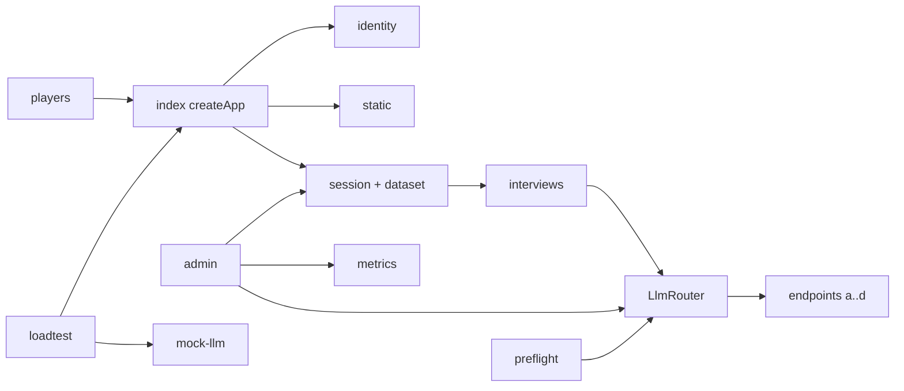
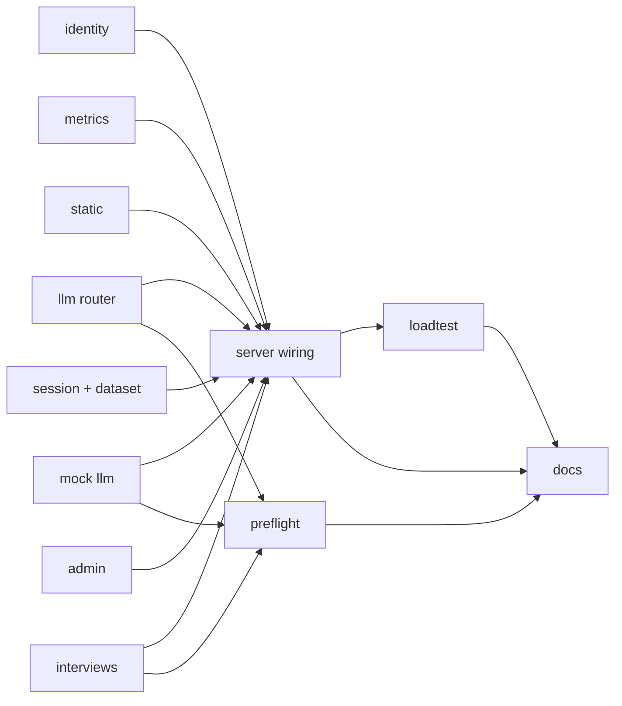

# Plan: Override backend for 200 players with LLM fallback

**Goal:** spec G1–G9: 200 independent games on one Mac, forward-only LLM failover across 3–4 endpoints, an operator admin listener, proven by a fault-injection load test.
**Architecture:** one Node process. `LlmRouter` sits in-process in front of the endpoints. JSONL dataset. A localhost admin listener.
**Tech stack:** Node ≥ 22.6, ESM `.mjs`, `node:http`, `node:test`. No new runtime dependencies.
**Spec:** demos/override/docs/plans/2026-10-26-backend-200.spec.md
**Detail:** contracts
**Target-min:** 14
**Ignore:** demos/override/dist/, demos/override/data/, demos/override/node_modules/, demos/override/test-results/, .gitignore, backendplan.md, demos/override/docs/, errors.mjs

## Global constraints

- Code lives in `demos/override/`. Run a test from the repo root: `node --test demos/override/tests/<name>.test.mjs`.
- The spec binds. Intent, Non-goals (Rulings) and Constraints apply to every task. Done looks like = acceptance (A1–A12). Decided = names, formats, router rules. Left to the builder / plan = internals. Diagrams = the module map.
- Wave 0 creates `demos/override/server/errors.mjs` exactly: `export class InterviewProviderError extends Error { constructor(code, message, diagnostics = {}) { super(message); this.name = 'InterviewProviderError'; this.code = code; this.diagnostics = diagnostics; this.provenance = null; } }`
- Match the style of `server/session.mjs`: compact functions, `RequestError(status, message)`, comments only for the why.
- No provider key, `Authorization` header or reasoning content in any file, log, trace or response.
- Tests use `mkdtempSync` dirs, never `demos/override/data`. A fake returns its producer's `e.g.` values.

## Main diagram

## Task graph

```mermaid
%% schedule
gantt
  title Predicted schedule (mm:ss)
  dateFormat X
  axisFormat %M:%S
  section lane 1
  T8 admin :t8, 0, 180s
  T9 server wiring :t9, 180, 184s
  T10 loadtest :t10, 364, 188s
  T12 docs :t12, 552, 106s
  section lane 2
  T2 llm router :t2, 0, 173s
  T11 preflight :t11, 173, 144s
  section lane 3
  T7 session + dataset :t7, 0, 155s
  section lane 4
  T6 interviews :t6, 0, 141s
  section lane 5
  T3 metrics :t3, 0, 137s
  section lane 6
  T5 mock llm :t5, 0, 133s
  section lane 7
  T1 identity :t1, 0, 121s
  section lane 8
  T4 static :t4, 0, 100s
```

critical path: T8 → T9 → T10 → T12 (11.0 min) · peak width 8 · predicted build 11.0 min · predicted total ≈ 23.2 min (target ✗ 14.0)

## Server modules

### T1 identity · Complexity 4 · Est. context 28k
**Owns:** demos/override/{server/identity.mjs, tests/identity.test.mjs}
**Components:** 2
**LOC owned:** 160
**Tests:** fast
**Model:** sonnet
**Est. time:** 2.2 min
**Produces:** identity.signToken(secret: string, expiresAt: number) -> string · identity.verifyToken(secret: string, token: string, now: number) -> boolean · identity.clientAddress(req: object, trustProxy: boolean) -> string · identity.WindowCounter(opts: {limit, windowMs}) · WindowCounter.take(key: string, now: number) -> boolean · WindowCounter.allowed(key: string, now: number) -> boolean · WindowCounter.add(key: string, now: number) -> void
e.g. verifyToken('s', signToken('s', 2000), 1000) -> true; at now 3000 -> false; secret 'x' -> false; verifyToken('s', 'junk', 0) -> false
e.g. clientAddress({headers:{'cf-connecting-ip':'1.2.3.4','x-forwarded-for':'5.6.7.8, 9.9.9.9'}, socket:{remoteAddress:'::1'}}, true) -> '1.2.3.4'; trustProxy false -> '::1'; only x-forwarded-for -> '5.6.7.8'
e.g. take('k',0) -> true; take('k',1) -> true; take('k',2) -> false; allowed('k',2) -> false; take('k',1001) -> true (limit 2, windowMs 1000)
**Review Focus:** protocol, state. `tampered_signature_false`: flip one hex char → false. `non_numeric_expiry_false`: `abc.<valid hmac of abc>` → false. `prunes_expired_keys`: 5000 expired keys, then one take → map size ≤ 1.
**Test code:** the e.g. lines and the Review Focus cases as named tests.
**Steps:** 1 write failing tests, 2 run: FAIL, 3 implement, 4 run: PASS
**Notes:** token = `${expiresAt}.${HMAC-SHA256 hex(secret, String(expiresAt))}`, compared with `timingSafeEqual` on equal-length buffers. Fixed window per key. Prune expired keys when the map holds more than 1000.

### T2 llm router · Complexity 7 · Est. context 46k
**Owns:** demos/override/{server/llm.mjs, tests/llm.test.mjs}
**Components:** 2
**LOC owned:** 600
**Tests:** fast
**Model:** sonnet
**Est. time:** 3.6 min
**Produces:** llm.LlmRouter(opts: {endpoints, maxInFlight, deadlineMs, maxCompletionTokens, failover, fetcher, restore, onSystem, onTrace, onEvent}) · LlmRouter.complete(req: {messages, sessionId, questionEventId, onAttempt}) -> Promise<Completion> · LlmRouter.setActive(name: string, opts: {pinned, reason, by}) -> Snapshot · LlmRouter.setCap(opts: {endpoint, value}) -> Snapshot · LlmRouter.probe(name: string, messages: array) -> Promise<ProbeResult> · LlmRouter.snapshot() -> Snapshot · LlmRouter.idle() -> Promise<void>
e.g. complete({messages, sessionId:'s1', questionEventId:'q1'}) -> {content:'Momo told me.', provenance:{endpoint:'a', apiBaseHost:'a.test', providerModel:'model-a', attempts:1, failedOver:false, pinned:false, queueMs:0, durationMs:850, promptTokens:812, completionTokens:9, reasoningTokens:null, samplingParams:{max_completion_tokens:2048, temperature:0.7}, traceIds:['t1'], semanticRetry:false}}
e.g. complete(…) with A 500 then B 503 -> rejects InterviewProviderError {code:'request_failed', diagnostics:{providerStatus:503}, provenance:{endpoint:'b', attempts:2, failedOver:true}}
e.g. snapshot() -> {active:'a', pinned:false, inFlight:0, queued:0, maxInFlight:200, endpoints:[{name:'a', model:'model-a', apiBaseHost:'a.test', inFlight:0, maxInFlight:50, queued:0, lastSuccessAt:null, lastFailureAt:null, lastFailureReason:null, failures5m:0}]}
e.g. setActive('b', {pinned:true, reason:'A slow'}) -> snapshot with active 'b', pinned true; setActive('zz', {reason:'x'}) throws 'Unknown endpoint zz.'; no reason throws 'A reason is required.'
e.g. probe('b', msgs) -> {ok:true, endpoint:'b', durationMs:420, content:'ready', reason:null}
e.g. onEvent gets {type:'attempt', endpoint:'a', ok:false, reason:'request_failed', durationMs:30, semantic:false} and {type:'failover', from:'a', to:'b', reason:'auto'}; onSystem gets {type:'llm_active', timestamp, active:'b', pinned:false, from:'a', by:'auto', reason:'5 failures in 30000 ms'}
**Review Focus:** state, protocol, numeric. `max_two_calls`: A 500 and B 500 → exactly 2 fetches. `length_same_endpoint_double`: A length then stop → budgets [2048, 4096], both on A. `failover_forward_only`: 5 failures on A within 30 s → active b, and a healthy A afterwards leaves it on b. `pinned_never_advances`. `last_endpoint_stays`. `restore_active`: restore {active:'b', pinned:true} is applied. `cap_holds`: B maxInFlight 2 with 6 concurrent → at most 2 concurrent fetches to B. `queued_follow_failover`: global cap 1, so waiting questions go to the new active endpoint. `queue_timeout`: deadline 50 ms while saturated → code 'queue_timeout' and no fetch. `deadline_bounds_attempts`: a hanging fetch rejects with 'timeout' within the deadline + 50 ms. `no_keys_in_trace`. `reasoning_only_failure`: null content + reasoning_content → 'empty_or_invalid_answer', and the reasoning is not traced. `ontrace_throw_isolated`.
**Test code:** the Review Focus cases and the e.g. lines as named tests, with a fake fetcher and fake timers or short deadlines.
**Steps:** 1 write failing tests, 2 run: FAIL, 3 implement, 4 run: PASS
**Notes:** Spec › Decided › Router rules is the algorithm. One FIFO queue; retries go to the head (`unshift`). `Authorization: Bearer <key>`. Per-attempt signal = `AbortSignal.any([questionDeadline, AbortSignal.timeout(min(endpoint.timeoutMs, remaining))])`. Copy the player messages per code from `answerInterview` in the current `server/interviews.mjs`. Import `InterviewProviderError` from `./errors.mjs`. For credentials_rejected, `console.error` at most once per endpoint per 60 s. A throwing `onTrace` is caught and logged.

### T3 metrics · Complexity 4 · Est. context 32k
**Owns:** demos/override/{server/metrics.mjs, tests/metrics.test.mjs}
**Components:** 2
**LOC owned:** 300
**Tests:** fast
**Model:** sonnet
**Est. time:** 2.6 min
**Consumes:** LlmRouter.snapshot() -> Snapshot (T2) · Investigations.stats() -> Stats (T7)
**Produces:** metrics.Registry() · Registry.counter(name: string, help: string, labelNames: array) -> Counter · Registry.gauge(name: string, help: string, labelNames: array, collect: function) -> Gauge · Registry.histogram(name: string, help: string, labelNames: array, buckets: array) -> Histogram · Registry.render() -> string · metrics.createGameMetrics(registry: Registry) -> GameMetrics · metrics.observeLlmEvent(m: GameMetrics, event: object) -> void · metrics.observeGameEvent(m: GameMetrics, event: object) -> void · metrics.observeWrite(m: GameMetrics, write: object) -> void · metrics.bindCollectors(registry: Registry, sources: {router, investigations, dataDir}) -> void
e.g. counter('x_total','X',['route']).inc({route:'/api/state'}); render() contains '# TYPE x_total counter' and 'x_total{route="/api/state"} 1'
e.g. histogram('h','H',[],[0.1,1]).observe({},0.3); render() contains 'h_bucket{le="0.1"} 0', 'h_bucket{le="+Inf"} 1', 'h_sum 0.3', 'h_count 1'
e.g. createGameMetrics(r) -> {httpRequests, httpDuration, sessionsStarted, sessionsCompleted, llmDuration, llmFailures, llmSemanticRetries, llmFailovers, logWriteDuration, logWriteFailures, staticBytes}
e.g. observeLlmEvent(m, {type:'failover', from:'a', to:'b', reason:'auto'}) -> render contains 'override_llm_failovers_total{from="a",to="b",reason="auto"} 1'
**Review Focus:** encoding, numeric. `label_escaping`: the value `a"b\c` plus a newline renders escaped. `valid_exposition`: every sample line matches `^[a-z_:][a-z0-9_:]*(\{.*\})? -?[0-9.e+Inf-]+$`. `collectors_from_sources`: fake snapshot/stats → `override_llm_active_endpoint{endpoint="a"} 1`, `override_sessions_by_stage{stage="verdict"} 1`.
**Test code:** the e.g. lines and the Review Focus cases.
**Steps:** 1 write failing tests, 2 run: FAIL, 3 implement, 4 run: PASS
**Notes:** names follow Spec › Decided › Metrics. Event-loop p99 comes from `monitorEventLoopDelay`, started in `bindCollectors`. Disk free comes from `statfsSync`. `observeWrite({kind, durationMs, ok})`.

### T4 static · Complexity 3 · Est. context 26k
**Owns:** demos/override/{server/static.mjs, tests/static.test.mjs}
**Components:** 1
**LOC owned:** 170
**Tests:** fast
**Model:** sonnet
**Est. time:** 2.0 min
**Produces:** static.loadStatic(publicDir: string) -> Map · static.serveStatic(files: Map, req: object, res: object) -> number
e.g. loadStatic('/missing') -> new Map()
e.g. serveStatic(files, GET /assets/index-CpDjbI4y.js, accept-encoding 'gzip, br') -> brotli byte count; headers Content-Encoding br, Vary Accept-Encoding, Cache-Control 'public, max-age=31536000, immutable'
e.g. serveStatic(files, GET /nope) -> -1 (nothing written)
**Review Focus:** protocol, encoding. `traversal_misses`: '/../package.json' → -1. `identity_without_accept`. `head_no_body`. `dotfiles_skipped`.
**Test code:** the e.g. lines and the Review Focus cases on a temp dir fixture.
**Steps:** 1 write failing tests, 2 run: FAIL, 3 implement, 4 run: PASS
**Notes:** '/' → '/index.html'. Text types over 1 KB get gzip level 9 and brotli quality 9 once, at load. HTML is 'no-cache'. A hashed `/assets/*-<hash>.(js|css)` is immutable; anything else is 'public, max-age=3600'. Move `mimeTypes` here from index.mjs.

### T5 mock llm · Complexity 3 · Est. context 25k
**Owns:** demos/override/{tests/mock-llm.mjs, tests/mock-llm.test.mjs}
**Components:** 1
**LOC owned:** 170
**Tests:** slow
**Model:** sonnet
**Est. time:** 2.6 min
**Produces:** mock.startMockLlm(opts: {mode, delayMs, maxConcurrent, content}) -> Promise<MockLlm>
e.g. startMockLlm({mode:'ok', delayMs:[0,0]}) -> {url:'http://127.0.0.1:<port>/v1', stats:{requests:0, inFlight:0, maxInFlight:0, byStatus:{}}, setMode(mode), reset(), close()}
e.g. mode 'ok': POST /v1/chat/completions -> 200 {model:'mock-model', choices:[{message:{content:'I never heard the bell, so I guessed it was snack time.'}, finish_reason:'stop'}], usage:{prompt_tokens:120, completion_tokens:12}}
**Review Focus:** protocol. `modes`: error500 → 500, rate429 → 429, hang → no reply until close(), flaky → alternates 500/ok, empty → content '', length → finish_reason 'length' with null content. `max_concurrent`: maxConcurrent 2, third concurrent → 429. `stats_track_peak`.
**Test code:** the Review Focus cases.
**Steps:** 1 write failing tests, 2 run: FAIL, 3 implement, 4 run: PASS

### T6 interviews · Complexity 4 · Est. context 34k
**Owns:** demos/override/{server/interviews.mjs, tests/interviews.test.mjs}
**Components:** 2
**LOC owned:** 330
**Tests:** fast
**Model:** sonnet
**Est. time:** 2.7 min
**Consumes:** LlmRouter.complete(req: {messages, sessionId, questionEventId, onAttempt}) -> Promise<Completion> (T2)
**Produces:** interviews.modelConfig(env: object) -> Config · interviews.loadEndpoints(env: object, readFile: function) -> Endpoints · interviews.answerInterview(config: Config, session: object, characterId: string, question: string, router: object, context: object) -> Promise<Answer> · interviews.buildMessages(session: object, characterId: string, question: string) -> array
e.g. modelConfig({}) -> {mode:'rehearsal', endpoints:[], endpointsHash:null, model:null, promptVersion:'banana-interview-v1', maxCompletionTokens:2048, timeoutMs:60000, maxInFlight:200, failover:{failures:5, windowMs:30000}}
e.g. modelConfig({OVERRIDE_LLM_API_KEY:'k', OVERRIDE_LLM_MODEL:'m'}) -> {mode:'live', model:'m', endpoints:[{name:'a', baseUrl:'https://api.openai.com/v1', model:'m', key:'k', keyEnv:'OVERRIDE_LLM_API_KEY', maxInFlight:200, tokenParam:'max_completion_tokens', timeoutMs:60000, temperature:null}], endpointsHash:'<16 hex>', …}
e.g. loadEndpoints({OVERRIDE_ENDPOINTS:'/e.json', OVERRIDE_ENDPOINT_A_KEY:'ka'}, () => '[{"name":"a","baseUrl":"https://a.test/v1","model":"ma","keyEnv":"OVERRIDE_ENDPOINT_A_KEY"}]') -> {endpoints:[{name:'a', baseUrl:'https://a.test/v1', model:'ma', key:'ka', keyEnv:'OVERRIDE_ENDPOINT_A_KEY', maxInFlight:50, tokenParam:'max_completion_tokens', timeoutMs:25000, temperature:null}], hash:'<16 hex>'}
e.g. answerInterview(modelConfig({}), session, 'nori', 'Did you hear the bell?', null) -> {answer:'I never heard the bell. I saw Pip carrying bananas and assumed snack time had started. I should have checked instead of guessing.', provenance:null}
**Review Focus:** protocol, encoding. `missing_key_names_variable`: keyEnv 'X_KEY' unset → error matches /X_KEY/ and contains no key. `duplicate_names_rejected`. `public_http_rejected`. `hash_ignores_keys`. `legacy_errors_kept`: /both/, /between 256 and 8192/, /between 1000 and 120000/. `answer_passes_context`: the fake router gets messages = buildMessages(…), sessionId, questionEventId, onAttempt.
**Test code:** the e.g. lines and the Review Focus cases. Port the prompt tests from tests/session.test.mjs that T7 deletes.
**Steps:** 1 write failing tests, 2 run: FAIL, 3 implement, 4 run: PASS
**Notes:** validation per Spec › Decided › Endpoint config. Re-export `InterviewProviderError` from `./errors.mjs`. `buildMessages` and `rehearsalAnswer` stay unchanged.

### T7 session + dataset · Complexity 6 · Est. context 44k
**Owns:** demos/override/{server/session.mjs, server/dataset.mjs, tests/session.test.mjs, tests/dataset.test.mjs}
**Components:** 2
**LOC owned:** 450
**Tests:** fast
**Model:** sonnet
**Est. time:** 2.9 min
**Consumes:** interviews.answerInterview(config: Config, session: object, characterId: string, question: string, router: object, context: object) -> Promise<Answer> (T6)
**Produces:** dataset.dataPaths(root: string) -> Paths · dataset.appendJsonl(file: string, record: object, kind: string) -> void · dataset.readJsonl(file: string, opts: {repair}) -> array · dataset.lastRecord(file: string, match: function) -> object · dataset.setWriteObserver(fn: function) -> void · session.Investigations(opts: {dataDir, config, router, answer, idleMs, meta, onEvent}) · Investigations.mutate(sessionId: string, action: string, input: object) -> Promise<View> · Investigations.view(sessionId: string) -> View · Investigations.export(sessionId: string) -> string · Investigations.stats() -> Stats · Investigations.setPaused(paused: boolean) -> void · Investigations.idle() -> Promise<void>
e.g. dataPaths('/d/live') -> {root:'/d/live', sessions:'/d/live/sessions', traces:'/d/live/traces', system:'/d/live/system.jsonl'} (dirs created, mode 0700)
e.g. readJsonl(f, {repair:true}) on '{"a":1}\n{"b"' -> [{a:1}], and the file becomes '{"a":1}\n'; readJsonl(missing) -> []
e.g. lastRecord(system, r => r.type === 'llm_active') -> {type:'llm_active', active:'b', pinned:true, …} or null
e.g. stats() -> {games:2, waiting:1, paused:false, byStage:{started:1, clues:0, interviewed:0, verdict:1}}
**Review Focus:** state, file. `torn_tail_resumes`: a torn last line → the restarted view equals the pre-crash view, and the next event keeps the sequence gapless. `new_game_rate_limit`: 21 starts in 1 s → 429. `question_rate_limit`: the 7th question in 60 s → 429 with no event logged. `paused_start_503`: start → 503 while existing games still play. `provenance_logged`: {answer, provenance} → interview_answer.provenance; a string answer → null; an error with .provenance → interview_failed.provenance. `session_started_meta`: meta fields present with schemaVersion 2. `idle_resolves`. `write_observer`: ok:false and a rethrow when the dir is gone.
**Test code:** the Review Focus cases plus the existing session tests, adapted to `sessions/`.
**Steps:** 1 write failing tests, 2 run: FAIL, 3 implement, 4 run: PASS
**Notes:** delete the 5 provider tests at the end of session.test.mjs (custom endpoint through timeouts); T6 owns them. Answer hook: `(config, session, characterId, question, {sessionId, questionEventId, onAttempt})` returns a string or `{answer, provenance}`. The default calls `answerInterview(…, router, ctx)`. `onAttempt` logs `interview_provider_response` with `endpoint`. `onEvent(event)` fires after each log. Limits: 20 new games/s (start + reset) → 'Too many new games right now. Try again in a moment.'; 6 questions/min/game → 'Slow down: at most 6 questions per minute.'; paused → 'New games are paused. Try again shortly.' Stages: started (no clue), clues, interviewed (all 3 heard), verdict (closed).

### T8 admin · Complexity 5 · Est. context 38k
**Owns:** demos/override/{server/admin.mjs, tests/admin.test.mjs}
**Components:** 2
**LOC owned:** 380
**Tests:** slow
**Model:** sonnet
**Est. time:** 3.2 min
**Consumes:** LlmRouter.snapshot() -> Snapshot (T2) · LlmRouter.setActive(name: string, opts: {pinned, reason, by}) -> Snapshot (T2) · LlmRouter.probe(name: string, messages: array) -> Promise<ProbeResult> (T2) · Investigations.stats() -> Stats (T7) · Investigations.setPaused(paused: boolean) -> void (T7) · Registry.render() -> string (T3)
**Produces:** admin.createAdmin(opts: {token, router, investigations, registry, dataDir, probeMessages, readSystem, onSystem}) -> Server
e.g. createAdmin({token:'t', …}) -> an unlistened http.Server; GET /admin/health with 'Authorization: Bearer t' -> 200 {ok:true, dataWritable:true, diskFreeBytes:123, router:<snapshot>, sessions:<stats>, recentSystem:[≤ 20 records]}
**Review Focus:** protocol, encoding; security review. `wrong_token_401` on every route except GET /admin. `empty_token_throws`. `unknown_endpoint_400`: {error:'Unknown endpoint zz.'}. `cap_validation_400`: value 0 or 'x'. `body_limit_413`: 16 KB. `pause_logged`: onSystem gets {type:'admin_action', action:'pause', paused:true}. `page_has_no_data`. `page_uses_textContent`. `metrics_content_type`: 'text/plain; version=0.0.4'. `router_null_rehearsal`: health has router null, and LLM routes → 409.
**Test code:** the Review Focus cases with fake router/investigations/registry.
**Steps:** 1 write failing tests, 2 run: FAIL, 3 implement, 4 run: PASS
**Notes:** also call `router.setCap({endpoint, value})` (T2, returns the snapshot; read T2 with `sl task T2`). Routes per Spec › Decided › Admin routes. Bearer compare with `timingSafeEqual`. The page is one inline HTML string: a token field (sessionStorage), a 1 s poll of /admin/health, endpoint/session/system tables, and buttons for move+pin (reason prompt), unpin, probe, cap and pause/resume.

## Integration

### T9 server wiring · Complexity 6 · Est. context 58k
**Owns:** demos/override/{server/index.mjs, tests/http.test.mjs}
**Components:** 2
**LOC owned:** 420
**Tests:** slow
**Model:** sonnet
**Est. time:** 3.3 min
**Produces:** index.createApp(opts: {investigations, accessCode, secret, trustProxy, staticFiles, metrics}) -> Server · index.startServer(env: object, opts: {publicDir}) -> Promise<Running>
e.g. startServer({PORT:'0', OVERRIDE_DATA_DIR:tmp, OVERRIDE_ENV:'test', OVERRIDE_ADMIN_PORT:'0', OVERRIDE_ADMIN_TOKEN:'t', OVERRIDE_SECRET:'s'}) -> {url:'http://127.0.0.1:<port>', adminUrl:'http://127.0.0.1:<port>', server, admin, router, investigations, close()}
**Review Focus:** protocol, state; security review. `signin_survives_restart` (same secret). `trust_proxy_per_client`: 30 failures from CF-Connecting-IP 1.1.1.1 leave 1.1.1.2 at 401. `health_public`. `graceful_close`: a pending interview against a 300 ms mock still returns 200 after close(), and new connections are refused. `backlog_1024`. `traces_not_exported`: a live interview → traces/<id>.jsonl exists and /api/events has no `messages`. `static_gzip`. Keep both existing http tests.
**Test code:** the Review Focus cases.
**Steps:** 1 write failing tests, 2 run: FAIL, 3 implement, 4 run: PASS
**Notes:** integrates the real T1–T8 modules: read their Produces with `sl task T1` … `sl task T8`. Wiring per Spec › Diagrams. Login limiter = WindowCounter(30, 60 s) keyed by clientAddress. Tokens: sign/verify, 12 h. HTTP route label = '/api/<name>' or 'static'. The router is built only in live mode, with restore = lastRecord(system, llm_active); traces go to traces/<sessionId or 'probes'>.jsonl. Probe messages = buildMessages for Momo's quick question. appCommit = OVERRIDE_APP_COMMIT, else `git rev-parse HEAD` plus a dirty flag, else 'unknown'. close(): server.close + closeIdleConnections, admin.close, then await idle() or 65 s, whichever is first. The main block maps SIGTERM/SIGINT → close() → exit. A missing secret → random + console.warn.

### T10 loadtest · Complexity 6 · Est. context 50k
**Owns:** demos/override/{tests/loadtest.mjs, tests/failover.test.mjs, package.json}
**Components:** 2
**LOC owned:** 450
**Tests:** slow
**Model:** sonnet
**Est. time:** 3.3 min
**Produces:** loadtest.runScenario(name: string, opts: {players, rampMs}) -> Promise<ScenarioResult>
e.g. runScenario('primary_errors', {players:30, rampMs:500}) -> {name:'primary_errors', pass:true, failures:[], stats:{players:30, verdicts:30, questions:90, failedQuestions:0, p95InterviewMs:180, activeAfter:'b', requestsByEndpoint:{a:6, b:90, c:0, d:0}}}
**Review Focus:** state, numeric. Every scenario row of Spec › Done looks like passes at 30 players; `npm run loadtest` passes at 200.
**Test code:** failover.test.mjs runs every scenario with {players:30, rampMs:500} and asserts pass with an empty failures list.
**Steps:** 1 write failing tests, 2 run: FAIL, 3 implement, 4 run: PASS
**Notes:** runs the real server (`startServer`, T9) and mocks (`startMockLlm`, T5); read both with `sl task`. 4 mocks a–d in a temp endpoints.json (http://127.0.0.1 is allowed). The test runs use a deadline of 3000 ms and endpoint timeoutMs 800. Player flow: access → start → reveal → 3 quick questions (a 502 is retried up to 2×) → verdict → export. server_restart = close() mid-round, then startServer on the same dir and secret; cookies carry over. CLI `node tests/loadtest.mjs [--players 200] [--ramp 10000] [--scenario name|all]` prints a table and exits 1 on any failure. Add script `"loadtest": "node tests/loadtest.mjs"`.

### T11 preflight · Complexity 4 · Est. context 36k
**Owns:** demos/override/{scripts/preflight.mjs, tests/preflight.test.mjs}
**Components:** 1
**LOC owned:** 260
**Tests:** slow
**Model:** sonnet
**Est. time:** 2.6 min
**Consumes:** interviews.modelConfig(env: object) -> Config (T6) · mock.startMockLlm(opts: {mode, delayMs, maxConcurrent, content}) -> Promise<MockLlm> (T5)
**Produces:** preflight.runPreflight(opts: {endpoints, capacity, steps, fetcher}) -> Promise<Report>
e.g. runPreflight({endpoints:[mockA], capacity:false}) -> {endpoints:[{name:'a', fidelity:[{character:'momo', clue:null, question:'Did the keeper really say you could take the bananas?', ok:true, words:12, flags:[], answer:'…'}], capacity:[]}]}
**Review Focus:** numeric. `capacity_steps`: steps [2,4] against a mock → [{concurrency:2, errors:0, p50Ms, p95Ms}, {concurrency:4, …}]. `errors_counted`: an error500 mock → errors = concurrency. `flags_reported`: an empty answer → ok false, flags ['empty'].
**Test code:** the Review Focus cases.
**Steps:** 1 write failing tests, 2 run: FAIL, 3 implement, 4 run: PASS
**Notes:** one single-endpoint LlmRouter per endpoint. Fidelity covers each character × (no clue, rule, message, bell) × (the quick question, 'What did you know at the time?', 'Who told you, and did you check?'). Flags for human review: 'empty', 'length' (outside 10–60 words), 'momo_no_admission' (a permission question without /made (it )?up|lied|invent|not true/i), 'pip_knows_motive' (/hungry/i), 'nori_heard_bell' (not matching /(never|didn'?t|did not) hear/i). CLI: `node --env-file-if-exists=.env scripts/preflight.mjs [--capacity] [--out file]` prints a markdown table.

### T12 docs · Complexity 2 · Est. context 40k
**Owns:** demos/override/{README.md, DEPLOY.md, .env.example, ops/endpoints.example.json, ops/prometheus.yml, tests/docs.test.mjs}
**Components:** 1
**LOC owned:** 220
**Tests:** fast
**Model:** sonnet
**Est. time:** 1.8 min
**Review Focus:** encoding. `endpoints_example_loads`: modelConfig with OVERRIDE_ENDPOINTS=ops/endpoints.example.json and the 4 keys set → 4 endpoints. `env_example_complete`: every OVERRIDE_ variable in Spec › Decided › Environment appears in .env.example.
**Test code:** the two cases.
**Steps:** 1 write failing tests, 2 run: FAIL, 3 write docs, 4 run: PASS
**Notes:** the README replaces the "one shared investigation" text and covers independent games, data layout, fallback config, admin, metrics, loadtest, preflight and the env table. DEPLOY.md gets a "Hosting 200 players on a Mac" section from backendplan §12 and §14: caffeinate, `sysctl kern.ipc.somaxconn=1024`, tunnel, Prometheus, runbook.

## Review Focus

| Package | App type | Categories | Specific risks |
|---|---|---|---|
| T2 router | concurrency | state, protocol, numeric | lost queue entries, slot leaks on abort, retry storms, flapping |
| T1, T8, T9 server | HTTP service, auth | protocol, encoding, state | token forgery, admin exposure, limiter keyed wrong behind a proxy (Opus security review) |
| T7 data | file I/O | file, state | torn tail, sequence gaps, keys in files |

**Probe entry:** serve=demos/override/server/index.mjs:startServer · call=demos/override/server/llm.mjs:LlmRouter.complete

## Self-review

All 12 spec acceptance checks map to tasks: A1 → all; A2 → T10; A3/A4 → T7, T9; A5 → T1, T7, T9; A6–A9 → T2, T6, T7; A10 → T8; A11 → T4, T9; A12 → T11. No placeholders. Owns sets are disjoint. Edges exist only where tests run the producer's code (T9, T10 and T11 integrate).

## Rulings

- Ruling: sequential [chain-890c] - T9 must run the real T1–T8 modules, T10 must run the real server under load, and T12 documents both, so the order is forced - cost if wrong: about 5 min of wall clock.
- Ruling: accept plan size over the 15k cap - the dispatched blocks T1–T7 and T11 are frozen, and the overflow is contract examples the consumers fake from - cost if wrong: a larger prime for each agent.
- Ruling: accept predicted 23 min vs target 14 - the chain above is inherent - cost if wrong: a later finish only.
