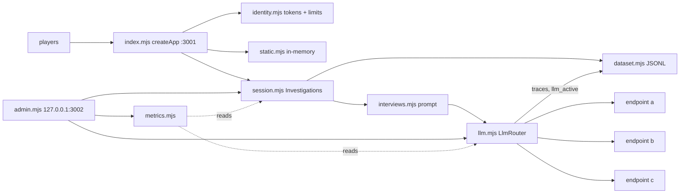
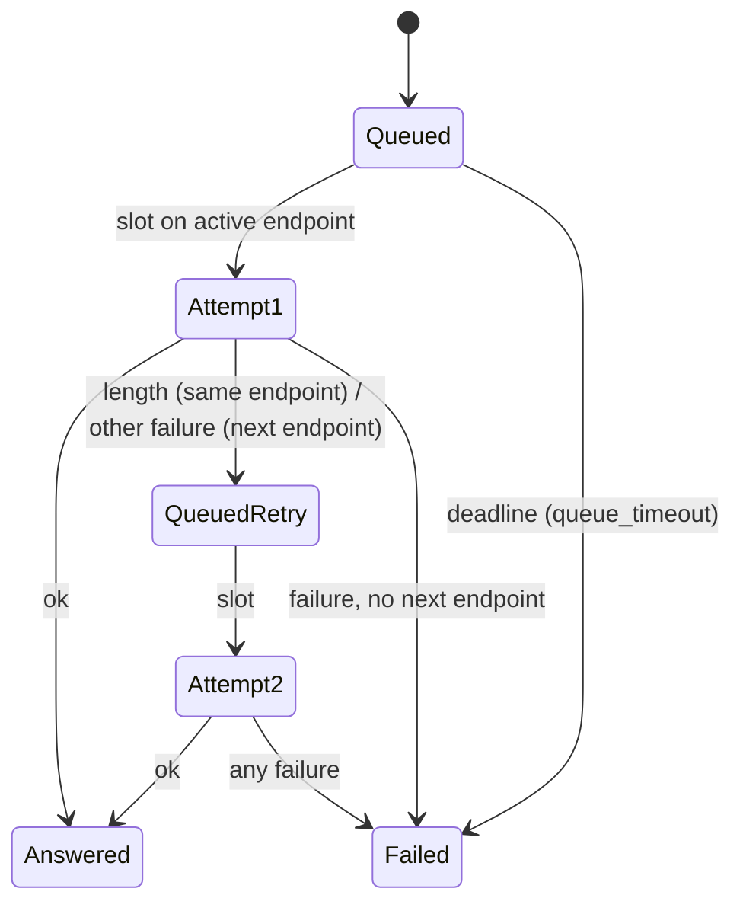

# Spec: Override backend for 200 concurrent players with LLM fallback

Source design: [backendplan.md](../../backendplan.md). This spec narrows it to the user's definition of done.

## Intent

The user's definition of done: "existing backend system that will be ready for 200 users with the fallbacks". The Banana Mystery server must host 200 simultaneous, independent games on one Mac. When the LLM provider fails, the server must move players to the next of 3–4 OpenAI-compatible endpoints. It must not lose games or data, and an operator must be able to see and steer this live.

## Goals

| # | Goal |
|---|---|
| G1 | 200 concurrent players, one independent game each (backendplan §5.1). |
| G2 | Games and sign-ins survive a crash or restart (§5.2, §5.6). |
| G3 | LLM fallback across an ordered endpoint list: one retry per question, forward-only automatic failover, operator pin, per-endpoint and global caps, a queue (§7). |
| G4 | Every answer records which endpoint produced it (provenance + trace) (§6.1–6.4). |
| G5 | Operator control and visibility on a localhost admin listener, plus Prometheus metrics (§8.1–8.3). |
| G6 | Static delivery and the connection queue sized for a 200-player burst; graceful shutdown (§9). |
| G7 | Abuse limits suited to many players behind one address (§5.7). |
| G8 | A repeatable load + fault-injection harness proves G1–G6 with mock endpoints (§13.2). |
| G9 | A preflight script checks each real endpoint before the event (§7.6). |

## Non-goals (Rulings)

- Ruling: participant links, consent screen, repeat-play tracking, client info, telemetry, deletion/validator/export scripts are cut (because the user's definition of done names capacity and fallback, not the study workflow; cost if wrong: one more phase later, and the event schema already has room).
- Ruling: Grafana dashboard, launchd plists, service user, backup job and stack scripts are cut. `ops/prometheus.yml` and an endpoint example ship (because those steps are machine setup done once by the operator; cost if wrong: manual setup).
- Ruling: no `prom-client`. A small built-in Prometheus text encoder is used (because the server has zero runtime npm dependencies today, and this keeps `npm ci` off the event machine's critical path; cost if wrong: around 120 lines of code to maintain).
- Ruling: the admin page polls `/admin/health` every second; there is no `/admin/stream` SSE route (because `EventSource` cannot send the bearer token; cost if wrong: one extra request per second on localhost).
- Ruling: no frontend changes. Queue position is exposed as a metric only (because the existing "Thinking…" state and error toasts already handle waits and failures; cost if wrong: players see no queue position).
- Ruling: there is no timed fsync. Writes stay `appendFileSync` (because a process crash loses nothing, and power loss is the backup's job; cost if wrong: about 1 s of data lost on power loss).
- Ruling: old logs at `data/<id>.jsonl` are not migrated (because the demo has no live dataset yet; cost if wrong: old sessions do not resume).
- Ruling: `OVERRIDE_SECRET` unset means a random secret per process and a startup warning (because local dev must keep working; cost if wrong: sign-ins reset on restart until the operator sets the secret).
- Ruling: the admin listener does not start when `OVERRIDE_ADMIN_TOKEN` is empty (because it is safe by default).

## Constraints

- Node ≥ 22.6, ESM `.mjs`, `node:test`. No new runtime npm dependencies.
- The existing style: compact functions, `RequestError(status, message)`, and short comments that explain why.
- Never write provider keys, `Authorization` headers or reasoning content to any file, log, trace, export or admin response.
- Traces never appear in the player export (`/api/events`).
- Per-question deadline 60 s (`OVERRIDE_LLM_TIMEOUT_MS`). Queue wait and all attempts count against it.
- At most 2 LLM calls per question.

## Done looks like

| # | Acceptance check |
|---|---|
| A1 | `node --test demos/override/tests/*.test.mjs` passes, including the failover scenarios at reduced scale. |
| A2 | `npm run loadtest` (200 players, 10 s ramp) passes every scenario in the table below. |
| A3 | Two players never share state. One player's pending answer never blocks another. Reset issues a new session cookie. Forged cookies get no session. |
| A4 | After a kill and restart, every game resumes from its log. A torn final line is truncated and the game continues from the last complete event. Sign-in cookies stay valid. |
| A5 | 40 correct sign-ins in a row from one address pass. The 31st wrong code in a minute returns 429. More than 20 new games in one second returns 429. More than 6 questions per minute in one game returns 429. Paused sessions return 503 on `start`. |
| A6 | A transport or semantic failure retries once on the next endpoint. `finish_reason: length` retries once on the same endpoint at double budget (max 8192). No question makes more than 2 calls. |
| A7 | 5 failed attempts on the active endpoint within 30 s advance it. It never moves back automatically. A pinned endpoint never advances. At the last endpoint the index stays put. Active endpoint and pin survive a restart. |
| A8 | The per-endpoint `maxInFlight` and global `OVERRIDE_LLM_MAX_IN_FLIGHT` hold. A retry waits for the backup's semaphore. Questions queued for a failed endpoint move to the new active one. |
| A9 | Every `interview_answer`/`interview_failed` carries `provenance`. Every attempt writes a trace record. No key appears in any file. |
| A10 | Admin on 127.0.0.1:`OVERRIDE_ADMIN_PORT` with a bearer token: health, set active/pin, probe, caps, pause, `/metrics`, `/admin` page. |
| A11 | Static files are served from memory with brotli/gzip by `Accept-Encoding`. Hashed assets are `immutable`. Listen backlog is 1024. SIGTERM lets pending answers finish (≤ 65 s) before exit. |
| A12 | `node scripts/preflight.mjs` prints per-endpoint fidelity results and, with `--capacity`, errors and p50/p95 per concurrency step. |

Load scenarios (A2): mock endpoints A–D.

| Scenario | Fault | Pass |
|---|---|---|
| healthy | none | 0 failed questions; 200/200 verdicts |
| primary_errors | A → 500 | active = B within 30 s; < 5% questions fail; provenance names B |
| primary_hangs | A never answers | as above; no question > deadline + 1 s |
| rate_limited | A → 429 | failover to B; A gets no traffic after failover |
| flaky_primary | A fails 50% | failover within 30 s; A gets no traffic after |
| silent_failure | A → 200, empty content | answers come from B; semantic retry metric > 0 |
| small_backup | A → 500, B cap 50 | B in-flight never > 50; C, D get 0 requests |
| all_down | A–D → 500 | every failed question returns 502 with a message; logs gapless |
| server_restart | restart mid-round | 200/200 games resume and finish |
| burst_arrival | 200 players within 1 s | 0 connection resets |

## Decided

**Data layout:** `data/<OVERRIDE_ENV>/` (default env `live`) holds `sessions/<sessionId>.jsonl` (the player export), `traces/<sessionId>.jsonl` (admin only; probes go to `traces/probes.jsonl`) and `system.jsonl`.

**Events:** `schemaVersion: 2`. `session_started` adds `env`, `appCommit`, `appDirty`, `endpointsHash`. `interview_answer` and `interview_failed` add `provenance` (`null` in rehearsal mode). `interview_provider_response` stays, with an added `endpoint` field.

**Provenance:** `{endpoint, apiBaseHost, providerModel, attempts, failedOver, pinned, queueMs, durationMs, promptTokens, completionTokens, reasoningTokens, samplingParams, traceIds, semanticRetry}`.

**Trace record:** backendplan §6.4 exactly, plus `providerStatus`. `error` is a failure code or `null`.

**Router rules:**

- Endpoints are ordered, `a` first. `active` is an index, and `pinned` is a flag.
- Attempt 1 goes to the endpoint that is active at dispatch time, so queued questions follow a failover.
- Failure codes: `timeout`, `connection_failed`, `invalid_response`, `credentials_rejected` (401/403), `rate_limited` (429), `request_failed` (other non-2xx), `empty_or_invalid_answer` (empty, reasoning-only, or over 6000 chars), `content_filter`, `completion_limit` (length), `queue_timeout`.
- Retry after `completion_limit`: the same endpoint, double budget. After any other failure: the next endpoint after the failed one, at the initial budget. If none exists, the question fails.
- Retries re-enter the queue at the head.
- `queue_timeout` and `completion_limit` do not count toward failover.
- Failover: when the active endpoint is not pinned, not last, and has ≥ `failures` within `windowMs`, `active` += 1. A `{type:'llm_active', timestamp, active, pinned, from, by:'auto'|'operator', reason}` record goes to `system.jsonl`. On startup the last such record is restored if its endpoint name still exists.
- Per-attempt timeout is `min(endpoint.timeoutMs, remaining deadline)`.
- The request body is `{model, messages, [tokenParam]: budget}`, plus `temperature` when it is not null.

**Endpoint config:** `OVERRIDE_ENDPOINTS` is a path to a JSON array of `{name, baseUrl, model, keyEnv, maxInFlight=50, tokenParam='max_completion_tokens', timeoutMs=25000, temperature=null}`. When it is unset, the legacy `OVERRIDE_LLM_*` variables form endpoint `a` with `timeoutMs` = the deadline and `maxInFlight` = the global cap. When there is no key and no model, rehearsal mode applies.

**Environment:** `OVERRIDE_ENV`, `OVERRIDE_SECRET`, `OVERRIDE_TRUST_PROXY` (`1`/`true`: client address from `CF-Connecting-IP`, else the last `X-Forwarded-For` entry, the one the trusted proxy appended), `OVERRIDE_ENDPOINTS`, `OVERRIDE_LLM_MAX_IN_FLIGHT` (200), `OVERRIDE_LLM_FAILOVER_FAILURES` (5), `OVERRIDE_LLM_FAILOVER_WINDOW_MS` (30000), `OVERRIDE_ADMIN_PORT` (3002), `OVERRIDE_ADMIN_TOKEN`, `OVERRIDE_APP_COMMIT`.

**Admin routes:** `GET /admin` (page, no token), and with a token: `GET /admin/health`, `GET /metrics`, `POST /admin/llm/active {endpoint, pinned, reason}`, `POST /admin/llm/probe {endpoint}`, `POST /admin/llm/cap {endpoint|null, value}`, `POST /admin/sessions/pause {paused}`.

**Metrics:** the names in backendplan §8.3, plus `override_process_event_loop_delay_p99_seconds`, `override_process_resident_memory_bytes`, `override_process_heap_used_bytes`. There are no IDs or text in labels.

**Public:** `GET /api/health` returns `{ok}`, with no auth.

## Left to the builder / plan

Internal structure of each module, test layout, admin page markup, mock-endpoint internals, preflight report format.

## Diagrams

