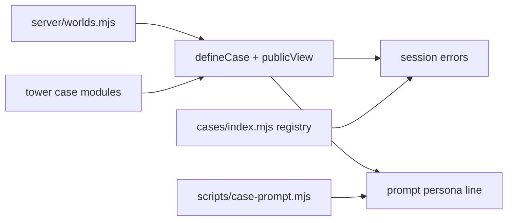
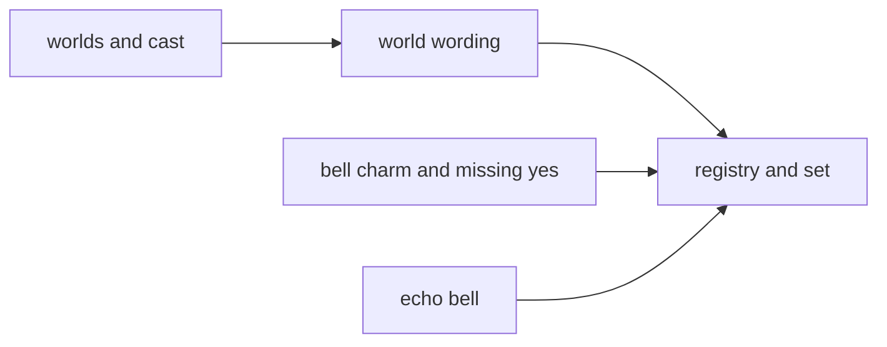

# Plan: wizard-tower cast for The Override (phase 1: server and stories)

**Goal:** a case can bring its own world and cast. Three draft cases move to a wizard school (Wren, Basil, Juniper, the Headmistress) and replace the uncommitted banana drafts.
**Architecture:** `server/worlds.mjs` names each world's place, cast nouns, clue spot and prompt persona. `defineCase` takes `world` (default `grove`) and any 3-character cast. Session errors and the prompt's persona line read the case's world. Three tower case modules join the registry as drafts.
**Tech stack:** Node 22 ESM `.mjs`, `node:test`, no new dependencies. Owns paths are repo-root relative; every other path is relative to `demos/override/`.
**Spec:** `docs/plans/2026-10-26-wizard-tower.content.md` (exact case strings)
**Detail:** tests
**Target-min:** 11

Global constraints:
- Existing codebase. No skeleton and no stubs: every file below exists or is created by its owning task. Test command: `node --test demos/override/tests/*.test.mjs` from the repo root.
- `worlds.grove` = `{ id: 'grove', place: 'Banana Grove', cast: { one: 'a monkey', many: 'monkeys' }, clueSpot: 'basket', persona: 'monkey' }`; `worlds.tower` = `{ id: 'tower', place: 'Wizard Tower', cast: { one: 'an apprentice', many: 'apprentices' }, clueSpot: 'potion cabinet', persona: 'wizard' }`.
- A case has exactly 3 characters with unique ids matching `/^[a-z][a-z0-9]{1,15}$/`.
- Grove output must not change: `banana-mystery` contentHash `2da1093c9eb3`, `banana-control` `d1f7d8558985`; first 16 hex of sha256 of the system prompt `buildMessages(kase, blank, 'momo', 'Why?')[0].content`: mystery `80d48cb3131e1eb3`, control `40df3449ac780dd8`.
- Do not touch `client/`, `tests/browser/`, `DEPLOY.md`, `docs/CASES_PLAN.md` (another session's work on those files is in flight).
- Case text is transcribed from the spec exactly, curly quotes included.



## File structure

- `server/worlds.mjs`: the world registry (new).
- `server/cases.mjs`: `defineCase` validates world and cast; `publicView` adds the world without `persona`.
- `scripts/case-prompt.mjs`: builds its blank interviews from the case's cast.
- `tests/fixtures/minimal-case.mjs`: adds `towerCase()`.
- `server/session.mjs`, `server/interviews.mjs`: wording from `kase.world`.
- `server/cases/tower-bell-charm.mjs`, `tower-missing-yes.mjs`, `tower-echo-bell.mjs`: the stories (new).
- `server/cases/index.mjs`: registry; `README.md`: one line.
- Tests: `tests/cases.test.mjs`, `tests/session.test.mjs`, `tests/tower-cases.test.mjs`, `tests/tower-echo.test.mjs`, `tests/case-set.test.mjs`.

## Task graph

```mermaid
%% schedule
gantt
  title Predicted schedule (mm:ss)
  dateFormat X
  axisFormat %M:%S
  section lane 1
  T1 worlds and cast :t1, 0, 137s
  T2 world wording :t2, 137, 110s
  T5 registry and set :t5, 247, 113s
  section lane 2
  T3 bell charm and missing yes :t3, 0, 125s
  section lane 3
  T4 echo bell :t4, 0, 92s
```





critical path: T1 → T2 → T5 (6.0 min) · peak width 3 · predicted build 6.0 min · predicted total ≈ 19.5 min (target ✗ 11.0)

Ruling: sequential - T2, T3 and T4 tests run the real `defineCase` (tower cases cannot be built before T1); T5 runs the registry, T2's wording and the case-prompt script together - a stub would test nothing.

## Package: server

App type: library (validator) + HTTP service wording. Categories: deep, encoding, state, protocol.
**Probe entry:** call=demos/override/server/cases.mjs#defineCase

### T1 worlds and cast · Complexity 4 · Est. context 30k
**Owns:** demos/override/server/worlds.mjs, demos/override/server/cases.mjs, demos/override/scripts/case-prompt.mjs, demos/override/tests/fixtures/minimal-case.mjs, demos/override/tests/cases.test.mjs
**Components:** 3
**LOC owned:** 110
**Tests:** fast
**Model:** sonnet
**Est. time:** 3 min
**Consumes:** none
**Produces:** worlds.worlds -> object · cases.defineCase(data: object) -> object · cases.publicView(kase: object) -> object · minimal_case.towerCase() -> object
  e.g. defineCase(minimalCase).world -> worlds.grove (with persona)
  e.g. defineCase(towerCase()).characters.map(c => c.id) -> ['wren', 'basil', 'juniper']
  e.g. publicView(defineCase(towerCase())).world -> { id: 'tower', place: 'Wizard Tower', cast: { one: 'an apprentice', many: 'apprentices' }, clueSpot: 'potion cabinet' }
**Review Focus:** grove hash unchanged (`world` absent from the hashed input); bad ids; extra knowledge keys.
**Steps:** 1 failing tests, 2 run: FAIL, 3 implement, 4 run: PASS
**Notes:** `defineCase` hashes the input data as today, then attaches `world: worlds[data.world ?? 'grove']` (frozen copy). Replace the fixed `IDS` with the case's own ids: knowledge keys must equal the cast ids exactly; culprits and finding characters must be cast ids. Check order: world, then characters (count, id format, duplicates), then the rest as today. Messages: `world: must be one of grove, tower`, `characters: must hold exactly 3 characters`, `characters[i].id: must match /^[a-z][a-z0-9]{1,15}$/`, `characters[i].id: duplicate character id X`, `knowledge.X: not a character`. `case-prompt.mjs`: `interviews: Object.fromEntries(kase.characters.map(c => [c.id, []]))`. `towerCase()` returns a fresh plain object: `minimalCase` with `id: 'mini-tower'`, `world: 'tower'`, `prompt: { setting: 'a test apprentice', use: ['potions'], avoid: ['override'] }`, ids and names momo→wren/Wren, pip→basil/Basil, nori→juniper/Juniper in characters, knowledge keys, `answer.culprits: ['wren']`, finding character `wren`.
**Test code (verbatim, appended to tests/cases.test.mjs):**
```js
import { worlds } from '../server/worlds.mjs';
import { towerCase } from './fixtures/minimal-case.mjs';
import bananaControl from '../server/cases/banana-control.mjs';
const grove = { id: 'grove', place: 'Banana Grove', cast: { one: 'a monkey', many: 'monkeys' }, clueSpot: 'basket' };
const tower = { id: 'tower', place: 'Wizard Tower', cast: { one: 'an apprentice', many: 'apprentices' }, clueSpot: 'potion cabinet' };
test('worlds registry', () => {
  assert.deepEqual(worlds.grove, { ...grove, persona: 'monkey' });
  assert.deepEqual(worlds.tower, { ...tower, persona: 'wizard' });
});
test('no world means the grove', () => assert.deepEqual(defineCase(copy()).world, { ...grove, persona: 'monkey' }));
test('a tower case brings its own cast', () => {
  const k = defineCase(towerCase());
  assert.equal(k.world.id, 'tower');
  assert.deepEqual(k.characters.map(c => c.id), ['wren', 'basil', 'juniper']);
});
test('unknown world', () => assert.throws(() => defineCase(copy({ world: 'moon' })), /case mini-case: world: must be one of grove, tower/));
test('cast is three unique lowercase ids', () => {
  assert.throws(() => defineCase(edit(d => { d.characters.pop(); })), /characters: must hold exactly 3 characters/);
  assert.throws(() => defineCase(edit(d => { d.characters[1].id = 'momo'; })), /characters\[1\]\.id: duplicate character id momo/);
  assert.throws(() => defineCase(edit(d => { d.characters[0].id = 'Momo'; })), /characters\[0\]\.id: must match/);
});
test('knowledge, culprits and findings follow the cast', () => {
  const missing = towerCase(); delete missing.knowledge.juniper;
  assert.throws(() => defineCase(missing), /knowledge\.juniper/);
  const extra = towerCase(); extra.knowledge.momo = ['x'];
  assert.throws(() => defineCase(extra), /knowledge\.momo: not a character/);
  assert.throws(() => defineCase({ ...towerCase(), answer: { culprits: ['momo'], feedback: { correct: 'c', other: 'o' } } }), /answer\.culprits/);
  const finding = towerCase(); finding.debrief.findings[0].character = 'pip';
  assert.throws(() => defineCase(finding), /debrief\.findings\[0\]\.character/);
});
test('grove hashes are unchanged', () => {
  assert.equal(bananaMystery.contentHash, '2da1093c9eb3');
  assert.equal(bananaControl.contentHash, 'd1f7d8558985');
});
test('publicView shows the world without the persona', () => {
  assert.deepEqual(publicView(defineCase(towerCase())).world, tower);
  assert.deepEqual(publicView(bananaMystery).world, grove);
});
```

### T2 world wording · Complexity 3 · Est. context 32k
**Owns:** demos/override/server/session.mjs, demos/override/server/interviews.mjs, demos/override/tests/session.test.mjs
**Components:** 2
**LOC owned:** 70
**Tests:** fast
**Model:** sonnet
**Est. time:** 2.5 min
**Consumes:** cases.defineCase(data: object) -> object (T1)
**Produces:** interviews.buildMessages(kase: object, session: object, characterId: string, question: string) -> list
  e.g. buildMessages(defineCase(towerCase()), blank, 'wren', 'Why?')[0].content includes 'A little wizard personality is welcome'
  e.g. sha256(buildMessages(bananaMystery, blank, 'momo', 'Why?')[0].content).slice(0, 16) -> '80d48cb3131e1eb3'
**Review Focus:** grove wording and prompt bytes unchanged; error precedence (unknown character before the clue check).
**Steps:** 1 failing tests, 2 run: FAIL, 3 implement, 4 run: PASS
**Notes:** tests use the fixture `towerCase()` from tests/fixtures/minimal-case.mjs (T1). With `w = kase.world`: `Choose one of the ${n} ${w.cast.many}.`, `Inspect the ${w.clueSpot} before asking the ${w.cast.many}.`, `Inspect the clues and ask all ${n} ${w.cast.many} before choosing.`, `Choose ${w.cast.one}, nobody, or not sure.`; template line `A little ${kase.world.persona} personality is welcome;`. In the existing tests: `talkToAll(act, id, kase = cases[0])` loops `kase.characters`; the leak test uses `newGames(t, { dev: true })` and passes `kase`; 'prompt names the role once' uses each case's `characters[0]` and asserts `You play ${c.name} (${c.role})`.
**Test code (verbatim, added to tests/session.test.mjs):**
```js
import { createHash } from 'node:crypto';
import { towerCase } from './fixtures/minimal-case.mjs';
const sha = s => createHash('sha256').update(s).digest('hex').slice(0, 16);
const blank = kase => ({ revealedPosition: 1, selectedEvidence: null, interviews: Object.fromEntries(kase.characters.map(c => [c.id, []])) });
test('grove prompts are byte-identical', () => {
  assert.equal(sha(buildMessages(cases[0], blank(cases[0]), 'momo', 'Why?')[0].content), '80d48cb3131e1eb3');
  assert.equal(sha(buildMessages(bananaControl, blank(bananaControl), 'momo', 'Why?')[0].content), '40df3449ac780dd8');
});
test('tower prompt asks for a little wizard personality', () => {
  const k = defineCase(towerCase());
  const system = buildMessages(k, blank(k), 'wren', 'Why?')[0].content;
  assert.ok(system.includes('A little wizard personality is welcome'));
  assert.equal(system.includes('monkey'), false);
});
test('tower errors speak of apprentices and the potion cabinet', async t => {
  const k = defineCase(towerCase());
  const { act } = newGames(t, { cases: [k] });
  const id = (await act(undefined, 'start', { caseId: k.id })).session.id;
  await assert.rejects(act(id, 'interview', { character: 'wren', question: 'Hi?' }), /Inspect the potion cabinet before asking the apprentices\./);
  await assert.rejects(act(id, 'interview', { character: 'momo', question: 'Hi?' }), /Choose one of the 3 apprentices\./);
  await assert.rejects(act(id, 'verdict', { suspect: 'wren', confidence: 50 }), /ask all 3 apprentices before choosing/);
  await act(id, 'reveal'); await talkToAll(act, id, k);
  await assert.rejects(act(id, 'verdict', { suspect: 'momo', confidence: 50 }), /Choose an apprentice, nobody, or not sure\./);
});
test('grove errors keep their wording', async t => {
  const { act } = newGames(t);
  const id = (await act(undefined, 'start')).session.id;
  await assert.rejects(act(id, 'interview', { character: 'momo', question: 'Hi?' }), /Inspect the basket before asking the monkeys\./);
  await assert.rejects(act(id, 'interview', { character: 'wren', question: 'Hi?' }), /Choose one of the 3 monkeys\./);
});
```

## Package: content

App type: data modules. Categories: encoding (exact strings), state (rehearsal branches).
**Probe entry:** call=demos/override/server/cases/index.mjs#cases

### T3 bell charm and missing yes · Complexity 3 · Est. context 34k
**Owns:** demos/override/server/cases/tower-bell-charm.mjs, demos/override/server/cases/tower-missing-yes.mjs, demos/override/tests/tower-cases.test.mjs
**Components:** 2
**LOC owned:** 190
**Tests:** fast
**Model:** sonnet
**Est. time:** 3.5 min
**Consumes:** cases.defineCase(data: object) -> object (T1)
**Produces:** tower_bell_charm.default -> object · tower_missing_yes.default -> object
**Review Focus:** regexes use `\b` word boundaries; every string matches the spec sections A and B.
**Steps:** 1 failing tests, 2 run: FAIL, 3 transcribe spec A and B, 4 run: PASS
**Test code (verbatim, tests/tower-cases.test.mjs):**
```js
import test from 'node:test';
import assert from 'node:assert/strict';
import bellCharm from '../server/cases/tower-bell-charm.mjs';
import missingYes from '../server/cases/tower-missing-yes.mjs';
const base = { selectedEvidence: null, revealedPosition: 1 };
const shown = e => ({ ...base, selectedEvidence: e });
test('both are one-chapter tower drafts with the shared cast and sign', () => {
  for (const k of [bellCharm, missingYes]) {
    assert.equal(k.status, 'draft'); assert.equal(k.world.id, 'tower'); assert.equal(k.chapters.length, 1);
    assert.deepEqual(k.characters.map(c => `${c.id}:${c.role}`), ['wren:The planner', 'basil:The fetcher', 'juniper:The bell-watcher']);
    assert.equal(k.records[0].text, 'Do not open the potion cabinet until I ring the tower bell. — The Headmistress');
  }
  assert.deepEqual(bellCharm.answer.culprits, ['juniper']);
  assert.deepEqual(missingYes.answer.culprits, ['basil']);
  assert.deepEqual(bellCharm.records.map(r => r.id), ['rule', 'sparkle', 'headmistress']);
  assert.deepEqual(missingYes.records.map(r => r.id), ['rule', 'request', 'reply']);
});
test('bell charm: Juniper leans on the sign, then admits the spell', () => {
  const r = bellCharm.rehearsal;
  assert.ok(r(base, 'juniper', 'Did you hear the bell ring?').includes('The sign says wait for the bell'));
  assert.ok(r(base, 'juniper', 'What do you know about the potions?').includes('The sign says wait for the bell'));
  assert.ok(r(base, 'juniper', 'Who rang the tower bell?').includes('I rang it with a spell'));
  assert.ok(r(shown('sparkle'), 'juniper', 'Hello').includes('I rang it with a spell'));
  assert.ok(r(shown('headmistress'), 'wren', 'Hello').includes('I didn’t know'));
  assert.ok(r(base, 'basil', 'Hello').includes('didn’t see who rang it'));
});
test('bell charm: the shout is the same everywhere', () => {
  for (const s of [bellCharm.knowledge.juniper[0], bellCharm.knowledge.wren[0], bellCharm.debrief.summary, bellCharm.rehearsal(base, 'wren', 'Hello')]) assert.ok(s.includes('“There’s the bell!”'));
});
test('missing yes: Basil dodges, then admits the no', () => {
  const r = missingYes.rehearsal;
  assert.ok(r(base, 'basil', 'Hello there').includes('Here they are'));
  assert.ok(r(base, 'basil', 'Was the cabinet heavy?').includes('Here they are'));
  assert.ok(r(base, 'basil', 'What did the Headmistress tell you?').includes('the Headmistress said no'));
  assert.ok(r(shown('reply'), 'basil', 'Hello').includes('the Headmistress said no'));
  assert.ok(r(shown('reply'), 'wren', 'Hello').includes('Basil never told me'));
  assert.ok(r(base, 'juniper', 'Hello').includes('too far away to hear'));
});
test('missing yes: public copy does not single out Basil', () => {
  assert.equal(missingYes.characters.find(c => c.id === 'juniper').introduction.includes('Basil'), false);
  assert.doesNotMatch(missingYes.copy.briefing.hint, /Basil/);
});
```

### T4 echo bell · Complexity 2 · Est. context 26k
**Owns:** demos/override/server/cases/tower-echo-bell.mjs, demos/override/tests/tower-echo.test.mjs
**Components:** 1
**LOC owned:** 100
**Tests:** fast
**Model:** sonnet
**Est. time:** 2 min
**Consumes:** cases.defineCase(data: object) -> object (T1)
**Produces:** tower_echo_bell.default -> object
**Review Focus:** no public field or prompt word names the shell; `\b` in regexes.
**Steps:** 1 failing tests, 2 run: FAIL, 3 transcribe spec C, 4 run: PASS
**Test code (verbatim, tests/tower-echo.test.mjs):**
```js
import test from 'node:test';
import assert from 'node:assert/strict';
import echo from '../server/cases/tower-echo-bell.mjs';
const base = { selectedEvidence: null, revealedPosition: 1 };
const shown = e => ({ ...base, selectedEvidence: e });
test('echo bell is an honest mistake with no culprit', () => {
  assert.equal(echo.status, 'draft'); assert.equal(echo.world.id, 'tower');
  assert.deepEqual(echo.answer.culprits, []);
  assert.deepEqual(echo.records.map(r => r.id), ['rule', 'shell', 'headmistress']);
  for (const list of Object.values(echo.knowledge)) for (const s of list) assert.doesNotMatch(s, /\b(lie|lied|lying|made up)\b/);
});
test('echo bell: nobody names the shell before seeing it', () => {
  const unseen = echo.rehearsal(base, 'juniper', 'Did you look at the bell when it rang?');
  assert.ok(unseen.includes('I didn’t look'));
  assert.doesNotMatch(unseen, /shell/i);
  assert.ok(echo.rehearsal(shown('shell'), 'juniper', 'Hello').includes('should have looked'));
  assert.ok(echo.rehearsal(shown('shell'), 'wren', 'Hello').includes('sounded just like the tower bell'));
  assert.ok(echo.rehearsal(base, 'basil', 'Hello').includes('sounded like the tower bell'));
});
test('echo bell: nothing public or prompted names the shell', () => {
  assert.doesNotMatch(JSON.stringify(echo.copy), /shell|echo/i);
  assert.equal(echo.prompt.use.some(w => /shell|echo/i.test(w)), false);
});
```

### T5 registry and set · Complexity 3 · Est. context 30k
**Owns:** demos/override/server/cases/index.mjs, demos/override/tests/case-set.test.mjs, demos/override/README.md
**Components:** 2
**LOC owned:** 90
**Tests:** fast
**Model:** sonnet
**Est. time:** 2.5 min
**Consumes:** tower_bell_charm.default -> object (T3) · tower_missing_yes.default -> object (T3) · tower_echo_bell.default -> object (T4) · interviews.buildMessages(kase: object, session: object, characterId: string, question: string) -> list (T2)
**Produces:** cases_index.cases -> list
**Review Focus:** drafts hidden without dev tools; wrong pick scores `other`.
**Steps:** 1 failing tests, 2 run: FAIL, 3 implement, 4 run: PASS
**Notes:** registry order: bananaMystery, bananaControl, towerBellCharm, towerMissingYes, towerEchoBell. README: after "The live cases are `banana-mystery` and `banana-control`." add: "Three wizard-tower drafts wait for art, client support and live validation: `tower-bell-charm` (Juniper rang the bell with a spell), `tower-missing-yes` (Basil kept quiet about a no) and `tower-echo-bell` (an honest mistake; the answer is Nobody)." `newGames` is the same helper as in `tests/session.test.mjs` (copy it).
**Test code (verbatim, tests/case-set.test.mjs, after imports and `newGames`):**
```js
const root = join(dirname(fileURLToPath(import.meta.url)), '..');
const towerIds = ['tower-bell-charm', 'tower-missing-yes', 'tower-echo-bell'];
test('registry lists the grove cases, then the tower drafts', () => {
  assert.deepEqual(cases.map(c => `${c.order}:${c.id}`), ['1:banana-mystery', '2:banana-control', '3:tower-bell-charm', '4:tower-missing-yes', '5:tower-echo-bell']);
});
test('every cast position and nobody is the answer at least once', () => {
  const answers = cases.map(c => c.answer.culprits.length ? String(c.characters.findIndex(x => x.id === c.answer.culprits[0])) : 'none');
  for (const a of ['0', '1', '2', 'none']) assert.ok(answers.includes(a), `some case answers ${a}`);
  for (const a of new Set(answers)) assert.ok(answers.filter(x => x === a).length <= cases.length / 2);
});
for (const id of towerIds) {
  test(`${id} stays hidden without dev tools`, async t => {
    const { games, act } = newGames(t);
    assert.equal(games.catalog().some(c => c.id === id), false);
    await assert.rejects(act(undefined, 'start', { caseId: id }), /Unknown case/);
  });
  test(`${id} plays in rehearsal and scores the verdict`, async t => {
    const kase = cases.find(c => c.id === id);
    for (const [suspect, line] of [[kase.answer.culprits[0] || 'none', 'correct'], ['wren', 'other']]) {
      const { act } = newGames(t, { dev: true });
      const sid = (await act(undefined, 'start', { caseId: id })).session.id;
      await act(sid, 'reveal');
      for (const c of kase.characters) await act(sid, 'interview', { character: c.id, question: 'What happened?' });
      const view = await act(sid, 'verdict', { suspect, confidence: 80 });
      assert.equal(view.debrief.feedback, kase.answer.feedback[line]);
      assert.equal(view.debrief.title, kase.debrief.title);
    }
  });
}
test('case-prompt prints a tower character', () => {
  const out = execFileSync(process.execPath, ['scripts/case-prompt.mjs', 'tower-bell-charm', 'juniper'], { cwd: root, encoding: 'utf8' });
  assert.ok(out.includes('You play Juniper (The bell-watcher), a young wizard'));
  assert.ok(out.includes('A little wizard personality is welcome'));
});
```

## Later (not in this run)

- **Art:** the user generates four sheets in interactive Codex from `public/assets/tower/*.prompt.txt`.
- **Phase 2, client** (trigger: the case-board work on `demo/override` is committed and the art exists): world-driven map, sprites, portraits and labels; Playwright for a tower case.

## Self-review

Coverage: Shared in all three files → T3, T4, T5; A. `server/cases/tower-bell-charm.mjs` → T3; B. `server/cases/tower-missing-yes.mjs` → T3; C. `server/cases/tower-echo-bell.mjs` → T4. No placeholders. Consumes match Produces. Edges are execution dependencies (ruling above). Each task has its measurable fields.
