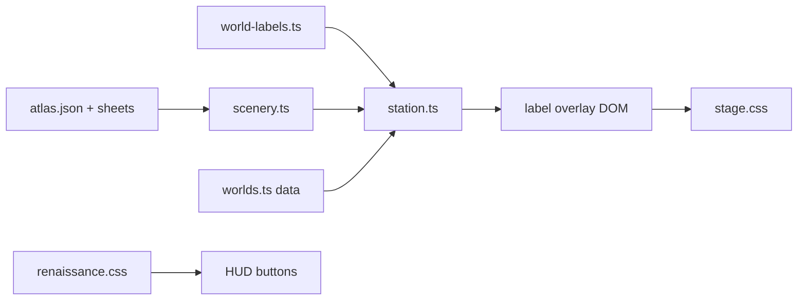
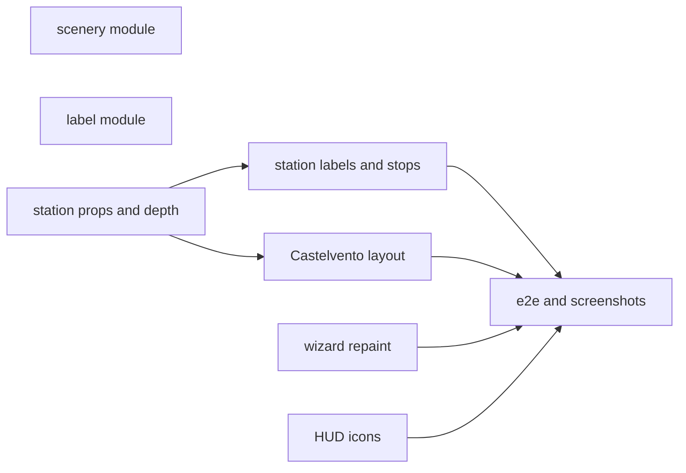

# Castelvento scene · plan

**Goal:** Ottavio gets his own look; the Castelvento square gets prop activity areas, depth scale and better cast placement; painted-backdrop worlds (department, renaissance) get compact name tags, no START HERE / YOUR GUESS world stops; Castelvento HUD gets inventory icons.
**Architecture:** Pure modules (`client/scenery.ts`, `client/world-labels.ts`) with node tests; `client/station.ts` (Phaser scene) wires them; world data in `client/worlds.ts`; CSS in `client/stage.css` and `client/renaissance.css`.
**Tech stack:** TypeScript client (Phaser 3, Vite), Node 25 test runner importing `.ts` directly, Python 3 + Pillow for art scripts.
**Spec:** docs/plans/2026-11-11-castelvento-scene.spec.md
**Detail:** contracts
**Target-min:** 14
**Ignore:** dist/, test-results/, node_modules, demos/override/.gitignore, demos/override/docs/plans/

## Global constraints
- Work dir: `demos/override` of this worktree. Unit tests: `node --test tests/<file>.test.mjs`; build: `npm run build` (tsc --noEmit + vite). Never run the e2e suite and the unit suite at once.
- World is 480 x 340 units; the Castelvento backdrop is drawn at 1/3 scale, x -16, y 0.
- Never edit `server/`, `content/`, or case files; contentHash pins must not move.
- Never reveal the hidden traveller in art, props, labels or icons.
- Original art files stay byte-identical; crops are done by atlas rects at draw time or CSS.
- New world-pack fields are optional; grove, friends and factory behave exactly as before.
- Visual checks: `node /private/tmp/claude-501/-Users-williambrach-Developer-AgentVerse/506ce9e1-2029-455d-9aa9-903ddfc217fc/scratchpad/shoot.mjs http://127.0.0.1:<port> <outPrefix> [case]` against your own server (`npm run build`, then `PORT=<44xx> HOST=127.0.0.1 OVERRIDE_DATA_DIR=$(mktemp -d) OVERRIDE_CONTENT_DIR=$(mktemp -d) node server/index.mjs &`); kill it afterwards. Ports: T1 4401, T5 4405, T6 4406, T7 4407, T8 4408.

## File structure
- `client/scenery.ts` atlas lookup, prop placement, perspective factor (new)
- `client/world-labels.ts` label emphasis and non-overlap layout (new)
- `client/station.ts` draws props, collisions, perspective, compact tags, ring, stop changes
- `client/worlds.ts` WorldPack fields and Castelvento/department data
- `client/main.ts` tells the station which conversation is open
- `client/stage.css` compact tag styles; `client/renaissance.css` HUD icons
- `client/text/worlds.json` objective hints
- `art/renaissance/wizard_repaint.py`, `public/assets/renaissance/characters/wizard-*.png`
- `public/assets/renaissance/expansion/*` copied sheets and atlas

```mermaid
%% schedule
gantt
  title Predicted schedule (mm:ss)
  dateFormat X
  axisFormat %M:%S
  section lane 1
  T5 station props and depth :t5, 0, 149s
  T6 station labels and stops :t6, 149, 153s
  T8 e2e and screenshots :t8, 302, 121s
  section lane 2
  T1 Ottavio repaint :t1, 0, 120s
  T7 Castelvento layout :t7, 149, 90s
  section lane 3
  T2 scenery module :t2, 0, 93s
  section lane 4
  T3 label module :t3, 0, 91s
  section lane 5
  T4 HUD icons :t4, 0, 86s
```

critical path: T5 → T6 → T8 (7.0 min) · peak width 5 · predicted build 7.0 min · predicted total ≈ 20.3 min (target ✗ 14.0)

## Package A · pure modules (library: numeric, state)
**Probe entry:** call=client/scenery.ts.placeProp · call=client/world-labels.ts.layoutLabels

### T2 scenery module · Complexity 3 · Est. context 30k
**Owns:** demos/override/client/scenery.ts, demos/override/tests/scenery.test.mjs, demos/override/public/assets/renaissance/expansion/market-props.png, demos/override/public/assets/renaissance/expansion/inventory-objects.png, demos/override/public/assets/renaissance/expansion/atlas.json
**Components:** 1
**LOC owned:** 110
**Tests:** fast
**Kind:** design
**Model:** sonnet
**Est. time:** 2 min
**Consumes:** none
**Produces:** scenery.atlasItem(atlas: Atlas, file: string, id: string) -> AtlasItem | undefined
e.g. atlasItem(atlas, 'market-props.png', 'barrel') -> { id: 'barrel', sourceRect: [444, 107, 260, 376], anchor: [130, 372] }
**Produces:** scenery.placeProp(item: AtlasItem, prop: SceneryProp, scale?: number) -> PropPlacement
e.g. placeProp(barrelItem, { id: 'barrel', x: 100, y: 200, width: 26, foot: { w: 20, h: 6 } }) -> { scale: 0.1, originX: 0.5, originY: 372 / 376, depth: 200, footprint: { x: 90, y: 194, w: 20, h: 6 } }
e.g. placeProp(barrelItem, { id: 'barrel', x: 100, y: 200, width: 26 }, 0.5) -> { scale: 0.05, originX: 0.5, originY: 372 / 376, depth: 200, footprint: null }
**Produces:** scenery.depthScale(p: Perspective | undefined, y: number) -> number
e.g. depthScale({ far: { y: 150, scale: 0.9 }, near: { y: 320, scale: 1 } }, 235) -> 0.95
e.g. depthScale(undefined, 10) -> 1
**Review Focus:** `clamps_outside_range`: y 100 -> 0.9, y 400 -> 1; `foot_scales_with_factor`: footprint w,h multiply by the scale argument; `unknown_id_undefined`.
**Test code:** named tests: atlas_item_lookup, place_prop_examples (both e.g.), depth_scale_examples, clamps_outside_range, foot_scales_with_factor, unknown_id_undefined, copies_byte_identical (sha256 of each copied file equals the source in /Users/williambrach/Developer/arbiter/assets/castelvento-expansion-v1/; skip when the source dir is missing).
**Steps:** 1 failing tests, 2 FAIL, 3 implement, 4 PASS
**Notes:** Types exported: `AtlasItem {id; sourceRect:[x,y,w,h]; anchor:[x,y]}`, `Atlas {sheets:{file; items: AtlasItem[]}[]}`, `SceneryProp {id; x; y; width; flip?: boolean; foot?: {w; h}}` (x,y = ground point in world units, width = display width before perspective), `PropPlacement {scale; originX; originY; depth; footprint: {x;y;w;h}|null}`, `Perspective {far:{y;scale}; near:{y;scale}}`. scale = width * factor / sourceRect.w; origin = anchor / size; footprint centred on x, bottom at y.

### T3 label module · Complexity 3 · Est. context 28k
**Owns:** demos/override/client/world-labels.ts, demos/override/tests/world-labels.test.mjs
**Components:** 1
**LOC owned:** 90
**Tests:** fast
**Kind:** design
**Model:** sonnet
**Est. time:** 2 min
**Consumes:** none
**Produces:** worldLabels.labelEmphasis(id: string, s: LabelState) -> 'strong' | 'subtle'
e.g. labelEmphasis('ottavio', { near: null, hovered: 'ottavio', active: null }) -> 'strong'
e.g. labelEmphasis('bruno', { near: 'ottavio', hovered: null, active: null }) -> 'subtle'
**Produces:** worldLabels.layoutLabels(boxes: LabelBox[], bounds: { w: number; h: number }, pad?: number) -> Record<string, { x: number; y: number }>
e.g. layoutLabels([{ id: 'a', x: 100, y: 50, w: 40, h: 8 }, { id: 'b', x: 110, y: 52, w: 40, h: 8 }], { w: 480, h: 340 }) -> { a: { x: 100, y: 50 }, b: { x: 110, y: 40 } }
e.g. layoutLabels([{ id: 'c', x: 5, y: 100, w: 40, h: 8 }], { w: 480, h: 340 }) -> { c: { x: 22, y: 100 } }
**Review Focus:** `no_overlap_five`: five boxes stacked at one point end pairwise apart by >= pad; `top_edge_pushes_down`: a box that would leave the top goes below the one it hit instead; `deterministic`: same input, same output; `strong_when_active_or_near`.
**Test code:** named tests: emphasis_examples, layout_examples, no_overlap_five, top_edge_pushes_down, deterministic, strong_when_active_or_near.
**Steps:** 1 failing tests, 2 FAIL, 3 implement, 4 PASS
**Notes:** `LabelBox {id; x; y; w; h}` (centre, world units); `LabelState {near; hovered; active: string|null}`. Clamp first (x to [pad+w/2, bounds.w-pad-w/2], y likewise), then in array order each box that overlaps an earlier placed box (with pad gap) moves up to clear it; if that leaves the top bound it moves below it instead; repeat until clear (max 20 passes).

### T4 HUD icons · Complexity 2 · Est. context 26k
**Owns:** demos/override/client/renaissance.css, demos/override/tests/renaissance-icons.test.mjs
**Components:** 1
**LOC owned:** 50
**Tests:** fast
**Kind:** design
**Model:** sonnet
**Est. time:** 1.5 min
**Consumes:** none
**Produces:** none
**Review Focus:** `rects_match_atlas`: each icon rule's background-size/position equals the atlas rect of its item; `scoped_to_renaissance`: every new selector starts with `#app[data-world="renaissance"]`.
**Test code:** named tests: rects_match_atlas, scoped_to_renaissance, svg_hidden_only_where_replaced.
**Steps:** 1 failing tests, 2 FAIL, 3 implement, 4 PASS
**Notes:** Sheet `/assets/renaissance/expansion/inventory-objects.png` (1536 x 1024, copied by T2). Targets: `#notebook-button` notebook, `.verdict-button` seal-stamp, `#coin-counter` coin-pouch, `.world-panel .world-swatch` town-map. Hide the replaced svg, draw a 24px square icon (`::before` or the swatch itself) cropped by the rect, `background-repeat: no-repeat`, contain the rect by its longer side, `image-rendering: pixelated`. Labels stay as text. Check `data-world` is on `#app` in client/main.ts before writing selectors.

## Package B · art (file generator: file, encoding)
**Probe entry:** run=python3 art/renaissance/wizard_repaint.py --check

### T1 Ottavio repaint · Complexity 4 · Est. context 40k
**Owns:** demos/override/art/renaissance/wizard_repaint.py, demos/override/public/assets/renaissance/characters/wizard-listening.png, demos/override/public/assets/renaissance/characters/wizard-speaking.png, demos/override/public/assets/renaissance/characters/wizard-thinking.png, demos/override/public/assets/renaissance/characters/wizard-idle-0.png, demos/override/public/assets/renaissance/characters/wizard-idle-1.png, demos/override/public/assets/renaissance/characters/wizard-idle-2.png, demos/override/public/assets/renaissance/characters/wizard-idle-3.png, demos/override/public/assets/renaissance/characters/wizard-talk-0.png, demos/override/tests/wizard-art.test.mjs
**Components:** 2
**LOC owned:** 150
**Tests:** fast
**Kind:** design
**Model:** sonnet
**Est. time:** 4 min
**Consumes:** none
**Produces:** none
**Review Focus:** `same_frame_box`: every wizard frame 132 x 188 RGBA; `differs_from_inventor`: no wizard file byte-equal to its inventor counterpart; `check_mode`: `--check` exits 0 when the head crop (rows 0..70) differs from the inventor's by mean abs diff > 25 per channel.
**Test code:** named tests: same_frame_box (read PNG IHDR), differs_from_inventor, every_wizard_frame_present.
**Steps:** 1 failing tests, 2 FAIL, 3 implement the script, run it, look at the frames with Read and a 4x contact sheet, 4 PASS
**Notes:** Source = the matching `inventor-*.png` frames (feet line and head column already registered). Hair -> silver (#cfcac0 family), add a long silver beard from the chin down onto the chest, robe -> ivory, mantle -> burgundy (#7a2132 family). Keep outlines dark, alpha unchanged except the beard. Ottavio must read as old and bearded at 44 px portrait size (the rail crops the head via renaissance.css lines 42-46). Take screenshots of the cast rail at port 4401 to confirm.

## Package C · station (web UI: protocol, encoding)
**Probe entry:** run=npm run build

### T5 station props and depth · Complexity 6 · Est. context 55k
**Owns:** demos/override/client/station.ts, demos/override/client/worlds.ts, demos/override/client/factory-figures.ts, demos/override/tests/scenery-world.test.mjs
**Components:** 2
**LOC owned:** 120
**Tests:** slow
**Kind:** design
**Model:** sonnet
**Est. time:** 4.5 min
**Consumes:** scenery.atlasItem(atlas: Atlas, file: string, id: string) -> AtlasItem | undefined (T2) · scenery.placeProp(item: AtlasItem, prop: SceneryProp, scale?: number) -> PropPlacement (T2) · scenery.depthScale(p: Perspective | undefined, y: number) -> number (T2)
**Produces:** WorldPack fields `scenery?: { sheet: string; atlas: string; props: SceneryProp[] }`, `perspective?: Perspective`, `labels?: 'compact'` in client/worlds.ts
**Review Focus:** `grove_unchanged`: worlds without scenery/perspective draw exactly as before; `footprint_blocks_walk`: each footprint becomes a static body colliding with the player; `walk_sheet_scaled_too`: the detective's walk sheet frames take the same perspective factor as its poses.
**Test code:** named tests in tests/scenery-world.test.mjs: renaissance_has_scenery_and_perspective, other_worlds_have_neither, labels_compact_on_department_and_renaissance_only.
**Steps:** 1 failing tests, 2 FAIL, 3 implement, 4 PASS, 5 build, screenshot at 4405
**Notes:** Preload the sheet once and add atlas frames to the texture (`texture.add(id, 0, x, y, w, h)`). Props: `setOrigin(originX, originY).setScale(scale).setDepth(depth).setFlipX(flip)`. Perspective multiplies spriteScale (cast, detective poses, walk sheet), prop scale, shadow size and labelLift at the foot y, every frame for the detective. Give renaissance a placeholder `scenery` with the 8 market props in a row at y 320 and `perspective: { far: { y: 158, scale: 0.86 }, near: { y: 326, scale: 1 } }`; T7 places them. Set `labels: 'compact'` on department and renaissance. Owns tests/scenery-world.test.mjs too.

### T6 station labels and stops · Complexity 6 · Est. context 58k
**Owns:** demos/override/client/station.ts, demos/override/client/main.ts, demos/override/client/stage.css, demos/override/client/text/worlds.json, demos/override/tests/browser/department.spec.mjs, demos/override/tests/compact-prompt.test.mjs
**Components:** 2
**LOC owned:** 150
**Tests:** slow
**Kind:** design
**Model:** sonnet
**Est. time:** 5 min
**Consumes:** worldLabels.labelEmphasis(id: string, s: LabelState) -> 'strong' | 'subtle' (T3) · worldLabels.layoutLabels(boxes: LabelBox[], bounds: { w: number; h: number }, pad?: number) -> Record<string, { x: number; y: number }> (T3)
**Produces:** Station.setActive(id: string | null) -> void
**Review Focus:** `hover_strong`: pointer over a figure sets its tag `data-emphasis="strong"`; `no_report_stop_compact`: compact worlds have no `report` stop, prop or tag and E never opens the report from the floor; `prompt_still_replaces_tag`; `grove_tags_unchanged`.
**Test code:** e2e in tests/browser/department.spec.mjs: compact_tags_strong_near_and_subtle_far, no_start_or_guess_tags, verdict_button_opens_report, tags_never_overlap.
**Steps:** 1 failing tests, 2 FAIL, 3 implement, 4 PASS (`npx playwright test --project=department`, after `npm run build`), 5 screenshot at 4406
**Notes:** Compact worlds (`world.labels === 'compact'`): overlay gets `data-labels="compact"`; tags get `data-emphasis`; recompute emphasis and `layoutLabels` (measure tags in world units via `--u`) only when near/hovered/active changes or on resize. Figures `setInteractive({ useHandCursor: true })` with pointerover/out; pointerdown on a figure calls `onArrival(id)`. No briefing tag; the briefing stop keeps its prop and [E] prompt. Drop the report stop. A gold ellipse ring (alpha .35) under the detective. main.ts calls `station.setActive(panel is a cast id ? panel : null)` wherever the panel changes. worlds.json hints: department "Find who killed Anders Vik. Walk with WASD, press E by a colleague or evidence."; renaissance "Find the time traveller. Walk with WASD, press E beside a townsperson.". Tag CSS: 5u font, 1.5u/3u padding, dark translucent background, light text; subtle opacity .6 and 4.5u font.

### T7 Castelvento layout · Complexity 5 · Est. context 45k
**Owns:** demos/override/client/worlds.ts, demos/override/tests/renaissance-world.test.mjs
**Components:** 1
**LOC owned:** 80
**Tests:** fast
**Kind:** design
**Model:** sonnet
**Est. time:** 3.5 min
**Consumes:** scenery.placeProp(item: AtlasItem, prop: SceneryProp, scale?: number) -> PropPlacement (T2)
**Produces:** none
**Review Focus:** `routes_connected`: a 6-unit grid flood fill from the briefing stop inside walk bounds minus blocks and footprints reaches every NPC approach point (slot y + 14) and covers >= 60% of the bounds; `props_on_cobbles`: every prop foot inside walk bounds or against a painted edge listed in the comments; `slots_apart`: NPCs >= 48 units apart.
**Test code:** named tests: routes_connected, props_on_cobbles, slots_apart, every_market_prop_placed_once.
**Steps:** 1 failing tests, 2 FAIL, 3 place, screenshot at 4407, adjust, 4 PASS
**Notes:** Areas: crates+barrel+handcart at the delivery side (right, by the bread stall), produce basket at the fruit stall (left), herb planter + ceramic jars beside the apothecary door, cloth bolts at the cloth stall, bench along the palazzo steps. NPCs near their area: Beatrice by the cloth, Agnese by her herbs, Matteo by his workshop, Bruno on the open plaza, Ottavio before the palazzo. Prop width so a barrel is ~0.6 of a figure's height. Keep the briefing stop at the plaza front.

## Package D · integration (web UI: protocol)
**Probe entry:** run=npx playwright test --project=renaissance

### T8 e2e and screenshots · Complexity 4 · Est. context 45k
**Owns:** demos/override/tests/browser/renaissance.spec.mjs, demos/override/tests/browser/investigation.spec.mjs
**Components:** 1
**LOC owned:** 70
**Tests:** slow
**Kind:** design
**Model:** sonnet
**Est. time:** 4 min
**Consumes:** Station.setActive(id: string | null) -> void (T6)
**Produces:** none
**Review Focus:** `scout_behind_and_in_front`: the detective's depth is below a prop's when north of its foot and above when south; `collision_holds`: walking into the barrel footprint stops the player; `every_npc_reachable`.
**Test code:** e2e: scout_depth_sorts_with_props, prop_footprint_blocks, every_npc_reachable_and_opens_dialogue, accuse_button_opens_report, no_traveller_hint_in_labels.
**Steps:** 1 tests, 2 run `npx playwright test --project=renaissance` and `--project=department` and `--project=default` (not with unit tests), 3 save after-screenshots and a 6 s webm (Playwright video) to the scratchpad `shots/` dir
**Notes:** Report remaining issues instead of fixing other tasks' files.

## Review Focus
- Package A (library): numeric (clamps, scale), state (deterministic layout). Risks: floating overlap at exact touch, NaN on empty input.
- Package B (file): alpha preserved, frame size, no traveller tell (repaint never uses role data).
- Package C (web UI): protocol (stops, E key, verdict button), encoding (tags use textContent only). Risks: hover listeners leaking across world switches; layout thrash every frame.
- Package D: route reachability, depth sort.

## Self-review
Coverage: spec 1 T1, 2 T2/T5/T7, 3 T5, 4 T7, 5 T3/T6, 6 T6, 7 T4, 8 global. No placeholders. T5, T6 and T7 share files and are ordered by edges.
