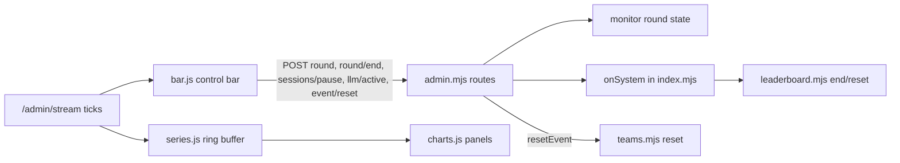
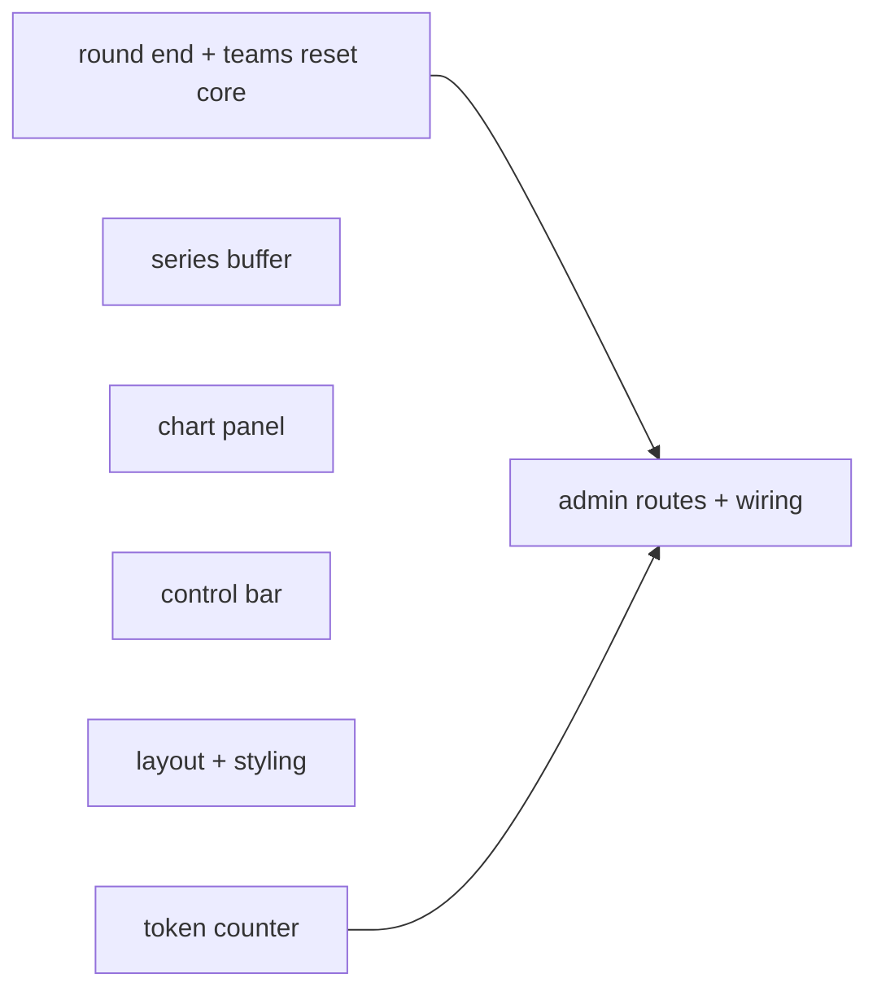

# Command centre v2: Grafana-style panels, control bar, end round, reset event

**Goal:** make `/admin` read like a Grafana board (time-series panels with axes, hover, threshold colours, each number once) and give the operator one control bar: start/end round, pause/resume new games, active LLM endpoint, reset the whole event.
**Architecture:** server adds two admin routes (`POST /admin/round/end`, `POST /admin/event/reset`) on top of the existing round/board/teams modules; the page keeps its plain ES-module design (no build, strict CSP) and gains three client modules: `series.js` (ring buffer of stream ticks), `charts.js` (SVG time-series panel), `bar.js` (control bar).
**Tech stack:** Node 22 ESM (`server/*.mjs`), browser ES modules (`server/admin/*.js`), `node:test`.
**Spec:** none (this doc). **Detail:** contracts. **Target-min:** 14

## Understood
User: "more like grafana"; controls "start it, reset etc."; Reset = whole event; End round = freeze board until next Start round; no mock-up.
- Ruling: own SVG charts, no uPlot (admin CSP is script-src 'self', no build step) - cost: one module swap.
- Ruling: reset event = clear teams (`teams_reset` record, history kept) + new round `Event reset`, which empties board, funnel, tallies - cost: hidden flags stay.
- Ruling: charts fed from 1 s stream ticks kept in the browser (60 min), seeded from `snapshot.history` - cost: older points at minute resolution.

## Global constraints
- Server: ESM `.mjs`, no new dependencies. Admin page: ES modules served from `server/admin/`, CSP without unsafe-inline: no inline `<script>`/`<style>`, text only via `textContent`, SVG via `createElementNS`, styles via classes or `el.style.prop =` (CSSOM).
- Test command: `node --test tests/<file>.test.mjs` (fast). Never run the browser suite and the unit suite at the same time.
- Frozen route shapes: existing `/admin/*` and `/api/*` responses only gain fields.
- Destructive actions ask: reset needs body `{confirm: "RESET"}` server-side and the user typing RESET client-side.
- Light and dark mode both work (tokens in `server/admin/app.css`).

## Main diagram

## File structure
Each task's Owns line lists its files; new files: `server/admin/series.js`, `charts.js`, `charts.css`, `bar.js`.

## Task graph

```mermaid
%% schedule
gantt
  title Predicted schedule (mm:ss)
  dateFormat X
  axisFormat %M:%S
  section lane 1
  T1 round end + teams reset core :t1, 0, 137s
  T2 admin routes + wiring :t2, 137, 151s
  section lane 2
  T6 layout + styling :t6, 0, 128s
  section lane 3
  T4 chart panel :t4, 0, 127s
  section lane 4
  T5 control bar :t5, 0, 126s
  section lane 5
  T7 token counter :t7, 0, 110s
  section lane 6
  T3 series buffer :t3, 0, 91s
```

critical path: T1 → T2 (4.8 min) · peak width 6 · predicted build 4.8 min · predicted total ≈ 18.6 min

## Server

**Probe entry:** serve=server/index.mjs startServer

### T1 round end + teams reset core · Complexity 3 (O-1) · Est. context 30k
**Owns:** server/leaderboard.mjs, server/teams.mjs, server/monitor-sources.mjs, tests/leaderboard.test.mjs, tests/teams.test.mjs, tests/monitor-sources.test.mjs
**Components:** 3
**LOC owned:** 110
**Tests:** fast
**Model:** sonnet
**Est. time:** 2.5 min
**Consumes:** nothing
**Produces:** leaderboard.end(at: number) -> void
e.g. board.reset(1000,'R1'); observe verdict at 3000; board.end(2000) -> that verdict counts only if observed with ms <= 2000; standings().endedAt -> 2000
e.g. board.reset(5000,'R2') -> standings().endedAt -> null
**Produces:** teams.reset() -> number
e.g. two teams joined; teams.reset() -> 2; teams.exists('Owls') -> false; teams.join('Owls').created -> true
**Produces:** loadRound(systemFile: string) -> {label: string|null, startedAt: number, endedAt: number|null}
e.g. records [round_started{startedAt:1000,label:'A'}, round_ended{endedAt:2000}] -> {label:'A', startedAt:1000, endedAt:2000}
e.g. records [round_ended{endedAt:500}, round_started{startedAt:1000,label:'B'}] -> {label:'B', startedAt:1000, endedAt:null}
**Review Focus:** `test_verdict_after_end_ignored`: reset(1000), end(2000), verdict event timestamp 2500 -> team played 0; `test_end_then_reset_reopens`: end(2000) then reset(3000) -> endedAt null and verdicts at 3500 count; `test_teams_reset_survives_restart`: join A, reset(), join B, new createTeams on same file -> A unknown, B known; `test_reset_frees_name`: after reset, join of the old name is created, not taken.
**Steps:** failing tests, implement, pass.
**Notes:** `end` before any observe still applies (startup order is reset, end, observe). Teams file record: `{type:'teams_reset', timestamp}`; replay clears both maps at that record. `standings()` always has `endedAt` (null when open).

### T2 admin routes + wiring · Complexity 5 (O-2) · Est. context 45k
**Owns:** server/admin.mjs, server/index.mjs, server/monitor.mjs, tests/admin.test.mjs, tests/monitor.test.mjs, tests/teams-http.test.mjs
**Components:** 2
**LOC owned:** 140
**Tests:** slow
**Model:** sonnet
**Est. time:** 4 min
**Consumes:** leaderboard.end(at: number) -> void (T1) · teams.reset() -> number (T1) · loadRound(systemFile: string) -> {label: string|null, startedAt: number, endedAt: number|null} (T1) · createTokenCounter(opts: {now: function}) -> {add(e: object): void, startRound(): void, stats(): object} (T7)
**Produces:** POST /admin/round/end -> 200 {label: string, startedAt: number, endedAt: number}
e.g. after POST /admin/round {label:'R1'} -> POST /admin/round/end {} -> 200 {label:'R1', startedAt: <n>, endedAt: <n>}
e.g. no round or already ended -> 409 {error:'No open round to end.'}
**Produces:** POST /admin/event/reset -> 200 {ok: true, teamsCleared: number, round: {label: string, startedAt: number}}
e.g. {confirm:'RESET'} with 3 teams -> 200 {ok:true, teamsCleared:3, round:{label:'Event reset', startedAt:<n>}}
e.g. {confirm:'reset'} -> 400 {error:'Type RESET to confirm.'}
**Produces:** snapshot.round -> {label: string|null, startedAt: number, endedAt: number|null}
e.g. after end -> snap.round.endedAt is a number; after a new start -> null
**Review Focus:** `test_end_round_freezes_public_board`: start round, team verdict, end, second team verdict -> GET /api/leaderboard lists only the first as played and `endedAt` is a number; `test_end_round_restored_after_restart`: end, restart server on same data dir -> snapshot.round.endedAt equal; `test_reset_event_clears_teams`: team cookie from before reset -> GET /api/team returns {team:null}, POST /api/team same name -> 200 created; `test_reset_requires_confirm`: missing confirm -> 400, teams intact; `test_reset_cookie_cross_site`: cookie auth POST without same-site -> 403 (existing guard covers new routes).
**Steps:** failing tests, implement, pass.
**Notes:** End writes `onSystem({type:'round_ended', timestamp, endedAt, label})`; onSystem calls `board.end`. Reset calls an injected `resetEvent({label})` from index.mjs: `teams.reset()`, then the POST /admin/round path with reason `event_reset`, logs `admin_action` `event_reset` {teamsCleared}. `monitor.load` keeps `round.endedAt`; `/api/leaderboard` adds `endedAt`. Tokens: monitor owns a token counter; `observeLlm` passes `attempt` events to `add`, `startRound` calls its `startRound`, snapshot gets `traffic.tokens = stats()` and `traffic.tokensPerMin = stats().perMin`. Review Focus also: `test_snapshot_tokens`: two attempt events {promptTokens:100, completionTokens:20} -> snap.traffic.tokens.total.total 240, after startRound round.total 0.

### T7 token counter · Complexity 2 (O-1) · Est. context 22k
**Owns:** server/monitor-tokens.mjs, server/llm.mjs, tests/monitor-tokens.test.mjs, tests/llm.test.mjs
**Components:** 2
**LOC owned:** 70
**Tests:** fast
**Model:** sonnet
**Est. time:** 2 min
**Consumes:** nothing
**Produces:** createTokenCounter(opts: {now: function}) -> {add(e: object): void, startRound(): void, stats(): object}
e.g. c.add({promptTokens:100, completionTokens:20}); c.stats() -> {total:{prompt:100, completion:20, total:120}, round:{prompt:100, completion:20, total:120}, perMin:120, calls:1}
e.g. c.startRound(); c.stats().round -> {prompt:0, completion:0, total:0}; c.stats().total.total -> 120
**Review Focus:** `test_missing_usage_counts_call_only`: add({}) -> calls +1, totals unchanged; `test_per_min_window`: add at t=0 and t=61000 -> perMin at t=61000 counts only the second; `test_attempt_event_has_tokens`: a router attempt against a fetcher answering usage {prompt_tokens:120, completion_tokens:12} emits onEvent {type:'attempt', promptTokens:120, completionTokens:12}; failed attempts with usage count too.
**Notes:** In llm.mjs only add `promptTokens` and `completionTokens` (integers or null) to the existing `attempt` onEvent object. Counter is in memory: since server start and since round start.

## Admin page

**Probe entry:** call=server/admin/series.js createSeries

### T3 series buffer · Complexity 3 (O-1) · Est. context 22k
**Owns:** server/admin/series.js, tests/admin-series.test.mjs
**Components:** 1
**LOC owned:** 90
**Tests:** fast
**Model:** sonnet
**Est. time:** 2 min
**Consumes:** nothing
**Produces:** createSeries(opts: {capMs?: number}) -> {push(snap: object): void, seed(history: object[]): void, points(key: string, t0: number, t1: number, maxPoints?: number): number[][], latest(key: string): number|null}
e.g. s.push({at:1000, players:{online:3}, traffic:{questionsPerMin:5}}); s.points('online',0,2000) -> [[1000,3]]; s.latest('questionsPerMin') -> 5
e.g. s.seed([{at:60000, online:4, questions:12, failures:0, p95Ms:900, reqs:600}]); s.points('reqPerSec',0,120000) -> [[60000,10]]
**Review Focus:** `test_keys`: keys are online (players.online), questionsPerMin, answerP95Ms, llmErrorRate, reqPerSec, loopP99Ms, queue, inFlight, rssBytes (traffic.*); `test_out_of_order_ignored`: push at 2000 then 1500 -> only 2000 kept; `test_cap_drops_old`: capMs 10000, pushes at 0 and 20000 -> points('online',0,30000) has one point; `test_downsample_keeps_max`: 1000 points 0..999 with one spike 50 at t=500, maxPoints 10 -> length <= 10 and contains value 50; `test_non_numbers_skipped`: traffic.answerP95Ms null -> no point for that tick; `test_seed_before_push`: seeded points older than the first push stay, seed after push ignores rows at or after the oldest pushed at.

### T4 chart panel · Complexity 5 (O-2) · Est. context 30k
**Owns:** server/admin/charts.js, server/admin/charts.css, tests/admin-charts.test.mjs
**Components:** 2
**LOC owned:** 210
**Tests:** fast
**Model:** sonnet
**Est. time:** 4 min
**Consumes:** nothing
**Produces:** niceTicks(min: number, max: number, count?: number) -> number[]
e.g. niceTicks(0, 187) -> [0, 50, 100, 150, 200]
e.g. niceTicks(0, 0) -> [0, 1]
**Produces:** renderChart(root: Element, spec: {title: string, series: {key: string, label: string, points: number[][]}[], range: number[], format: function, thresholds?: {warn: number|null, bad: number|null}, now?: number}) -> 'ok'|'warn'|'bad'
e.g. renderChart(div, {title:'Questions / min', series:[{key:'q', label:'questions', points:[[0,1],[1000,3]]}], range:[0,1000], format:String}) -> 'ok'; div has `.chart-title` 'Questions / min', `.chart-value` '3'
e.g. same with thresholds {warn:2, bad:10} -> 'warn'; root dataset.level 'warn'
**Review Focus:** `test_updates_in_place`: second render with new points reuses the same svg element; `test_empty_series`: no points -> `.chart-value` '–', no NaN in any path attribute; `test_y_axis_starts_at_zero`: values 40..60 -> lowest tick 0; `test_threshold_lines`: warn and bad draw dashed lines only when inside the y range; `test_hover`: pointermove at x of t=1000 -> tooltip text contains the formatted value at the nearest point and time hh:mm:ss; `test_text_only`: a title containing `<b>` renders as text.
**Notes:** Level comes from the first series' latest value. x axis: 4 time labels hh:mm. Layout: header (title left, current value right, coloured by level), SVG with viewBox and `preserveAspectRatio="none"` for the plot plus HTML axis labels so text is not stretched. Area fill under the first series. CSS in charts.css uses the tokens in app.css.

### T5 control bar · Complexity 5 (O-2) · Est. context 38k
**Owns:** server/admin/bar.js, server/admin/round.js, server/admin/controls.js, server/admin/round.css, tests/admin-bar.test.mjs, tests/admin-round.test.mjs, tests/admin-controls.test.mjs
**Components:** 2
**LOC owned:** 200
**Tests:** fast
**Model:** sonnet
**Est. time:** 4 min
**Consumes:** POST /admin/round/end -> 200 {label: string, startedAt: number, endedAt: number} (T2) · POST /admin/event/reset -> 200 {ok: true, teamsCleared: number, round: {label: string, startedAt: number}} (T2) · snapshot.round -> {label: string|null, startedAt: number, endedAt: number|null} (T2)
**Produces:** createBar(root: Element, opts: {api: function, prompt?: function, confirm?: function}) -> {update(snap: object): void}
e.g. bar.update({at:120000, round:{label:'R1', startedAt:0, endedAt:null}, sessions:{paused:false}, router:{active:'a', pinned:false, endpoints:[{name:'a'},{name:'b'}]}}) -> shows 'R1 · 2 min', buttons 'End round', 'Pause new games', endpoint select value 'a'
e.g. round.endedAt set -> shows 'R1 · ended, final standings', 'End round' hidden, 'Start round' shown
**Review Focus:** `test_reset_needs_typed_word`: prompt returns 'reset' -> no api call, message 'Reset cancelled'; prompt 'RESET' -> api('/admin/event/reset', {confirm:'RESET'}); `test_end_round_confirms`: confirm false -> no call; true -> api('/admin/round/end', {}); `test_pause_toggles`: paused false -> api('/admin/sessions/pause', {paused:true}); `test_endpoint_switch`: select 'b' -> prompt reason, api('/admin/llm/active', {endpoint:'b', pinned:true, reason}); `test_rehearsal_mode`: router null -> endpoint select hidden; `test_error_shown`: api rejects 'boom' -> bar message 'Error: boom'; `test_system_lines`: systemLine for round_ended and admin_action event_reset read 'round "R1" ended' and 'event reset (3 teams cleared)'.
**Notes:** The bar hosts the existing Start-round form (createRoundControl stays in round.js, gains `ended` state text). Pause moves from controls.js into the bar; controls.js keeps endpoints, caps, probes, stats, system records. No `window` access at import time.

### T6 layout + styling · Complexity 5 (O-2) · Est. context 45k
**Owns:** server/admin/index.html, server/admin/app.js, server/admin/tiles.js, server/admin/app.css, server/admin/centre.css, server/admin/tiles.css, tests/admin-tiles.test.mjs, tests/browser/admin.spec.mjs
**Components:** 2
**LOC owned:** 220
**Tests:** fast
**Model:** sonnet
**Est. time:** 5 min
**Consumes:** createSeries(opts: {capMs?: number}) -> {push(snap: object): void, seed(history: object[]): void, points(key: string, t0: number, t1: number, maxPoints?: number): number[][], latest(key: string): number|null} (T3) · renderChart(root: Element, spec: {title: string, series: {key: string, label: string, points: number[][]}[], range: number[], format: function, thresholds?: {warn: number|null, bad: number|null}, now?: number}) -> 'ok'|'warn'|'bad' (T4) · createBar(root: Element, opts: {api: function, prompt?: function, confirm?: function}) -> {update(snap: object): void} (T5)
**Produces:** worstLevel(snap: object) -> 'ok'|'warn'|'bad'
e.g. worstLevel({at:0, traffic:{loopP99Ms:600}}) -> 'bad'
e.g. worstLevel({at:0, traffic:{}}) -> 'ok'
**Review Focus:** `test_no_duplicate_metrics`: stat strip = tokens used, diskFreeBytes, writeFailures5m, credentialsRejected5m, failoverAt only; `test_tokens_tile`: traffic.tokens {total:{total:1234567,prompt:1000000,completion:234567}, round:{total:5600}} -> tile '5.6k this round', sub '1.23M since start · 1M in / 235k out'; absent -> '–'; `test_worst_level`: examples above; `test_render_history_removed`: no renderHistory export.
**Notes:** Order: header `#bar` (createBar, replaces `#round`) · 4 big player numbers · stat strip · charts grid, range picker 5/15/30/60 min (localStorage in try/catch), 9 panels: Online, Questions / min, Answer p95 (8000/20000), LLM errors (0.05/0.2, %), Tokens / min, Requests / s, Queue + in flight (queue 10/50), Event loop p99 (100/500), Memory · log + leaderboard · Results · LLM ops · System records. app.js: hello -> `series.seed(snap.history)`, push every snapshot, re-render charts per tick, ⚠ in title from worstLevel. Grafana look: 12-col grid, 8 px gaps, flat 1 px panels, small uppercase titles, dense; light mode via tokens. Fix admin.spec.mjs selectors for removed elements only.

## Review Focus
- Server (HTTP service): protocol, state. Risks: reset racing an in-flight answer (team attach after reset must not resurrect the team: `teams.attach` on an unknown id is a no-op); end round restored after restart; cross-site POST on the new routes.
- Page (web UI): protocol via the API, encoding. Risks: text injection in titles/labels (textContent only), NaN in SVG paths, CSP violations (no inline style/script).

## Self-review
Coverage: charts T3 T4 T6; bar T5; end round and reset T1 T2 T5; tokens T7 T2 T6. Only T2 runs T1/T7 code. Owns disjoint.
