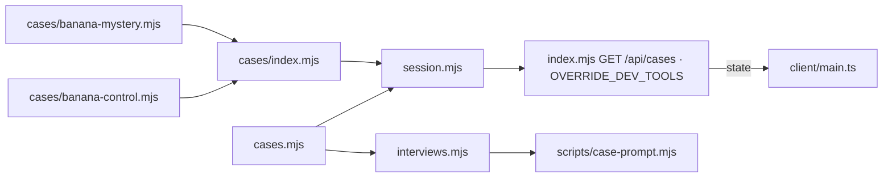
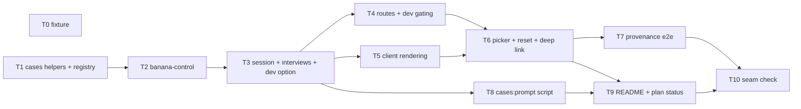

# Integration plan: override-cases

**Goal:** port the validated prototype into the real branch task by task, and add what the prototype left out: draft-case gating, the `cases:prompt` script, README docs, and a seam check over every suite.
**Architecture:** case modules behind `defineCase` → `Investigations` resolves one case per session → `publicView` in `/api/state` → `client/main.ts` renders from it; `scripts/case-prompt.mjs` prints `buildMessages` output.
**Tech stack:** Node 25, ESM `.mjs` server (no framework), TypeScript 5.9 + Vite 7 client, Phaser 3.90 (untouched), `node:test`, Playwright 1.58. Language: JavaScript and TypeScript.
**Spec:** docs/plans/2026-10-26-override-cases.spec.md
**Review plan:** docs/plans/2026-10-26-override-cases.feature.md
**Source:** branch `superlite/override-cases-proto` (read a file with `git show superlite/override-cases-proto:<path>`); exact strings in docs/plans/override-cases.content.md; prototype plan docs/plans/2026-10-26-override-cases.proto.md
**Spec sections:** Intent and Done looks like → T5–T7, T10; Constraints and Decided → T1–T4, T8; Left to the builder / plan → task Notes; Diagrams → Main diagram.
**Detail:** contracts
**Target-min:** 25
**Ignore:** demos/override/node_modules/, demos/override/dist/, demos/override/data/, demos/override/test-results/, demos/override/playwright-report/

## Global constraints
- Every npm command runs in `demos/override`. Fast tests from the repo root: `node --test demos/override/tests/*.test.mjs`. Slow: `npx playwright test` in `demos/override` (port 4317, one run at a time; run `npm run build` first because the server serves `dist/`). Type check: `npm run build`.
- No new dependencies. Every case string reaches the DOM through `escape()`.
- FROZEN: the feature plan's "Interfaces that must not change", plus the prototype's signatures: `defineCase`, `contentHash`, `publicView`, `listCases`, `findCase`, `Investigations.catalog`, `replay(events, cases)`, `buildMessages(kase, …)`, `answerInterview(config, kase, …)`, `GET /api/cases`, the `caseId` fields of `start`/`reset`.
- Port rule: a port task copies each owned file byte for byte from the prototype worktree, `PROTO=/Users/williambrach/Developer/AgentVerse/.superlite/sandboxes/override-cases-proto` (`mkdir -p` the folder, then `cp "$PROTO/<path>" <path>`; a file the prototype deleted is removed with `git rm`), then runs that file's tests. Changes beyond the copy are listed in the block. The prototype has no stubs or fakes; `tests/fixtures/minimal-case.mjs` is a unit-test asset and is ported (Ruling).
- Base: `demo/override` at 29a0d90, the prototype's own base, so copies apply cleanly (Ruling: if the branch has moved when the worktree is cut, T3 and T4 reconcile instead of copying).
- Ruling: the client's only test harness is Playwright against the real server, so the client chain is sequential - cost if wrong: wall time.

## Main diagram


## File structure
- Ported: `demos/override/server/{cases.mjs,session.mjs,interviews.mjs,index.mjs}`, `server/cases/{index,banana-mystery,banana-control}.mjs`, `client/{types.ts,main.ts,banana.css}`, `tests/fixtures/minimal-case.mjs`, `tests/{fixtures,cases,banana-control,session,http}.test.mjs`, `tests/browser/{investigation,cases,provenance}.spec.mjs`; `server/case.mjs` deleted.
- New: `demos/override/scripts/case-prompt.mjs`, `tests/case-prompt.test.mjs`, `package.json` script; README section; `docs/plans/2026-10-26-override-cases.seam.md`.

## Task graph

```mermaid
%% schedule
gantt
  title Predicted schedule (mm:ss)
  dateFormat X
  axisFormat %M:%S
  section lane 1
  T1 cases helpers + registry :t1, 0, 116s
  T2 banana-control :t2, 116, 93s
  T3 session + interviews + dev option :t3, 209, 122s
  T5 client rendering :t5, 332, 131s
  T6 picker + reset + deep link :t6, 462, 124s
  T7 provenance e2e :t7, 586, 121s
  T10 seam check :t10, 707, 115s
  section lane 2
  T0 fixture :t0, 0, 83s
  T8 cases prompt script :t8, 332, 88s
  T9 README + plan status :t9, 586, 87s
  section lane 3
  T4 routes + dev gating :t4, 332, 85s
```




critical path: T1 → T2 → T3 → T5 → T6 → T7 → T10 (13.7 min) · peak width 3 · predicted build 13.7 min · predicted total ≈ 25.3 min (target ✗ 25.0)

## Predicted schedule

## Server package

**Probe entry:** `call=demos/override/server/cases.mjs:defineCase · serve=demos/override/server/index.mjs:createApp`

### T0 fixture · Complexity 1 (O-1) · Est. context 22k
**Owns:** demos/override/tests/fixtures/minimal-case.mjs, demos/override/tests/fixtures.test.mjs
**Components:** 1
**LOC owned:** 50
**Tests:** fast
**Kind:** mechanical
**Model:** haiku
**Est. time:** 1.5 min (1 component, about 50 LOC copied, fast tests)
**Produces:** `minimalCase` (ported fixture)
**Review Focus:** encoding.
**Test code (verbatim):**
```js
import test from 'node:test';
import assert from 'node:assert/strict';
import { minimalCase } from './fixtures/minimal-case.mjs';
test('minimal case fixture has the agreed shape', () => {
  assert.equal(minimalCase.id, 'mini-case');
  assert.deepEqual(minimalCase.characters.map(c => c.id), ['momo', 'pip', 'nori']);
  assert.equal(minimalCase.records.length, 1);
  assert.deepEqual(Object.keys(minimalCase.copy), ['headline', 'intro', 'briefing', 'basket', 'report']);
  assert.equal(typeof minimalCase.rehearsal, 'function');
});
```
**Steps:** 1 copy both files from the source branch, 2 `node --test demos/override/tests/fixtures.test.mjs`: PASS
**Notes:** create no other file.

### T1 cases helpers + registry · Complexity 3 (O-1) · Est. context 30k
**Owns:** demos/override/server/cases.mjs, demos/override/server/cases/index.mjs, demos/override/server/cases/banana-mystery.mjs, demos/override/tests/cases.test.mjs
**Components:** 2
**LOC owned:** 120
**Tests:** fast
**Kind:** design
**Model:** sonnet
**Est. time:** 2 min (2 components, about 120 LOC copied, fast tests)
**Produces:** `portT1` (helpers, registry, banana-mystery module)
**Review Focus:** deep, state, encoding. Tests (ported): `defineCase adds a stable 12-hex hash`, `defineCase names the failing path`, `publicView sends only the allowlist`, `listCases and findCase hide drafts unless dev`, `banana-mystery validates`.
**Steps:** 1 copy the four files, 2 `node --test demos/override/tests/cases.test.mjs`: PASS (5)
**Notes:** `index.mjs` imports `banana-control.mjs`, which T2 writes; nothing imports `index.mjs` until T3.

### T2 banana-control · Complexity 2 (O-1) · Est. context 26k
**Owns:** demos/override/server/cases/banana-control.mjs, demos/override/tests/banana-control.test.mjs
**Components:** 1
**LOC owned:** 110
**Tests:** fast
**Kind:** design
**Model:** sonnet
**Est. time:** 1.5 min (1 component, about 110 LOC copied, fast tests)
**Produces:** `portT2` (the control case)
**Review Focus:** encoding. Tests (ported): `control case validates`, `scripted replies`, `nobody lied in the knowledge`.
**Steps:** 1 copy both files, 2 `node --test demos/override/tests/banana-control.test.mjs`: PASS (3); `node --test demos/override/tests/cases.test.mjs` still PASS

### T3 session + interviews + dev option · Complexity 5 (O-1) · Est. context 40k
**Owns:** demos/override/server/session.mjs, demos/override/server/interviews.mjs, demos/override/tests/session.test.mjs, demos/override/server/case.mjs
**Components:** 2
**LOC owned:** 170
**Tests:** fast
**Kind:** design
**Model:** sonnet
**Est. time:** 2.5 min (2 components, about 170 LOC, fast tests)
**Produces:** `portT3` (case threading, replay by case, prompt v2) · `Investigations(opts: {dataDir, config, answer?, idleMs?, cases?, dev?}) -> Investigations`
e.g. `new Investigations({ dataDir, config, cases: [ready, draft], dev: true }).catalog()` -> both rows; without `dev` -> `[ready row]`; `mutate(undefined, 'start', { caseId: draft.id })` -> 400 `Unknown case.` without `dev`, 200 with it
**Review Focus:** state, protocol. Beyond the copy: add `dev = false` to the `Investigations` options and pass `{ dev }` to every `listCases`/`findCase` call; add the test `dev mode shows draft cases and lets them start` (the e.g. line). Ported tests: the 24 names in the source `tests/session.test.mjs`, including `every registered case keeps its answer off the wire before the verdict`, `control case feedback`, `logs carry provenance`, `unknown case is rejected`, `reset keeps or switches the case`, `a restarted server restores a control game`, `replay needs a registered case with the same version`, `prompt names the role once`, `a draft case id is rejected like an unknown one, with no log file`.
**Steps:** 1 copy the three files, 2 add the dev option and its failing test, 3 run: FAIL, 4 implement, 5 run: PASS (25), 6 `git rm demos/override/server/case.mjs`
**Notes:** keep every FROZEN signature; `dev` is additive.

### T4 routes + dev gating · Complexity 3 (O-1) · Est. context 28k
**Owns:** demos/override/server/index.mjs, demos/override/tests/http.test.mjs
**Components:** 1
**LOC owned:** 40
**Tests:** fast
**Kind:** design
**Model:** sonnet
**Est. time:** 1.5 min (1 component, about 40 LOC, fast tests)
**Produces:** `portT4` (`GET /api/cases`) · `OVERRIDE_DEV_TOOLS` gating in the main block
**Review Focus:** protocol. Beyond the copy: in the `if (process.argv[1] …)` main block, `const dev = process.env.OVERRIDE_DEV_TOOLS === '1'`; when `dev && process.env.NODE_ENV === 'production'` print `Dev tools are off in production.` and use `false`; pass `dev` to `new Investigations({ …, dev })`. Ported tests: the three in the source `tests/http.test.mjs`.
**Steps:** 1 copy both files, 2 add the gating, 3 `node --test demos/override/tests/http.test.mjs`: PASS (3)
**Notes:** `createApp` keeps its signature; the gating lives only in the main block.

### T8 cases:prompt script · Complexity 3 (O-1) · Est. context 30k
**Owns:** demos/override/scripts/case-prompt.mjs, demos/override/tests/case-prompt.test.mjs, demos/override/package.json
**Components:** 1
**LOC owned:** 70
**Tests:** fast
**Kind:** design
**Model:** sonnet
**Est. time:** 2 min (1 component, about 70 LOC, fast tests)
**Produces:** `node scripts/case-prompt.mjs <caseId> <characterId> [--chapter N] [--evidence <recordId>] [--question "…"] -> stdout` · `npm run cases:prompt`
e.g. `node demos/override/scripts/case-prompt.mjs banana-mystery momo --chapter 1` -> stdout starts `--- system` and contains `You play Momo (The planner), a monkey in an authored two-minute banana mystery (banana-authored-v1.0.0, banana-interview-v2).` and never `the The`; exit 0
e.g. `node demos/override/scripts/case-prompt.mjs nope momo` -> stderr `usage:` line plus `unknown case: nope`; exit 2
**Review Focus:** protocol (CLI). Behaviour: imports `cases` from `../server/cases/index.mjs` and `buildMessages` from `../server/interviews.mjs`; builds `session = { revealedPosition: chapter (default 1), selectedEvidence: evidence ?? null, interviews: { momo: [], pip: [], nori: [] } }`; question defaults to the character's `quickQuestion`; prints each message as `--- <role>` then its content; unknown case, unknown character, chapter outside `1..chapters.length`, or evidence not revealed → usage on stderr, exit 2. `package.json` gains `"cases:prompt": "node scripts/case-prompt.mjs"`. Tests (`spawnSync` of `process.execPath`): `prints the system prompt for a case and character` (first e.g.), `rejects bad arguments with usage and exit 2` (second e.g. plus `--chapter 9`), `attaches the presented evidence` (`--evidence bell` → the last message contains `"id":"bell"`).
**Steps:** 1 failing tests, 2 run: FAIL, 3 implement, 4 run: PASS
**Notes:** no new dependencies; argument parsing by hand (`node:util parseArgs` is allowed).

## Client package

**Probe entry:** `serve=demos/override/server/index.mjs:createApp`

### T5 client rendering · Complexity 4 (O-1) · Est. context 32k
**Owns:** demos/override/client/types.ts, demos/override/client/main.ts, demos/override/tests/browser/investigation.spec.mjs
**Components:** 1
**LOC owned:** 150
**Tests:** slow
**Kind:** design
**Model:** sonnet
**Est. time:** 2.5 min (1 component, about 150 LOC copied, slow tests)
**Produces:** `portT5` (case-driven rendering, `main.ts` at the prototype's final state)
**Review Focus:** encoding, protocol via API. Copy `main.ts` and `banana.css`-independent files at the prototype's final state (T6 included; T6 then owns only `banana.css` and the picker spec). Ported spec tests: the four in the source `investigation.spec.mjs`.
**Steps:** 1 copy the three files, 2 `npm run build`: PASS, 3 `npx playwright test tests/browser/investigation.spec.mjs`: PASS (4)
**Notes:** `CharacterId` stays the `momo | pip | nori` union (ruling); do not touch station.ts, notebook.ts, monkey-idle.ts.

### T6 picker + reset + deep link · Complexity 3 (O-1) · Est. context 30k
**Owns:** demos/override/client/banana.css, demos/override/tests/browser/cases.spec.mjs
**Components:** 1
**LOC owned:** 90
**Tests:** slow
**Kind:** design
**Model:** sonnet
**Est. time:** 2 min (1 component, about 90 LOC copied, slow tests)
**Produces:** `portT6` (picker styles and spec)
**Review Focus:** encoding, protocol. Ported spec tests: `picker starts the chosen case`, `deep link preselects`, `deep link is dropped after start and ids are not injected`, `control case to Nobody`, `reset switches case`, `phone width keeps the picker single column`.
**Steps:** 1 copy both files, 2 `npm run build`: PASS, 3 `npx playwright test tests/browser/cases.spec.mjs tests/browser/investigation.spec.mjs`: PASS (10)

### T7 provenance e2e · Complexity 2 (O-1) · Est. context 26k
**Owns:** demos/override/tests/browser/provenance.spec.mjs
**Components:** 1
**LOC owned:** 70
**Tests:** slow
**Kind:** design
**Model:** sonnet
**Est. time:** 1.5 min (1 component, about 70 LOC copied, slow tests)
**Produces:** `portT7` (provenance and leak spec)
**Review Focus:** protocol, state. Ported spec tests: `export carries case provenance`, `state never leaks the answer`, `/api/cases is the allowlist`.
**Steps:** 1 copy the file, 2 `npx playwright test tests/browser/provenance.spec.mjs`: PASS (3)

## Docs package

**Probe entry:** `run=node demos/override/scripts/case-prompt.mjs`

### T9 README + plan status · Complexity 2 (O-1) · Est. context 30k
**Owns:** demos/override/README.md, demos/override/docs/CASES_PLAN.md
**Components:** 1
**LOC owned:** 60
**Tests:** fast
**Kind:** design
**Model:** sonnet
**Est. time:** 1.5 min (1 component, about 60 LOC, fast tests)
**Produces:** `docsCases` (README "Writing a case")
**Review Focus:** encoding. README: replace the "one shared active investigation per server" sentence with per-browser sessions and the case picker; in "Play" mention the picker and `?case=<id>`; a new "## Writing a case" section (a case is one module in `server/cases/`, registered in `server/cases/index.mjs`; the fields and the allowlist point to the spec table; `status: 'draft'` plus `OVERRIDE_DEV_TOOLS=1` for hidden cases; `npm run cases:prompt -- <case> <character> --chapter 1` to see the exact prompt; the two case files are the examples); update "Structure and artwork" (`server/cases/` replaces `server/case.mjs`); in "Research records" add `contentHash` and `assignment`. CASES_PLAN.md: a status line under the title: "Steps 0–4 implemented on `superlite/override-cases` (2026-10-26)". Test: `grep -c "Writing a case" demos/override/README.md` is 1 and `grep -c "case.mjs" demos/override/README.md` is 0 (run as a shell check, no test file).
**Steps:** 1 edit, 2 run the two greps
**Notes:** docs describe code that T3–T8 already landed.

### T10 seam check · Complexity 2 (O-1) · Est. context 26k
**Owns:** docs/plans/2026-10-26-override-cases.seam.md
**Components:** 1
**LOC owned:** 20
**Tests:** slow
**Kind:** design
**Model:** sonnet
**Est. time:** 1.5 min (1 component, about 20 LOC, slow tests)
**Produces:** `seamReport` (counts of every suite on the integrated tree)
**Review Focus:** state. Run from the worktree root `node --test demos/override/tests/*.test.mjs` (expect 39 pass: 36 ported + 3 new), then in demos/override `npm run build` and `npx playwright test` (expect 21 pass), then `node scripts/case-prompt.mjs banana-control momo --chapter 1` (prints the control setting). Confirm `Dockerfile` still copies `server/` whole (covers `server/cases/`) and `server/case.mjs` is gone. Write the counts and any failure to the seam report; failures are findings for fixers, not fixes.
**Steps:** 1 run the four commands, 2 write the report

## Review Focus (probe plan)
| Package | App type | Categories | Specific risks |
|---|---|---|---|
| server | HTTP service + library | protocol, encoding, state, deep | copy drift from the source branch; `dev` gating leaking drafts in production; replay of pre-feature logs (no `caseId` match → fresh game) |
| client | web UI | protocol via API, encoding | copy drift; `dist/` stale before Playwright |
| docs/cli | CLI + docs | protocol, file | bad args; README examples that do not run |

## Rulings
- Ruling: plan about 2.8k over the 15k cap - the slim prime carries only the header and constraints; port tasks copy files and reference the content doc - cost if wrong: none.
- Ruling: integration dispatch waits until the prototype is frozen, its try-out approved and its checkpoints committed on `superlite/override-cases-proto`, because every port task reads that branch - cost if wrong: a port copies a pre-fix file.
- Ruling: MISSED TARGET by 0.3 min accepted - the client chain is sequential on one Playwright port - cost if wrong: none.

## Self-review
Spec Done 1–10 map to T1–T10 (9 → T8). No placeholders. Edges are execution dependencies. Every task has Components, LOC owned, Tests, Kind, Model; each package carries a probe entry.
