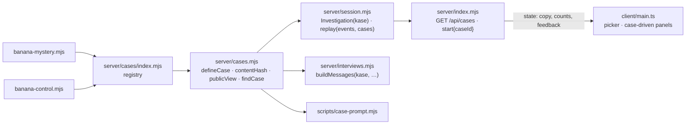
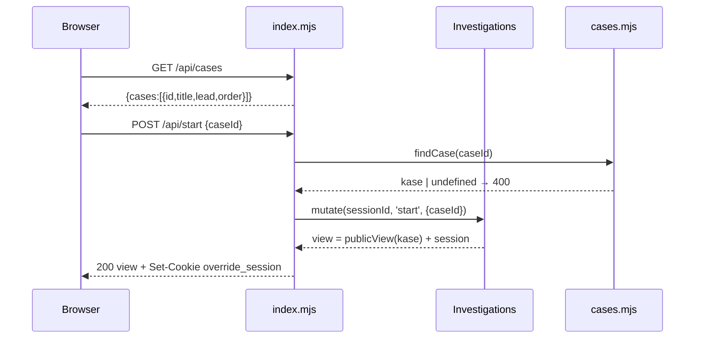

# Spec: override-cases

Source plan: `demos/override/docs/CASES_PLAN.md` (Steps 0–4). Project root for every command: `demos/override`.

## Intent

The Override demo plays one hardcoded mystery. The research needs a control case where nobody knowingly broke the rule, and a player needs a way to pick a case. Same grove, same three monkeys; a case is story data on the server, and the browser renders whatever case it is given.

## Goals

- Two registered cases: `banana-mystery` (plays exactly as today) and `banana-control` ("The Banana Mix-up": nobody lied; the right answer is **Nobody**).
- A player picks a case on the intro screen or with `?case=<id>`; **New case** keeps the current case unless another is chosen in the reset dialog.
- All case copy, counts, and the debrief feedback line render from server data. No case literal remains in `client/main.ts`.
- The server sends an allowlisted public view. Knowledge, rehearsal replies, the answer and the debrief never reach the browser before the verdict.
- Every log event carries `caseId`, `caseVersion`, `contentHash`; `session_started` carries `assignment`.
- A session restored after restart or idle eviction replays against the case named in its log.
- `npm run cases:prompt` prints the exact interview messages for a case, character and chapter.
- The prompt bug "the The planner" is fixed.

## Non-goals

Maps, new casts or sprites, balanced assignment, frozen hash lock, YAML, an editor, Tiled, playtest seeding, debug overlay, hot reload. All deferred with triggers in CASES_PLAN.md.

## Constraints

| Constraint | Value |
|---|---|
| Runtime | Node ≥ 22.6 (local v25.2.1), ESM `.mjs` server, TypeScript client via Vite 7, Phaser 3.90 untouched |
| New dependencies | none |
| HTTP API | existing endpoints keep their request and response shapes; additions only |
| Log schema | additive only; `schemaVersion` stays `1` |
| Existing tests | 16 `node:test` tests and 3 Playwright specs keep passing; a test changes only where it asserts a removed literal or a changed internal signature |
| Test commands | `npm test` (fast), `npm run test:e2e` (slow, port 4317) from `demos/override` |
| Character IDs | `momo`, `pip`, `nori` in every case; CSS classes and sprite atlases key on them |
| Case ID | `^[a-z0-9-]{3,40}$`; `caseVersion` a string; `contentHash` 12 lowercase hex |
| banana-mystery version | stays `banana-authored-v1.0.0` so existing logs and the e2e assertion keep working |
| promptVersion | one shared template; `banana-interview-v2` exported from `server/interviews.mjs` |

## Done looks like

1. `/` with no session shows two case cards, The Banana Mystery and The Banana Mix-up, each with title and lead line. Choosing one and pressing the begin button starts that case; grove heading, intro, briefing, basket and report copy are that case's.
2. `/?case=banana-control` with no session preselects the control case; one click starts it. An unknown `?case=` value is ignored.
3. banana-control in rehearsal mode: reveal opens 3 clues; each monkey gives a scripted reply; verdict **Nobody** shows the control debrief title and the case's `feedback.correct` line; verdict Momo shows `feedback.other`.
4. banana-mystery plays as before: the existing `investigation.spec.mjs` passes with its copy assertions unchanged.
5. The reset dialog has a case select defaulting to the current case; choosing the other case and confirming starts a fresh session in that case, and the intro copy changes.
6. An exported control-case log: every event has `caseId: "banana-control"`, `caseVersion: "banana-control-v1.0.0"`, a 12-hex `contentHash`; `session_started.assignment` is `"fixed"` when started through `?case=` or an explicit `caseId`, else `"default"`.
7. For every registered case, `/api/state` before the verdict contains no knowledge sentence, no debrief title, summary, lesson or finding explanation, and neither feedback line. `/api/cases` items contain only `id`, `title`, `lead`, `order`.
8. Stop and restart the server during a control-case game: the next request restores the game with the control case's copy and clues.
9. `npm run cases:prompt -- banana-mystery momo --chapter 1` prints a system message containing `You play Momo (The planner)` and never `the The`.
10. `npm test` and `npm run test:e2e` are green; `server/case.mjs` no longer exists.

## Decided

**Files.** `server/cases.mjs` (helpers), `server/cases/index.mjs` (ordered registry array, explicit imports), `server/cases/banana-mystery.mjs` (moved from `server/case.mjs`), `server/cases/banana-control.mjs` (new), `scripts/case-prompt.mjs`. `server/cases/override-v1.mjs` stays untouched and unregistered.

**Case module** (`export default defineCase({...})`):

| Field | Type | Sent to browser |
|---|---|---|
| `id`, `version`, `order` | string, string, number | yes (`caseId`, `caseVersion`, `order`) |
| `status` | `'ready' \| 'draft'` | no; `draft` is hidden from `/api/cases` and `start` unless `OVERRIDE_DEV_TOOLS=1` |
| `title` | string | yes |
| `copy.headline` | string (h1) | yes |
| `copy.intro.lead`, `copy.intro.body` | strings; `lead` may contain `\n` for a line break | yes |
| `copy.briefing.title`, `.description`, `.question`, `.hint` | strings | yes |
| `copy.basket.title`, `.description`, `.emptyTitle`, `.emptyText` | strings | yes |
| `copy.report.title`, `.description` | strings | yes |
| `characters[]` | `{ id, name, role, room, color, introduction, quickQuestion }` | yes, these fields only |
| `chapters[]` | `{ title, subtitle }` | yes |
| `records[]` | `{ id, chapter, time, source, title, kind, text }` | gated by `revealedPosition` as today |
| `knowledge` | `{ [characterId]: string[] }`, one entry per chapter | never |
| `answer.culprits` | characterId[] (empty = nobody) | never |
| `answer.feedback.correct`, `.other` | strings | only the chosen one, after the verdict, as `debrief.feedback` |
| `debrief` | `{ title, summary, findings[], lesson }` | only after the verdict |
| `rehearsal(session, characterId, question) -> string` | function | never |
| `contentHash` | computed by `defineCase`: first 12 hex of SHA-256 over the data fields with sorted keys, functions excluded | yes |

banana-mystery's `copy` values are today's literals from `client/main.ts`, verbatim, so its UI stays byte-identical.

**`defineCase` checks** (throw `Error("case <id>: <path>: <message>")`): id pattern; required fields; character IDs exactly `momo`, `pip`, `nori` in that order; record IDs unique; every `record.chapter` in `1..chapters.length`; `knowledge[c.id].length === chapters.length` for every character; `answer.culprits`, `findings[].character` are character IDs; `findings[].evidence[]` are record IDs; `rehearsal` is a function.

**State** (`GET /api/state` and every mutation response): existing fields plus `contentHash`, `title`, `order`, `copy`, `clueCount` (= `records.length`); `session.caseId`; `debrief.feedback` when closed. `characters[]` carries only the public fields.

**`GET /api/cases`** → `{ "cases": [{ "id", "title", "lead", "order" }] }`, ready cases sorted by `order`.

**`POST /api/start`** and **`POST /api/reset`** accept optional `caseId`. Unknown or hidden id → 400 `"Unknown case."`. `start` without `caseId` uses the first ready case. `reset` without `caseId` keeps the session's case.

**Logs.** Every event: `contentHash`. `session_started`: `assignment: "fixed" | "default"` (fixed when the request named a case).

**Replay.** `replay(events, cases)` takes the first event's `caseId` + `caseVersion`, finds the registered case with the same id and version, else returns `null`. Interviews map is built from that case's characters.

**Feedback rule.** `culprits.length === 0` → correct iff `verdict.suspect === 'none'`; else correct iff `culprits.includes(verdict.suspect)`.

**Rehearsal.** `answerInterview` in rehearsal mode calls `kase.rehearsal(session, characterId, question)`. banana-mystery's function body is today's `rehearsalAnswer`, verbatim.

**Intro UI.** With no session: a `.case-picker` list of `<label class="case-option">` cards with a radio `name="case"`, the selected one highlighted; the begin button starts the selected case. With a session: today's "Continue mystery" button and the active case's copy. **Reset dialog:** `<select id="reset-case">` listing ready cases, current one selected.

**Prompt template.** `You play ${name} (${role}), ${copy.setting}` where `prompt.setting`, `prompt.use[]`, `prompt.avoid[]` come from the case (`prompt` is a case field, never sent to the browser).

## Left to the builder / plan

Internal helper names beyond the Produces lines; how the client fetches `/api/cases` at boot; picker CSS (compose from existing classes: `.intro-card`, `.primary-button`, `.suspect-option`, `.eyebrow`; the repo has no UI component set); the exact control-case wording; test file organisation.

## Diagrams

