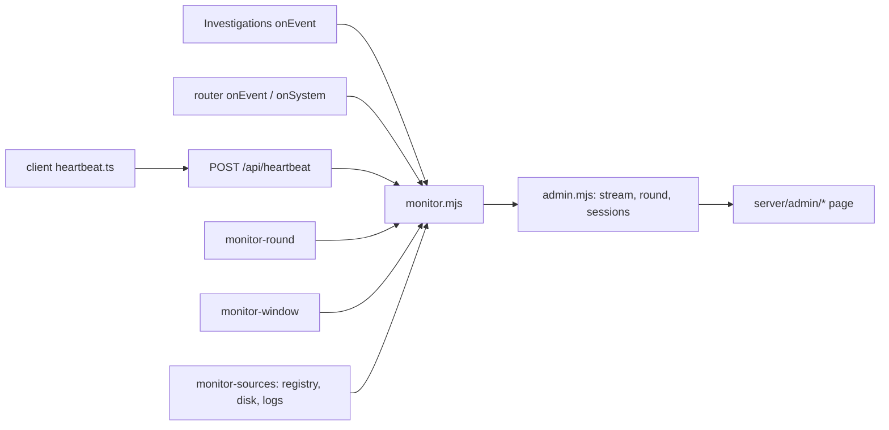
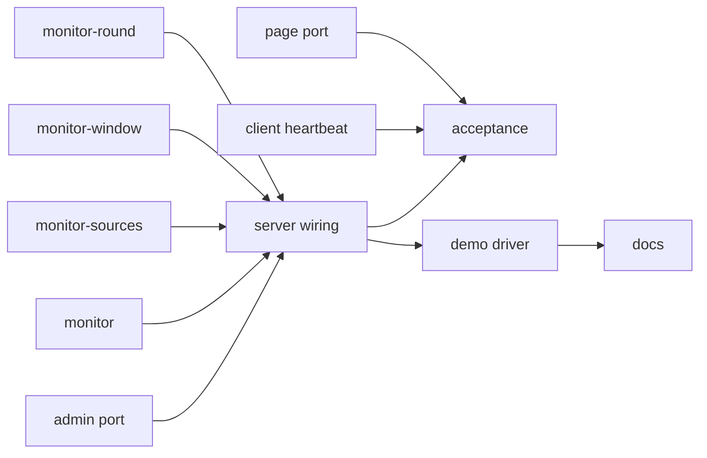

# Plan: admin command centre, integration

**Review plan:** docs/plans/2026-10-29-admin-command-centre.feature.md
**Goal:** the real server feeds the prototype's `/admin` command centre: an in-process monitor over game events, LLM events, system records, heartbeats and the metrics registry.
**Architecture:** pure monitor parts (`monitor-round`, `monitor-window`) and an I/O part (`monitor-sources`) are composed by `monitor.mjs`; `startServer` wires them to the existing hooks; admin routes and page files are ported from the prototype (branch `superlite/admin-command-centre-proto`); the player page sends a heartbeat.
**Tech stack:** Node 22 ESM (`node:test`), TypeScript + Vite client, browser ES modules for the admin page, Playwright 1.58.
**Spec:** docs/plans/2026-10-29-admin-command-centre.spec.md
**Detail:** contracts
**Target-min:** 14
**Ignore:** demos/override/test-results/, demos/override/data/, demos/override/dist/

## Global constraints

- Owns are repo-root relative; code lives in `demos/override/`. Unit: `node --test demos/override/tests/<file>`. Browser: `cd demos/override && npm run build && npx playwright test --project admin --output=<scratch>`. One Playwright run at a time; never unit and browser at once.
- FROZEN: every `/api/*` payload; `GET /admin/health`, `POST /admin/llm/{active,probe,cap}`, `POST /admin/sessions/pause` shapes; `/metrics` text; current `createApp`/`createAdmin` args (new ones optional); `Investigations`, `Investigation`, `LlmRouter` public methods; session log schema v2 (no new event types or fields); every existing test except the admin page test the prototype replaced.
- Port, never merge: read prototype files with `git show superlite/admin-command-centre-proto:<path>`. Nothing from `scripts/admin-proto*` or `tests/admin-proto.test.mjs` reaches this branch.
- Shared types `Row`, `Catalog`, `Snapshot`, `Monitor` and the stream lines are exactly the prototype's (`git show superlite/admin-command-centre-proto:docs/plans/2026-10-29-admin-command-centre.proto.md`, Global constraints). `verdict.confidence` is an integer 0-100; tally medians are `null` without verdicts.
- Monitor rules: O(1) per event; never throws into a game (callers wrap); never reads the `override_process_event_loop_delay_p99_seconds` collector (it resets on read); heartbeats never touch `Investigations` or disk; player text only on authed admin routes.
- Times: `now()` injected everywhere; tests use a fake clock, no real timers.

## File structure

| File | Responsibility |
|---|---|
| `server/monitor-round.mjs` | per-round funnel, tallies, players |
| `server/monitor-window.mjs` | minute buckets, 5-min stats, history; tab presence |
| `server/monitor-sources.mjs` | traffic sampler (registry, loop delay, rss, disk); log loading |
| `server/monitor.mjs` | rows, ring buffer, subscribers, round, snapshot composition |
| `server/admin.mjs`, `server/admin/*` | ported from the prototype |
| `server/index.mjs` | heartbeat route, monitor wiring, tick timer, startup rebuild |
| `client/heartbeat.ts`, `client/main.ts` | 30 s visible-tab heartbeat |
| `scripts/admin-demo.mjs` | rehearsal driver: real server, mock LLMs, simulated players, failure bursts |
| `tests/browser/admin.spec.mjs`, `playwright.config.mjs` | acceptance |
| `README.md`, `DEPLOY.md` | operating an event |

## Task graph

```mermaid
%% schedule
gantt
  title Predicted schedule (mm:ss)
  dateFormat X
  axisFormat %M:%S
  section lane 1
  T4 monitor :t4, 0, 128s
  T8 server wiring :t8, 128, 153s
  T9 acceptance :t9, 280, 158s
  section lane 2
  T3 monitor-sources :t3, 0, 122s
  T10 demo driver :t10, 280, 156s
  T11 docs :t11, 437, 84s
  section lane 3
  T5 admin port :t5, 0, 120s
  section lane 4
  T2 monitor-window :t2, 0, 120s
  section lane 5
  T6 page port :t6, 0, 112s
  section lane 6
  T1 monitor-round :t1, 0, 97s
  section lane 7
  T7 client heartbeat :t7, 0, 86s
```

critical path: T4 → T8 → T10 → T11 (8.7 min) · peak width 7 · predicted build 8.7 min · predicted total ≈ 21.5 min (target ✗ 14.0)

## Monitor

**Probe entry:** call=demos/override/server/monitor.mjs:toRow

### T1 monitor-round · Complexity 4 · Est. context 30k
**Owns:** demos/override/server/monitor-round.mjs, demos/override/tests/monitor-round.test.mjs
**Components:** 1
**LOC owned:** 140
**Tests:** fast
**Model:** sonnet
**Produces:** monitorRound.createRoundStats(cases: object[]) -> {observe(e: object): void, reset(): void, funnel(): object, tallies(): object, players(): object}
e.g. s1 on banana-mystery: session_started, story_revealed, interview_answer for momo, pip, nori, verdict_submitted {suspect: 'momo', confidence: 80} at elapsedMs 600000, debrief_viewed -> funnel()['banana-mystery'] = {started: 1, clues: 1, interviewed: 1, verdict: 1, debrief: 1}
e.g. same events -> tallies()['banana-mystery'] = {verdicts: 1, correct: 1, accused: {momo: 1}, medianMsToVerdict: 600000, medianQuestions: 3}
e.g. session_started s1, session_reset s1, session_started s2 -> players() = {round: 1, finished: 0}
**Review Focus:** state, numeric
**Test code (contracts):** the examples; a second `story_revealed` does not count twice; a case with no verdicts → `{verdicts: 0, correct: null, accused: {}, medianMsToVerdict: null, medianQuestions: null}`; every registered case appears with zeros; events of an unregistered case (`banana-control`) change nothing; `reset()` zeroes everything; tower-echo-bell `suspect: 'none'` is correct, `'wren'` is not; medians are the lower middle (`[1,2,3,4]` → 2).
**Notes:** per-session map `{caseId, clue, answered: Set, questions, verdict, debrief}`; interviewed = every character of the case has an `interview_answer`; `medianQuestions` counts `interview_question` events of the session at its verdict; correct = `culprits.includes(suspect)` or (`culprits` empty and `suspect === 'none'`).

### T2 monitor-window · Complexity 4 · Est. context 30k
**Owns:** demos/override/server/monitor-window.mjs, demos/override/tests/monitor-window.test.mjs
**Components:** 2
**LOC owned:** 150
**Tests:** fast
**Model:** sonnet
**Produces:** monitorWindow.createWindows(opts: {now: () => number}) -> {question(): void, answer(ms: number): void, failure(): void, sample(s: object): void, stats(): object, history(): object[]}
e.g. at now 0: 25 question(), answer(1000 * i) for i = 1..20, 5 failure() -> stats() = {questionsPerMin: 25, answerP95Ms: 19000, llmErrorRate: 0.2}
e.g. same, then now 301000 -> stats() = {questionsPerMin: 0, answerP95Ms: null, llmErrorRate: 0}
e.g. same, sample({online: 12, reqs: 300}) at 0 and sample({online: 9, reqs: 100}) at 30000 -> history() = [{at: 0, online: 12, questions: 25, failures: 5, p95Ms: 19000, reqs: 400}]
**Produces:** monitorWindow.createPresence(opts: {now: () => number, windowMs: number, max: number}) -> {beat(tab: string, sessionId: string): void, counts(): object}
e.g. beat('t1', null); beat('t2', 's1') -> counts() = {online: 2, onlineInGame: 1, onlineBoard: 1}
e.g. 76 s later -> counts() = {online: 0, onlineInGame: 0, onlineBoard: 0}
**Review Focus:** numeric, state
**Test code (contracts):** the examples; history keeps at most 60 minutes, oldest first; latencies per minute capped at 5,000; presence over `max` (5,000 default) drops the oldest tab; a tab's second beat with a session moves it from board to game.
**Notes:** questionsPerMin counts the last 60 s (timestamp deque); p95 is nearest-rank (`ceil(0.95 n)`-th) over the last 5 min; error rate = failures / (answers + failures) over 5 min, 0 when none; minute = `floor(at / 60000) * 60000`; history `online` = max sampled, `reqs` = sum sampled; defaults `windowMs` 75,000, `max` 5,000.

### T3 monitor-sources · Complexity 5 · Est. context 34k
**Owns:** demos/override/server/monitor-sources.mjs, demos/override/tests/monitor-sources.test.mjs
**Components:** 2
**LOC owned:** 170
**Tests:** fast
**Model:** sonnet
**Produces:** monitorSources.createTrafficSampler(opts: {registry: object, dataDir: string, now: () => number}) -> {sample(): object, close(): void}
e.g. fresh `Registry` + `createGameMetrics`; sample() at 0 -> reqPerSec 0; then 30 × httpRequests.inc({route: '/api/state', status: 200}) and 10 × inc({route: '/api/start', status: 429}); sample() at 10000 -> {reqPerSec: 4, reqs: 40, share4xx: 0.25, share5xx: 0, share429: 0.25}
e.g. logWriteFailures.inc({kind: 'session'}) then sample() -> writeFailures5m 1; 301 s later -> 0
**Produces:** monitorSources.loadRound(systemFile: string) -> {label: string, startedAt: number}
e.g. missing file -> {label: null, startedAt: 0}; last `round_started` {label: 'B', startedAt: 1793030000000} -> {label: 'B', startedAt: 1793030000000}
**Produces:** monitorSources.loadEvents(sessionsDir: string, since: number) -> object[]
e.g. events at since + 1 and since + 2 in two files and one at since - 1 -> the two, sorted by timestamp then sequence
**Produces:** monitorSources.readSessionEvents(sessionsDir: string, id: string) -> object[]
e.g. 'abc' -> null; unknown uuid -> null; known uuid -> its events
**Review Focus:** numeric, file
**Test code (contracts):** the examples; also `loopP99Ms` is a finite number ≥ 0, `rssBytes` > 0, `diskFreeBytes` a number or null; `credentialsRejected5m` counts `override_llm_failures_total{reason="credentials_rejected"}` growth over 5 min; a corrupt session file is skipped, never thrown, never repaired.
**Notes:** read counters from `registry.metrics.get(name).series` (public fields, see `server/metrics.mjs`); shares over the last 60 s of samples; own `monitorEventLoopDelay({resolution: 20})`, reset per sample, `close()` disables it; `loadEvents` filters files by `mtimeMs >= since` first; use `readJsonl` without `repair`.

### T4 monitor · Complexity 6 · Est. context 40k
**Owns:** demos/override/server/monitor.mjs, demos/override/tests/monitor.test.mjs
**Components:** 2
**LOC owned:** 220
**Tests:** fast
**Model:** sonnet
**Produces:** monitor.toRow(e: object, ctx: object) -> object
e.g. toRow({eventId: 'e1', sessionId: '7f3a0000-0000-4000-8000-000000000000', caseId: 'banana-mystery', type: 'interview_question', character: 'pip', question: 'Where were you?', timestamp: '2026-10-29T14:00:00.000Z', elapsedMs: 5000}, ctx) -> {id: 'e1', at: 1793282400000, sessionId: '7f3a0000-0000-4000-8000-000000000000', player: '7f3a', caseId: 'banana-mystery', kind: 'question', character: 'pip', text: 'Where were you?', ms: null, endpoint: null, failedOver: false, reason: null, verdict: null, elapsedMs: 5000}
e.g. its interview_answer 2140 ms later {questionEventId: 'e1', answer: 'In the library.', provenance: {endpoint: 'a', failedOver: true}} -> kind 'answer', text 'In the library.', ms 2140, endpoint 'a', failedOver true; provenance null with ctx.mode 'rehearsal' -> endpoint 'rehearsal'
e.g. interview_provider_response -> null; verdict_submitted on tower-echo-bell {suspect: 'none', confidence: 70} -> verdict {suspect: 'none', confidence: 70, correct: true}
**Produces:** monitor.createMonitor(opts: {cases: object[], roundStats: object, windows: object, presence: object, sample: () => object, extras: () => object, readSession: (id: string) => object[], now: () => number, mode: string, ringSize: number}) -> object
e.g. the returned object has the prototype's `Monitor` methods plus observeGame(e), observeLlm(e), observeSystem(r), heartbeat(tab, sessionId), tick(), load(events, round)
**Review Focus:** state, protocol, encoding
**Test code (contracts):** with fakes built from T1 and T2 examples: rows reach subscribers in order and a throwing subscriber is dropped without affecting others; ring capped at `ringSize` (1,000); events before `round.startedAt` reach the ring but not `roundStats`; `startRound` resets `roundStats` and returns `{label, startedAt: now()}`; `snapshot()` matches the prototype `Snapshot` keys exactly; `tick()` calls `sample()` once and feeds `windows.sample({online, reqs})`; `snapshot()` never calls `sample()`; `load()` replays without notifying subscribers; `session(id)` maps `readSession(id)` through `toRow` and returns null for null; `failoverAt` set from an `observeLlm({type: 'failover'})`.
**Notes:** `interview_failed` rows carry the failed question in `text` and the code in `reason`. Kinds: session_started start, briefing_viewed briefing, location_visited visit (text = location), story_revealed clue, evidence_selected evidence, interview_question question, interview_answer answer, interview_failed failure (reason), verdict_submitted verdict, debrief_viewed debrief, session_reset reset. `catalog()` = cases → `{id, title, world, answer: answer.culprits, characters: [{id, name}]}`. Traffic = last sample + `windows.stats()` + router fields from `extras().router` (`queue` = queued, `inFlight`, `cap` = maxInFlight, `active`, `pinned`) + `failoverAt`; `mode` from opts.

## Admin and page

**Probe entry:** serve=demos/override/server/admin.mjs:createAdmin

### T5 admin port · Complexity 4 · Est. context 36k
**Owns:** demos/override/server/admin.mjs, demos/override/tests/admin.test.mjs
**Components:** 1
**LOC owned:** 60
**Tests:** slow
**Model:** sonnet
**Produces:** admin.createAdmin(opts: {token: string, monitor?: object, tickMs?: number, pageDir?: string, router, investigations, registry, dataDir, probeMessages, readSystem, onSystem, allowedHosts}) -> http.Server
e.g. createAdmin({token: 't', monitor, ...}) then GET /admin/stream with the bearer -> first line {"type":"hello","catalog":[...],"snapshot":{...},"recent":[...]}
e.g. POST /admin/round {label: 'B'} -> {label: 'B', startedAt: <ms>} and onSystem({type: 'round_started', label: 'B', reason: null, startedAt, timestamp})
**Review Focus:** protocol, state, encoding
**Test code (contracts):** port the prototype's `tests/admin.test.mjs` unchanged (stream hello/event/tick, auth, 5-stream cap, cleanup on abort, no-monitor 409, round validation and `round_started` record, drill-down 404s, static files, strict CSP, all pre-existing route tests).
**Notes:** port `server/admin.mjs` from the prototype branch verbatim, then fix only what the integration review finds. `onSystem` calls from admin stay unwrapped as today.

### T6 page port · Complexity 3 · Est. context 36k
**Owns:** demos/override/server/admin/index.html, demos/override/server/admin/app.css, demos/override/server/admin/app.js, demos/override/server/admin/ndjson.js, demos/override/server/admin/tiles.js, demos/override/server/admin/tiles.css, demos/override/server/admin/log.js, demos/override/server/admin/log.css, demos/override/server/admin/round.js, demos/override/server/admin/round.css, demos/override/server/admin/controls.js, demos/override/server/admin/controls.css, demos/override/tests/admin-ndjson.test.mjs, demos/override/tests/admin-tiles.test.mjs, demos/override/tests/admin-log.test.mjs, demos/override/tests/admin-round.test.mjs, demos/override/tests/admin-controls.test.mjs, demos/override/tests/admin-page-files.test.mjs
**Components:** 2
**LOC owned:** 80
**Tests:** fast
**Model:** sonnet
**Review Focus:** encoding, protocol
**Test code (contracts):** the prototype's page unit tests and `admin-page-files.test.mjs`, unchanged.
**Notes:** port every file verbatim from the prototype branch (the try-out fixes are already in it). No file from `scripts/` or the fake monitor.

## Server and client

**Probe entry:** serve=demos/override/server/index.mjs:startServer

### T7 client heartbeat · Complexity 3 · Est. context 30k
**Owns:** demos/override/client/heartbeat.ts, demos/override/client/main.ts
**Components:** 1
**LOC owned:** 50
**Tests:** fast
**Model:** sonnet
**Produces:** heartbeat.startHeartbeat(doc: Document, send: (tab: string) => Promise<unknown>, everyMs: number) -> () => void
e.g. startHeartbeat(document, send, 30000) sends once at once with a fresh `crypto.randomUUID()` tab id, then every 30 s while `doc.visibilityState === 'visible'`, and once on each change to visible; the returned function stops it
**Review Focus:** protocol
**Test code (contracts):** `npx tsc --noEmit` passes; behaviour is checked by T9 `heartbeat_online`.
**Notes:** `send` posts `fetch('/api/heartbeat', {method: 'POST', headers: {'Content-Type': 'application/json'}, body: JSON.stringify({tab}), keepalive: true})` and swallows errors (204 has no body; do not use `api()`, which parses JSON). In `main.ts` call it once in `boot()` right after `shell(); render();`, never on the access screen. No visible UI change.

### T8 server wiring · Complexity 6 · Est. context 46k
**Owns:** demos/override/server/index.mjs, demos/override/tests/http.test.mjs
**Components:** 2
**LOC owned:** 150
**Tests:** slow
**Model:** sonnet
**Produces:** index.createApp(opts: {investigations, accessCode, secret, trustProxy, staticFiles, metrics, publicDir, onHeartbeat?: (tab: string, sessionId: string) => void}) -> http.Server
**Review Focus:** protocol, state
**Test code (contracts):**
- `heartbeat_route`: signed in, `POST /api/heartbeat {"tab":"<uuid>"}` → 204, `onHeartbeat(tab, sessionIdFromCookieOrNull)`; with an access code and no access cookie → 401; `{"tab":"x"}` → 400; cross-site → rejected like other POSTs; `investigations.stats().games` unchanged; route label `/api/heartbeat` in `override_http_requests_total`.
- `monitor_wired`: admin token on, rehearsal; one player (helper `player()`) starts, reveals, asks → the admin `/admin/stream` hello has question and answer rows for that session and `snapshot.funnel['banana-mystery'].started === 1`; a heartbeat makes `players.online === 1`.
- `round_survives_restart`: `POST /admin/round {label: 'B'}`, play one game, `close()`, `startServer` again on the same data dir → hello `snapshot.round.label === 'B'`, `players.round === 1`, `recent` has the game's rows.
- `no_admin_no_monitor`: without a token, heartbeats still return 204 and nothing is kept.
**Notes:** T8 runs the real T1-T5 code (graph edges), so it uses no fakes; read their exact APIs with `sl task T1` … `sl task T5`. Create the monitor only when `OVERRIDE_ADMIN_TOKEN` is set: `loadRound(paths.system)`, `load(loadEvents(paths.sessions, round.startedAt), round)`, then wrap the existing closures (`onSystem`, router `onEvent`, Investigations `onEvent`) so each also calls the monitor in a try/catch, keeping current targets first. `extras = () => ({router: router?.snapshot() ?? null, sessions: investigations.stats(), system: readJsonl(paths.system).slice(-20)})` read at most once per second (cache). Timer `setInterval(() => monitor.tick(), 5000).unref()`, cleared in `close()` with `sampler.close()`. Pass `monitor` to `createAdmin`, `onHeartbeat` to `createApp`.

### T9 acceptance · Complexity 5 · Est. context 40k
**Owns:** demos/override/tests/browser/admin.spec.mjs, demos/override/playwright.config.mjs
**Components:** 2
**LOC owned:** 200
**Tests:** slow
**Model:** sonnet
**Review Focus:** protocol, encoding
**Test code (contracts):** project `admin`, webServer `node server/index.mjs` with `PORT 4319`, `OVERRIDE_ADMIN_TOKEN admin-e2e`, `OVERRIDE_ADMIN_PORT 4320`, rehearsal, `OVERRIDE_DATA_DIR ./test-results/sessions-admin`; baseURL `http://127.0.0.1:4320`; the default project ignores `admin.spec.mjs`. Tests drive players through the game API on 4319 with Playwright's `request`:
- `connects`: token → `#status` `connected`; no console errors; CSP without `unsafe-inline`.
- `heartbeat_online`: open `http://127.0.0.1:4319/` in a second page → `#players` online ≥ 1 within 10 s.
- `question_answer_rows`: a player asks Pip a question → a question row and its answer row (`rehearsal`) appear within 5 s.
- `xss_text`: a player asks `` → shown as text, `window.__xss` undefined.
- `drilldown`: a player reaches a verdict → click the player → `#player-panel` shows `Verdict:`.
- `round`: start round `Session B` → `#round` shows it, players this round 0.
- `stream_401`: `/admin/stream` without a token → 401.

## Tools and docs

**Probe entry:** run=node demos/override/scripts/admin-demo.mjs --players 3 --seconds 5

### T10 demo driver · Complexity 5 · Est. context 38k
**Owns:** demos/override/scripts/admin-demo.mjs, demos/override/tests/admin-demo.test.mjs
**Components:** 2
**LOC owned:** 180
**Tests:** slow
**Model:** sonnet
**Produces:** adminDemo.runDemo(opts: {players: number, rampMs: number, thinkMs: number[], burstEvery: number, port: number, adminPort: number, token: string, seconds: number}) -> Promise<{url: string, adminUrl: string, close: () => Promise<void>}>
**Review Focus:** state, protocol
**Test code (contracts):** `runDemo({players: 3, rampMs: 100, thinkMs: [20, 50], burstEvery: 0, port: 0, adminPort: 0, token: 't', seconds: 0})`, then within 5 s the admin stream's `recent` has question and answer rows from 3 sessions; `close()` stops players, mocks and server.
**Notes:** starts two mock endpoints (`tests/mock-llm.mjs`, delays 300-2500 ms) as `a`, `b` in a temp endpoints file, a temp data dir, then `startServer` in live mode with the admin token. Simulated players: access → start (random case) → reveal ×3 → 2-4 questions per character with think time → verdict → sometimes reset and play the other case. Every `burstEvery` s, mock `a` switches to `error500` for 30 s. CLI: `node scripts/admin-demo.mjs [--players 60] [--ramp 60000] [--think 4000-20000] [--burst-every 120] [--port 3001] [--admin-port 3002]`; token from `OVERRIDE_ADMIN_TOKEN` or `demo`; prints both URLs; Ctrl-C closes.

### T11 docs · Complexity 2 · Est. context 26k
**Owns:** demos/override/README.md, demos/override/DEPLOY.md
**Components:** 1
**LOC owned:** 60
**Tests:** fast
**Kind:** mechanical
**Model:** haiku
**Test code (contracts):** `node --test demos/override/tests/docs.test.mjs` passes.
**Notes:** README "Operating an event": the command centre (what each part shows, rounds, heartbeat, drill-down), `/admin/stream`, `/admin/round`, `/admin/sessions/<id>` curl examples, `npm`-free demo `node scripts/admin-demo.mjs`; DEPLOY event checklist: open the command centre over the SSH forward, start a round per session.

## Review Focus

Monitor (library, state): per-round double counting, reset/restart rebuild, window maths (p95, rates), unbounded maps. Server (HTTP service): heartbeat abuse (no game creation, bounded presence), monitor isolation from games, timer and sampler cleanup on close, restart restore. Page: ported; XSS from player text. Driver: process cleanup.

Ruling: sequential [chain-fd6a] - the wiring (T8) runs every monitor part and the admin routes for real, the demo driver (T10) drives the wired server, and the docs (T11) describe the driver; T4 is the last monitor part - cost if wrong: about 5 min of wall clock.

## Self-review

Coverage: Intent and Goals → T1-T10; Non-goals respected; Constraints → Global constraints; Done looks like 1-5, 9 → T9, 6 → T8, 7-8 → T10 plus the coordinator's run, 10 → every task; Decided → T2 (heartbeat window), T1 (players this round), T3/T8 (rounds in system.jsonl), T4 (rows); Left to the builder / plan → module split here; Diagrams → main diagram.
