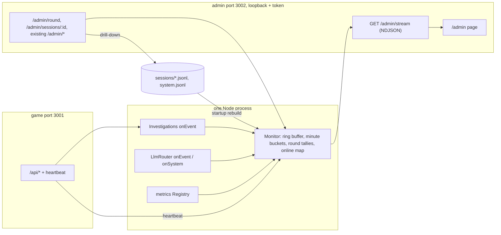

# Spec: admin-command-centre

## Intent

During a game event (up to ~200 players on one Mac), the operator needs one screen that answers four questions at a glance: how many players are here, is the server and the LLM coping, what are players asking and getting back, and how far they are. Today `/admin` (127.0.0.1:3002) shows a one-second snapshot of the router, in-memory game counts and the last 20 system records as raw JSON. It has no history, no player count beyond games in memory, and no view of the conversation. The command centre adds those inside the existing admin listener, with no new service: everything it needs already passes through the one server process. Prometheus/Grafana stay optional.

## Goals

- **Players**: *online now* (browser tabs with the game open and visible, heartbeat in the last 75 s, split into in a game / on the case board), *playing* (games in memory, as today), *players this round* (games started minus resets since the round began), *finished this round* (verdicts).
- **Traffic tiles** with green/amber/red state: HTTP req/s (and 4xx/5xx/429 share), questions per minute, LLM answer p95 latency, LLM error rate, queue depth, in-flight vs cap, active endpoint (pinned or not), event-loop delay p99, resident memory, disk free, log-write failures.
- **History**: per-minute buckets for the last 60 minutes, drawn as sparklines under the tiles (online players, questions, failures, p95 latency, req/s).
- **Message log**: a live, newest-first feed of interview questions, answers and failures, plus the other game events behind a filter. Each row: time, short player id, case, character, direction, text, and for answers the latency, endpoint and whether it failed over. Filters: case, character, kind, free text, one player. A follow/freeze toggle.
- **Player drill-down**: clicking a player opens that game's whole timeline read from its session log on disk: start, clues, every question and answer, verdict, debrief, with elapsed times.
- **Funnel per case**: started → first clue → interviewed every character → verdict → debrief, counted for the current round.
- **Round tallies per case**: accused suspect distribution (including Nobody), share correct, median time to verdict, median questions per game.
- **Rounds**: an operator action "Start round" with a label. Counts scope to the current round. The round survives a restart.
- **Existing controls kept**: endpoint table with Move + pin, Unpin, Probe, Cap; global cap; Pause/Resume new games; recent system records (rendered readably, not as raw JSON).
- **Live updates** over one authenticated stream instead of one-second polling.

## Non-goals

- Projector page (`/admin/show`), broadcast banner to players, "close round". Later work.
- Grafana, Prometheus or Loki setup or changes; `/metrics` output stays as it is.
- Viewing raw LLM traces (`traces/*.jsonl`) in the page.
- Editing, deleting or replaying player sessions; kicking players.
- Alerts outside the open page (phone, email, sound beyond the tab).
- More than one server instance.
- Any change to the player-facing game UI beyond the invisible heartbeat.

## Constraints

| Item | Rule |
|---|---|
| Listener | Admin stays on `127.0.0.1:$OVERRIDE_ADMIN_PORT` only, bearer token, DNS-rebinding host guard. Same rules for every new route, including the stream. |
| Player text | Shown only on authenticated admin routes. Never in metrics labels, never on the game port, never in `system.jsonl`. Rendered with `textContent` only: a question like `` shows as text. |
| CSP | Stricter than today: `default-src 'none'; script-src 'self'; style-src 'self'; connect-src 'self'; base-uri 'none'; form-action 'none'; frame-ancestors 'none'` (no `'unsafe-inline'`). No CDN, fonts or libraries from the network (a closed LAN has no internet). Charts are hand-drawn SVG. No inline `style` attributes or inline scripts; dynamic sizes go through CSSOM (`el.style.x = …`) or SVG attributes. |
| Research logs | Session JSONL schema v2 unchanged: no new event types, no new fields. Heartbeats are not written to session logs. |
| Frozen interfaces | `/api/*` payload shapes; `GET /admin/health`, `POST /admin/llm/active`, `/admin/llm/probe`, `/admin/llm/cap`, `/admin/sessions/pause` request and response shapes; `/metrics` text; `Investigations`, `Investigation`, `LlmRouter` public methods; `createApp` and `createAdmin` keep working with their current arguments (new arguments optional). |
| Isolation | A monitor failure never breaks a game: observers are wrapped, as `onEvent` is today. |
| Cost | Per game event O(1) work. Per stream tick O(games in memory). Heartbeat does no disk I/O and no JSONL replay. Startup rebuild reads only session logs touched since the round began. |
| Stream | `fetch` + NDJSON with the bearer header (EventSource cannot send it). A slow or dead admin client is dropped, never buffered without bound. At most 5 concurrent streams. |
| Heartbeat | `POST /api/heartbeat {tab}` every 30 s while the tab is visible, plus once on becoming visible. `tab` is a random UUID made per page load; the session comes from the existing cookie (may be absent before Start). Behind the same access gate as other `/api/*` routes, labelled `/api/heartbeat` in metrics. It never trips the login, new-game or question limiters, never calls `Investigations.find/view` (no replay), never creates a game. The tab map is bounded (5,000) and swept. |
| Event-loop delay | The monitor keeps its own `monitorEventLoopDelay`; it never reads the `override_process_event_loop_delay_p99_seconds` collector, which resets on read. |

## Done looks like

1. With `OVERRIDE_ADMIN_TOKEN` set, `http://127.0.0.1:3002/admin` asks for the token, then shows "connected", the player counts, the tiles and the message log, with no console errors.
2. Two browsers playing: *online now* shows 2 within 35 s; closing one tab drops it to 1 within 80 s; *playing* and *total this round* match the games started.
3. A question asked in the game appears in the message log within 2 s, followed by its answer with latency and endpoint (or `rehearsal`). A failed answer shows as a red row with its reason.
4. Filtering by case, character, kind, text and player narrows the log; clicking a player opens their full timeline, including the verdict.
5. Submitting a verdict moves that game to *verdict* in its case's funnel and updates the round tally (accused distribution, share correct, medians).
6. "Start round" with a label resets round counts to 0 and shows the label; the action is recorded in `system.jsonl` with its reason. After a server restart, the round, its counts and the recent message log are back.
7. In live mode against mock endpoints with injected failures, the error-rate tile turns amber then red, failed rows appear, and the endpoint table shows the failures. Move + pin, Probe, Cap and Pause still work from the page.
8. With 200 load-test players and the page open, the page stays responsive and no heartbeat gets a 429 or creates a game.
9. `/admin/stream` and every new route: no token → 401, foreign `Host` → 403. A question containing HTML renders as text.
10. Every existing unit test and Playwright spec passes; the existing admin routes return the same shapes.

## Decided

- No Grafana/Prometheus dependency; the command centre lives in the admin listener.
- Heartbeat interval 30 s; *online now* window 75 s; keyed by tab, not by session.
- *Players this round* = `session_started` − `session_reset` events in the round (a reset logs `session_reset` on the old game, then `session_started` on the new one). It survives a restart because both come from the logs.
- Character names come from the registered cases; events from unregistered (archived) cases fall back to the character id.
- Rounds are recorded as system records in `system.jsonl` (type `round_started`, with label, reason, timestamp). With no such record, the round is everything in the current data directory (one `OVERRIDE_ENV` per event).
- Per-player drill-down reads the session log from disk, so it works for games evicted from memory.
- Ring buffer of recent game events in memory (order of 1,000), refilled from logs at startup.
- Tile thresholds (one table in code, so they can be tuned):

| Tile | Amber | Red |
|---|---|---|
| LLM error rate, 5 min | > 5 % | > 20 % |
| Queue depth | > 10 | > 50 |
| Answer p95, 5 min | > 8 s | > 20 s |
| Event-loop delay p99 | > 100 ms | > 500 ms |
| Disk free | < 5 GB | < 1 GB |
| Log-write failures, 5 min | — | > 0 |
| Automatic failover | within 5 min | — |
| Credentials rejected, 5 min | — | > 0 |

- When any tile is red, the tab title is prefixed with a marker.
- The page moves out of the inline `PAGE` string into `server/admin/` (HTML, JS, CSS), loaded into memory at startup and served by the admin listener without a token (they hold no data), like `GET /admin` today. `tests/admin.test.mjs` page assertions move to the served files and keep their strength (no `innerHTML`/`outerHTML`/`insertAdjacentHTML`/`document.write`/`eval`, `textContent` used, no external `src`/`href`, identical bytes per request).

## Left to the builder / plan

- Module layout (e.g. `server/monitor.mjs`), the exact stream message shapes, and the route names for the heartbeat, round and drill-down.
- Page layout, colours and sparkline drawing, within the CSP and no-CDN rules.
- How the prototype fakes data (L1 stubs behind the planned stream contract).

## Diagrams

