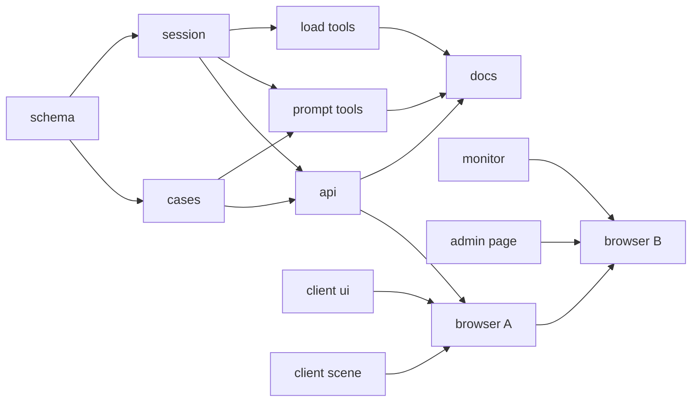
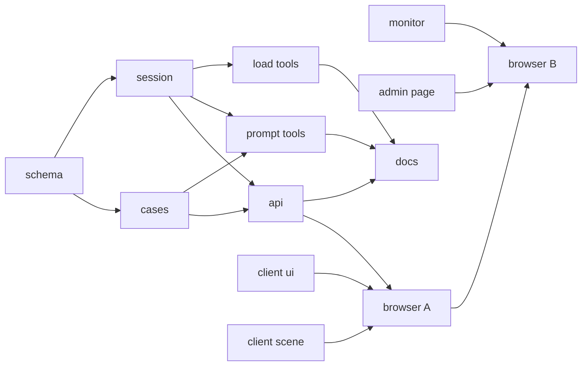

# Plan: agent roles, per-session cast, 3–5 agents

**Review plan:** docs/plans/2026-10-29-agent-roles.feature.md
**Goal:** a scored role pick per character; a random cast per session; 3–5 agents per world.
**Architecture:** part cases; the session draws, logs and hides a cast and scores role verdicts; the rest follows.
**Tech stack:** Node 22 ESM (`node:test`), TypeScript + Vite + Phaser client, Playwright 1.58.
**Spec:** docs/plans/2026-10-29-agent-roles.spec.md
**Detail:** contracts
**Target-min:** 20
**Ignore:** demos/override/test-results/, demos/override/data/, demos/override/dist/

## Global constraints

- Owns are repo-root relative; code in `demos/override/`. Unit: `node --test demos/override/tests/<file>` from the repo root. Browser: `cd demos/override && npm run build && npx playwright test <spec> --output=<scratch>`; one Playwright run at a time (check `pgrep -fl "playwright test"` and `lsof -i :4317-4320` first); never unit and browser suites at once.
- Port from `PROTO=/Users/williambrach/Developer/AgentVerse/.superlite/worktrees/agent-roles/.superlite/sandboxes/agent-roles-proto` (same paths); never copy `?pad=5`, `playwright.proto.config.mjs` or `tests/proto-*`. Strings: `docs/plans/2026-10-29-agent-roles.content.md`.
- Retarget, never weaken. Archived cases and their tests (`banana-control.test.mjs`, `tower-cases.test.mjs`) stay unchanged and pass.
- Shared contract (spec Constraints is authoritative):
  - `ROLES` villain, collaborator, fooled, honest (content doc). `worlds.grove.agents = 4`, `worlds.tower.agents = 3`, integer 3–5.
  - Part case: `characters [{id,name,color}]`, `parts [{id, role, label, introduction, quickQuestion, knowledge[], finding}]`, `debrief {title, summary, lesson}`, `answer.feedback {correct, other}`, `rehearsal(partId, question)`; `{partId}` placeholders. No `parts` = legacy, validated as today, `legacy: true`; `new Investigations({cases})` throws on legacy.
  - Cast `{[characterId]: partId}`; persona order everywhere; `session.cast` server-side only. A view with no session uses `identityCast`.
  - View `{...publicView(kase, cast), roles: ROLES, authored, mode, model, session, debrief}`. Verdict body `{sessionId, revision, roles, confidence, explanation?}`; logged verdict `{roles, truth, results, score, total, confidence, explanation, evidenceIds: [], submittedAt}`; bad roles → 400 `Pick a role for each monkey.` (world singular). Debrief per spec.
  - Log `schemaVersion` 3, `session_started.cast`; replay needs v3 + bijective cast. `GET /api/events` → `cast: null` while active. `interview-v4`; `banana-authored-v3.0.0`, `tower-echo-bell-v3.0.0`. Admin shapes: spec "Admin".
- Spec coverage: Intent and Goals (T1–T13), Constraints (contract above), Done looks like 1–11 (T11/T12, T3/T6, T13), Decided (T2, T9, T10), Left to the builder / plan (T10 slots, T7 labels), Diagrams (main diagram).
- Ruling: sequential edge T1 → T3 - T3's tests run T1's fixture and `defineCase` - cost if wrong: T3 starts ~2 min later.

## File structure

Owns lists are the file sets. New: `server/roles.mjs` (role list), `client/recolor.ts` (hue shift + recoloured sheets), `client/roles.css` (picker styles), `tests/recolor.test.mjs`, `tests/browser/cast.mjs`, `tests/browser/roles.spec.mjs`.

## Task graph

```mermaid
%% schedule
gantt
  title Predicted schedule (mm:ss)
  dateFormat X
  axisFormat %M:%S
  section lane 1
  T9 client game UI :t9, 0, 161s
  T8 demo driver and load test :t8, 267, 142s
  T13 docs :t13, 409, 88s
  T12 browser specs B and baseline :t12, 549, 149s
  section lane 2
  T10 client scene and recolour :t10, 0, 151s
  T4 API and http :t4, 267, 121s
  T11 browser specs A :t11, 388, 161s
  section lane 3
  T1 roles  worlds and case schema :t1, 0, 130s
  T3 session and prompt core :t3, 130, 136s
  T5 prompt tools :t5, 267, 120s
  section lane 4
  T6 monitor :t6, 0, 120s
  T2 live cases v3 :t2, 130, 126s
  section lane 5
  T7 admin page :t7, 0, 115s
```

critical path: T1 → T3 → T4 → T11 → T12 (11.6 min) · peak width 5 · predicted build 11.6 min · predicted total ≈ 23.7 min (target ✗ 20.0)

## Server

**Probe entry:** call=demos/override/server/cases.mjs:defineCase

### T1 roles, worlds and case schema · Complexity 5 · Est. context 40k
**Owns:** demos/override/server/roles.mjs, demos/override/server/worlds.mjs, demos/override/server/cases.mjs, demos/override/tests/cases.test.mjs, demos/override/tests/worlds.test.mjs, demos/override/tests/fixtures/minimal-case.mjs, demos/override/tests/fixtures.test.mjs
**Components:** 2
**LOC owned:** 240
**Tests:** fast
**Model:** sonnet
**Produces:** cases.defineCase(data: object, opts?: {worlds?: object}) -> Case
**Produces:** cases.resolve(kase: Case, cast: Record<string, string>, text: string) -> string
**Produces:** cases.castCharacters(kase: Case, cast: Record<string, string>) -> Character[]
**Produces:** cases.partOf(kase: Case, cast: Record<string, string>, characterId: string) -> Part
**Produces:** cases.publicView(kase: Case, cast: Record<string, string>) -> object
**Produces:** cases.identityCast(kase: Case) -> Record<string, string>
e.g. identityCast(fixture) -> {momo:'boss', pip:'helper', nori:'bystander'}
e.g. resolve(fixture, {momo:'helper', pip:'boss', nori:'bystander'}, '{boss} asked {helper}') -> 'Pip asked Momo'
e.g. partOf(fixture, {momo:'helper', pip:'boss', nori:'bystander'}, 'pip').role -> 'villain'
**Review Focus:** state, encoding
**Test code (contracts):** fixture = part case on an injected 3-agent world (momo/pip/nori; `boss` villain, `helper` fooled, `bystander` honest; `SECRET` markers in knowledge/findings) plus `fiveCase()` on `agents: 5`; tests `count_matches_world`, `unknown_placeholder_throws`, `agents_range` (2, 6 throw), `legacy_still_validates` (banana-control loads, `legacy`, hash pin kept), `public_view_shape` (today's keys; no part/role ids or `SECRET`; ids/names/colors/rooms identical across casts), the e.g. lines, `five_agents_define`.

### T2 live cases v3 · Complexity 4 · Est. context 36k
**Owns:** demos/override/server/cases/banana-mystery.mjs, demos/override/server/cases/tower-echo-bell.mjs, demos/override/server/cases/index.mjs, demos/override/tests/case-set.test.mjs, demos/override/tests/tower-echo.test.mjs
**Components:** 2
**LOC owned:** 200
**Tests:** fast
**Model:** sonnet
**Review Focus:** encoding, state
**Test code (contracts):** `registry` (banana then tower; no legacy; both worlds; one case with a villain part, one with none; archived ids rejected at start); `banana_v3` and `tower_v3` (versions, casts, part roles per content doc, new `contentHash` pins; tower public copy never names the echo shell, its debrief does); `rehearsal_tables` (every row of both tables, as templates).

### T3 session and prompt core · Complexity 7 · Est. context 52k
**Owns:** demos/override/server/session.mjs, demos/override/server/interviews.mjs, demos/override/tests/session.test.mjs
**Components:** 2
**LOC owned:** 290
**Tests:** fast
**Model:** sonnet
**Consumes:** cases.partOf(kase: Case, cast: Record<string, string>, characterId: string) -> Part (T1) · cases.resolve(kase: Case, cast: Record<string, string>, text: string) -> string (T1)
**Produces:** session.shuffleIds(ids: string[]) -> string[]
**Review Focus:** state, protocol
**Test code (contracts):** retarget to the T1 fixture with the `shuffle` option; add `cast_logged_and_hidden`, `reset_and_case_switch_reshuffle`, `replay_keeps_cast`, `replay_rejects_v2_and_bad_cast`, `verdict_scoring` (all right, one wrong; truth/results logged), `verdict_errors` (missing/extra/unknown role; `suspect` alone → 400), `export_redacts_until_verdict`, `legacy_case_throws`, `prompt_resolved` (part label + resolved knowledge, no `{`), `rehearsal_resolved`, `shuffle_uniform` (4000 draws ≥ 800 per id per index); extend the leak test to part/role ids.

### T4 API and http · Complexity 3 · Est. context 30k
**Owns:** demos/override/server/index.mjs, demos/override/tests/http.test.mjs
**Components:** 1
**LOC owned:** 70
**Tests:** slow
**Model:** sonnet
**Review Focus:** protocol
**Test code (contracts):** `verdict_roles_http` (200, debrief score), `suspect_rejected_http` (400), `export_cast_null_then_present`, `probe_messages_resolved` (probe uses `castCharacters(kase, identityCast(kase))[0].quickQuestion`; no `{`); existing assertions stay.

### T5 prompt tools · Complexity 4 · Est. context 36k
**Owns:** demos/override/scripts/case-prompt.mjs, demos/override/scripts/preflight.mjs, demos/override/tests/interviews.test.mjs, demos/override/tests/case-prompt.test.mjs, demos/override/tests/preflight.test.mjs
**Components:** 2
**LOC owned:** 150
**Tests:** fast
**Model:** sonnet
**Review Focus:** encoding
**Test code (contracts):** `case-prompt <case> <character> [--part <partId>] [--question]` (identity cast default; unknown part → exit 1); `interviews.test` on the v3 banana prompt (names resolved, `interview-v4`); preflight rows per banana character, identity cast, flags `planner_no_admission`, `carrier_knows_motive`, `lookout_no_admission`, `minder_heard_bell`.

### T6 monitor · Complexity 4 · Est. context 34k
**Owns:** demos/override/server/monitor.mjs, demos/override/server/monitor-round.mjs, demos/override/tests/monitor.test.mjs, demos/override/tests/monitor-round.test.mjs, demos/override/tests/admin.test.mjs
**Components:** 2
**LOC owned:** 150
**Tests:** fast
**Model:** sonnet
**Review Focus:** numeric, state
**Test code (contracts):** catalog has no `answer`; `toRow` verdict `{score:3, total:4, confidence:70}`; two fake v3 verdicts → `{verdicts:2, perfect:1, rolesRight:7, rolesTotal:8, byRole:{villain:{right:2,total:2}, collaborator:{right:1,total:2}, fooled:{right:2,total:2}, honest:{right:2,total:2}}}`; first verdict only; a v2 verdict counts in the funnel, not tallies.

### T7 admin page · Complexity 3 · Est. context 30k
**Owns:** demos/override/server/admin/round.js, demos/override/server/admin/log.js, demos/override/tests/admin-round.test.mjs, demos/override/tests/admin-log.test.mjs
**Components:** 2
**LOC owned:** 110
**Tests:** fast
**Model:** sonnet
**Review Focus:** encoding, numeric
**Test code (contracts):** heading `2 verdicts · 88 % roles right · 1 perfect` from the T6 example; one bar per role with `total > 0` (ROLES label, right/total); log `3/4 roles · 70 %`; panel `Verdict: 3 of 4 roles right · 70 %`; v2 row `Verdict (old format)`.

### T8 demo driver and load test · Complexity 3 · Est. context 30k
**Owns:** demos/override/scripts/admin-demo.mjs, demos/override/tests/loadtest.mjs
**Components:** 2
**LOC owned:** 60
**Tests:** slow
**Model:** sonnet
**Review Focus:** protocol
**Test code (contracts):** both post `roles` (random role per `view.characters` id); loadtest pass rule unchanged; `node --test demos/override/tests/admin-demo.test.mjs` and `npm run loadtest -- --players 10 --scenario steady` green.

## Client

### T9 client game UI · Complexity 5 · Est. context 44k
**Owns:** demos/override/client/main.ts, demos/override/client/types.ts, demos/override/client/roles.css, demos/override/client/style.css, demos/override/client/fit.css
**Components:** 2
**LOC owned:** 220
**Tests:** slow
**Model:** sonnet
**Review Focus:** encoding, protocol
**Test code (contracts):** checked by T11; `npx tsc --noEmit` clean; port the prototype files as tried out.

### T10 client scene and recolour · Complexity 5 · Est. context 46k
**Owns:** demos/override/client/station.ts, demos/override/client/worlds.ts, demos/override/client/monkey-idle.ts, demos/override/client/recolor.ts, demos/override/client/placeholder-art.ts, demos/override/client/banana.css, demos/override/client/tower.css, demos/override/client/case-board.css, demos/override/tests/recolor.test.mjs, demos/override/tests/sprite-specs.test.mjs, demos/override/tests/placeholder-art.test.mjs
**Components:** 3
**LOC owned:** 230
**Tests:** fast
**Model:** sonnet
**Review Focus:** numeric, state
**Test code (contracts):** `recolor.test.mjs` from `proto-recolor.test.mjs` (hue + saturation/lightness ratio, outline kept, slots 3–4 = (84,212), (404,212)); `sprite-specs`/`placeholder-art` cover 5 idle entries; `case_board_faces_per_world` (index ≥ 3 faces of another world's cast use that world's sheet); stop title `Pick the roles`; no `?pad`.

## Browser and docs

### T11 browser specs A · Complexity 5 · Est. context 44k
**Owns:** demos/override/tests/browser/cast.mjs, demos/override/tests/browser/roles.spec.mjs, demos/override/tests/browser/investigation.spec.mjs, demos/override/tests/browser/cases.spec.mjs, demos/override/tests/browser/provenance.spec.mjs
**Components:** 2
**LOC owned:** 220
**Tests:** slow
**Model:** sonnet
**Review Focus:** protocol
**Test code (contracts):** `cast.mjs` reads `test-results/sessions/live/sessions/<id>.jsonl`; `nav_labels_follow_cast` (nav, report rows and interview heading show the held part's label, also after reset); `roles.spec` = the prototype acceptance spec on the default project; investigation/cases/provenance retargeted (4 monkeys, role picker, perfect via `castOf`, tower all `fooled` → 3/3, no leak before verdict, export cast null then present).

### T12 browser specs B and baseline · Complexity 4 · Est. context 40k
**Owns:** demos/override/tests/browser/tower.spec.mjs, demos/override/tests/browser/walking.spec.mjs, demos/override/tests/browser/admin.spec.mjs, demos/override/tests/browser/grove-look.spec.mjs-snapshots/grove-darwin.png
**Components:** 2
**LOC owned:** 120
**Tests:** slow
**Model:** sonnet
**Review Focus:** protocol
**Test code (contracts):** tower ids/labels/aria in persona order; walking adds Kiki's stop; admin posts roles and reads "roles" in the log row; grove baseline regenerated on purpose (`--update-snapshots` for that spec only), then a clean rerun passes.

### T13 docs · Complexity 2 · Est. context 26k
**Owns:** demos/override/README.md, demos/override/docs/CASES_PLAN.md
**Components:** 1
**LOC owned:** 70
**Tests:** fast
**Model:** sonnet
**Review Focus:** encoding
**Test code (contracts):** README Play / Writing a case / Research records cover roles, parts, `{partId}`, `agents`, the shuffle, export redaction, schema v3, `--part`; CASES_PLAN lists story variants as deferred; `node --test demos/override/tests/docs.test.mjs` passes.
