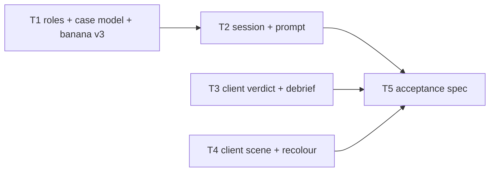
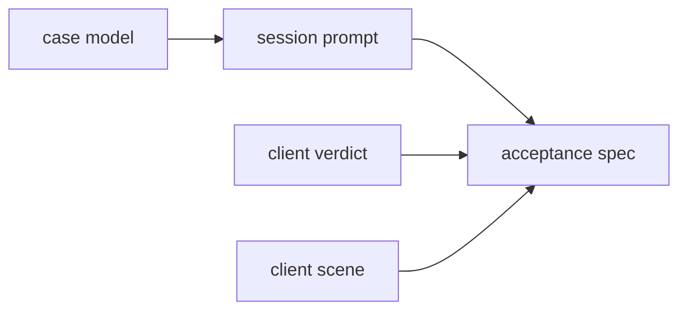

# Plan: agent-roles prototype

**Review plan:** docs/plans/2026-10-29-agent-roles.feature.md
**Goal:** a runnable sandbox of the Override game where the grove has 4 monkeys dealt into 4 story parts at random per session, the verdict picks a role per monkey and the debrief scores each one.
**Architecture:** part cases + per-session cast on the server (roles, case model, session, prompt), a role picker and scored debrief in the client, a scene with up to 5 stations and recoloured art for characters past the sheet's 3 columns; one Playwright acceptance spec on its own port.
**Tech stack:** Node 22 ESM (`node:test`), TypeScript + Vite + Phaser client, Playwright 1.58.
**Spec:** docs/plans/2026-10-29-agent-roles.spec.md
**Detail:** contracts
**Target-min:** 10
**Ignore:** demos/override/test-results/, demos/override/data/, demos/override/dist/

## Global constraints

- This is a prototype sandbox (L1). Owns are repo-root relative; code lives in `demos/override/`. Ported later, never merged: write clean code, but stubs listed here stay behind.
- Spec (`docs/plans/2026-10-29-agent-roles.spec.md`, Constraints table) is the contract for shapes; exact case strings are in `docs/plans/2026-10-29-agent-roles.content.md`. Copy strings exactly.
- Stubs in this sandbox: the registry (`server/cases/index.mjs`) holds only `banana-mystery` v3; `tower-echo-bell` is unregistered; no legacy-case rejection, no export redaction, no admin/tool/doc changes; `?pad=5` is a client-only layout stub.
- Unit tests: only new files `demos/override/tests/proto-*.test.mjs`, run with `node --test demos/override/tests/proto-<name>.test.mjs` from the sandbox root. Existing tests may fail in the sandbox; do not edit them.
- Shared contract:
  - Roles (`server/roles.mjs`): `ROLES = [{id:'villain',label:'Villain',hint}, {id:'collaborator',label:'Collaborator',hint}, {id:'fooled',label:'Honest but fooled',hint}, {id:'honest',label:'Honest',hint}]` (hints in the content doc).
  - `worlds.grove.agents = 4`, `worlds.tower.agents = 3`.
  - Cast = `{[characterId]: partId}`, a bijection. Characters keep persona order everywhere.
  - View (`/api/state`): `{...publicView(kase, cast), roles: ROLES, authored, mode, model, session, debrief}`; `session` never contains `cast`.
  - Verdict body: `{sessionId, revision, roles: {[characterId]: roleId}, confidence, explanation?}`.
  - Debrief: `{title, summary, lesson, feedback, score, total, findings: [{character, role, picked, correct, classification, explanation}]}`.
  - `session_started` logs `cast`; `schemaVersion` 3; `promptVersion` `interview-v4`.
- Spec coverage: Intent and Goals (T1–T5, grove only), Constraints (shared contract above), Done looks like items 1, 3–5, 8 (T5 acceptance spec), Decided (T1 content, T3 picker pattern), Left to the builder / plan (T4 slot points and recolour), Diagrams (main diagram below). Tower, legacy rejection, export redaction, admin, tools and docs are integration-only.
- Browser: `cd demos/override && npm run build && npx playwright test -c playwright.proto.config.mjs --output=<scratch dir>`; port 4417 only; check `pgrep -fl "playwright test"` first; never unit and browser suites at once.

## File structure

| Task | Files (under `demos/override/`) |
|---|---|
| T1 | `server/roles.mjs` (new), `server/worlds.mjs`, `server/cases.mjs`, `server/cases/banana-mystery.mjs`, `server/cases/index.mjs`, `tests/proto-cases.test.mjs` (new) |
| T2 | `server/session.mjs`, `server/interviews.mjs`, `tests/proto-session.test.mjs` (new) |
| T3 | `client/main.ts`, `client/types.ts`, `client/roles.css` (new), `client/style.css`, `client/fit.css` |
| T4 | `client/station.ts`, `client/worlds.ts`, `client/monkey-idle.ts`, `client/recolor.ts` (new), `client/placeholder-art.ts`, `client/banana.css`, `client/tower.css`, `client/case-board.css`, `tests/proto-recolor.test.mjs` (new) |
| T5 | `playwright.proto.config.mjs` (new), `tests/browser/roles.spec.mjs` (new) |

## Task graph

```mermaid
%% schedule
gantt
  title Predicted schedule (mm:ss)
  dateFormat X
  axisFormat %M:%S
  section lane 1
  T3 client verdict and debrief :t3, 0, 158s
  T5 acceptance spec :t5, 255, 131s
  section lane 2
  T4 client scene and recolour :t4, 0, 151s
  section lane 3
  T1 roles  case model and banana v3 :t1, 0, 133s
  T2 session and prompt :t2, 133, 122s
```

critical path: T1 → T2 → T5 (6.4 min) · peak width 3 · predicted build 6.4 min · predicted total ≈ 19.8 min (target ✗ 10.0)

## Server

**Probe entry:** call=demos/override/server/cases.mjs:defineCase

### T1 roles, case model and banana v3 · Complexity 5 · Est. context 40k
**Owns:** demos/override/server/roles.mjs, demos/override/server/worlds.mjs, demos/override/server/cases.mjs, demos/override/server/cases/banana-mystery.mjs, demos/override/server/cases/index.mjs, demos/override/tests/proto-cases.test.mjs
**Components:** 2
**LOC owned:** 260
**Tests:** fast
**Model:** sonnet
**Produces:** roles.ROLES -> Array<{id: string, label: string, hint: string}>
**Produces:** cases.defineCase(data: object, opts?: {worlds?: object}) -> Case
**Produces:** cases.resolve(kase: Case, cast: Record<string, string>, text: string) -> string
**Produces:** cases.castCharacters(kase: Case, cast: Record<string, string>) -> Character[]
**Produces:** cases.partOf(kase: Case, cast: Record<string, string>, characterId: string) -> Part
**Produces:** cases.publicView(kase: Case, cast: Record<string, string>) -> object
e.g. resolve(banana, {momo:'carrier', pip:'planner', nori:'lookout', kiki:'minder'}, 'I told {carrier} to bring') -> 'I told Momo to bring'
e.g. castCharacters(banana, {momo:'carrier', pip:'planner', nori:'lookout', kiki:'minder'})[1] -> {id:'pip', name:'Pip', role:'The planner', room:'02', color:'#5c9ca4', introduction:'I told Momo to bring the bananas over. We were hungry!', quickQuestion:'Did the keeper really say you could take the bananas?'}
e.g. partOf(banana, {momo:'carrier', pip:'planner', nori:'lookout', kiki:'minder'}, 'nori') -> {id:'lookout', role:'collaborator', label:'The lookout', ...}
**Review Focus:** state, encoding
**Test code (contracts):**
- `banana_v3_shape`: `version === 'banana-authored-v3.0.0'`; 4 characters `momo,pip,nori,kiki`; parts `planner,carrier,lookout,minder` with roles `villain,fooled,collaborator,honest`.
- `count_must_match_world`: banana data with 3 parts throws `/must hold 4 parts/`; with `opts.worlds` grove agents 5 and 5 characters/parts it defines.
- `unknown_placeholder_throws`: a part text with `{nobody}` throws `/unknown placeholder \{nobody\}/`.
- `resolve_and_cast`: the three `e.g.` lines above.
- `public_view_no_leak`: for two casts, `publicView` JSON contains no part id string (`planner`, `carrier`, `lookout`, `minder`) and no role id; `characters` ids/names/colors/rooms identical across casts.
**Notes:** a case without `parts` keeps today's validation (legacy); world `agents` must be an integer 3–5. `rehearsal(partId, question)` returns a template; resolving is the caller's job.

### T2 session and prompt · Complexity 6 · Est. context 46k
**Owns:** demos/override/server/session.mjs, demos/override/server/interviews.mjs, demos/override/tests/proto-session.test.mjs
**Components:** 2
**LOC owned:** 170
**Tests:** fast
**Model:** sonnet
**Consumes:** cases.partOf(kase: Case, cast: Record<string, string>, characterId: string) -> Part (T1) · cases.resolve(kase: Case, cast: Record<string, string>, text: string) -> string (T1) · roles.ROLES -> Array<{id: string, label: string, hint: string}> (T1)
**Produces:** session.shuffleIds(ids: string[]) -> string[]
e.g. shuffleIds(['planner','carrier','lookout','minder']) -> ['lookout','planner','minder','carrier'] (a uniform random permutation)
**Review Focus:** state, protocol
**Test code (contracts):**
- `cast_per_session`: `new Investigations({shuffle: ids => [...ids].reverse(), ...})`; after start the session log's `session_started.cast` is `{momo:'minder', pip:'lookout', nori:'carrier', kiki:'planner'}`; the view's `characters[3].role === 'The planner'`; `JSON.stringify(view.session)` has no `cast`.
- `reset_reshuffles`: with a counter-based shuffle, reset gives a different cast; reload (new `Investigations` over the same data dir) keeps it.
- `verdict_scores_roles`: all interviewed, roles equal to the truth → `debrief.score === 4`, `total === 4`, feedback = `answer.feedback.correct`; one wrong → `score === 3`, that finding `correct === false`, `picked` is the wrong role.
- `verdict_rejects_bad_roles`: missing a character, an extra id, or `'boss'` as a role → 400.
- `rehearsal_resolves_names`: with the reversed cast, asking Kiki (planner) "Did the keeper really say you could take the bananas?" → contains `told Nori to take the bananas`.
- `prompt_uses_part`: `buildMessages` for Kiki contains `The planner` and `Nori` and no `{`.
- `shuffle_uniform`: 4000 `shuffleIds` draws put every id at every index at least 800 times.
**Notes:** the view is `{...publicView(kase, cast), roles: ROLES, ...}` using T1's `cases.publicView(kase, cast)` and `roles.ROLES` (real code through the T1 edge). Keep `session.cast` on the server-side session object but strip it from `view().session`. Replay reads `cast` from `session_started` (schema 3); reset/case switch draws a new cast. `answerInterview` resolves `kase.rehearsal(partId, question)` with `resolve(kase, cast, text)`.

## Client

### T3 client verdict and debrief · Complexity 5 · Est. context 44k
**Owns:** demos/override/client/main.ts, demos/override/client/types.ts, demos/override/client/roles.css, demos/override/client/style.css, demos/override/client/fit.css
**Components:** 2
**LOC owned:** 200
**Tests:** slow
**Model:** sonnet
**Review Focus:** encoding, protocol
**Test code (contracts):**
- Checked by T5. `npm run build` passes (tsc + vite).
**Notes:** spec Constraints (View, Verdict API, Debrief, Fairness). Report panel: title/description from `copy.report`, one-line legend of the four roles with hints, then per character a `fieldset.role-row` (face via `castClass`, name, job label) with four hidden-radio chips `input[name="role-<id>"][value=<roleId>]` in ROLES order, all one neutral style (`roles.css`, `.case-option` pattern, `:focus-visible`); confidence + optional explanation stay; submit button disabled with text `Pick a role for <Name>` until every row has a pick, then `Lock in roles`; draft `reportDraft = {roles:{}, confidence:70, explanation:''}` survives re-renders. Debrief: eyebrow `YOUR SCORE · N / M ROLES`, `feedback`, then per finding: face, NAME (not id), `<truth label>`, `You said: <picked label> ✓|✗` (`.pick-right`/`.pick-wrong`), classification, explanation; lesson and buttons as today. N-generic: nav grid columns = cast + 1 (CSS var `--nav-n`), notebook index `0${2+n}`, "Ask N …", progress `x / n heard`. Remove the Nobody / Not sure options and `suspect` from types. Escape every server string as today.

### T4 client scene and recolour · Complexity 6 · Est. context 48k
**Owns:** demos/override/client/station.ts, demos/override/client/worlds.ts, demos/override/client/monkey-idle.ts, demos/override/client/recolor.ts, demos/override/client/placeholder-art.ts, demos/override/client/banana.css, demos/override/client/tower.css, demos/override/client/case-board.css, demos/override/tests/proto-recolor.test.mjs
**Components:** 3
**LOC owned:** 230
**Tests:** fast
**Model:** sonnet
**Produces:** recolor.hueShift(data: Uint8ClampedArray, fromColor: string, toColor: string) -> Uint8ClampedArray
e.g. hueShift(rgba(203,118,86,255), '#cb7656', '#d9a62e') -> a pixel whose hue is within 4° of #d9a62e's hue
e.g. hueShift(rgba(40,40,40,255), '#cb7656', '#d9a62e') -> rgba(40,40,40,255) (low saturation unchanged)
**Review Focus:** numeric, state
**Test code (contracts):**
- `hue_shift_moves_saturated`: the first `e.g.`; alpha unchanged.
- `hue_shift_keeps_outline`: the second `e.g.`; saturation < 0.15 untouched.
- `slots_spread`: each world pack's 5 slot points are ≥ 64 px from each other and from report (132,276) / briefing (244,276), inside x 48–432, y 110–300; slots 0–2 equal (116,156), (364,156), (364,268).
**Notes:** slot points move into `WorldPack.slots` (5 each). `Station.configure/init` take up to 5. A character at index i ≥ 3 draws the cast/idle frames of index i−3, hue-shifted from that base's `color` to its own (file or placeholder art); idle periods/offsets extend to 5. DOM faces for index ≥ 3: generate the recoloured cast sheet once per world+cast (offscreen canvas → blob URL) and set `--face-sheet-<i>` on `document.documentElement`; CSS `.slot-3`/`.slot-4` faces use it with the base column's position, in grove and tower. aria-label lists the actual cast. Prototype stub: `?pad=5` pads the scene cast (not the DOM) with fake characters `Pad4`/`Pad5` so 5 stations can be screenshot. Choose slot 3–4 points by screenshot (`npx playwright screenshot` of the built app on a spare port); prop nudges allowed except slots 0–2, report and briefing.

## Acceptance

### T5 acceptance spec · Complexity 4 · Est. context 36k
**Owns:** demos/override/playwright.proto.config.mjs, demos/override/tests/browser/roles.spec.mjs
**Components:** 1
**LOC owned:** 150
**Tests:** slow
**Model:** sonnet
**Review Focus:** protocol
**Test code (contracts):**
- Config: one project, `testMatch: 'roles.spec.mjs'`, webServer `node server/index.mjs` on 4417 with empty LLM key/model/access code, `OVERRIDE_DATA_DIR: './test-results/proto-sessions'`; same viewport/timeouts as `playwright.config.mjs`.
- Helper `castOf(sessionId)`: reads `test-results/proto-sessions/sessions/<id>.jsonl`, returns `session_started.cast`; truth = part role from the content doc (`planner` villain, `carrier` fooled, `lookout` collaborator, `minder` honest).
- `four_monkeys`: nav has Momo, Pip, Nori, Kiki + "Your guess"; 4 NPCs in the scene.
- `no_leak_before_verdict`: page HTML and `/api/state` text contain none of `planner|carrier|lookout|minder|villain|collaborator` before the verdict.
- `picker_requires_all`: after interviewing all four, submit is disabled until 4 rows are picked.
- `perfect_score`: picks from `castOf` → text `4 / 4`, perfect feedback; each finding shows ✓.
- `one_wrong`: swap one pick → `3 / 4`, exactly one `.pick-wrong`.
- `shuffle_varies`: 8 resets → at least 2 distinct casts.
