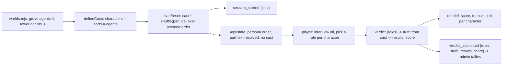

# Spec: agent-roles

## Intent

The user asked for three feature cards in the Override game (`demos/override`):

1. **Flag several agents with roles.** Players can accuse more than one agent. Each agent gets a role from the spectrum villain / collaborator / honest but fooled / honest, and each correct role scores.
2. **Randomize roles per session.** Each game shuffles which agent holds which role, so teams can't shout answers across tables. Ground truth follows the shuffle, and no sprite or colour may give a role away.
3. **3 to 5 agents per environment.** Each environment's config sets the agent count.

Today a game has exactly three fixed characters. The player picks one suspect (or Nobody / Not sure), and the answer is the same in every session. After this change:

- A case defines story **parts**, each with a hidden role.
- Every session deals the world's characters into those parts at random.
- The player picks a role for every character, and the debrief scores each one.

## Goals

- Each environment (world: `grove`, `tower`) sets its agent count, 3–5, in `server/worlds.mjs`. Every case in that world has exactly that many characters and parts.
- Every session gets a uniformly random cast (character → part), drawn on start and reset. It survives reload and server restart, and the research log records it.
- The verdict is a role for every character, scored per character. The debrief shows the score, the true role of each character next to the player's pick, and that part's explanation.
- Nothing a player can see or download before the verdict reveals the cast: not the order, sprite, colour, room number, scene position, DOM attributes, the `/api/state` payload, or the session export.
- The two live cases are rewritten as part cases:
  - `banana-mystery`: 4 agents, one of each role.
  - `tower-echo-bell`: 3 agents, all honest but fooled.
- The scene, nav, notebook and verdict work for 3, 4 and 5 characters.
- The admin command centre, load tools, preflight, `case-prompt` script and docs follow.

## Non-goals

- Story variants that move a role to a different part. Job labels, introductions and quick questions belong to the part, so "the planner" is the same role in every banana game. Names, faces, colours, order and positions are what shuffle. This is a known limit, listed as a follow-up.
- New painted art. Characters past the art sheet's three cast columns use a runtime recolour (Decided). Prompt files for real art are a follow-up.
- Porting the archived cases (`banana-control`, `tower-bell-charm`, `tower-missing-yes`, `override-v1`). They keep loading for their own tests, but the game refuses to play them.
- Partial credit inside a role (e.g. "collaborator" counted half right for a villain).
- Migrating in-progress games from the v2 case versions.

## Constraints

| Item | Rule |
|---|---|
| Roles | Ids, in this order: `villain`, `collaborator`, `fooled`, `honest`. Labels: "Villain", "Collaborator", "Honest but fooled", "Honest". One source: `server/roles.mjs`. The verdict always offers all four, whatever the case holds. |
| Agent count | `worlds.<id>.agents`: an integer from 3 to 5. Live config: grove 4, tower 3. `defineCase` rejects a part case unless `characters.length === parts.length === world.agents`. |
| Case shape | Part cases use `characters: [{id, name, color}]` (personas, in display order) and `parts: [{id, role, label, introduction, quickQuestion, knowledge: string[], finding: {classification, explanation}}]`. Text may contain `{partId}` placeholders, which resolve to the name of the character holding that part. An unknown placeholder is a load error. `debrief` holds `{title, summary, lesson}`, `answer` holds `{feedback: {correct, other}}`, and the case has `rehearsal(partId, question) -> template string`. Part ids match `/^[a-z][a-z0-9]{1,15}$/`. |
| Legacy cases | A case without `parts` is validated exactly as today (3 characters, `answer.culprits`, findings) and marked `legacy: true`. `new Investigations({cases})` throws if any case is legacy. The registry holds no legacy case. |
| Shuffle | Fisher–Yates over the part ids with `crypto.randomInt`, drawn once per start and per reset (including a case switch). `Investigations` takes a `shuffle(ids) -> ids` option so tests are deterministic. The character order never changes. |
| Public view (`/api/state`) | `characters` stays in persona order with the same keys as today. `role` = the held part's `label`. `room` = `'01'…'0N'` by persona index. `color` comes from the persona. `introduction` and `quickQuestion` come from the part, resolved. A new top-level `roles: [{id, label, hint}]` lists the four choices. No part id, role id of a character, or `cast` appears anywhere in the view, `session` included, until the verdict. After the verdict, the truth appears only in `debrief.findings`. |
| Verdict API | `POST /api/verdict {sessionId, revision, roles: {[characterId]: roleId}, confidence, explanation?}`. 400 if any character is missing or extra, or a value is not a role id. The rule that every character must be interviewed first stays. `suspect` is no longer accepted (400). |
| Scoring | `results[id] = roles[id] === truth[id]`, `score` = the number of true results, `total` = cast size. `feedback` is `answer.feedback.correct` when `score === total`, else `.other`. |
| Debrief | `{title, summary, lesson, feedback, score, total, findings: [{character, role, picked, correct, classification, explanation}]}`, in persona order, all text resolved. |
| Research log | `schemaVersion` 3. `session_started` adds `cast: {[characterId]: partId}`. `verdict_submitted.verdict` = `{roles, truth, results, score, total, confidence, explanation, evidenceIds: [], submittedAt}`; there is no `suspect` or `suspects`. Replay requires v3 and a `cast` that is a bijection from the case's character ids to its part ids; anything else replays as null (fresh game). The envelope is otherwise unchanged (`revealedPosition`/`selectedEvidence` stay `null`). |
| Export | `GET /api/events` returns `session_started.cast` as `null` while the session is active, and the file unchanged once the verdict is in. |
| Prompt | `promptVersion` `interview-v4`. `buildMessages(kase, session, characterId, question)` keeps its signature and reads `session.cast`. The prompt uses the character's name, the held part's label and the part's resolved knowledge. Rehearsal answers come from `kase.rehearsal(partId, question)`, resolved. |
| Case versions | `banana-authored-v3.0.0`, `tower-echo-bell-v3.0.0`. Exact strings are in `docs/plans/2026-10-29-agent-roles.content.md`. |
| Fairness | Two sessions with different casts get `/api/state` responses that are identical in every key except the resolved `role`, `introduction` and `quickQuestion` texts and the copy text with placeholders. The client draws a character from its persona and persona index only. No CSS class, data attribute, colour or sprite depends on the part or role. The four role choices share one neutral style. Before the verdict, nothing is styled per role; after it, correct and wrong picks are marked. |
| Scene | Each world pack defines 5 slot points. Slots 0–2 keep today's coordinates (the e2e tests pin them). Slots 3–4 are new, at least 64 px from every other stop, inside the walk bounds, with labels clear of props and other labels. The scene draws `cast.length` slots. |
| Art beyond 3 | A character at persona index `i ≥ 3` uses the cast and idle art of index `i − 3`. Its saturated pixels are hue-shifted so that the base character's `color` hue becomes its own `color` hue; outlines (low saturation) stay. This applies to the scene sprite and the DOM faces, whether the art is file or placeholder. |
| Admin | Catalog: `{id, title, world, characters: [{id, name}]}` (no `answer`). Row verdict: `{score, total, confidence}`. Round tallies: `{verdicts, perfect, rolesRight, rolesTotal, byRole: {[roleId]: {right, total}}, medianMsToVerdict, medianQuestions}`. The page shows "N verdicts · X % roles right · P perfect" and one bar per role present. A verdict without `roles` (schema v2) counts in the funnel only. |
| Tests | Retarget, never weaken. Tests of archived cases stay unchanged. The grove pixel baseline is regenerated on purpose (4th monkey). |

## Done looks like

1. `/?case=banana-mystery` shows four monkeys (Momo, Pip, Nori, Kiki) at four stations. Nav lists four monkeys + "Your guess", and the notebook index counts 2 + 4 pages. Kiki is a recoloured monkey, distinct from Momo.
2. Two fresh sessions usually differ in who is "The planner" (the job label under a name). Over 200 starts, every one of the 4 parts lands on every character (unit test).
3. `/api/state` and the DOM before the verdict contain no part id, role id of a character or `cast`. The export before the verdict has `cast: null`; after the verdict it has the cast.
4. After interviewing all four, "Your guess" shows each monkey with four role choices. Submit stays disabled until every monkey has a role. Submitting shows "N of 4 roles right", each monkey's true role next to the pick (✓/✗), the part's explanation, and the feedback (perfect vs other).
5. A verdict that matches the session's cast scores 4/4. A verdict naming one wrong role scores 3/4.
6. `/?case=tower-echo-bell`: three apprentices with the same flow. All "Honest but fooled" scores 3/3.
7. A 5-agent world (test config) validates, plays, scores 5/5 and lays out 5 stations (unit tests). Setting a world's `agents` to a count its cases don't match fails at load with a clear error.
8. In rehearsal mode, asking each banana character its quick question gets that part's key answer, with the current names filled in.
9. Admin: the round view shows % roles right, perfect count and per-role bars. Log rows read "3/4 roles · 70 %".
10. `npm test`, `npm run build` and `npm run test:e2e` are green. `npm run loadtest -- --players 30 --scenario steady` and `node scripts/admin-demo.mjs` run with role verdicts.
11. README and CASES_PLAN describe parts, roles, the shuffle, the agent count and log schema v3.

## Decided

- Environment = world (`grove`, `tower`); the agent count lives in `server/worlds.mjs` (Ruling).
- Grove gets a 4th monkey, **Kiki** (`kiki`, colour `#d9a62e`, golden), drawn as a recolour of Momo.
- Banana v3 parts: `planner` villain, `carrier` fooled, `lookout` collaborator, `minder` honest. Tower v3 parts: `planner`, `fetcher`, `watcher`, all fooled.
- Personas stay in the case file (`characters`), not in the world config.
- The cast is logged as part ids, and the truth is logged in the verdict, so admin reads one event.
- The job-label key stays `characters[].role` in the public view (frozen client interface). Spectrum roles use `roles` (view and verdict) and `findings[].role`/`.picked`.
- The client keeps one-off markup. The role picker is a row of four hidden-radio chips per character, reusing the `.case-option` pattern.
- Fixed while rewriting `round.js`: the existing bug where tallies treated a count as a fraction.

## Left to the builder / plan

- Slot 3–4 coordinates within the Scene rule. Small prop nudges are allowed (not slots 0–2, the report board or the briefing stop).
- The recolour implementation (offscreen canvas at load, blob URL for CSS faces).
- How the room nav and case-board faces fit 5–6 items. The fit rule from `cases.spec` (nav + dossier on one screen) stays.
- Exact admin bar labels, and test restructuring inside each file.

## Diagrams

