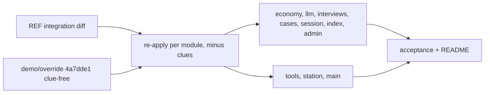
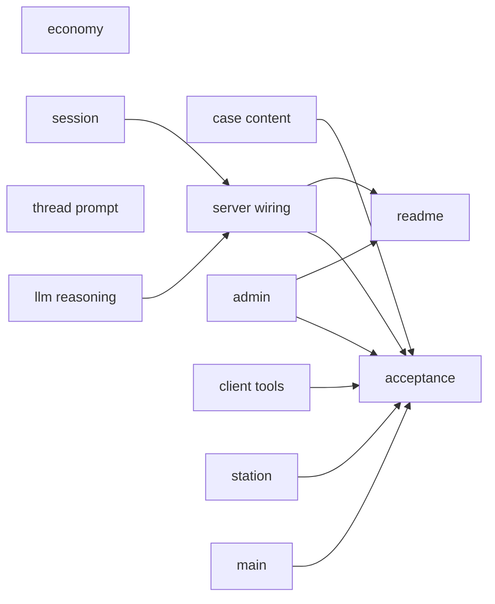

# Plan: coins-and-tools, re-port onto the clue-free game

**Review plan:** docs/plans/2026-10-29-coins-and-tools.feature.md
**Goal:** re-apply the finished, reviewed coins-and-tools integration onto `demo/override` @ 4a7dde1, where clues were removed (spec "Revision 2"): no Show-a-clue tool, Let them talk open from the start.
**Architecture:** unchanged from the first integration: `economy.mjs`; `LlmRouter.complete` returns reasoning; `interviews.mjs` thread prompt; `Investigation` spend/inspect/continue/replay with live reasoning in memory; admin cost/coins; client counter, chips, hints, bubbles, thread panel.
**Tech stack:** Node ESM (`node:test`; node 25 runs `.ts`), TypeScript + Vite + Phaser 3.90, Playwright 1.58.
**Spec:** docs/plans/2026-10-29-coins-and-tools.spec.md
**Detail:** contracts
**Target-min:** 16
**Ignore:** demos/override/test-results/, demos/override/data/, demos/override/dist/, demos/override/node_modules/

## Global constraints

- Owns are repo-root relative; code in `demos/override/`. Unit: `node --test demos/override/tests/<file>`. Types: `cd demos/override && npx tsc --noEmit`. Browser: `cd demos/override && npm run build && npx playwright test --project 
 --output=$TMPDIR/pw-<task>`. Never unit and browser at once; one Playwright run at a time.
- REFERENCE = `/Users/williambrach/Developer/AgentVerse/.superlite/worktrees/coins-and-tools` (the reviewed integration on the old clue game, uncommitted; read-only). Feature diff of a tracked file: `git -C $REF diff c543cd5 -- demos/override/<path>`; a new file: read `$REF/demos/override/<path>`. Re-apply the diff onto THIS branch's clue-free file; never copy a whole tracked file from REF (that would revert remove-clues).
- Clue-free rules: tools `ask` (2 coins, no charges), `inspect` (5 coins, charges 1, env `OVERRIDE_REASONING_CHARGES` 1-2), `continue` (1 coin per 3-line round, charges 3); no `clue` anywhere. Budget `OVERRIDE_COIN_BUDGET` empty or 6-999. Spend only on success; check order charges, budget, reserve; reserve = `costs.ask` x characters with no interview answer (inspect counts its target; interview excludes its target). `continue` needs no clue or reveal: allowed from the start.
- Exact 409 messages: `No reasoning inspections left.` · `No conversations left.` · `Not enough coins: this costs ${cost} and you have ${left} left.` · `Save coins: you need ${reserve} to ask everyone once.` · `${name} has not said anything yet.` · `No reasoning available for ${name}.`
- View `session` adds `economy {budget, spent, costs, charges: {inspect|continue: {max, used}}}`, `thread`, `chatter {round, pending}`, `inspections`. Events: `session_started.economy`, `spend {tools, cost, total}` on costed events, `reasoning_inspected`, `chatter_line` (+`provenance`, `threadPromptVersion` `thread-v1`), `chatter_failed`, `chatter_provider_response`, `verdict_submitted.coins`. `schemaVersion` 2; replay rebuilds all; live reasoning only in memory until inspected.
- FROZEN: this branch's `/api/*` fields, `defineCase`, hashes `banana-mystery` `d3d6d3b88060` and `tower-echo-bell` `034b87367f37`, `promptVersion` `interview-v3` and the interview prompt, `Investigation`/`Investigations`/`LlmRouter` public methods (additive only), admin route paths, the regenerated grove baseline. Existing tests pass; a task changes an existing test only additively where it names it.

## Task graph

```mermaid
%% schedule
gantt
  title Predicted schedule (mm:ss)
  dateFormat X
  axisFormat %M:%S
  section lane 1
  T7 admin :t7, 0, 138s
  T11 acceptance :t11, 255, 135s
  section lane 2
  T10 main :t10, 0, 138s
  T12 readme :t12, 255, 87s
  section lane 3
  T5 session :t5, 0, 129s
  T6 server wiring :t6, 129, 126s
  section lane 4
  T8 client tools :t8, 0, 125s
  section lane 5
  T3 thread prompt :t3, 0, 119s
  section lane 6
  T9 station :t9, 0, 117s
  section lane 7
  T4 case content :t4, 0, 115s
  section lane 8
  T1 economy :t1, 0, 93s
  section lane 9
  T2 llm reasoning :t2, 0, 86s
```

critical path: T5 → T6 → T11 (6.5 min) · peak width 9 · predicted build 6.5 min · predicted total ≈ 19.9 min (target ✗ 16.0)

## Server

**Probe entry:** call=demos/override/server/economy.mjs:quote

### T1 economy · Complexity 2 · Est. context 24k
**Owns:** demos/override/server/economy.mjs, demos/override/tests/economy.test.mjs, demos/override/.env.example
**Components:** 1
**LOC owned:** 110
**Tests:** fast
**Model:** sonnet
**Produces:** economy.quote(wallet: object, tools: string[], reserve: number) -> {cost: number, ok: boolean, reason: string|null}
e.g. quote(budget15spent12, ['inspect'], 0) -> {cost: 5, ok: false, reason: 'Not enough coins: this costs 5 and you have 3 left.'}
**Produces:** economy.createWallet(rules: object) -> {budget, spent, costs, charges}
e.g. createWallet(economyRules({})) -> {budget: null, spent: 0, costs: {ask: 2, inspect: 5, continue: 1}, charges: {inspect: {max: 1, used: 0}, continue: {max: 3, used: 0}}}
**Test code (contracts):** REF economy.mjs and test with every `clue` cost, charge, label and test removed (a test asserts `quote(w, ['clue'], 0)` throws or rejects an unknown tool, your choice, stated in the test name); `.env.example` gets REF's two variables; `docs.test.mjs` passes.

### T2 llm reasoning · Complexity 2 · Est. context 26k
**Owns:** demos/override/server/llm.mjs, demos/override/tests/llm.test.mjs, demos/override/tests/mock-llm.mjs, demos/override/tests/mock-llm.test.mjs
**Components:** 1
**LOC owned:** 90
**Tests:** fast
**Kind:** mechanical
**Model:** haiku
**Produces:** LlmRouter.complete(opts: object) -> {content: string, reasoning: string|null, provenance: object}
e.g. complete(...) with message {content: 'fine', reasoning_content: 'R1'} -> {content: 'fine', reasoning: 'R1', provenance}
**Test code (contracts):** remove-clues did not touch these four files: confirm `git diff c543cd5 4a7dde1 -- <file>` is empty for each, then copy each from `$REF` byte for byte; `llm.test.mjs`, `mock-llm.test.mjs`, `failover.test.mjs` pass.

### T3 thread prompt · Complexity 4 · Est. context 36k
**Owns:** demos/override/server/interviews.mjs, demos/override/tests/interviews.test.mjs, demos/override/tests/thread-prompt.test.mjs
**Components:** 2
**LOC owned:** 140
**Tests:** fast
**Model:** sonnet
**Consumes:** LlmRouter.complete(opts: object) -> {content: string, reasoning: string|null, provenance: object} (T2)
**Produces:** interviews.answerThread(config: object, kase: object, session: object, characterId: string, router: object, context: object) -> {text: string, reasoning: string|null, provenance: object|null}
e.g. answerThread(rehearsalConfig, kase, s, 'pip', null, {}) -> {text: kase.rehearsalChatter(s, 'pip', n), reasoning: null, provenance: null}
**Review Focus:** encoding (no question text; own knowledge only; injection stays data)
**Test code (contracts):** re-apply REF's interviews.mjs diff: `answerInterview` returns `reasoning`; `threadPromptVersion`, `buildThreadMessages`, `answerThread`, using this branch's whole-knowledge, no-records prompt style (no `revealedPosition`, no records block); port REF interviews.test.mjs edits and thread-prompt.test.mjs minus evidence/records assertions; the interview-prompt hash test pins THIS branch's `buildMessages` output (`interview-v3`).

### T4 case content · Complexity 3 · Est. context 32k
**Owns:** demos/override/server/cases.mjs, demos/override/server/cases/banana-mystery.mjs, demos/override/server/cases/tower-echo-bell.mjs, demos/override/tests/case-tools-content.test.mjs
**Components:** 2
**LOC owned:** 110
**Tests:** fast
**Model:** sonnet
**Produces:** kase.rehearsalReasoning(session: object, characterId: string) -> string
e.g. findCase('banana-mystery').rehearsalReasoning(s, 'momo') -> 30-120 words of Momo's inner reasoning
**Produces:** kase.rehearsalChatter(session: object, characterId: string, n: number) -> string
e.g. findCase('tower-echo-bell').rehearsalChatter(s, 'wren', 0) -> a 15-40 word post by Wren
**Review Focus:** encoding (leaks)
**Test code (contracts):** re-apply REF's optional-function support in cases.mjs and the two cases' functions; rewrite any line that mentions a clue, record, sign board, basket/cabinet inspection or shown evidence so it fits the clue-free v2 story; port the content test with the new hashes; leak checks against the v2 knowledge, debrief, feedback and the LEAKS list of `tests/browser/provenance.spec.mjs`.

### T5 session · Complexity 6 · Est. context 50k
**Owns:** demos/override/server/session.mjs, demos/override/tests/agent-tools.test.mjs, demos/override/tests/agent-tools-live.test.mjs
**Components:** 2
**LOC owned:** 230
**Tests:** fast
**Model:** sonnet
**Consumes:** economy.quote(wallet: object, tools: string[], reserve: number) -> {cost: number, ok: boolean, reason: string|null} (T1) · economy.createWallet(rules: object) -> {budget, spent, costs, charges} (T1) · interviews.answerThread(config: object, kase: object, session: object, characterId: string, router: object, context: object) -> {text: string, reasoning: string|null, provenance: object|null} (T3)
**Produces:** Investigation.mutate('continue', {sessionId, revision}) -> view
e.g. new game, continue x3 -> thread characters [cast0, cast1, cast2], chatter {round: 1, pending: 0}, spent 1
**Review Focus:** state, protocol, numeric, privacy
**Test code (contracts):** re-apply REF's session.mjs diff onto the clue-free file (interview spends `['ask']` only; no evidence branch; `continue` has no reveal check); port both REF test files, deleting clue tests and replacing `continue_before_clue_400` with `continue_from_start`; keep every reviewer regression test.

### T6 server wiring · Complexity 3 · Est. context 32k
**Owns:** demos/override/server/index.mjs, demos/override/tests/coins-http.test.mjs
**Components:** 1
**LOC owned:** 110
**Tests:** slow
**Model:** sonnet
**Review Focus:** protocol (live seam)
**Test code (contracts):** add `inspect`, `continue` to this branch's action list and route labels, `config.economy = economyRules(env)`; port REF coins-http.test.mjs without reveal steps; `budget_env_seam` (budget 6, continue first) still expects `Save coins: you need 6 to ask everyone once.`

### T7 admin · Complexity 4 · Est. context 40k
**Owns:** demos/override/server/monitor.mjs, demos/override/server/monitor-round.mjs, demos/override/server/admin.mjs, demos/override/server/admin/log.js, demos/override/server/admin/round.js, demos/override/tests/monitor.test.mjs, demos/override/tests/monitor-round.test.mjs, demos/override/tests/admin-log.test.mjs, demos/override/tests/admin-round.test.mjs, demos/override/tests/admin.test.mjs
**Components:** 3
**LOC owned:** 120
**Tests:** fast
**Model:** sonnet
**Review Focus:** encoding, state
**Test code (contracts):** re-apply REF's diffs (row `cost`, kinds `chatter`/`inspect`, `chatter_failed` as failure, `sessionCoins`, drill-down `coins`, `medianCoins`, log/round text) onto this branch's funnel (`asked` step); all admin and monitor tests pass.

## Client

**Probe entry:** call=demos/override/client/tools.ts:toolsBlock

### T8 client tools · Complexity 3 · Est. context 32k
**Owns:** demos/override/client/tools.ts, demos/override/client/types.ts, demos/override/client/tools.css, demos/override/tests/tools-ui.test.mjs
**Components:** 2
**LOC owned:** 190
**Tests:** fast
**Model:** sonnet
**Produces:** tools.toolsBlock(e: Economy, tools: Tool[], reserve: number) -> {enabled: boolean, reason: string|null}
e.g. toolsBlock(budget15spent12, ['inspect'], 0) -> {enabled: false, reason: 'Not enough coins'}
**Review Focus:** encoding
**Test code (contracts):** REF tools.ts, tools.css and test minus `clue` (`Tool = 'ask' | 'inspect' | 'continue'`, no clue hint/chip, spend summary without clue showings); re-apply REF's types.ts diff onto the clue-free types.

### T9 station · Complexity 2 · Est. context 28k
**Owns:** demos/override/client/bubble-layout.ts, demos/override/client/station.ts, demos/override/client/bubbles.css, demos/override/tests/bubble-layout.test.mjs
**Components:** 2
**LOC owned:** 130
**Tests:** fast
**Model:** sonnet
**Produces:** Station.say(characterId: string, text: string) -> void
e.g. say('momo', 'Hi') -> one `.station-bubble[data-character="momo"]` above Momo's name label
**Test code (contracts):** copy the three new files from REF; re-apply REF's station.ts diff onto this branch's station.ts; `bubble-layout.test.mjs` passes.

### T10 main · Complexity 5 · Est. context 44k
**Owns:** demos/override/client/main.ts
**Components:** 1
**LOC owned:** 210
**Tests:** slow
**Model:** sonnet
**Consumes:** tools.toolsBlock(e: Economy, tools: Tool[], reserve: number) -> {enabled: boolean, reason: string|null} (T8) · Station.say(characterId: string, text: string) -> void (T9)
**Review Focus:** protocol, encoding
**Test code (contracts):** re-apply REF's main.ts diff onto the clue-free main.ts: counter, Ask chip + hint, Inspect, Let them talk + Read thread + tooltip, thread panel, pacing loop, debrief summary; no clue picker or clue chip; `npx tsc --noEmit && npm run build` pass.

## Acceptance and docs

**Probe entry:** serve=demos/override/server/index.mjs:startServer

### T11 acceptance · Complexity 5 · Est. context 40k
**Owns:** demos/override/tests/browser/coins.spec.mjs, demos/override/playwright.config.mjs
**Components:** 1
**LOC owned:** 190
**Tests:** slow
**Model:** sonnet
**Review Focus:** protocol, state
**Test code (contracts):** re-apply REF's `coins` project; port REF coins.spec.mjs without reveal or clue steps: `counter_starts_zero`, `question_costs` (Momo 2, Pip 4), `inspect_once` (9), `talk_round`, `budget_409`, `reload_keeps_thread`, `tower_tools`, plus `talk_from_start` (Let them talk before any question works); then every project green with this branch's grove baseline.

### T12 readme · Complexity 2 · Est. context 26k
**Owns:** demos/override/README.md
**Components:** 1
**LOC owned:** 60
**Tests:** fast
**Model:** sonnet
**Test code (contracts):** re-apply REF's README diff onto this branch's clue-free README, minus the Show-a-clue row and any clue wording; `docs.test.mjs` passes.

## Review Focus

Server: double spend, spend on failure, replay drift, reserve maths, charges past max, live reasoning reaching traces/events/view before inspection, thread messages carrying questions or other characters' knowledge, stray clue references. Client: XSS via reasoning/thread text, controls enabled when the server refuses, continue loop vs busy and navigation, layout height (grove baseline, fits one screen), no clue UI.

## Self-review

Coverage: spec (Revision 2) 'Intent', 'Goals' → T1-T11; 'Constraints' → Global constraints; 'Done looks like' 1, 3-5, 7-9, 11 → T5, T10, T11; 2 → T1, T11; 6 → T3, T6; 10 → T7; 12 → T11, T12; 'Decided' → Global constraints; 'Left to the builder / plan' → T8-T10; 'Diagrams' → main diagram. Edges as in the first integration.
