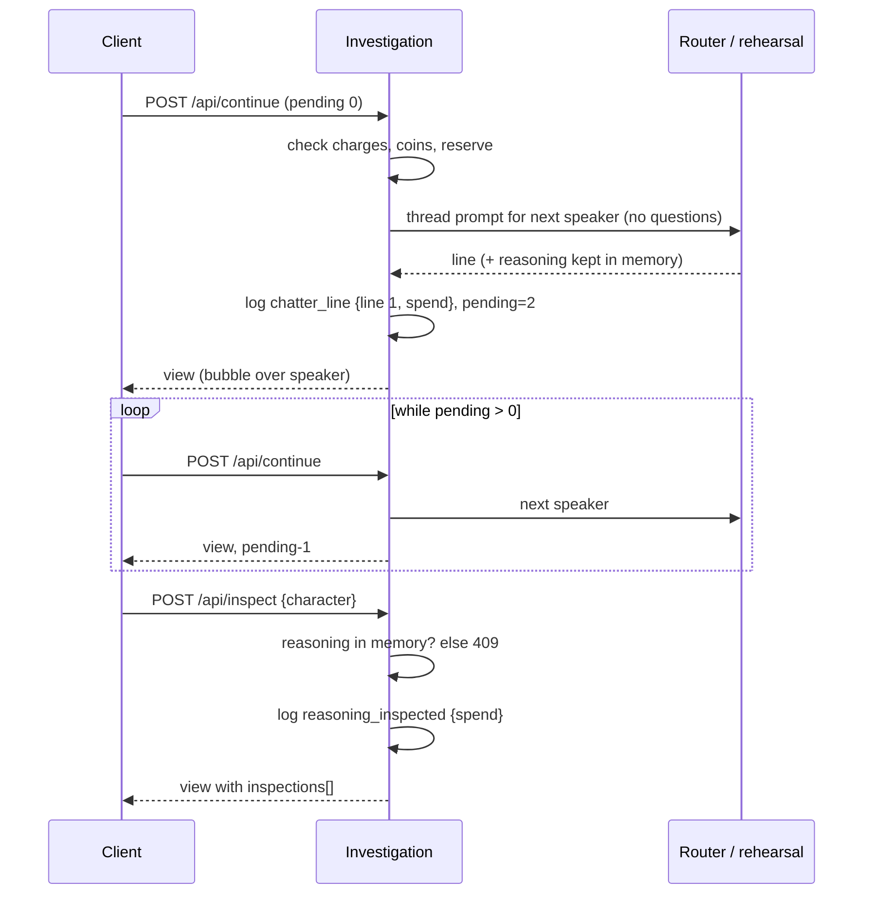
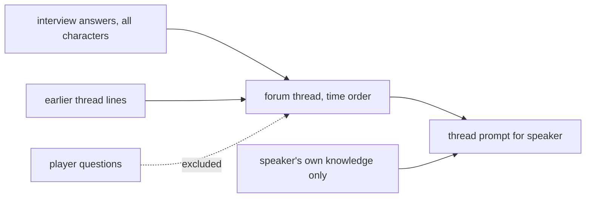

# Spec: coins-and-tools

## Intent

Override games are played by teams at events. Today every action is free and unlimited, so teams just ask until they are sure. This feature adds a small economy: every question and tool use costs coins, each tool has a limited number of charges, and two new tools let a team see what the agents do when nobody is asking. These tools are **Inspect reasoning** (an agent's chain of thought, rare and expensive) and **Let them talk** (the three agents continue among themselves, cheap). The operator sees each team's coin total. Source: five tickets from the user (coin counter, inspect chain of thought, use limits, continue tool, speech bubbles).

**Revision 2 (2026-10-29, rebase):** while this was built, `demo/override` removed clues from the game (remove-clues spec: no clue records, no reveal/evidence actions, interviews open from the start, case versions `v2.0.0`, `promptVersion` `interview-v3`). Ruling: the feature is re-ported onto the clue-free game. The *Show a clue* tool goes away with clues; Ask, Inspect reasoning and Let them talk keep their costs and charges. Where this revision and the text below disagree, this paragraph wins.

## Goals

- A coin counter is always visible during a game. Every costed action adds its cost. The total is logged per team (one game = one team) and shown to the operator.
- Optional hard budget (`OVERRIDE_COIN_BUDGET`, e.g. 15). Without it, coins are only counted.
- Each limited tool (Inspect reasoning, Let them talk) has its own charges and shows how many uses are left.
- **Inspect reasoning** shows how one agent reasoned about its most recent line. Default: 1 charge per game. At most 2 (`OVERRIDE_REASONING_CHARGES=2`).
- **Let them talk**: the three agents post 3 lines in a forum-style thread. Each agent sees every agent's earlier lines (its answers to the team and earlier thread posts) and never sees the team's questions.
- Thread lines appear as speech bubbles over the speaking agent, and stay readable in a thread log. Every control has a short hint that says what it does.

## Non-goals

- No change to case content (copy, clues, knowledge, answers, debrief) and no version or `contentHash` change for any case.
- No change to the interview prompt (`promptVersion` stays `banana-interview-v2`). Characters still never see each other's *interview* histories in interviews.
- No player accounts, cross-game wallets, leaderboards, or operator-adjustable costs at run time.
- No new Prometheus metric. No projector view.
- The existing empty-state bug (`client/main.ts:343`, single-quoted `${…}`) is out of scope.

## Constraints

| Item | Rule |
|---|---|
| Authority | Server-authoritative. The client only displays coins and charges. Every check is enforced on the server. |
| Log schema | `schemaVersion` stays 2. Changes are additive only: new event types and new payload fields. `replay()` rebuilds every new piece of state. A restored `view()` deep-equals the live one. |
| Frozen | Existing `/api/*` request and response fields, `defineCase`'s required fields, `Investigations`/`Investigation`/`LlmRouter` public methods (new optional args and return fields only), admin route paths, and the session log's existing event types and fields. |
| Hashes | `contentHash` of `banana-mystery` (`d3d6d3b88060`) and `tower-echo-bell` (`034b87367f37`, both v2.0.0) are unchanged. New authored rehearsal text lives in functions, which are not hashed. |
| Reasoning privacy | Provider reasoning is held **only in server memory** until a team inspects it. It is never written to traces, session events, provenance, or `view()` before that. Once inspected, the shown text is logged (the export records what the team saw). |
| Leaks | Authored rehearsal reasoning and thread lines paraphrase. They never quote a `knowledge` line or debrief text word for word. Existing leak tests stay as strong as they are. |
| Tests | Retarget, never weaken. `npm run build` before e2e. Never run unit and e2e suites at the same time. |
| Layout | Bubbles are hidden unless a thread line is showing, so the grove pixel baseline is unchanged. No new row in the world column: the canvas size is unchanged. |

## Done looks like

1. In a new game, `#coin-counter` reads `0 coins` (no budget) or `0 / 15 coins` (budget 15). Hovering or focusing it explains it.
2. A quick question adds **2**. There is no clue tool (clues were removed from the game).
3. Failed provider answers, walking, the verdict and reset cost nothing.
4. **Inspect reasoning** on a character who has spoken costs **5** and shows a reasoning block under that character's last line. The next attempt (default 1 charge) is refused: the control reads "0 left" and is disabled. With `OVERRIDE_REASONING_CHARGES=2` it works twice. If no reasoning exists (the model returned none, or the server restarted since), the server answers 409 and nothing is spent.
5. **Let them talk** costs **1** and uses one of **3** charges. Three lines arrive one after another, each as a bubble over its speaker, and are added to the thread log. Speakers rotate in cast order, continuing after the last poster. If a line fails, the round is kept: "Keep listening" fetches the rest for free.
6. Live mode (mock LLM): the thread request for a character holds that character's system prompt (own knowledge only), every earlier answer and thread line from all three characters in time order, and **no** player question text.
7. With budget 15: an action that would exceed the budget is refused (409, with a message), and its control is disabled. So is any action that would leave too few coins to ask each not-yet-interviewed character once. So the team can always reach a verdict.
8. Reload the page, or restart the server: coins, charges, the thread, pending lines and inspected reasoning are all restored. Uninspected live reasoning is gone, and inspecting then gives 409 with nothing spent.
9. The debrief shows the team's total ("You spent 11 of 15 coins") and the tools it used. `verdict_submitted` carries `coins: {spent, budget}`.
10. Admin: the message log shows `inspect` and `chatter` rows and each row's cost. A player's drill-down shows the team's coin total. Each case's tallies show the median coins at verdict.
11. Rehearsal mode works end to end with authored reasoning and thread lines for both live cases.
12. `npm test`, `npm run build`, `npm run test:e2e` (all projects) are green. The grove pixel baseline is unchanged. README describes the costs, the tools, the two env vars, and the new events.

## Decided

| Tool | Coins | Charges | Notes |
|---|---|---|---|
| Ask (quick or typed) | 2 | none (technical 40/character limit stays) | spent when the answer is logged |
| Inspect reasoning | 5 | 1 (env 1–2) | explains the target's most recent line (answer or thread post) |
| Let them talk | 1 per round | 3 rounds | a round is 3 lines; spent when line 1 lands |
| Walk, verdict, reset | 0 | none | |

- **Env:** `OVERRIDE_COIN_BUDGET` (empty = no budget, else an integer 6–999); `OVERRIDE_REASONING_CHARGES` (1 or 2, default 1). Both go in `.env.example`.
- **Rules snapshot:** `session_started` gains `economy: {budget, costs, charges}`. A game keeps its own rules after a restart, even if the env changed. A log from before this feature replays with the current rules and 0 coins spent.
- **Spend record:** every costed event gains `spend: {tools: [...], cost, total}`. Replay sums `spend` and counts charges from `spend.tools`.
- **New actions:** `POST /api/inspect {sessionId, revision, character}` and `POST /api/continue {sessionId, revision}`. Both return the view. One thread line per `continue` request. The client loops while `session.chatter.pending > 0`.
- **New events:** `reasoning_inspected {character, sourceEventId, reasoning, spend}`, `chatter_line {character, text, round, line, provenance, threadPromptVersion, spend?}`, `chatter_failed {character, round, reason, provenance}`. `interview_answer` gains `spend`. `verdict_submitted` gains `coins`.
- **View** (`session.*`): `economy {budget, spent, costs, charges: {inspect|continue: {max, used}}}`, `thread [{character, text, round, timestamp}]`, `chatter {round, pending}`, `inspections [{character, sourceEventId, reasoning, timestamp}]`.
- **Errors:** coins, charges, reserve, and "no reasoning available" give 409 with a player-readable message. `continue` is available from the start, like interviews.
- **Reasoning source:** live mode uses the provider's `message.reasoning_content ?? message.reasoning`, capped at 4,000 characters. Rehearsal uses the case's `rehearsalReasoning(session, characterId)`.
- **Thread prompt:** a new builder with its own `threadPromptVersion` (`thread-v1`). Posts are labeled untrusted content. Rehearsal uses the case's `rehearsalChatter(session, characterId, n)`. Thread lines never enter interview prompts.
- **Rate:** thread lines do not count toward the 6-questions-per-minute limit. Charges bound them (at most 9 lines per game).
- **UI homes:** coin counter in `.top-meta`; Ask and Inspect reasoning in the interview panel, each with a cost/charges chip and a visible one-line hint; Let them talk (and "Read thread") in `.station-bottomline`; thread log as a dossier panel; bubbles as `.station-bubble` in the `.station-labels` overlay, one at a time.
- Labels kept exact: the "Ask question" button text, `.speech.character` (reasoning uses `.speech.reasoning`).

## Left to the builder / plan

- Module layout (expected: `server/economy.mjs`), exact hint wording, chip styling per world.
- How the thread panel is reached in the notebook, and bubble pacing (about 3–8 s per line, scaled by length; the last bubble fades about 8 s after the round).
- Mock-LLM option name for returning reasoning.

## Diagrams

