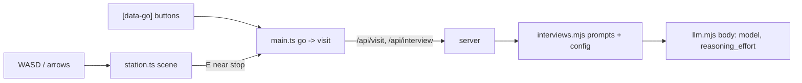
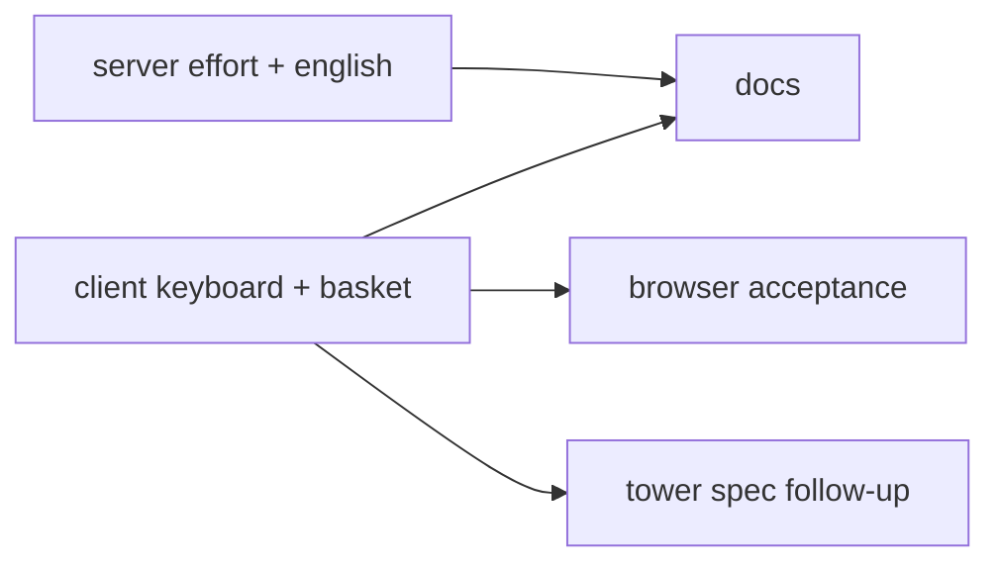

# Plan: Override tune-ups (basket, keyboard-only walking, GLM 5.3 Flash low reasoning, English only)

**Goal:** four decisions for the Override demo: the banana basket is back on the grove picnic blanket; the investigator moves only with WASD/arrows (no click-to-move); live interviews can send `reasoning_effort: "low"` for `zai-org/GLM-5.3-Flash`; characters always answer in English.
**Architecture:** client `station.ts`, `main.ts`, `worlds.ts`; server `interviews.mjs`, `llm.mjs`; browser specs; README/DEPLOY.
**Tech stack:** Node ESM (`node:test`), TypeScript + Vite + Phaser 3.90, Playwright 1.58.
**Spec:** none (decisions are in Global constraints)
**Detail:** contracts
**Target-min:** 18
**Ignore:** demos/override/test-results/, demos/override/data/, demos/override/dist/, demos/override/node_modules/

## Global constraints

- Owns are repo-root relative; code in `demos/override/`. Unit: `node --test demos/override/tests/<file>` from the repo root. Types: `cd demos/override && npx tsc --noEmit`. Browser: `cd demos/override && npm run build && npx playwright test <spec> --output=$TMPDIR/pw-<task>` (the server serves the built `dist/`). Never run unit and browser suites at the same time.
- D1 basket: grove only, in `create()` draw `this.prop(keys.props, 'basket', 244, 221, 45).setDepth(216)` on the blanket (the pre-363bcd4 position and size). Decoration: no stop, no label, no collider. Tower unchanged.
- D2 keyboard-only: a canvas click never moves the investigator and opens nothing (it only blurs the focused element, when enabled). Destination buttons (`[data-go]`) open their page at once, as `Skip walking` did; the avatar stays where it is. E/Space next to a stop still opens it. Remove `#skip-walking`, `skipWalking`, `Station.travel`, `arrive`, `findRoute`, `route`, `destination`, `marker`, `blocked` and the "Walking to …" hint.
- D3 model: `zai-org/GLM-5.3-Flash` (listed by the provider's `/models`) with `reasoning_effort: "low"` (checked live: reasoning 318 -> 56 chars). Env `OVERRIDE_LLM_REASONING_EFFORT`: empty/unset = not sent; else `low|medium|high`, otherwise throw `OVERRIDE_LLM_REASONING_EFFORT must be low, medium or high.` Endpoints JSON field `reasoningEffort` (same values or absent/null), otherwise throw `Endpoint <name>: reasoningEffort must be low, medium or high.` Endpoint objects gain `reasoningEffort: string|null` (last key, after `temperature`); the endpoints hash covers it. The body gets `reasoning_effort` only when set; `params`/`samplingParams` likewise gain `reasoning_effort` only when set.
- D4 English: `promptVersion = 'interview-v4'`, `threadPromptVersion = 'thread-v2'`. Interview prompt: insert ` Always answer in English, even if the question is in another language, and do not comment on the language.` right after `(15–40 words, at most three short sentences).` on the "Speak in first person" line. Thread prompt: insert ` Always write in English.` right after `(15–40 words, at most three short sentences).` Pinned prompt hashes are recomputed from the new text.
- Copy (exact): grove hint `Walk with WASD / arrows. Press E next to a monkey.`; tower hint `Walk with WASD / arrows. Press E next to an apprentice.`; `WorldPack.text.clickOne` renamed `oneWithArticle` (values unchanged); briefing note `Walk with WASD or the arrow keys and press E next to ${oneWithArticle} to talk. The buttons under the map open a page straight away.`; canvas aria-label `<place> with <names> and your <investigator>. Walk with WASD or the arrow keys, press E to talk, or use the destination buttons.` (the `createStation` default uses Banana Grove / Momo, Pip, Nori / monkey investigator).
- FROZEN: `/api/*` fields, case hashes, event schema v2, `tests/browser/grove-look.spec.mjs-snapshots` except T3's regeneration. Existing tests change only where a task names them.

## File structure

No new source files. Each task's Owns lists the files it changes.

## Task graph

```mermaid
%% schedule
gantt
  title Predicted schedule (mm:ss)
  dateFormat X
  axisFormat %M:%S
  section lane 1
  T2 client keyboard + basket :t2, 0, 135s
  T3 browser acceptance :t3, 135, 143s
  section lane 2
  T1 server effort + english :t1, 0, 115s
  T5 tower spec follow-up :t5, 135, 117s
  section lane 3
  T4 docs :t4, 135, 82s
```

critical path: T2 → T3 (4.6 min) · peak width 3 · predicted build 4.6 min · predicted total ≈ 18.5 min (target ✗ 18.0)

## Section: server

App type: HTTP service config + prompt builder. Categories: protocol (request body), encoding (config validation), state (hash).

**Probe entry:** call=demos/override/server/interviews.mjs:modelConfig

### T1 server effort + english · Complexity 3 · Est. context 40k
**Owns:** demos/override/server/interviews.mjs, demos/override/server/llm.mjs, demos/override/.env.example, demos/override/ops/endpoints.example.json, demos/override/tests/interviews.test.mjs, demos/override/tests/llm.test.mjs, demos/override/tests/session.test.mjs, demos/override/tests/thread-prompt.test.mjs, demos/override/tests/case-prompt.test.mjs, demos/override/tests/coins-http.test.mjs, demos/override/tests/agent-tools-live.test.mjs
**Components:** 2
**LOC owned:** 110
**Tests:** fast
**Model:** sonnet
**Consumes:** none
**Produces:** interviews.modelConfig(env: object) -> {mode: string, endpoints: object[], model: string|null, promptVersion: string}
e.g. modelConfig({OVERRIDE_LLM_API_KEY: 'k', OVERRIDE_LLM_MODEL: 'm', OVERRIDE_LLM_REASONING_EFFORT: 'low'}).endpoints[0].reasoningEffort -> 'low'
e.g. modelConfig({OVERRIDE_LLM_API_KEY: 'k', OVERRIDE_LLM_MODEL: 'm'}).endpoints[0].reasoningEffort -> null
e.g. modelConfig({OVERRIDE_LLM_API_KEY: 'k', OVERRIDE_LLM_MODEL: 'm', OVERRIDE_LLM_REASONING_EFFORT: 'max'}) -> throws 'OVERRIDE_LLM_REASONING_EFFORT must be low, medium or high.'
**Produces:** LlmRouter.complete(opts: {messages: object[]}) -> {content: string, reasoning: string|null, provenance: object}
e.g. endpoint reasoningEffort 'low' -> request body has reasoning_effort 'low'; provenance.samplingParams -> {max_completion_tokens: 2048, temperature: null, reasoning_effort: 'low'}
e.g. endpoint reasoningEffort null -> body has no reasoning_effort key; samplingParams -> {max_completion_tokens: 2048, temperature: null}
**Review Focus:** protocol: `effort_sent_only_when_set` (body key absent for null, present for 'low', also on the doubled-budget retry); encoding: `effort_env_rejects` ('max' and 'LOW' throw; ' low ' is trimmed to 'low'; '' is null), `endpoint_effort_rejects` (reasoningEffort 5 throws the endpoint message); state: `hash_changes_with_effort` (same endpoints, 'low' vs null -> different endpointsHash).
**Test code (contracts):** in interviews.test.mjs: the two existing endpoint deepEquals gain `reasoningEffort: null`; `legacy_effort` (the three modelConfig examples above); `endpoints_effort` (`reasoningEffort: 'low'` in a file -> 'low'; absent -> null; 'max' -> endpoint message); `hash_changes_with_effort`; `english_prompts` (buildMessages system includes `Always answer in English, even if the question is in another language.`; buildThreadMessages system includes `Always write in English.`). In llm.test.mjs: `effort_sent_only_when_set` (capture the fetch body for ep('a', {reasoningEffort: 'low'}) and ep('a')). Update pins: `interview-v3` -> `interview-v4` (interviews, session, thread-prompt, case-prompt tests), `thread-v1` -> `thread-v2` (thread-prompt, coins-http, agent-tools-live), and recompute the pinned sha values in session.test.mjs and thread-prompt.test.mjs. `docs.test.mjs` must stay green: add `OVERRIDE_LLM_REASONING_EFFORT=` with a one-line comment to `.env.example` after `OVERRIDE_LLM_MODEL=`; add `"reasoningEffort": "low"` to all four entries of `ops/endpoints.example.json`.
**Steps:** 1 failing tests, 2 run: FAIL, 3 implement, 4 run: PASS (`node --test demos/override/tests/interviews.test.mjs demos/override/tests/llm.test.mjs demos/override/tests/session.test.mjs demos/override/tests/thread-prompt.test.mjs demos/override/tests/case-prompt.test.mjs demos/override/tests/docs.test.mjs demos/override/tests/coins-http.test.mjs demos/override/tests/agent-tools-live.test.mjs`)
**Notes:** legacy endpoint object order: `{name, baseUrl, model, key, keyEnv, maxInFlight, tokenParam, timeoutMs, temperature, reasoningEffort}`. Do not change the local `.env` (the coordinator does).

## Section: client

App type: web UI (Phaser scene + DOM). Categories: protocol (keyboard/pointer input), encoding (copy).

**Probe entry:** run=cd demos/override && npx tsc --noEmit

### T2 client keyboard + basket · Complexity 3 · Est. context 45k
**Owns:** demos/override/client/station.ts, demos/override/client/main.ts, demos/override/client/worlds.ts, demos/override/client/style.css, demos/override/client/tower.css, demos/override/tests/worlds.test.mjs
**Components:** 3
**LOC owned:** 90
**Tests:** fast
**Model:** sonnet
**Consumes:** none
**Produces:** worlds.worldFor(id: string) -> WorldPack
e.g. worldFor('grove').text.oneWithArticle -> 'a monkey'; worldFor('grove').text.hint -> 'Walk with WASD / arrows. Press E next to a monkey.'
e.g. worldFor('tower').text.oneWithArticle -> 'an apprentice'; worldFor('tower').text.hint -> 'Walk with WASD / arrows. Press E next to an apprentice.'
**Review Focus:** protocol: the pointerdown handler keeps only the blur (no `findRoute`, no `travel`), `go()` always calls `visit()`; encoding: copy exactly as in Global constraints.
**Test code (contracts):** worlds.test.mjs: the two `w.text` deepEquals use the new `hint` and `oneWithArticle` (no `clickOne` key). Then `cd demos/override && npx tsc --noEmit` passes and `grep -nE "skipWalking|skip-walk|travel\(|findRoute|clickOne" client/*.ts client/*.css` prints nothing.
**Steps:** 1 update worlds.test.mjs, 2 run: FAIL, 3 implement D1, D2 and the copy, 4 run: PASS + tsc.
**Notes:** D1 sits in the `(['briefing', 'report'] ...)` area or right after it, guarded by `grove`. Keep the keyboard `keydown` preventDefault and the E/Space interaction. `resetPosition()` keeps resetting body, direction, walk and NPCs. Drop `.skip-walk` rules from style.css and tower.css; keep `.world-footer`.

## Section: browser

App type: web UI acceptance. Categories: protocol (input), state (position).

**Probe entry:** run=cd demos/override && npx playwright test walking.spec.mjs

### T3 browser acceptance · Complexity 3 · Est. context 42k
**Owns:** demos/override/tests/browser/walking.spec.mjs, demos/override/tests/browser/investigation.spec.mjs, demos/override/tests/browser/cases.spec.mjs, demos/override/tests/browser/provenance.spec.mjs, demos/override/tests/browser/grove-look.spec.mjs-snapshots/grove-darwin.png
**Components:** 2
**LOC owned:** 70
**Tests:** slow
**Model:** sonnet
**Consumes:** none
**Produces:** none
**Review Focus:** protocol: `map_clicks_never_move`; state: `nav_opens_in_place`.
**Test code (contracts):** walking.spec: replace 'destination and ground clicks keep a continuous walk cycle…' with `map clicks never move the investigator; destination buttons open the page in place`: after start, last sample = {frame 'down-0', x 244, y 276}; click the canvas at game (300,204), sample 600 ms: every sample x 244, y 276, frame 'down-0'; click the canvas at game (116,120) (on Momo): `#panel h2` stays 'A bunch of trouble.' and position unchanged; click `nav [data-go="momo"]`: `#panel h2` 'Momo', position still (244,276). Add `the banana basket sits on the picnic blanket`: a scene child with texture key 'jungle' and frame name 'basket' exists at x 244, y 221, depth 216. In 'monkeys react on approach…' drop the two `#skip-walking` lines and replace the final canvas click with `page.keyboard.press('e')` (still expects `#panel h2` 'Momo'). Remove every other `#skip-walking` line in walking/cases/provenance/investigation specs; investigation.spec's `toBeChecked()` becomes `toHaveCount(0)`. Regenerate the grove baseline with `npx playwright test grove-look.spec.mjs --update-snapshots --output=...`, Read the PNG and confirm the basket with bananas is on the blanket and nothing else changed, then run grove-look again without the flag: PASS.
**Steps:** 1 edit specs, 2 `npm run build`, 3 run walking, investigation, cases, provenance, grove-look specs: PASS.
**Notes:** edge T2 -> T3: these specs run T2's built client. Do not edit client code; report a client defect as DONE_WITH_CONCERNS.

### T5 tower spec follow-up · Complexity 3 · Est. context 30k
**Owns:** demos/override/tests/browser/tower.spec.mjs
**Components:** 1
**LOC owned:** 30
**Tests:** slow
**Model:** sonnet
**Consumes:** none
**Produces:** none
**Review Focus:** state: `switch_from_open_interview` (tower: nav juniper opens Juniper; switching to banana-mystery closes the case board, grove world, briefing panel, player at (244,276), no page errors).
**Test code (contracts):** rename 'switching mid-walk or with the case board open' to 'switching from an open interview or with the case board open'; keep its assertions.
**Steps:** 1 edit, 2 `npm run build`, 3 run tower.spec.mjs --project=tower: PASS.
**Notes:** added after the full e2e run: with keyboard-only walking a nav click opens the interview at once, and switching case from there hung on "Opening…". Fixes in client files go under T2.

## Section: docs

App type: docs. Categories: none.

**Probe entry:** run=node --test demos/override/tests/docs.test.mjs

### T4 docs · Complexity 1 · Est. context 26k
**Owns:** demos/override/README.md, demos/override/DEPLOY.md
**Components:** 1
**LOC owned:** 20
**Tests:** fast
**Kind:** mechanical
**Model:** haiku
**Consumes:** none
**Produces:** none
**Review Focus:** none
**Test code (contracts):** `node --test demos/override/tests/docs.test.mjs` passes; `grep -n "Skip walking\|Click a monkey" demos/override/README.md` prints nothing; `grep -c "GLM-5.3-Flash" demos/override/README.md demos/override/DEPLOY.md` is at least 1 each.
**Steps:** 1 edit, 2 run the checks: PASS.
**Notes:** README: in the `.env` block set `OVERRIDE_LLM_MODEL=zai-org/GLM-5.3-Flash` and add `OVERRIDE_LLM_REASONING_EFFORT=low`; after the block add: "`OVERRIDE_LLM_REASONING_EFFORT` (`low`, `medium` or `high`) is sent as `reasoning_effort`; leave it empty for a model that does not accept it. With GLM 5.3 Flash, `low` keeps the reasoning players can inspect to a few lines. In an endpoints file the field is `reasoningEffort`." Add to Live interviews: "The game is English only: the UI is written in English, and both prompts tell characters to answer in English whatever language the question is in (`interview-v4`, `thread-v2`)." Env table: after the `OVERRIDE_LLM_MAX_COMPLETION_TOKENS` row add `| \`OVERRIDE_LLM_REASONING_EFFORT\` | empty | \`low\`, \`medium\` or \`high\`, sent as \`reasoning_effort\`; empty sends nothing. |`. Replace the first two sentences of the walking paragraph ("Click a monkey, signpost … reduced-motion preferences.") with "Walk with WASD or the arrow keys, and press E or Space next to a monkey, the signpost or the start marker. Clicking the map does not move the investigator; the destination buttons open a conversation or your guess straight away. A basket of bananas sits on the picnic blanket." DEPLOY.md: in the env block set the model to `zai-org/GLM-5.3-Flash` and add `OVERRIDE_LLM_REASONING_EFFORT=low` under it.

## Self-review

Coverage: D1 T2+T3, D2 T2+T3+T4, D3 T1+T4, D4 T1+T4. No shared files. Review Focus per section above.
