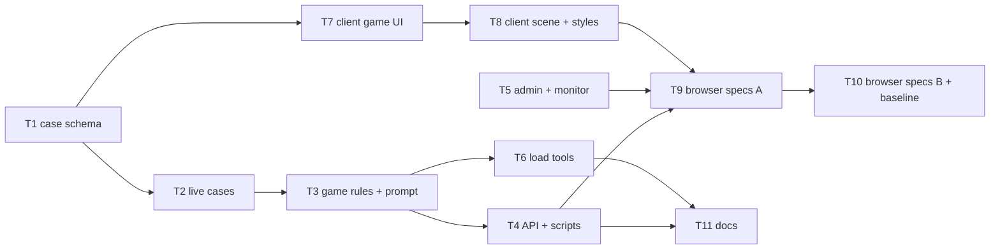
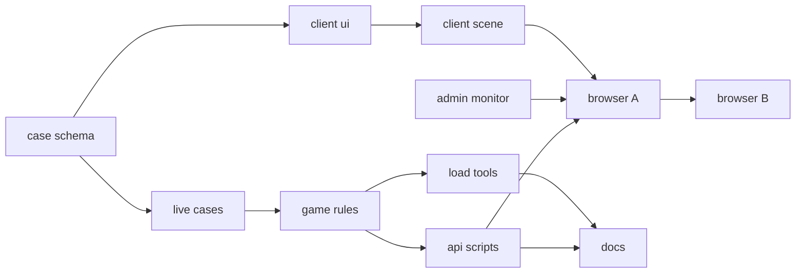

# Plan: remove clues from the Override game

**Review plan:** docs/plans/2026-10-29-remove-clues.feature.md
**Goal:** a game is briefing → interview the three characters → verdict → debrief; no clue records, stops, pages, selectors or citations anywhere a player can reach.
**Architecture:** the case schema keeps clue fields as optional legacy (archived cases), the live cases drop them, session/prompt/API lose the reveal and evidence paths, the client loses clue UI, the admin funnel and tools follow.
**Tech stack:** Node 22 ESM (`node:test`), TypeScript + Vite + Phaser client, Playwright 1.58.
**Spec:** docs/plans/2026-10-29-remove-clues.spec.md
**Detail:** contracts
**Target-min:** 16
**Ignore:** demos/override/test-results/, demos/override/data/, demos/override/dist/

## Global constraints

- Owns are repo-root relative; code in `demos/override/`. Unit: `node --test demos/override/tests/<file>` from the repo root. Browser: `cd demos/override && npm run build && npx playwright test <spec> --output=<scratch>`; one Playwright run at a time (`pgrep -fl "playwright test"` first); never unit and browser suites at once.
- Retarget, never weaken (spec Constraints). Archived cases (`banana-control`, `tower-bell-charm`, `tower-missing-yes`, `override-v1`) and their tests stay unchanged and must still pass.
- Shared contract (every task codes to it):
  - Live case shape: no `chapters`, `records`, `copy.basket`, `debrief.findings[].evidence`; `knowledge[charId]` is a non-empty array of strings, all of it used in the prompt. When an (archived) case has `chapters`/`records`/`copy.basket`/`findings[].evidence`, `defineCase` validates them exactly as today.
  - Versions: `banana-authored-v2.0.0`, `tower-echo-bell-v2.0.0`; `promptVersion` = `interview-v3`.
  - `publicView` = today's object minus `chapters`, `clueCount`, `copy.basket`, `world.clueSpot`. Server `worlds.mjs` drops `clueSpot`; client `worlds.ts` drops `clueSpot`, `clueNav`, `clueLabel`, `clueTitle`.
  - `view()`: no `records`; `session` has no `revealedPosition`/`selectedEvidence`; turns are `{question, answer, timestamp}`; `debrief.findings[]` are `{character, classification, explanation}`.
  - Actions: `start`, `reset`, `visit`, `interview`, `verdict`. `visit` locations: `briefing`, `report`, cast ids. Interviews have no gate. Verdict error when a character is unheard: `Ask all ${n} ${world.cast.many} before choosing.`; `evidenceIds` in the input is ignored; the stored verdict has `evidenceIds: []`.
  - Every logged event keeps the keys `revealedPosition: null` and `selectedEvidence: null`. No `story_revealed` or `evidence_selected` events. Replay ignores those two keys (old-version logs do not replay: existing caseVersion check).
  - `stats().byStage` = `{started, asked, interviewed, verdict}`; `asked` = at least one `interview_question`.
  - Admin snapshot `funnel[caseId]` = `{started, asked, interviewed, verdict, debrief}`; label "First question". `toRow` returns null for `story_revealed` and `evidence_selected`.
  - Client `LocationId` = `'briefing' | 'report' | <cast id>`; room nav = cast + "Your guess" (4 columns); notebook index = 2 + cast pages.

## File structure

| Task | Files (under `demos/override/`) |
|---|---|
| T1 | `server/cases.mjs`, `server/worlds.mjs`, `tests/cases.test.mjs`, `tests/fixtures/minimal-case.mjs`, `tests/fixtures.test.mjs` |
| T2 | `server/cases/banana-mystery.mjs`, `server/cases/tower-echo-bell.mjs`, `tests/tower-echo.test.mjs`, `tests/case-set.test.mjs` |
| T3 | `server/session.mjs`, `server/interviews.mjs`, `tests/session.test.mjs`, `tests/interviews.test.mjs` |
| T4 | `server/index.mjs`, `tests/http.test.mjs`, `scripts/case-prompt.mjs`, `tests/case-prompt.test.mjs`, `scripts/preflight.mjs`, `tests/preflight.test.mjs` |
| T5 | `server/monitor-round.mjs`, `server/monitor.mjs`, `server/admin/round.js`, `server/admin/controls.js`, `tests/monitor-round.test.mjs`, `tests/monitor.test.mjs`, `tests/admin-round.test.mjs`, `tests/admin-controls.test.mjs`, `tests/admin.test.mjs`, `tests/metrics.test.mjs` |
| T6 | `tests/loadtest.mjs`, `scripts/admin-demo.mjs` |
| T7 | `client/main.ts`, `client/types.ts`, `client/worlds.ts`, `tests/worlds.test.mjs` |
| T8 | `client/station.ts`, `client/notebook.ts`, `client/style.css`, `client/banana.css`, `client/tower.css`, `client/notebook.css`, `client/pixel.css`, `client/fit.css` |
| T9 | `tests/browser/cases.spec.mjs`, `tests/browser/investigation.spec.mjs`, `tests/browser/provenance.spec.mjs` |
| T10 | `tests/browser/walking.spec.mjs`, `tests/browser/tower.spec.mjs`, `tests/browser/admin.spec.mjs`, `tests/browser/grove-look.spec.mjs-snapshots/grove-darwin.png` |
| T11 | `README.md`, `DEPLOY.md`, `docs/CASES_PLAN.md` |

## Task graph

```mermaid
%% schedule
gantt
  title Predicted schedule (mm:ss)
  dateFormat X
  axisFormat %M:%S
  section lane 1
  T1 case schema :t1, 0, 113s
  T7 client game UI :t7, 113, 126s
  T8 client scene and styles :t8, 238, 116s
  T4 API and scripts :t4, 357, 171s
  T9 browser specs A :t9, 528, 174s
  T10 browser specs B and baseline :t10, 702, 146s
  section lane 2
  T5 admin and monitor :t5, 0, 110s
  T2 live cases :t2, 113, 116s
  T3 game rules and prompt :t3, 229, 128s
  T6 load tools :t6, 357, 137s
  T11 docs :t11, 528, 87s
```

critical path: T1 → T2 → T3 → T4 → T9 → T10 (14.1 min) · peak width 2 · predicted build 14.1 min · predicted total ≈ 25.6 min (target ✗ 16.0)

## Server

**Probe entry:** call=demos/override/server/cases.mjs:defineCase

### T1 case schema · Complexity 4 · Est. context 34k
**Owns:** demos/override/server/cases.mjs, demos/override/server/worlds.mjs, demos/override/tests/cases.test.mjs, demos/override/tests/fixtures/minimal-case.mjs, demos/override/tests/fixtures.test.mjs
**Components:** 2
**LOC owned:** 90
**Tests:** fast
**Model:** sonnet
**Review Focus:** state, encoding
**Test code (contracts):**
- `clue_fields_optional`: a case without `chapters`, `records`, `copy.basket` and `findings[].evidence` defines; `knowledge` arrays of any non-zero length are accepted; an empty knowledge array or a non-string entry throws.
- `legacy_clue_fields_still_validated`: with `chapters`, a record with `chapter: 2` of 1 throws as today; `findings[].evidence` naming an unknown record throws.
- `public_view_has_no_clue_fields`: `publicView` keys no longer include `chapters`/`clueCount`; `copy` has no `basket`; `world` has no `clueSpot`.
- The fixture `minimal-case.mjs` becomes clue-free; the archived `banana-control` still imports and its hash test keeps its pinned value. The `banana-mystery` hash pin is deleted here; T2 pins the new one.
**Notes:** `server/worlds.mjs` drops `clueSpot` from both worlds; update the world fixtures in `cases.test.mjs`.

### T2 live cases · Complexity 4 · Est. context 34k
**Owns:** demos/override/server/cases/banana-mystery.mjs, demos/override/server/cases/tower-echo-bell.mjs, demos/override/tests/tower-echo.test.mjs, demos/override/tests/case-set.test.mjs
**Components:** 2
**LOC owned:** 120
**Tests:** fast
**Model:** sonnet
**Review Focus:** state, encoding
**Test code (contracts):**
- `banana_clue_free`: no `chapters`/`records`/`copy.basket`; `version === 'banana-authored-v2.0.0'`; no knowledge string contains `shown`; findings have no `evidence`; `answer.feedback.other === 'The key was who knew the keeper had said no.'`; pins its new `contentHash`.
- `banana_rehearsal_keywords`: Momo + "Did the keeper say you could?" → the admission ("…I made up the permission…"); Pip + "The keeper never said yes, did they?" → "…Momo fooled me…"; Nori → unchanged reply.
- `tower_clue_free`: same shape checks, `version === 'tower-echo-bell-v2.0.0'`; still no public copy names the echo shell; the debrief summary names it.
- `tower_rehearsal_keywords`: "Could it have been an echo?" to Juniper/Wren/Basil → their former "shown" replies; other questions → unchanged replies.
- `case-set.test.mjs`: plays without `reveal`.
**Notes:** keep every other string; rewrite "If shown …" clauses as "If asked/told …" reactions (spec Decided). Tower intro mentioning the potion cabinet stays (story, not a stop).

### T3 game rules and prompt · Complexity 6 · Est. context 46k
**Owns:** demos/override/server/session.mjs, demos/override/server/interviews.mjs, demos/override/tests/session.test.mjs, demos/override/tests/interviews.test.mjs
**Components:** 2
**LOC owned:** 220
**Tests:** fast
**Model:** sonnet
**Review Focus:** state, protocol
**Test code (contracts):**
- `interview_open_at_start`: start, then interview Momo → 200 with an answer; no reveal needed.
- `reveal_and_evidence_gone`: `mutate(id, 'reveal')` and `'evidence'` → 404 `Unknown action.`; `visit` with `replay`/`evidence` → 400.
- `verdict_rules`: verdict before all three are heard → 400 `Ask all 3 monkeys before choosing.`; after → 200; `evidenceIds: ['x']` in input is ignored; stored `verdict.evidenceIds` is `[]`.
- `events_keep_null_clue_keys`: every event has `revealedPosition === null` and `selectedEvidence === null`; no `story_revealed`/`evidence_selected`.
- `view_has_no_clue_fields`: no `records`; session without `revealedPosition`/`selectedEvidence`; turns `{question, answer, timestamp}`; closed debrief findings without `evidence`.
- `replay_restores_clue_free_game` and old-version logs do not replay.
- `stats_by_stage`: `{started, asked, interviewed, verdict}`.
- `prompt_has_all_knowledge`: `buildMessages` for Pip includes Pip's whole knowledge, no `AVAILABLE PUBLIC RECORDS`, no presented evidence, `promptVersion === 'interview-v3'`; re-pin the prompt hashes.
**Notes:** keep every other existing test's intent: tests that used `reveal` only to bump the revision use `visit` instead.

### T4 API and scripts · Complexity 4 · Est. context 36k
**Owns:** demos/override/server/index.mjs, demos/override/tests/http.test.mjs, demos/override/scripts/case-prompt.mjs, demos/override/tests/case-prompt.test.mjs, demos/override/scripts/preflight.mjs, demos/override/tests/preflight.test.mjs
**Components:** 3
**LOC owned:** 120
**Tests:** slow
**Model:** sonnet
**Review Focus:** protocol
**Test code (contracts):**
- `http`: `POST /api/reveal` → 404 `Unknown endpoint.`; the `player()` helper starts and interviews without reveal; the first test checks the state has no `records`; every existing http test keeps its intent.
- `case-prompt`: `node scripts/case-prompt.mjs tower-echo-bell juniper` prints the prompt; `--chapter`/`--evidence` → usage error.
- `preflight`: 9 fidelity rows (3 characters × 3 questions), no `clue` column.
**Notes:** `actions` = `start, reset, visit, interview, verdict` (route labels follow); the admin probe session drops `revealedPosition`/`selectedEvidence`.

## Admin and tools

**Probe entry:** call=demos/override/server/monitor-round.mjs:createRoundStats

### T5 admin and monitor · Complexity 3 · Est. context 32k
**Owns:** demos/override/server/monitor-round.mjs, demos/override/server/monitor.mjs, demos/override/server/admin/round.js, demos/override/server/admin/controls.js, demos/override/tests/monitor-round.test.mjs, demos/override/tests/monitor.test.mjs, demos/override/tests/admin-round.test.mjs, demos/override/tests/admin-controls.test.mjs, demos/override/tests/admin.test.mjs, demos/override/tests/metrics.test.mjs
**Components:** 2
**LOC owned:** 70
**Tests:** fast
**Model:** sonnet
**Review Focus:** state
**Test code (contracts):**
- `funnel_asked`: first `interview_question` of a session sets `asked`; the funnel is `{started, asked, interviewed, verdict, debrief}`; `story_revealed` changes nothing.
- `no_clue_rows`: `toRow` of `story_revealed`/`evidence_selected` → null.
- `round.js` funnel labels: Started, First question, Interviewed all, Verdict, Debrief.
- `controls.js` stage line uses `asked` ("asked N").
- Fixtures in admin/metrics tests use `byStage: {started, asked, interviewed, verdict}`.

### T6 load tools · Complexity 2 · Est. context 26k
**Owns:** demos/override/tests/loadtest.mjs, demos/override/scripts/admin-demo.mjs
**Components:** 2
**LOC owned:** 20
**Tests:** slow
**Model:** sonnet
**Review Focus:** protocol
**Test code (contracts):** `node --test demos/override/tests/failover.test.mjs demos/override/tests/admin-demo.test.mjs` pass with players that start, interview and verdict without `reveal`.

## Client

**Probe entry:** run=npm --prefix demos/override run build

### T7 client game UI · Complexity 6 · Est. context 48k
**Owns:** demos/override/client/main.ts, demos/override/client/types.ts, demos/override/client/worlds.ts, demos/override/tests/worlds.test.mjs
**Components:** 2
**LOC owned:** 200
**Tests:** fast
**Model:** sonnet
**Review Focus:** encoding, state
**Test code (contracts):** `npx tsc --noEmit` clean; `worlds.test.mjs` asserts the clue keys are gone on both sides and the packs still match the server worlds.
**Notes:** remove from main.ts: the replay/evidence nav buttons and sections, `evidenceCard`, `replayPanel`, `evidencePanel`, the reveal/evidence actions and handlers, the interview lock and clue selector and clue tags, the verdict clue selector and `evidenceIds`, the debrief evidence details, clue progress texts. New copy: intro flow `01 Ask ${n} ${many} · 02 Choose`; briefing tasks "Ask ${n} ${many}" + "Make your guess", CTA "Ask ${first name}" (`data-go` first cast id); quick progress `1. Ask the ${many} · h / n heard` then `2. Ready to make your guess`; reset dialog without "clues". A saved `location` of `replay`/`evidence` falls back to `briefing`. The notebook index uses `2 + characters.length`.

### T8 client scene and styles · Complexity 4 · Est. context 36k
**Owns:** demos/override/client/station.ts, demos/override/client/notebook.ts, demos/override/client/style.css, demos/override/client/banana.css, demos/override/client/tower.css, demos/override/client/notebook.css, demos/override/client/pixel.css, demos/override/client/fit.css
**Components:** 2
**LOC owned:** 120
**Tests:** fast
**Model:** sonnet
**Review Focus:** state
**Test code (contracts):** `npx tsc --noEmit` and `npm run build` clean.
**Notes:** `buildStops` drops the `replay` and `evidence` stops; the basket/cabinet prop and the clue board are no longer drawn; `report` and `briefing` stay at their positions. Notebook animations for `.evidence-card` and `.chapter-heading` go. Remove clue-only CSS (evidence cards, basket illustration, replay records, completion note, empty state, selected banner, present-to, presented record, compose select/label used only by the clue selector, evidence checkbox, finding details); `.room-nav` grid becomes `repeat(4, …)` in style.css and fit.css.

## Browser specs and docs

**Probe entry:** run=npx --prefix demos/override playwright test --list

### T9 browser specs A · Complexity 5 · Est. context 44k
**Owns:** demos/override/tests/browser/cases.spec.mjs, demos/override/tests/browser/investigation.spec.mjs, demos/override/tests/browser/provenance.spec.mjs
**Components:** 3
**LOC owned:** 150
**Tests:** slow
**Model:** sonnet
**Review Focus:** protocol
**Test code (contracts):** the specs play both cases without clues: no `#reveal-button`, `.evidence-card`, `#present-evidence` or `#verdict-clue`; assert those are absent and the nav has 4 items; exports have no `story_revealed`/`evidence_selected` and verdict `evidenceIds: []`; the compact-notebook test checks an interview page instead of the clue page. All `default` and `tower` project specs in these files pass.

### T10 browser specs B and baseline · Complexity 4 · Est. context 38k
**Owns:** demos/override/tests/browser/walking.spec.mjs, demos/override/tests/browser/tower.spec.mjs, demos/override/tests/browser/admin.spec.mjs, demos/override/tests/browser/grove-look.spec.mjs-snapshots/grove-darwin.png
**Components:** 2
**LOC owned:** 90
**Tests:** slow
**Model:** sonnet
**Review Focus:** protocol
**Test code (contracts):** walking specs walk to a monkey and "Your guess" instead of the basket; tower station labels no longer include `POTION CABINET`/`CLUES`; notebook count `/ 05`; admin `player()` without reveal. Regenerate `grove-darwin.png` once on purpose (`--update-snapshots` on `grove-look.spec.mjs` only) and confirm by eye that only the basket stop, its label and the clue board are gone.

### T11 docs · Complexity 2 · Est. context 28k
**Owns:** demos/override/README.md, demos/override/DEPLOY.md, demos/override/docs/CASES_PLAN.md
**Components:** 1
**LOC owned:** 60
**Tests:** fast
**Model:** sonnet
**Test code (contracts):** `node --test demos/override/tests/docs.test.mjs` passes; no README line still describes revealing, presenting or citing clues except a short "Clues were removed on 2026-10-29" note.

## Review Focus

Server (HTTP service + case library): protocol (removed actions, verdict input), state (replay of old logs, stats), encoding (prompt content). Client (web UI): state (saved locations, notebook index), encoding (no new HTML injection paths). Specific risks: a missed `revealedPosition` read crashing `/api/state`; prompts losing knowledge; pixel baseline overwritten blindly.

## Self-review

Coverage: Intent, Goals → T1-T11; Non-goals respected (archived cases, art untouched); Constraints → Global constraints; Done looks like 1-4 → T7-T10, 5-6 → T3/T4, 7 → T5, 8 → T4/T6/T9/T10, 9 → T11; Decided → T2 (knowledge, rehearsal, feedback), T8 (stops, CSS); Left to the builder / plan → copy within rules; Diagrams → main diagram.
