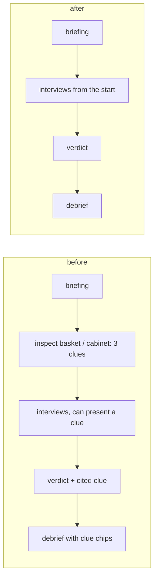

# Spec: remove-clues

## Intent

The user asked to remove clues from the Override game entirely (option B). Today a player must inspect the basket (grove) or potion cabinet (tower) to reveal three clue cards before any interview unlocks, can present a clue to a character, and must cite clues in the verdict. After this change a game is: read the briefing → interview the three characters → choose who knowingly broke the rule → debrief. Both live mysteries stay solvable from the briefing and the interviews: Momo admits the made-up permission when asked about the keeper, permission or the bell; all three apprentices honestly believed the tower bell, which points to Nobody, and the echo shell becomes the debrief's reveal.

## Goals

- No clue records, clue cards, "find the clues" stop, clue nav buttons, clue notebook pages, clue selector in interviews, or clue citations in the verdict anywhere a player can reach.
- Interviews are open from the start; the verdict needs every character interviewed (nothing else).
- Characters know their whole perspective from the first question; prompts contain no public-records block and no presented evidence.
- The two live cases (`banana-mystery`, `tower-echo-bell`) are rewritten without clue content and get new versions.
- The admin command centre follows: no clue or evidence rows, and the funnel's "First clue" step becomes "First question".
- Tooling (load test, admin demo driver, preflight, case-prompt script) and docs follow.

## Non-goals

- Rewriting the archived cases (`banana-control`, `tower-bell-charm`, `tower-missing-yes`, `override-v1`); they stay on disk and keep loading.
- New art. The basket/cabinet cells stay in the shared prop sheets, unused.
- New game features to replace clues (hints, timers, notes).
- Migrating in-progress games from the old case versions.

## Constraints

| Item | Rule |
|---|---|
| Research logs | Schema v2 stays: every event keeps `revealedPosition` and `selectedEvidence` keys, written as `null`; `verdict.evidenceIds` is written as `[]`. No new event types. `story_revealed` and `evidence_selected` are no longer produced. |
| Case versions | `banana-mystery` → `banana-authored-v2.0.0`, `tower-echo-bell` → `tower-echo-bell-v2.0.0`. `promptVersion` → `interview-v3`. Old-version sessions do not replay (existing caseVersion check) and their players start a new game. |
| Archived cases | `defineCase` still accepts and validates `chapters`, `records`, `copy.basket` and `debrief.findings[].evidence` when present, so the archived modules and their tests load unchanged; the game never reads them. Live cases omit them. |
| API | Actions `reveal` and `evidence` are removed (unknown endpoint). `visit` accepts `briefing`, `report` and the cast ids. `/api/state` drops `records`, `chapters`, `clueCount`, `copy.basket`, `world.clueSpot`, session `revealedPosition`/`selectedEvidence`, turn `evidence`/`revealedPosition`, debrief `findings[].evidence`. Other payload fields unchanged. |
| Stats and metrics | `stats().byStage` stage `clues` becomes `asked` (a game with at least one question); `override_sessions_by_stage` label values follow. |
| Admin | Funnel steps: started → first question → interviewed all → verdict → debrief (`funnel[case].asked` replaces `clues`). Old `story_revealed`/`evidence_selected` events found in logs produce no rows. |
| Tests | Retarget, never weaken: tests that revealed clues before interviewing now interview directly; clue-specific tests are deleted only when the behaviour no longer exists, and a test asserting its absence replaces them. |
| Pixel baseline | The grove baseline (`grove-darwin.png`) is regenerated on purpose (the basket stop, its label and the clue board are gone); the art itself is unchanged. |

## Done looks like

1. `/?case=banana-mystery`: no basket stop, no clue nav items, no "Find 3 clues" text; the room nav lists the three monkeys and "Your guess"; the briefing's next step points at the first monkey.
2. A player can ask Momo a question immediately after starting; asking Momo about permission (rehearsal mode) gets the admission.
3. "Your guess" unlocks after all three are interviewed; the verdict form has no clue selector; choosing Momo shows the correct feedback and the debrief without clue chips.
4. `/?case=tower-echo-bell`: same flow in the tower (no cabinet stop); choosing Nobody is correct and the debrief explains the echo shell.
5. `POST /api/reveal` and `POST /api/evidence` → 404; a verdict without `evidenceIds` is accepted.
6. The session export has no `story_revealed`/`evidence_selected` events; every event still has `revealedPosition: null` and `selectedEvidence: null`; the verdict has `evidenceIds: []`.
7. The admin funnel shows "First question" instead of "First clue"; the message log has no clue or evidence rows.
8. `npm test`, `npm run build`, `npm run test:e2e` green; `npm run loadtest -- --players 30 --scenario steady` and `node scripts/admin-demo.mjs` run without reveal calls.
9. README and CASES_PLAN describe the clue-free flow and the new versions.

## Decided

- Option B (user). AI orchestrator (user).
- The clue stops and their props (basket / cabinet and the clue board) leave the scenes; "Your guess" keeps its board; "START HERE" (briefing) stays.
- Knowledge strings lose their "if shown the clue…" clauses and gain equivalent "if asked/told…" reactions (e.g. Pip: if told the keeper never gave permission, says Momo fooled them; apprentices: if asked whether it could have been another bell or an echo, are surprised and did not know then).
- Rehearsal replies switch from clue branches to keyword branches with the same answers.
- Banana `feedback.other`: "The key was who knew the keeper had said no."
- Clue-only CSS and notebook animations are removed with the markup that used them.
- The pre-existing literal `${escape(world().text.clueSpot)}` button disappears with the clue empty state.

## Left to the builder / plan

- Exact wording of rewritten knowledge clauses and briefing/next-step copy, within the Decided rules.
- How the notebook index and room-nav grid adapt to 2 + cast pages and 4 nav items.
- Test restructuring inside each file.

## Diagrams

