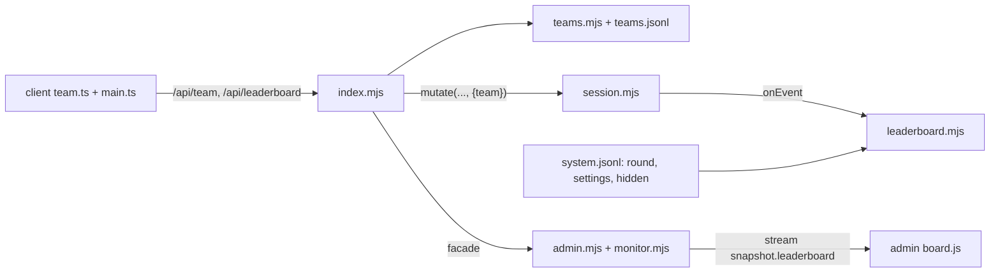
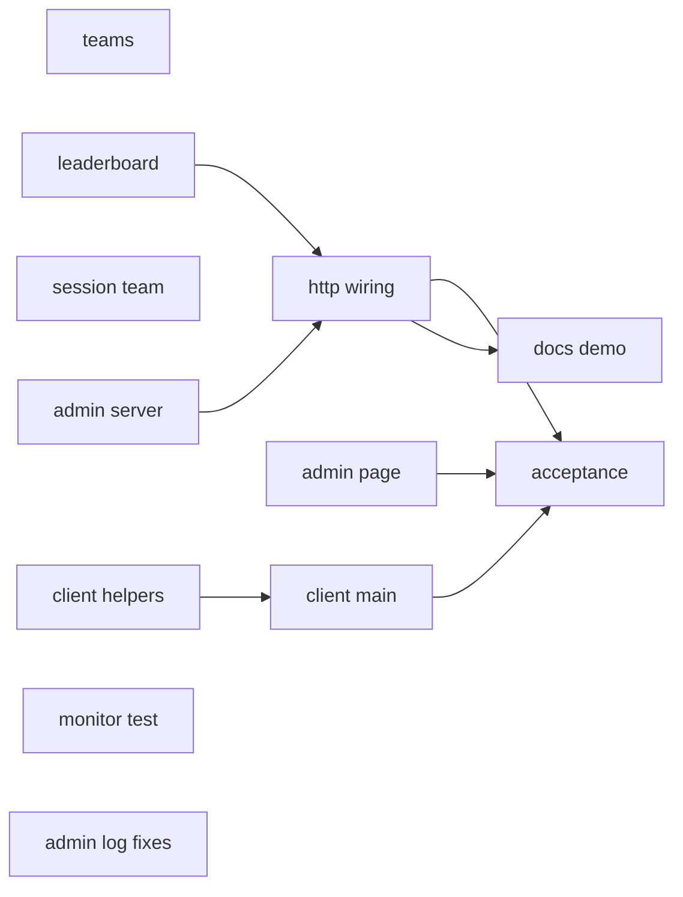

# Plan: teams and leaderboard

**Goal:** team check-in (light login, session follows the team), per-round leaderboard (points per correct guess, ties by time or coins), admin leaderboard with rank toggle and hide.
**Architecture:** `server/teams.mjs` (registry + teams.jsonl), `server/leaderboard.mjs` (pure, fed by game events), `session_started.team`, `/api/team` + `/api/leaderboard` in `index.mjs`, admin routes + snapshot, `client/team.ts` helpers wired in `main.ts`, admin `board.js`.
**Tech stack:** Node ESM (`node:test`; node runs `.ts`), TypeScript + Vite, Playwright 1.58.
**Spec:** docs/plans/2026-10-29-teams-leaderboard.spec.md
**Detail:** contracts
**Target-min:** 20
**Ignore:** demos/override/test-results/, demos/override/data/, demos/override/dist/, demos/override/node_modules/

## Global constraints

- Owns are repo-root relative; code in `demos/override/`. Unit: `node --test demos/override/tests/<file>` from the repo root. Types: `cd demos/override && npx tsc --noEmit`. Browser: `cd demos/override && npm run build && npx playwright test <spec> --output=$TMPDIR/pw-<task>`. Never unit and browser suites at once; one Playwright run at a time.
- Spec Constraints table is authoritative: name rule, messages, limits, cookie, storage records, scoring, order, hidden, settings records, admin routes. Copy messages exactly.
- Public leaderboard row: `{rank: number|null, name, points, played, timeMs, coins, you: boolean}`, no `teamId`, no `hidden`. Admin row adds `teamId`, `hidden`.
- Session view adds `session.team: {id, name} | null`. `schemaVersion` stays 2.
- DOM contract (game): `#team-form`, `#team-name` (maxlength 24), `#team-submit`, `#team-error`, `#team-join` ("Join <Name>"), `#team-other`, `#team-cancel` (switch only), top bar `#team-button` (shows the name) and `#leaderboard-button`, overlays `#team-switch` and `#leaderboard` (`#leaderboard-close`, rows `.board-row`, own row `.board-row.you`), debrief `#debrief-leaderboard`. Admin: section `#board`, toggles `[data-rank-by="time|coins"]` with `aria-pressed`, rows `.board-row[data-team="<id>"]`, button `[data-action="hide"]` / `[data-action="show"]`.
- FROZEN: existing `/api/*` fields, admin route paths, `Investigation` public methods (additive params only), case hashes, `tests/browser/grove-look.spec.mjs-snapshots`. Existing tests change only where a task names them.

## File structure

New: `server/teams.mjs`, `server/leaderboard.mjs`, `server/admin/board.{js,css}`, `client/team.{ts,css}`, `tests/browser/team.mjs` (browser helper), `tests/browser/teams.spec.mjs`; each task's Owns lists the rest.

## Task graph

```mermaid
%% schedule
gantt
  title Predicted schedule (mm:ss)
  dateFormat X
  axisFormat %M:%S
  section lane 1
  T6 admin page :t6, 0, 128s
  T9 acceptance :t9, 266, 160s
  section lane 2
  T7 client helpers :t7, 0, 126s
  T8 client main :t8, 126, 131s
  T10 docs demo :t10, 266, 143s
  section lane 3
  T5 admin server :t5, 0, 122s
  T4 http wiring :t4, 122, 144s
  section lane 4
  T2 leaderboard :t2, 0, 111s
  section lane 5
  T1 teams :t1, 0, 103s
  section lane 6
  T3 session team :t3, 0, 91s
```

critical path: T5 → T4 → T9 (7.1 min) · peak width 6 · predicted build 7.1 min · predicted total ≈ 20.3 min (target ✗ 20.0)

## Section: server

App type: HTTP service + library (auth-like). Categories: protocol, encoding, state, numeric; security review (light login, cookie, id leaks).

**Probe entry:** call=demos/override/server/leaderboard.mjs:createLeaderboard · serve=demos/override/server/index.mjs:startServer

### T1 teams · Complexity 4 · Est. context 34k
**Owns:** demos/override/server/teams.mjs, demos/override/tests/teams.test.mjs
**Components:** 1
**LOC owned:** 190
**Tests:** fast
**Model:** sonnet
**Consumes:** none
**Produces:** teams.teamName(raw: string) -> {name: string, key: string} | null
e.g. teamName('  Banana   Squad ') -> {name: 'Banana Squad', key: 'banana squad'}
e.g. teamName('x') -> null · teamName('<b>Owls</b>') -> null
**Produces:** teams.createTeams(opts: {file: string|null, max: number}) -> Teams
**Produces:** Teams.join(raw: string, opts: {join: boolean}) -> {team: {id: string, name: string, sessionId: string|null}, created: boolean} | {taken: string}
e.g. join('Banana Squad', {join: false}) -> {team: {id: 'uuid-a', name: 'Banana Squad', sessionId: null}, created: true}
e.g. then join('banana squad', {join: false}) -> {taken: 'Banana Squad'}
e.g. then join('banana squad', {join: true}) -> {team: {id: 'uuid-a', name: 'Banana Squad', sessionId: null}, created: false}
**Produces:** Teams.find(id: string) -> {id: string, name: string, sessionId: string|null} | null
e.g. find('uuid-a') -> {id: 'uuid-a', name: 'Banana Squad', sessionId: null} · find('nope') -> null
**Produces:** Teams.exists(raw: string) -> boolean
e.g. exists('BANANA squad') -> true · exists('Owls') -> false
**Produces:** Teams.attach(id: string, sessionId: string) -> void
e.g. attach('uuid-a', 's1'); find('uuid-a').sessionId -> 's1'
**Review Focus:** encoding (names), state (reload), file
**Test code (contracts):** `team_name_rules` (also 'Æble Hold 3' -> key 'æble hold 3'; 25 chars, '  ', '-Owls', 5 -> null; "Owls' Nest!" ok); `join_create_taken_join`; `find_rejects_non_uuid`; `persist_and_reload` (new createTeams on the same file restores name and sessionId; join with join:true returns the same id); `cap_503` (max 2: third new name throws RequestError status 503 with the spec message; joining an existing name still works); `invalid_400` (status 400, spec message); `partial_tail_ignored` (a partial last line is dropped); `attach_unknown_ignored`.
**Notes:** throw `RequestError` from `./session.mjs`. Records per spec Storage; create writes before returning (a failed write throws); an attach write failure keeps the in-memory pointer and logs `console.error`. `file: null` = memory only. ids from `randomUUID`.

### T2 leaderboard · Complexity 5 · Est. context 36k
**Owns:** demos/override/server/leaderboard.mjs, demos/override/tests/leaderboard.test.mjs
**Components:** 1
**LOC owned:** 260
**Tests:** fast
**Model:** sonnet
**Consumes:** none
**Produces:** leaderboard.createLeaderboard(cases: object[], opts: {startedAt: number}) -> Leaderboard
**Produces:** Leaderboard.observe(e: object) -> void
**Produces:** Leaderboard.reset(startedAt: number) -> void
**Produces:** Leaderboard.setRankBy(mode: string) -> void
**Produces:** Leaderboard.setHidden(teamId: string, hidden: boolean) -> void
**Produces:** Leaderboard.restore(records: object[]) -> void
**Produces:** Leaderboard.standings(opts: {includeHidden: boolean, you: string|null}) -> {rankBy: string, startedAt: number, teams: object[]}
e.g. A 'Banana Squad' right on banana-mystery (momo) at 120000 ms, 8 coins; B 'Owls' wrong at 60000 ms, 4 coins; C 'Lynx' only started -> standings({includeHidden: false, you: 'A'}) -> {rankBy: 'time', startedAt: 0, teams: [{rank: 1, teamId: 'A', name: 'Banana Squad', points: 1, played: 1, timeMs: 120000, coins: 8, hidden: false, you: true}, {rank: 2, teamId: 'B', name: 'Owls', points: 0, played: 1, timeMs: 60000, coins: 4, hidden: false, you: false}, {rank: null, teamId: 'C', name: 'Lynx', points: 0, played: 0, timeMs: 0, coins: 0, hidden: false, you: false}]}
e.g. after setHidden('A', true): includeHidden false -> teams [Owls rank 1, Lynx rank null]; includeHidden true -> [Banana Squad rank null hidden true, Owls rank 1, Lynx rank null]
**Review Focus:** numeric (sums, ties), state (first verdict only, rounds, resets)
**Test code (contracts):** `first_verdict_counts` (a replay with a wrong guess keeps 1 point, played 1); `nobody_case` (tower-echo-bell 'none' = 1, 'wren' = 0); `time_from_first_start` (start 0 s, reset and restart at 60 s, verdict at 150 s -> 150000); `coins_across_sessions` (session 1 spend.total 6, session 2 verdict coins.spent 4 -> 10; a session started after the verdict is not counted); `rank_by_time_and_coins` (A 100 s/12 coins vs B 200 s/4 coins, both 1 point: time A,B; coins B,A); `ties_share_rank` (1, 1, 3); `unranked_after_ranked`; `hidden_rows`; `reset_round` (events before startedAt ignored; reset empties); `restore_settings` (last leaderboard_settings wins, team_hidden in order); `ignores_teamless_and_unknown_case`; `score_field_points` (verdict {score: 3} -> 3 points); `setRankBy_rejects` ('speed' throws); `never_throws` (observe(null), observe({})); `name_latest`.
**Notes:** pure, no I/O, no clock. Event times are ISO `timestamp`. Team from `session_started.team {id, name}` (strings) only.

### T3 session team · Complexity 2 · Est. context 30k
**Owns:** demos/override/server/session.mjs, demos/override/tests/session-team.test.mjs
**Components:** 1
**LOC owned:** 90
**Tests:** fast
**Model:** sonnet
**Consumes:** none
**Produces:** Investigations.mutate(sessionId: string|null, action: string, input: object, ctx: {team: object|null}) -> view
e.g. mutate(null, 'start', {}, {team: {id: 'uuid-a', name: 'Banana Squad'}}) -> view.session.team {id: 'uuid-a', name: 'Banana Squad'}; its session_started event has the same team
e.g. mutate(null, 'start', {}) -> view.session.team null; session_started.team null
**Review Focus:** state (replay)
**Test code (contracts):** `start_with_team`; `start_without_team`; `reset_takes_ctx_team`; `replay_restores_team` (a new Investigations on the same dir); `replay_drops_bad_team` (team {id: 5} -> null).
**Notes:** thread `team` through `Investigation.mutate(action, input, {kase, assignment, team})` into `start`; only `{id, name}` is stored.

### T5 admin server · Complexity 3 · Est. context 36k
**Owns:** demos/override/server/admin.mjs, demos/override/server/monitor.mjs, demos/override/tests/admin-leaderboard.test.mjs
**Components:** 2
**LOC owned:** 170
**Tests:** fast
**Model:** sonnet
**Consumes:** adminBoard.standings() -> {rankBy: string, startedAt: number, teams: object[]} (T4) · adminBoard.setRankBy(mode: string) -> void (T4) · adminBoard.setHidden(teamId: string, hidden: boolean) -> void (T4)
**Produces:** adminHttp.leaderboard(method: string, body: object) -> {rankBy: string, startedAt: number, teams: object[]}
e.g. leaderboard('POST', {rankBy: 'coins'}) -> 200 standings with rankBy 'coins' (route POST /admin/leaderboard; GET returns standings)
e.g. leaderboard('POST', {rankBy: 'speed'}) -> 400 {error: 'rankBy must be time or coins.'} · no leaderboard -> 409 {error: 'The leaderboard is off.'}
**Produces:** adminHttp.hidden(body: {teamId: string, hidden: boolean}) -> {rankBy: string, startedAt: number, teams: object[]}
e.g. hidden({teamId: 'uuid-a', hidden: true}) -> 200 standings, that row hidden true (route POST /admin/teams/hidden)
e.g. hidden({teamId: 'nope', hidden: true}) -> 400 {error: 'teamId must be a team id.'} · hidden({teamId: 'uuid-a', hidden: 'yes'}) -> 400 {error: 'hidden must be true or false.'}
**Produces:** monitor.snapshot() -> {leaderboard: object|null}
e.g. snapshot() with extras() returning {leaderboard: L} -> {..., leaderboard: L}; without -> {..., leaderboard: null}
e.g. snapshot() rows (recent(), session(id)) of a game whose session_started had team {name: 'Owls'} -> row.team 'Owls'; teamless -> row.team null
**Review Focus:** protocol (auth, validation), encoding
**Test code (contracts):** routes with a fake facade (401 without token, 400 bad rankBy / non-boolean hidden / non-UUID teamId, 409 when `leaderboard` is null, 200 standings); `snapshot_has_leaderboard`; `rows_carry_team` (live, `load` and `session(id)` drill-down); team map capped at 5000.
**Notes:** `createAdmin({..., leaderboard = null})`. Existing admin and monitor tests stay green.

### T4 http wiring · Complexity 5 · Est. context 52k
**Owns:** demos/override/server/index.mjs, demos/override/tests/teams-http.test.mjs
**Components:** 1
**LOC owned:** 260
**Tests:** slow
**Model:** sonnet
**Consumes:** Teams.join(raw: string, opts: {join: boolean}) -> {team: {id: string, name: string, sessionId: string|null}, created: boolean} | {taken: string} (T1) · Investigations.mutate(sessionId: string|null, action: string, input: object, ctx: {team: object|null}) -> view (T3)
**Produces:** http.team(method: string, body: object) -> {team: {name: string}|null, created: boolean}
e.g. team('GET', {}) with no cookie -> {team: null}
e.g. team('POST', {name: 'Owls'}) -> 200 {team: {name: 'Owls'}, created: true} + Set-Cookie override_team=<uuid>
e.g. team('POST', {name: 'owls'}) -> 409 {error: 'A team called Owls is already playing. Join it, or pick another name.', taken: 'Owls'} · team('POST', {name: 'owls', join: true}) -> 200 {team: {name: 'Owls'}, created: false}
**Produces:** http.leaderboard() -> {rankBy: string, teams: object[]}
e.g. leaderboard() -> {rankBy: 'time', teams: [{rank: 1, name: 'Owls', points: 1, played: 1, timeMs: 95000, coins: 6, you: true}]} (route GET /api/leaderboard)
**Produces:** adminBoard.standings() -> {rankBy: string, startedAt: number, teams: object[]}
e.g. standings() -> {rankBy: 'time', startedAt: 0, teams: [{rank: 1, teamId: 'uuid-a', name: 'Owls', points: 1, played: 1, timeMs: 95000, coins: 6, hidden: false, you: false}]}
**Produces:** adminBoard.setRankBy(mode: string) -> void
e.g. setRankBy('coins') -> undefined; standings().rankBy -> 'coins'; system.jsonl gains {type: 'leaderboard_settings', rankBy: 'coins'}
**Produces:** adminBoard.setHidden(teamId: string, hidden: boolean) -> void
e.g. setHidden('uuid-a', true) -> undefined; standings().teams[0].hidden -> true; system.jsonl gains {type: 'team_hidden', teamId: 'uuid-a', hidden: true}
**Review Focus:** protocol, state, security (cookie, id leak, rate limit)
**Test code (contracts):** `team_gate_flow`; `same_team_two_browsers` (B joins A's team: same session id in /api/state; B resets, A sees the new id); `session_started_team`; `leaderboard_public` (correct banana verdict 'momo' -> rank 1, 1 point, you true; no `teamId`/`hidden` keys; another team sees you false); `teamless_still_works` (override_session cookie as before, not on the board); `new_team_rate_limit` (121st new name from one address in a minute -> 429; join still 200); `restart_restores` (startServer twice on one data dir: team name, session, rankBy 'coins' set via POST /admin/leaderboard); `round_empties_board` (POST /admin/round).
**Notes:** `createApp({..., teams = createTeams({file: null}), leaderboard = null})`; route labels add `team`, `leaderboard`. With a known team, `sessionId = team.sessionId`; after a mutation that changes the session, `teams.attach` (no session cookie); without a team, behaviour unchanged. startServer builds the board with T2's real `createLeaderboard(cases)` (edge T2 -> T4); teams file `join(paths.root, 'teams.jsonl')`; board restored from system.jsonl, reset to `loadRound().startedAt`, fed `loadEvents(paths.sessions, startedAt)` (load once, shared with the monitor) and every `onEvent`; `round_started` system records reset it; facade setters write `leaderboard_settings` / `team_hidden` via `onSystem`; `extras()` adds `leaderboard: standings({includeHidden: true})`.

### T11 monitor test retarget · Complexity 1 · Est. context 20k
**Owns:** demos/override/tests/monitor.test.mjs
**Components:** 1
**LOC owned:** 4
**Tests:** fast
**Kind:** mechanical
**Model:** haiku
**Consumes:** none
**Test code (contracts):** the two pinned-key assertions follow T5's additive fields: a row has `team: null`, the snapshot keys include `leaderboard`; `node --test demos/override/tests/monitor.test.mjs` passes.
**Notes:** done by T5's implementer (see Ruling in progress); recorded so a task owns the file.

## Section: admin page

App type: web UI. Categories: encoding (XSS via team names), protocol via its API.

**Probe entry:** call=demos/override/server/admin/board.js:boardRows

### T6 admin page · Complexity 4 · Est. context 40k
**Owns:** demos/override/server/admin/board.js, demos/override/server/admin/board.css, demos/override/server/admin/index.html, demos/override/server/admin/app.js, demos/override/server/admin/controls.js, demos/override/server/admin/log.js, demos/override/tests/admin-board.test.mjs
**Components:** 2
**LOC owned:** 220
**Tests:** fast
**Model:** sonnet
**Consumes:** monitor.snapshot() -> {leaderboard: object|null} (T5) · adminHttp.leaderboard(method: string, body: object) -> {rankBy: string, startedAt: number, teams: object[]} (T5) · adminHttp.hidden(body: {teamId: string, hidden: boolean}) -> {rankBy: string, startedAt: number, teams: object[]} (T5)
**Review Focus:** encoding
**Test code (contracts):** `boardRows` (rank null -> '–', timeMs 125000 -> '2:05', points 1 -> '1 pt', hidden flag, null leaderboard -> []); `renderBoard` with the fake DOM from admin-round.test (toggle calls api('/admin/leaderboard', {rankBy: 'coins'}), Hide calls api('/admin/teams/hidden', {teamId, hidden: true}), `aria-pressed` follows rankBy, re-render keeps one row per team); `systemLine` for `leaderboard_settings` and `team_hidden`; log shows `row.team` instead of the 4-character id when present.
**Notes:** textContent only (admin-page-files.test bans innerHTML). Section `#board` sits in the `.side` column above the funnel; empty board text `No team has finished a case this round.`

### T12 admin log review fixes · Complexity 1 · Est. context 20k
**Owns:** demos/override/server/admin/log.css, demos/override/tests/admin-log.test.mjs
**Components:** 1
**LOC owned:** 40
**Tests:** fast
**Kind:** mechanical
**Model:** haiku
**Consumes:** none
**Test code (contracts):** the log player column fits long team names (`minmax(44px, 12ch)`, ellipsis); tests for team names in rows and the player chip, markup in a name stays text; `node --test demos/override/tests/admin-log.test.mjs` passes.
**Notes:** written by the admin package reviewer (see Ruling in progress).

## Section: client

App type: web UI. Categories: encoding (names), protocol via the API.

**Probe entry:** call=demos/override/client/team.ts:teamNameError

### T7 client helpers · Complexity 3 · Est. context 32k
**Owns:** demos/override/client/team.ts, demos/override/client/team.css, demos/override/client/types.ts, demos/override/tests/team-ui.test.mjs
**Components:** 2
**LOC owned:** 200
**Tests:** fast
**Model:** sonnet
**Consumes:** none
**Produces:** team.teamNameError(raw: string) -> string | null
e.g. teamNameError('Owls') -> null · teamNameError('x') -> 'Team names are 2 to 24 letters, numbers and spaces.'
**Produces:** team.teamGate(view: {name: string, error: string, taken: string|null, busy: boolean, switching: boolean}) -> string
e.g. teamGate({name: '', error: '', taken: null, busy: false, switching: false}) -> markup with #team-form, #team-name maxlength 24, #team-submit, #team-error
e.g. taken 'Owls' -> also #team-join 'Join Owls' and #team-other; switching true -> also #team-cancel
**Produces:** team.leaderboardPanel(board: {rankBy: string, teams: object[]}) -> string
e.g. {rankBy: 'time', teams: [{rank: 1, name: 'Owls', points: 1, played: 1, timeMs: 125000, coins: 8, you: true}]} -> table with one `tr.board-row.you` holding '1', 'Owls', '1 pt', '2:05', '8 coins'
e.g. teams [] -> `
No team has finished a case yet.
`
**Produces:** team.clock(ms: number) -> string
e.g. clock(125000) -> '2:05' · clock(3725000) -> '62:05'
**Review Focus:** encoding
**Test code (contracts):** the examples plus `names_escaped` (`` name -> `&lt;img`), rank null -> 'Playing', '2 pts', `rankBy` caption 'Ties by time' / 'Ties by coins'.
**Notes:** types.ts: `Session.team: {id: string; name: string} | null`, `LeaderboardRow`, `Leaderboard`. team.css styles the gate, chip and board in both world themes.

### T8 client main · Complexity 5 · Est. context 46k
**Owns:** demos/override/client/main.ts
**Components:** 1
**LOC owned:** 150
**Tests:** slow
**Model:** sonnet
**Consumes:** team.teamGate(view: {name: string, error: string, taken: string|null, busy: boolean, switching: boolean}) -> string (T7) · team.leaderboardPanel(board: {rankBy: string, teams: object[]}) -> string (T7) · http.team(method: string, body: object) -> {team: {name: string}|null, created: boolean} (T4) · http.leaderboard() -> {rankBy: string, teams: object[]} (T4)
**Review Focus:** protocol (taken flow, polling stops), encoding
**Test code (contracts):** `npx tsc --noEmit && npm run build` pass. Behaviour checked by T9.
**Notes:** boot: access, then start the heartbeat (before the gate), then GET /api/team; no team -> gate in `.access-screen`; POST needs the raw response for `taken`; success -> continue boot. `#team-button` opens `#team-switch` (teamGate switching), success -> `location.reload()`. `#leaderboard-button` and `#debrief-leaderboard` open `#leaderboard`, polled every 10 s while open, stopped on close. Escape and backdrop close both overlays; the station is disabled while one is open. Debrief fine print: `Each case scores once per team: your first guess counts.`

## Section: acceptance and docs

**Probe entry:** serve=demos/override/server/index.mjs:startServer

### T9 acceptance · Complexity 5 · Est. context 48k
**Owns:** demos/override/tests/browser/team.mjs, demos/override/tests/browser/teams.spec.mjs, demos/override/tests/browser/admin.spec.mjs, demos/override/tests/browser/cases.spec.mjs, demos/override/tests/browser/coins.spec.mjs, demos/override/tests/browser/grove-look.spec.mjs, demos/override/tests/browser/investigation.spec.mjs, demos/override/tests/browser/provenance.spec.mjs, demos/override/tests/browser/tower.spec.mjs, demos/override/tests/browser/walking.spec.mjs
**Components:** 2
**LOC owned:** 210
**Tests:** slow
**Model:** sonnet
**Consumes:** http.team(method: string, body: object) -> {team: {name: string}|null, created: boolean} (T4)
**Review Focus:** protocol, state
**Test code (contracts):** `team.mjs` exports `joinTeam(target, name?)` (POST /api/team via `target.request`, unique `Team xxxxxxxx`) and `test` = base test whose `page` joins a team first, plus `expect`. Existing specs import from `./team.mjs`; provenance's `browser.newContext` pages call `joinTeam(ctx)`. teams.spec: `gate_first`, `bad_name_inline`, `join_same_team` (two contexts, same session id), `reload_keeps_team`, `leaderboard_after_correct` (banana 'momo' -> `.board-row.you` with '1 pt'), `replay_keeps_points`. admin.spec adds `leaderboard_section` (teams via `playwright.request.newContext()`, toggle Coins sets aria-pressed, Hide removes the team from /api/leaderboard). Then every project passes with the unchanged grove baseline.

### T10 docs demo · Complexity 2 · Est. context 28k
**Owns:** demos/override/README.md, demos/override/scripts/admin-demo.mjs
**Components:** 2
**LOC owned:** 70
**Tests:** slow
**Model:** sonnet
**Consumes:** http.team(method: string, body: object) -> {team: {name: string}|null, created: boolean} (T4)
**Test code (contracts):** README "Teams and the leaderboard" under Play (check-in, join, first guess counts, scoring, ties) and the command-centre leaderboard bullets; a note to use a fresh `OVERRIDE_ENV` per event. admin-demo players POST `/api/team {name: 'Demo team N', join: true}` before playing; `tests/admin-demo.test.mjs` and `docs.test.mjs` pass.

## Review Focus

Server: session hijack beyond the light-login design (team id is the only key; ids never public), two screens racing a start, attach pointer after restart, first-verdict rule across resets, time/coins sums, hidden teams leaking via ranks, rate limit counting joins, round reset, write failure on create. Client/admin: XSS through team names (game markup and admin textContent), gate shown when the server has no team, polling leaks, top bar fitting one row at 1440 px and wrapping cleanly on phones, heartbeat before the gate.

## Self-review

Coverage: spec Intent, Goals -> T1-T10; Constraints -> Global constraints, T1, T2, T4, T5; Done looks like 1-3 -> T1, T3, T4, T8, T9; 4 -> T2, T4, T7, T9; 5-6 -> T4, T5, T6, T9; 7 -> T9, T10; Decided -> Global constraints; Left to the builder / plan -> T6-T8; Diagrams -> main diagram. Edges: T4's tests run T1, T2, T3 and T5 for real; T8's build needs T7's exports; T9 and T10 run the whole server. Ruling: one acceptance task - the Playwright web servers use fixed ports, so browser tasks cannot run in parallel - cost if wrong: about 2 min.
