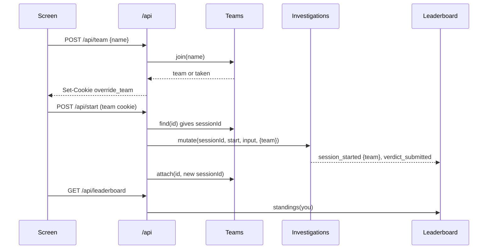

# Spec: teams and leaderboard

## Intent

At events (IMADA Cup) each team of three or four plays Override on one screen. Today a game belongs to an anonymous browser cookie, and the operator sees only 4-character session ids. Teams should compete. A light check-in names the team and ties its game to that name. A leaderboard gives points for correct guesses and breaks ties by speed or by thrift. The operator controls the ranking and moderates names in `/admin`. Source: the user's two tickets ("Team name at the start", "Leaderboard ... + admin panel support").

## Goals

- **Check-in first:** before the case board, the team types its name. The browser is then tied to that team (cookie `override_team`).
- **Light login:** the same name on another screen means the same team, after a "Join that team?" confirmation. A team's current game follows the team: every screen of a team plays the same session.
- Every game a team starts or resets logs `team {id, name}` in `session_started`.
- **Leaderboard per round:** points for each correct guess. Ties are broken by time or by coins, as the operator chooses. Players open it from the top bar and from the debrief.
- **Admin:** a leaderboard section with a Time / Coins rank toggle and hide/show per team (moderation). Team names appear in the message log and in the drill-down.

## Non-goals

- No passwords, member names, team size, rename, or avatars. No switch to turn the check-in off.
- No projector page (`/admin/show` stays deferred).
- No change to case content, prompts, coin rules or the verdict shape. Log `schemaVersion` stays 2; `session_started.team` is additive.
- The server does not refuse games without a team (old browsers, load test, scripts). Those games are simply not on the leaderboard.

## Constraints

| Item | Rule |
|---|---|
| Team name | Trimmed, inner whitespace collapsed to one space, NFC. 2–24 characters: letters of any script, digits, spaces and `' ’ & . - ! ? #`. First character a letter or digit. Key = lowercase name. Error: `Team names are 2 to 24 letters, numbers and spaces.` (400) |
| Taken name | 409 `{error: 'A team called <Name> is already playing. Join it, or pick another name.', taken: '<Name>'}`; the same request with `join: true` joins. |
| Limits | 1000 teams at most: 503 `The team list is full. Ask the organisers.` New teams: 120 per minute per client address, 429 `Too many new teams. Try again in a minute.` |
| Cookie | `override_team=<uuid>`; HttpOnly, SameSite=Strict, Path=/, Max-Age 43200, Secure as for the other cookies. With a known team, the session is the team's current session, not `override_session`. |
| Storage | `<dataDir>/teams.jsonl`: `team_created {teamId, name, timestamp}` and `team_session {teamId, sessionId, timestamp}`. A restart restores names and current sessions. |
| Privacy | Team ids never appear in public payloads (`/api/leaderboard`). Only the team's own `/api/state` holds its id. |
| Round | The current admin round (`round_started` in system.jsonl); with no round, everything. A new round empties the board. |
| Counted game | Only a team's **first verdict per case** in the round counts. |
| Points | 1 per correct guess: with an empty `culprits` list the correct guess is `none`, otherwise the guess must be in `culprits`. A verdict with an integer `score` field (a future role verdict) gives `score` points. |
| Time | Per case: the counted verdict's time minus the team's first `session_started` for that case in the round. |
| Coins | Per case: the coins spent across all of the team's sessions of that case started at or before the counted verdict. |
| Order | Points descending, then the rank-by metric ascending, then the other metric ascending, then name. Teams with no counted verdict come last, unranked ("playing"). Equal points, time and coins share a rank (1, 1, 3). |
| Hidden | A hidden team is left out of the player board and takes no rank. The admin still sees it, marked hidden. |
| Settings | `rankBy` is `time` (the default) or `coins`. It is stored in system.jsonl as `leaderboard_settings {rankBy}`; hiding is stored as `team_hidden {teamId, hidden}`. Both are restored at start. |
| Admin | Same bearer token, CSP and textContent-only rules. `GET /admin/leaderboard`, `POST /admin/leaderboard {rankBy}` and `POST /admin/teams/hidden {teamId, hidden}` return the standings. The stream snapshot gains `leaderboard`. |
| Frozen | Existing `/api/*` fields (additive only), existing admin routes, case hashes, the grove pixel baseline. Existing tests pass. |

## Done looks like

1. A fresh browser shows the team check-in before the case board. A bad name shows the error inline. A good name opens the case board, and the top bar shows the team name.
2. The same name typed on a second browser shows "A team called X is already playing" with Join and Pick another. Join opens the same game: same session id, same transcript.
3. Reset session, starting another case and reloading all keep the team.
4. After a correct guess, the leaderboard shows the team with 1 point, its time and its coins, and the team's own row is highlighted. Replaying the same case does not change the points.
5. In admin, the leaderboard lists every team in the round, including ones still playing. The Time / Coins toggle reorders the list and survives a restart. Hide removes a team from `/api/leaderboard` and from the player board. Log rows show team names.
6. Starting a new round in admin empties the board.
7. All existing unit and browser suites pass; the browser specs join a team through a helper. The `admin-demo` rehearsal players join teams.

## Decided

Names, routes, messages, cookie, files and events as in Constraints. Rank-by default `time`. Points per correct guess = 1.

## Left to the builder / plan

Markup and CSS, the poll interval of the open leaderboard (about 10 s), file layout, and test names.

## Diagrams

