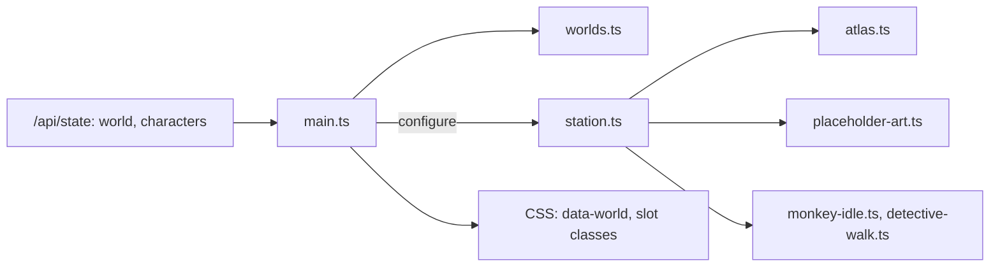
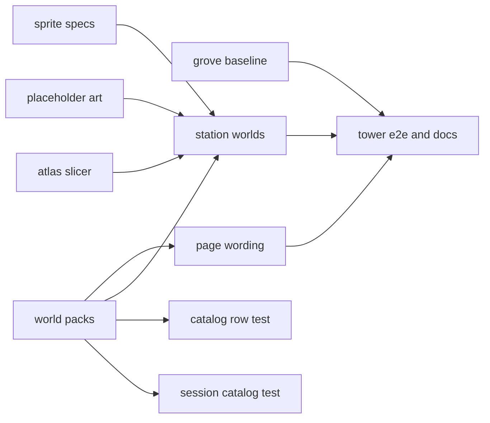

# Plan: tower client, per-case worlds, sprites and cast (phase 2)

## Design

**User said:** each game (case) gets its own environment, sprites and actors; first world is the wizard tower; the user generates the tower art from the prompt files in `public/assets/tower/`.
**Assumed:** art may be missing during the build, so every tower image has a code-drawn placeholder with the same layout; the grove looks and reads exactly as today; tower cases stay drafts (`OVERRIDE_DEV_TOOLS=1`).
**Approach:** the server already sends `state.world` (phase 1). The client gets one world pack per world id (strings, art URLs, palette). The station boots in the grove as today; `configure(world, cast)` restarts it with another world and cast. Tower frames are measured from the PNG alpha at runtime (`sliceAtlas`), so regenerated art needs no hand-tuned anchors; the grove keeps its tuned tables. A failed image falls back to `placeholderAtlas`. Rejected: a JSON frame manifest per image (a hand step every time art is regenerated).
**Testing:** node tests import the pure `.ts` modules; a pixel baseline of the grove canvas from the start commit; a Playwright `tower` project with dev tools on.

**Goal:** the client renders each case's world (map, props, cast, investigator, portraits, wording) and switches when the case changes.
**Architecture:** see Design and the diagram.
**Tech stack:** TypeScript, Vite, Phaser 3.90; Node 25 `node:test` (type stripping); Playwright.
**Spec:** none (Design above; tower strings in `docs/plans/2026-10-26-wizard-tower.content.md`)
**Detail:** contracts
**Target-min:** 14

Global constraints:
- Paths are relative to `demos/override/`; Owns are repo-root relative. Unit: `node --test demos/override/tests/*.test.mjs` from the repo root. Build: `npm run build`. Browser: `npm run build && npx playwright test <spec> --output=<your scratch dir>` (serves `dist/`; one Playwright run at a time on port 4317, retry once if busy).
- Pure modules (`client/worlds.ts`, `client/atlas.ts`, `client/placeholder-art.ts`, `client/monkey-idle.ts`, `client/detective-walk.ts`) have only `import type` imports; tests import `../client/<name>.ts`.
- Frozen for existing tests: scene key `banana-grove`; scene fields `player`, `avatar`, `walk`, `npcs` (Map id → { sprite, reset() }), `resetPosition()`, `travel()`, `setEnabled()`; frame names `${direction}-${pose}` and `${id}-${pose}`; `createStation(onArrival, onHint) -> Station`; all grove UI text; existing specs pass unchanged.
- Stops by cast slot in both worlds: slot 0 (116,156), slot 1 (364,156), slot 2 (364,268); clue (244,236), evidence (68,220), report (132,276), briefing (244,276).
- Tower art (may be absent, any pixel size): `/assets/tower/apprentices.png` 4×4 (columns wren, basil, juniper, inspector; rows down, up, left, right); `apprentice-idle.png` 4 poses (neutral, blink, gesture start, gesture) × 3 rows (wren, basil, juniper); `inspector-walk.png` 4×4 (rows down, up, left, right; columns steps); `tower-props.png` 2×2 (bookshelf, potion cabinet / noticeboard, bell).
- `Frame` = `{ x, y, w, h, anchorX, anchorY }`, atlas pixels, anchors relative to the frame's top-left.
- Every pack string and name in HTML goes through `escape()`. No `server/` change except `listCases`.



## File structure

`client/worlds.ts` packs · `client/atlas.ts` slicer · `client/placeholder-art.ts` RGBA placeholders · `client/monkey-idle.ts`, `client/detective-walk.ts` sprite specs · `client/station.ts` scene · `client/main.ts`, `client/notebook.ts`, CSS page · `playwright.config.mjs`, `tests/browser/tower.spec.mjs`, `tests/browser/grove-look.spec.mjs` browser · docs.

## Task graph

```mermaid
%% schedule
gantt
  title Predicted schedule (mm:ss)
  dateFormat X
  axisFormat %M:%S
  section lane 1
  T1 grove baseline :t1, 0, 118s
  T8 tower e2e and docs :t8, 278, 151s
  section lane 2
  T5 sprite specs :t5, 0, 117s
  T6 station worlds :t6, 117, 161s
  section lane 3
  T2 world packs :t2, 0, 115s
  T7 page wording :t7, 115, 153s
  section lane 4
  T4 placeholder art :t4, 0, 97s
  section lane 5
  T3 atlas slicer :t3, 0, 94s
```





critical path: T5 → T6 → T8 (7.2 min) · peak width 5 · predicted build 7.2 min · predicted total ≈ 20.4 min (target ✗ 14.0)

## Package: engine

App type: library. Categories: deep, numeric, encoding.
**Probe entry:** call=demos/override/client/atlas.ts#sliceAtlas

### T2 world packs · Complexity 3 · Est. context 30k
**Owns:** demos/override/client/worlds.ts, demos/override/client/types.ts, demos/override/server/cases.mjs, demos/override/tests/worlds.test.mjs, demos/override/tests/browser/provenance.spec.mjs
**Components:** 2
**LOC owned:** 110
**Tests:** fast
**Model:** sonnet
**Consumes:** none
**Produces:** worlds.worldFor(id: string | undefined) -> WorldPack
  e.g. worldFor('tower').text.clueSpot -> 'potion cabinet'
  e.g. worldFor('moon').id -> 'grove'
  e.g. worldFor('tower').art -> { cast: '/assets/tower/apprentices.png', idle: '/assets/tower/apprentice-idle.png', walk: '/assets/tower/inspector-walk.png', props: '/assets/tower/tower-props.png' }
**Review Focus:** `packs match the server worlds`; `catalog rows name their world`.
**Tests:** `grove text is today's text` and `tower text` (rows below, deepEqual); `packs match the server worlds` (place, many, clueSpot equal `server/worlds.mjs`; server `cast.one` ends with ' ' + text.one); `unknown world is the grove` (undefined, 'moon'); `catalog rows name their world` (`listCases(registry, { dev: true })`: banana-mystery 'grove', tower-bell-charm 'tower').
**Steps:** 1 failing tests, 2 run: FAIL, 3 implement, 4 run: PASS
**Notes:** `WorldPack = { id, text: { place, eyebrow, day, one, many, castLabel, clueSpot, clueNav, clueLabel, clueTitle, hint, clickOne, investigator, icon }, art: { cast, idle, walk, props }, palette: { ground, label, labelBg } }`. Grove: Banana Grove · GROVE · PICNIC DAY · monkey · monkeys · MONKEY · basket · Basket · BANANA BASKET · Inspect the banana basket · Click a monkey or use WASD / arrows to explore. · a monkey · monkey investigator · the `banana` SVG path from main.ts; art `/assets/banana/` monkeys, monkey-idle, detective-walk, jungle-props `.png`; palette '#82a75e', '#40533c', '#fff6dd'. Tower: Wizard Tower · TOWER · POTION DAY · apprentice · apprentices · APPRENTICE · potion cabinet · Cabinet · POTION CABINET · Inspect the potion cabinet · Click an apprentice or use WASD / arrows to explore. · an apprentice · inspector · star `M12 3l2.6 5.6 6 .7-4.5 4.1 1.2 6L12 16.4l-5.3 3 1.2-6-4.5-4.1 6-.7z`; palette '#5d566e', '#3d3550', '#f3ecff'. `listCases` adds `world: c.world.id`; the allowlist in provenance.spec becomes `['id', 'lead', 'order', 'title', 'world']` (T8 runs it). types: `CharacterId = string`, `CaseState.world: { id: string; place: string; cast: { one: string; many: string }; clueSpot: string }`.

### T2b catalog row test · Complexity 1 · Est. context 20k
**Owns:** demos/override/tests/cases.test.mjs
**Components:** 1
**LOC owned:** 4
**Tests:** fast
**Model:** sonnet
**Consumes:** none
**Produces:** none
**Tests:** `listCases and findCase hide drafts unless dev`: the expected rows are `{ id, title, lead, order, world: 'grove' }`.
**Steps:** 1 edit the expected rows, 2 run: PASS
**Notes:** follow-up fix of T2 (ruling in progress.md): only that assertion changes.

### T2c session catalog test · Complexity 1 · Est. context 20k
**Owns:** demos/override/tests/session.test.mjs
**Components:** 1
**LOC owned:** 4
**Tests:** fast
**Model:** sonnet
**Consumes:** none
**Produces:** none
**Tests:** `catalog lists the ready cases in order`: the expected rows are `{ id, title, lead, order, world: 'grove' }`.
**Steps:** 1 edit the expected rows, 2 run: PASS
**Notes:** follow-up fix of T2 (ruling in progress.md): only that assertion changes.

### T3 atlas slicer · Complexity 5 · Est. context 30k
**Owns:** demos/override/client/atlas.ts, demos/override/tests/atlas.test.mjs
**Components:** 1
**LOC owned:** 120
**Tests:** fast
**Model:** sonnet
**Consumes:** none
**Produces:** atlas.sliceAtlas(alpha: ArrayLike<number>, width: number, height: number, cols: number, rows: number, threshold?: number) -> Frame[]
  e.g. sprites (2,2,4,6) and (12,1,6,8) in a 20×10 2×1 atlas -> [{x:2,y:2,w:4,h:6,anchorX:2,anchorY:6},{x:12,y:1,w:6,h:8,anchorX:3,anchorY:8}]
  e.g. empty right cell of that atlas without the second sprite -> {x:10,y:0,w:10,h:10,anchorX:5,anchorY:10}
**Review Focus:** numeric: cut off-by-one, cell at the image edge, threshold boundary; deep: 2000×2000 atlas under 100 ms.
**Steps:** 1 failing tests, 2 run: FAIL, 3 implement, 4 run: PASS
**Notes:** opaque = alpha > threshold (16). Boundary k: e = round(k·width/cols), window [e − floor(cellW/3), e + floor(cellW/3)] clipped; take the longest run of columns with the fewest opaque pixels (tie: run nearest e); cut = floor((runStart + runEnd + 1)/2) = first column of the next cell. Rows alike. Per cell, row-major: bbox of opaque pixels; anchorY = h; anchorX = (minX + maxX + 1)/2 − x over opaque columns in the bbox's top max(1, round(0.4·h)) rows. Empty cell: whole cell, anchor bottom centre.
**Test code (verbatim):**
```js
import test from 'node:test';
import assert from 'node:assert/strict';
import { sliceAtlas } from '../client/atlas.ts';
const blank = (w, h) => ({ w, h, a: new Uint8Array(w * h) });
const rect = (img, x, y, rw, rh, v = 255) => { for (let j = y; j < y + rh; j++) for (let i = x; i < x + rw; i++) img.a[j * img.w + i] = v; return img; };
const slice = (img, cols, rows) => sliceAtlas(img.a, img.w, img.h, cols, rows);
test('trims each cell to its sprite', () => {
  assert.deepEqual(slice(rect(rect(blank(20, 10), 2, 2, 4, 6), 12, 1, 6, 8), 2, 1), [{ x: 2, y: 2, w: 4, h: 6, anchorX: 2, anchorY: 6 }, { x: 12, y: 1, w: 6, h: 8, anchorX: 3, anchorY: 8 }]);
});
test('cuts in the real gutter, not the even split', () => {
  const [a, b] = slice(rect(rect(blank(20, 10), 3, 0, 9, 10), 14, 0, 4, 10), 2, 1);
  assert.deepEqual([a.x, a.w, b.x, b.w], [3, 9, 14, 4]);
});
test('anchors on the head, not the body', () => {
  assert.deepEqual(slice(rect(rect(blank(10, 10), 5, 0, 2, 4), 2, 4, 8, 6), 1, 1)[0], { x: 2, y: 0, w: 8, h: 10, anchorX: 4, anchorY: 10 });
});
test('an empty cell is the whole cell', () => {
  assert.deepEqual(slice(rect(blank(20, 10), 2, 2, 4, 6), 2, 1)[1], { x: 10, y: 0, w: 10, h: 10, anchorX: 5, anchorY: 10 });
});
test('rows split and come out row-major', () => {
  const f = slice(rect(rect(rect(blank(20, 20), 1, 1, 5, 7), 11, 2, 5, 6), 2, 12, 5, 7), 2, 2);
  assert.deepEqual(f.map(g => [g.x, g.y]), [[1, 1], [11, 2], [2, 12], [9, 10]]);
});
test('faint pixels are not sprite', () => {
  assert.deepEqual(slice(rect(rect(blank(10, 10), 0, 0, 10, 10, 10), 3, 3, 2, 2), 1, 1)[0], { x: 3, y: 3, w: 2, h: 2, anchorX: 1, anchorY: 2 });
});
```

### T4 placeholder art · Complexity 3 · Est. context 30k
**Owns:** demos/override/client/placeholder-art.ts, demos/override/tests/placeholder-art.test.mjs
**Components:** 1
**LOC owned:** 140
**Tests:** fast
**Model:** sonnet
**Consumes:** none
**Produces:** placeholder_art.placeholderAtlas(kind: 'cast' | 'idle' | 'walk' | 'props', colors: string[]) -> RgbaAtlas
  e.g. placeholderAtlas('idle', ['#cf7a4a', '#6e9a5c', '#9a85c2']) -> { width: 256, height: 192, cols: 4, rows: 3, data: Uint8ClampedArray(196608) }
  e.g. placeholderAtlas('props', []) -> { width: 128, height: 128, cols: 2, rows: 2, data: Uint8ClampedArray(65536) }
**Review Focus:** numeric: margins and baseline per cell; encoding: '#rrggbb' parsing.
**Tests:** `sizes per kind` (cast 256×256 4×4, idle 256×192 4×3, walk 256×256 4×4, props 128×128 2×2); `every cell has a sprite with a clear margin` (opaque pixels, none within 4 px of a cell edge); `feet share a baseline` (cast, idle, walk: lowest opaque row of each cell is cell y 59); `idle rows carry the cast colours` (idle row 1 col 0 has an opaque '#6e9a5c' pixel); `blink closes the eyes` (idle cols 0 and 1 differ, only above cell y 30); `deterministic` (equal bytes).
**Steps:** 1 failing tests, 2 run: FAIL, 3 implement, 4 run: PASS
**Notes:** `RgbaAtlas = { width, height, cols, rows, data }`, RGBA row-major, 64 px cells. cast: columns colors[0..2] and navy '#2c3e66', rows down, up, left, right; idle: rows colors[0..2], poses neutral, blink, arm half up, arm up; walk: navy, rows directions, legs apart in steps 1 and 3; props: bookshelf, cabinet, board, bell. Figure: robe in the colour with a darker hem, head '#f1c9a5' with two eye pixels (none when blinking or facing up), pointed hat in the darker colour. No DOM.

### T5 sprite specs · Complexity 4 · Est. context 34k
**Owns:** demos/override/client/monkey-idle.ts, demos/override/client/detective-walk.ts, demos/override/tests/sprite-specs.test.mjs
**Components:** 2
**LOC owned:** 130
**Tests:** fast
**Model:** sonnet
**Consumes:** none
**Produces:** monkey_idle.idleSpec(poses: Frame[], textureKey: string, height: number, slot: number) -> IdleSpec · monkey_idle.groveIdle -> Record<string, IdleSpec> · detective_walk.walkSpec(frames: Frame[], textureKey: string, height: number) -> WalkSpec · detective_walk.groveWalk -> WalkSpec
  e.g. idleSpec(four poses of h 40, 'tower-idle', 46, 1) -> { textureKey: 'tower-idle', poses, scale: 1.15, period: 4300, offset: 1200 }
  e.g. walkSpec(sixteen frames of h 50, 'tower-walk', 40).scale -> 0.8
  e.g. groveWalk.scale -> 0.16
**Review Focus:** state: grove numbers unchanged; origins come from the spec.
**Tests:** `grove idle numbers are unchanged` (groveIdle.momo.poses[2] = {x:724,y:0,w:362,h:362,anchorX:169.5,anchorY:354}; pip.scale = 44/313; nori.offset = 2600); `grove walk numbers are unchanged` (groveWalk.frames[5] = {x:314,y:330,w:313,h:292,anchorX:163,anchorY:284}); the two examples; `origins come from the spec` (fake scene: MonkeyIdle with momo's grove spec sets origin (169/362, 354/362); a frame {x:0,y:0,w:20,h:40,anchorX:10,anchorY:40} gives (0.5, 1); same for DetectiveWalk).
**Steps:** 1 failing tests, 2 run: FAIL, 3 implement, 4 run: PASS
**Notes:** `IdleSpec = { textureKey, poses: Frame[], scale, period, offset }`, scale = height / max pose h, period/offset by slot [4800, 4300, 5600] / [0, 1200, 2600]. `WalkSpec = { textureKey, frames: Frame[16] (down, up, left, right × step), scale }`. `new MonkeyIdle(scene, id, x, y, spec)`, `new DetectiveWalk(scene, x, y, spec)`; frames are added to `spec.textureKey`; `loadMonkeyIdle` and `loadDetectiveWalk` keep loading the grove files.

## Package: client

App type: web UI. Categories: protocol via its API, encoding, state.
**Probe entry:** run=npm --prefix demos/override run build

### T1 grove baseline · Complexity 3 · Est. context 30k
**Owns:** demos/override/tests/browser/grove-look.spec.mjs, demos/override/tests/browser/grove-look.spec.mjs-snapshots/
**Components:** 1
**LOC owned:** 40
**Tests:** slow
**Model:** sonnet
**Consumes:** none
**Produces:** none
**Review Focus:** state: deterministic frame (reduced motion, fixed viewport, intro closed).
**Tests:** `grove canvas matches the start commit`: reduced motion, 1440×1000, `/?case=banana-mystery`, click `#begin-button`, `#intro` gone, wait for the scene avatar (the `walkingTestGame` hook from walking.spec), 500 ms, `toHaveScreenshot('grove.png', { maxDiffPixels: 50 })` on `#station canvas`.
**Steps:** 1 write the spec, 2 make the baseline, 3 commit-ready files
**Notes:** other tasks edit the client meanwhile, so make the baseline from the start commit: `git archive 3d99754 demos/override | tar -x -C <scratch>/base`, symlink `node_modules` from the worktree, copy the spec in, `npm run build && npx playwright test grove-look --update-snapshots`, copy the snapshot folder back. T8 runs it against the new code.

### T6 station worlds · Complexity 6 · Est. context 50k
**Owns:** demos/override/client/station.ts
**Components:** 2
**LOC owned:** 220
**Tests:** slow
**Model:** sonnet
**Consumes:** worlds.worldFor (T2) · atlas.sliceAtlas (T3) · placeholder_art.placeholderAtlas (T4) · monkey_idle.idleSpec, monkey_idle.groveIdle, detective_walk.walkSpec, detective_walk.groveWalk (T5)
**Produces:** station.Station.configure(world: WorldPack, cast: Character[]) -> void
**Review Focus:** state: configure twice (no-op), grove→tower→grove (NPCs, colliders, blocked cells rebuilt, frames not duplicated); failed image → placeholder; `travel(slotId)` after a restart.
**Tests:** `npm run build`; `tests/browser/walking.spec.mjs` stays green.
**Steps:** 1 implement, 2 build, 3 walking.spec: PASS
**Notes:** Before any configure the scene is today's grove with momo, pip, nori. Same world id and cast ids: no-op; else `scene.restart({ world, cast })`, player at briefing. Public `worldId` and `artSources: Record<'cast' | 'idle' | 'walk' | 'props', 'file' | 'placeholder'>`. Grove keeps keys `monkey-idle`, `detective-walk`, `jungle` and its drawing code; tower keys `tower-cast|idle|walk|props`, `load.on('loaderror')` → placeholder via `ImageData`; frames via canvas alpha → `sliceAtlas` → `idleSpec(…, 46, slot)`, `walkSpec(…, 46)`. Stops from the cast and pack text (`Ask ${name}`, upper-case name labels, text.clueTitle and clueLabel). Tower room, seed `wizard-tower-v1`: stone floor in palette.ground with speckles, lighter flagstone hall where the grove path is, round lilac rug where the blanket is, bookshelves (props frame 0) at the grove tree positions, cabinet as the clue, board and bell as in the grove. Canvas aria-label: `${place} with ${names joined by ', '} and your ${investigator}. Click ${clickOne}, use the destination buttons, or walk with WASD and arrows.` Hint text from text.hint.

### T7 page wording · Complexity 5 · Est. context 55k
**Owns:** demos/override/client/main.ts, demos/override/client/notebook.ts, demos/override/client/banana.css, demos/override/client/case-board.css
**Components:** 2
**LOC owned:** 150
**Tests:** slow
**Model:** sonnet
**Consumes:** worlds.worldFor (T2) · station.Station.configure (T6, name only)
**Produces:** none
**Review Focus:** encoding: pack strings and names escaped; protocol: grove→tower via the case board rebuilds nav, notebook page order and station (a stale nav is a bug).
**Tests:** `npx vite build` (no type check: T6 may not have landed; T8 type-checks).
**Steps:** 1 implement, 2 vite build
**Notes:** `const world = () => worldFor(state.world?.id)`. Replace every hard-coded grove word with pack text (monkey(s), MONKEY, basket, Basket, THE BASKET, Banana Grove, GROVE, PICNIC DAY, wordmark icon, '<Eyebrow capitalised> destinations'); "Ask Momo" → first character. Move the world parts of the shell (icon, section label, eyebrow, day, nav) into `renderWorld()`, run from `shell()` and from `render()` when `${world.id}:${ids}` changes; it also sets `app.dataset.world` and calls `station.configure(world(), state.characters)`. `renderNotebook(target, markup, key, section, order)` with `['briefing', 'replay', ...ids(), 'evidence', 'report']`. Portraits: add `slot-${i}` and `style="--cast-color:<color>"` beside the id class on `.portrait`, `.monkey-face`, `.avatar-dot`; tower CSS under `[data-world="tower"]` uses `/assets/tower/apprentices.png` row 0, same sizes and offsets as the grove's `monkeys.png` rules, `background-color: var(--cast-color)` behind. The case-board `.monkey-line` takes `data-world` from the selected `CaseRow.world`. Access and offline screens keep their text.

### T8 tower e2e and docs · Complexity 4 · Est. context 45k
**Owns:** demos/override/playwright.config.mjs, demos/override/tests/browser/tower.spec.mjs, demos/override/README.md, demos/override/public/assets/tower/ARTWORK.md
**Components:** 2
**LOC owned:** 140
**Tests:** slow
**Model:** sonnet
**Consumes:** station.Station.configure (T6) · worlds.worldFor (T2)
**Produces:** none
**Review Focus:** protocol: the tower project never leaks into the default one; state: tests pass with and without the user's PNGs.
**Tests:** project `tower` (second webServer on 4318, `OVERRIDE_DEV_TOOLS: '1'`, own `OVERRIDE_DATA_DIR`; default project ignores tower.spec): `a tower case shows the tower and its cast` (`/?case=tower-bell-charm`; nav Wren, Basil, Juniper; `#quick-progress` has 'potion cabinet'; canvas label starts 'Wizard Tower with Wren, Basil, Juniper'; scene.worldId 'tower'; npcs keys wren, basil, juniper); `missing art falls back to placeholders` (route `/assets/tower/*.png` to 404: artSources all 'placeholder', no page errors); `switching to a grove case brings the monkeys back` (Cases → banana-mystery → confirm: nav Momo, Pip, Nori; worldId 'grove'; eyebrow has GROVE); `walking to an apprentice opens the interview` (nav Basil → panel h2 'Basil'). Then `npm run build`, unit tests and the full `npx playwright test` (grove-look included) are green.
**Steps:** 1 failing tests, 2 run: FAIL, 3 implement, 4 run: PASS
**Notes:** ARTWORK.md: the four files, layouts (Global constraints), prompt order, placeholder fallback, "overwrite the PNG and reload". README "Writing a case": one line on `world`.

## Self-review

Coverage: world wording T2/T7, scene T6, sprites T3–T5, art fallback T4/T6, regression T1/T8. Edges are execution only; concurrent tasks share no file. Rulings in progress.md.
