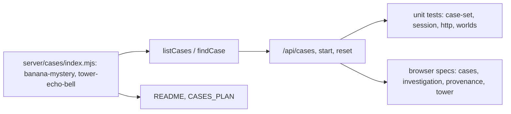
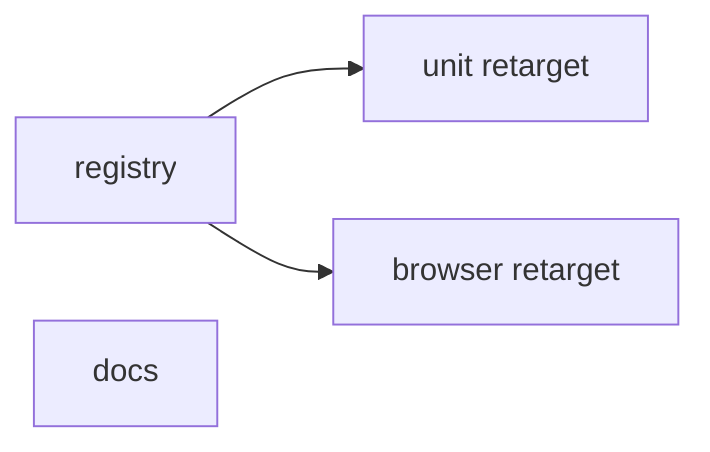

# Plan: two cases, one grove and one tower

**Review plan:** docs/plans/2026-10-29-two-cases.feature.md
**Goal:** the registry holds exactly `banana-mystery` (grove, order 1) and `tower-echo-bell` (tower, order 2, now ready); three cases are archived; every test targets reachable cases.
**Architecture:** data-only change in `server/cases/`; tests retargeted. No client, server-logic, world or art change.
**Tech stack:** Node 25 `node:test`; TypeScript + Vite build; Playwright 1.58.
**Spec:** docs/plans/2026-10-29-two-cases.spec.md
**Detail:** tests
**Target-min:** 8

Global constraints:
- Paths are relative to `demos/override/`; Owns are repo-root relative. Unit: `node --test demos/override/tests/<file>` from the repo root. Browser: `cd demos/override && npm run build && npx playwright test <spec> --output=<your scratch dir>`; one Playwright run at a time; never run unit and browser suites at the same time.
- FROZEN: `defineCase`, `listCases`, `findCase`, `publicView`, `Investigations`, every `/api/*` payload, log schema v2, all case content except `tower-echo-bell`'s `order` and `status`. Do not touch `client/`, `server/*.mjs`, `server/worlds.mjs`, art, or the archived modules.
- Archived (stay on disk, unregistered, unchanged): `server/cases/banana-control.mjs`, `tower-bell-charm.mjs`, `tower-missing-yes.mjs`, `override-v1.mjs`. Tests that import them directly stay: `banana-control.test.mjs`, `tower-cases.test.mjs`, `cases.test.mjs`, the draft-rejection test in `session.test.mjs`.
- `tower-echo-bell` facts (from its module): title `Lanterns Too Soon`; lead `A bell rang.\nThe potions came out too soon.`; headline `Was it time?`; briefing title `Lanterns, too soon.`; cast `wren`/`basil`/`juniper`; version `tower-echo-bell-v1.0.0`; answer Nobody; debrief title `Nobody knew it was too soon.`; feedback correct `Right. The rule was broken, but nobody knew it. The echo shell fooled everyone.`, other `The potions came out too soon, but by mistake. The echo shell sounds just like the tower bell.`
- Retarget, never weaken: replace a dropped case with `tower-echo-bell` and its own strings; keep every assertion's intent.



## File structure

| File | Responsibility |
|---|---|
| `demos/override/server/cases/index.mjs` | registry: two cases in order |
| `demos/override/server/cases/tower-echo-bell.mjs` | `order: 2`, `status: 'ready'` |
| `demos/override/tests/case-set.test.mjs` | two-case registry and design rule |
| `demos/override/tests/tower-echo.test.mjs`, `worlds.test.mjs` | status and world rows |
| `demos/override/tests/session.test.mjs`, `http.test.mjs` | second case is `tower-echo-bell` |
| `demos/override/tests/browser/*.spec.mjs`, `playwright.config.mjs` | browser retarget |
| `demos/override/README.md`, `demos/override/docs/CASES_PLAN.md` | live and archived cases |

## Task graph

```mermaid
%% schedule
gantt
  title Predicted schedule (mm:ss)
  dateFormat X
  axisFormat %M:%S
  section lane 1
  T1 registry :t1, 0, 83s
  T3 browser retarget :t3, 83, 143s
  section lane 2
  T4 docs :t4, 0, 81s
  T2 unit retarget :t2, 83, 82s
```





critical path: T1 → T3 (3.8 min) · peak width 2 · predicted build 3.8 min · predicted total ≈ 17.8 min (target ✗ 8.0)

## Section: cases (data + node tests)

App type: library. Categories: state (registry order, dev visibility). Risks: an archived id still reachable with dev tools; the default case changing.

### T1 registry · Complexity 2 · Est. context 26k
**Owns:** demos/override/server/cases/index.mjs, demos/override/server/cases/tower-echo-bell.mjs, demos/override/tests/case-set.test.mjs, demos/override/tests/tower-echo.test.mjs, demos/override/tests/worlds.test.mjs
**Components:** 1
**LOC owned:** 45
**Tests:** fast
**Kind:** mechanical
**Model:** haiku
**Est. time:** 1.5 min
**Consumes:** none
**Produces:** cases/index.mjs.cases -> Case[]
e.g. cases.map(c => c.id) -> ['banana-mystery', 'tower-echo-bell']
e.g. cases.map(c => c.order) -> [1, 2]
**Review Focus:** `archived cases stay out of the catalog (dev true)`: start with `tower-bell-charm` rejects /Unknown case/ even with dev tools.
**Steps:** 1 edit `index.mjs`: import only `banana-mystery.mjs` and `tower-echo-bell.mjs`; `export const cases = [bananaMystery, towerEchoBell];` with one comment line above it naming the archived modules (`banana-control.mjs`, `tower-bell-charm.mjs`, `tower-missing-yes.mjs`, `override-v1.mjs`). 2 `tower-echo-bell.mjs`: `order: 5` -> `order: 2`, `status: 'draft'` -> `status: 'ready'`; nothing else. 3 `tower-echo.test.mjs`: `assert.equal(echo.status, 'draft')` -> `'ready'`. 4 `worlds.test.mjs` `catalog rows name their world`: `tower-bell-charm` -> `tower-echo-bell`. 5 `case-set.test.mjs`: keep the imports and `newGames`/`root` helpers, replace everything from `const towerIds` to the end with the code below. 6 run `node --test demos/override/tests/case-set.test.mjs demos/override/tests/tower-echo.test.mjs demos/override/tests/worlds.test.mjs demos/override/tests/cases.test.mjs demos/override/tests/tower-cases.test.mjs demos/override/tests/banana-control.test.mjs demos/override/tests/case-prompt.test.mjs`: PASS. (`session.test.mjs` is T2's; it fails until T2.)
**Test code (verbatim):**
```js
const towerId = 'tower-echo-bell';
const archived = ['banana-control', 'tower-bell-charm', 'tower-missing-yes'];
test('registry lists one grove case, then one tower case', () => {
  assert.deepEqual(cases.map(c => `${c.order}:${c.id}:${c.status}:${c.world.id}`), ['1:banana-mystery:ready:grove', '2:tower-echo-bell:ready:tower']);
});
test('the case set spans both worlds, one culprit and one nobody', () => {
  assert.deepEqual(cases.map(c => c.world.id).sort(), ['grove', 'tower']);
  assert.ok(cases.some(c => c.answer.culprits.length > 0), 'some case has a culprit');
  assert.ok(cases.some(c => c.answer.culprits.length === 0), 'some case answers nobody');
});
for (const dev of [false, true]) {
  test(`archived cases stay out of the catalog (dev ${dev})`, async t => {
    const { games, act } = newGames(t, { dev });
    assert.deepEqual(games.catalog().map(c => c.id), ['banana-mystery', towerId]);
    for (const id of archived) await assert.rejects(act(undefined, 'start', { caseId: id }), /Unknown case/);
  });
}
test(`${towerId} plays in rehearsal and scores the verdict`, async t => {
  const kase = cases.find(c => c.id === towerId);
  for (const [suspect, line] of [['none', 'correct'], ['wren', 'other']]) {
    const { act } = newGames(t);
    const sid = (await act(undefined, 'start', { caseId: towerId })).session.id;
    await act(sid, 'reveal');
    for (const c of kase.characters) await act(sid, 'interview', { character: c.id, question: 'What happened?' });
    const view = await act(sid, 'verdict', { suspect, confidence: 80 });
    assert.equal(view.debrief.feedback, kase.answer.feedback[line]);
    assert.equal(view.debrief.title, 'Nobody knew it was too soon.');
  }
});
test('case-prompt prints a tower character', () => {
  const out = execFileSync(process.execPath, ['scripts/case-prompt.mjs', towerId, 'juniper'], { cwd: root, encoding: 'utf8' });
  assert.ok(out.includes('You play Juniper (The bell-watcher), a young wizard'));
  assert.ok(out.includes('A little wizard personality is welcome'));
});
```

### T2 unit retarget · Complexity 2 · Est. context 34k
**Owns:** demos/override/tests/session.test.mjs, demos/override/tests/http.test.mjs
**Components:** 1
**LOC owned:** 30
**Tests:** fast
**Kind:** mechanical
**Model:** haiku
**Est. time:** 1.5 min
**Consumes:** cases/index.mjs.cases -> Case[] (T1)
**Produces:** none
**Review Focus:** `logs carry provenance`: an unnamed start still logs `assignment: 'default'` and `caseId: 'banana-mystery'`.
**Steps:** In `session.test.mjs`: add `import towerEcho from '../server/cases/tower-echo-bell.mjs';` after the `banana-control.mjs` import (keep that import: the draft-rejection test uses it). Then, by test name:
- `control case feedback`: `caseId: 'tower-echo-bell'`; suspects `[['none', 'correct'], ['wren', 'other']]`; `talkToAll(act, id, towerEcho)`; feedback from `towerEcho.answer.feedback[line]`; title `'Nobody knew it was too soon.'`.
- `logs carry provenance`: both `'banana-control'` -> `'tower-echo-bell'`.
- `catalog lists the ready cases in order`: second row `{ id: 'tower-echo-bell', title: 'Lanterns Too Soon', lead: 'A bell rang.\nThe potions came out too soon.', order: 2, world: 'tower' }`.
- `reset keeps or switches the case`: both `'banana-control'` -> `'tower-echo-bell'`.
- `reset with a caseId during a pending interview is still a 409`: `'banana-control'` -> `'tower-echo-bell'`.
- `a restarted server restores a control game`: rename to `a restarted server restores a tower game`; `caseId: 'tower-echo-bell'`; `talkToAll(act, id, towerEcho)`; title `'Lanterns Too Soon'`; `interviews.nori` -> `interviews.juniper`.
- `replay needs a registered case with the same version`: both `'banana-control'` -> `'tower-echo-bell'`.
In `http.test.mjs` `the case catalog needs the access token and lists public rows only`: second row `{ id: 'tower-echo-bell', title: 'Lanterns Too Soon', lead: 'A bell rang.\nThe potions came out too soon.', order: 2 }`; the 404 path `/server/cases/banana-control.mjs` -> `/server/cases/tower-echo-bell.mjs`.
Run `node --test demos/override/tests/session.test.mjs demos/override/tests/http.test.mjs`: PASS. Then `grep -n "banana-control" demos/override/tests/session.test.mjs` shows only the import and the draft-rejection test.
**Test code (verbatim):** the edits above are the tests; no new test.

### T4 docs · Complexity 1 · Est. context 22k
**Owns:** demos/override/README.md, demos/override/docs/CASES_PLAN.md
**Components:** 1
**LOC owned:** 10
**Tests:** fast
**Kind:** mechanical
**Model:** haiku
**Est. time:** 1.5 min
**Consumes:** none
**Produces:** none
**Review Focus:** none
**Steps:** 1 `README.md` "Writing a case": `banana-mystery.mjs` and `banana-control.mjs` are the examples -> `banana-mystery.mjs` (grove) and `tower-echo-bell.mjs` (tower). Replace the bullet starting `` `server/cases/override-v1.mjs` stays archived `` with: "The live cases are `banana-mystery` (grove; Momo made up the permission) and `tower-echo-bell` (tower; an honest mistake, the answer is Nobody). Archived and unregistered: `override-v1`, `banana-control`, `tower-bell-charm`, `tower-missing-yes`; register one in `server/cases/index.mjs` to bring it back." 2 `docs/CASES_PLAN.md`: append one numbered decision after the last item of the decisions list that holds "**Override-v1:** stays archived and unregistered": "**Two live cases (2026-10-29):** the registry is `banana-mystery` and `tower-echo-bell`, one per world. `banana-control`, `tower-bell-charm` and `tower-missing-yes` are archived and unregistered." Use the list's own numbering. 3 `grep -c "tower-echo-bell" demos/override/README.md` >= 2.
**Test code (verbatim):** none (docs).

## Section: browser

App type: web UI. Categories: protocol via its API, encoding. Risks: a spec still naming an archived id silently checks the first card; leak list missing the new case's answer.

### T3 browser retarget · Complexity 4 · Est. context 48k
**Owns:** demos/override/tests/browser/cases.spec.mjs, demos/override/tests/browser/investigation.spec.mjs, demos/override/tests/browser/provenance.spec.mjs, demos/override/tests/browser/tower.spec.mjs, demos/override/playwright.config.mjs
**Components:** 2
**LOC owned:** 70
**Tests:** slow
**Model:** sonnet
**Est. time:** 4 min
**Consumes:** cases/index.mjs.cases -> Case[] (T1)
**Produces:** none
**Review Focus:** protocol: `deep link preselects` checks the tower card is checked (not just any card); encoding: escape test unchanged. Leak: `LEAKS` gains `Nobody knew it was too soon.` and both tower feedback lines.
**Steps:** Replace every `banana-control` / `tower-bell-charm` use with `tower-echo-bell`, taking expected strings from the Global constraints and from the rendered page (run the spec, read the failure, confirm against `server/cases/tower-echo-bell.mjs` and `server/worlds.mjs`). Specifics:
- `cases.spec.mjs`: the Nobody play becomes `honest mistake to Nobody` with asks `[['wren', 'I thought the Headmistress rang it'], ['basil', 'sounded like the tower bell'], ['juniper', 'I didn’t look']]`, h2 `Nobody knew it was too soon.`, summary contains `Right. The rule was broken, but nobody knew it.`; the solved test interviews `wren`, `basil`, `juniper` and checks the chip on `Lanterns Too Soon`; preview/reset/returning tests use `Lanterns` and `Lanterns, too soon.`.
- `investigation.spec.mjs` `copy, counts and nav come from the active case`: reset to `tower-echo-bell`, then its h1, intro title, h2, `CASE 002` and station topline.
- `provenance.spec.mjs`: export test plays `tower-echo-bell` with `wren`/`basil`/`juniper`, `caseVersion` `tower-echo-bell-v1.0.0`, h2 `Nobody knew it was too soon.`; add the three tower strings to `LEAKS`.
- `tower.spec.mjs`: `tower-bell-charm` -> `tower-echo-bell` (default arg and every `switchTo`); line-3 comment: dev tools no longer needed for the tower case.
- `playwright.config.mjs`: 4318 comment `Dev tools on, so the draft tower cases are visible.` -> `Dev tools on, as in local development.`; keep the `tower` project and its server.
Run `cd demos/override && npm run build && npx playwright test --output=<scratch>` (both projects): PASS, with the grove pixel baseline unchanged. Then `grep -rn "banana-control\|tower-bell-charm\|tower-missing-yes" demos/override/tests/browser` -> no output.
**Test code (verbatim):** the retargeted specs are the tests; no new spec file.

**Probe entry:** run=npm --prefix demos/override test

## Review Focus

- cases (library): state: archived ids rejected with and without dev tools; default case stays `banana-mystery`; `tower-echo-bell` hash changes, grove hash `2da1093c9eb3` does not.
- browser (web UI): protocol: `/api/cases` has two rows; encoding: escape spec unchanged; leak loop covers both live cases.

## Self-review

Coverage: spec Done 1-2 (T1, T3), 3 (T3), 4 (T3), 5 (T1), 6 (T1), 7 (T1-T3), 8 (T4). No placeholders. T2 and T3 consume T1's `cases`. Edges only where tests run T1's registry. No shared files.
