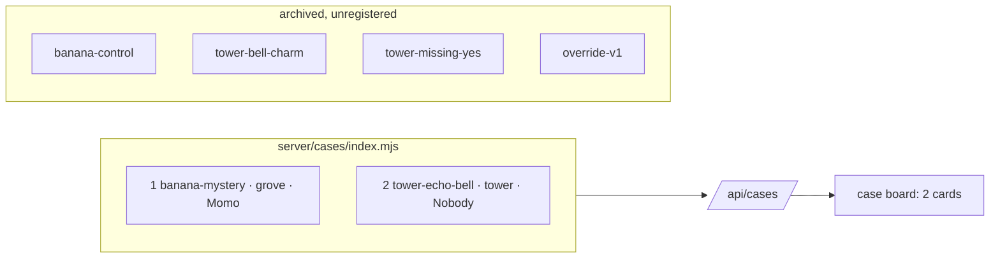

# Spec: two-cases

## Intent

The Override demo ships exactly two cases: one in the grove and one in the wizard tower. A player sees two cards on the case board, one per world. The cases do not share a world or an answer: one has a culprit, the other is an honest mistake. Ruling (AI orchestrator; the user said "one grove and one tower, you can select"): **The Banana Mystery** (grove, answer Momo) and **Lanterns Too Soon** (`tower-echo-bell`, tower, answer Nobody).

## Goals

- The registry (`server/cases/index.mjs`) lists `banana-mystery` (order 1) and `tower-echo-bell` (order 2), both `status: 'ready'`.
- `banana-control`, `tower-bell-charm` and `tower-missing-yes` stay in `server/cases/` as archived, unregistered modules (same treatment as `override-v1.mjs`).
- Every unit test and Playwright spec passes against the two-case registry.

## Non-goals

- No change to case content (copy, clues, knowledge, rehearsal, answers) of any case.
- No change to the client, the server code paths, the worlds, the art, or the log schema.
- No deletion of the archived modules or their module-level tests.
- No version bump of `tower-echo-bell` (no player has a stored session of it in production; it was a draft).

## Constraints

| Item | Rule |
|---|---|
| Interfaces | `defineCase`, `listCases`, `findCase`, `Investigations`, `/api/*` payloads: frozen |
| Default case | stays `cases[0]` = `banana-mystery`; `assignment: 'default'` unchanged |
| Grove hashes | `banana-mystery` contentHash `2da1093c9eb3` unchanged |
| Tests | retarget, never weaken: a test that played `banana-control` to Nobody now plays `tower-echo-bell` to Nobody with its own strings |
| e2e | `npm run build` before `npm run test:e2e`; never run unit and e2e suites at the same time |

## Done looks like

1. `GET /api/cases` (production, dev tools off) returns exactly two rows: `banana-mystery` (order 1, world grove) and `tower-echo-bell` (order 2, world tower).
2. Same two rows with `OVERRIDE_DEV_TOOLS=1`: the archived drafts are not listed and `start` with their ids returns 400 "Unknown case".
3. `/?case=tower-echo-bell` opens the tower with Wren, Basil, Juniper; playing it to **Nobody** shows "Nobody knew it was too soon." and the "correct" feedback line.
4. `/` shows two case cards; the default (no `?case=`) is The Banana Mystery, unchanged.
5. `npm run cases:prompt -- tower-echo-bell juniper` prints `You play Juniper (The bell-watcher), a young wizard`.
6. The case-set design rule becomes: the registry spans both worlds, and at least one case has a culprit and at least one answers Nobody.
7. `npm test` and `npm run test:e2e` (both projects) green; the grove pixel baseline unchanged.
8. README "Writing a case" and `demos/override/docs/CASES_PLAN.md` name the two live cases and the three archived ones.

## Decided

- Case pair, order and statuses as above.
- Archived modules keep `status` as they are (`banana-control` stays `'ready'` in its file but is unreachable because it is unregistered).
- Module-level tests of archived cases (`banana-control.test.mjs`, `tower-cases.test.mjs`, the grove-hash test of `banana-control`, the draft-rejection test that builds from `banana-control`) stay as they are: they import the modules directly.
- `tower-echo.test.mjs` asserts `status === 'ready'`.
- The Playwright `tower` project (port 4318, dev tools on) stays; its comment no longer claims it exists for drafts.

## Left to the builder / plan

- Exact expected strings in retargeted tests, taken from `server/cases/tower-echo-bell.mjs` and the rendered page.
- Whether the leak list in `provenance.spec.mjs` gains `tower-echo-bell` answer strings (preferred: yes, mirroring the `banana-control` strings it had).

## Diagrams

