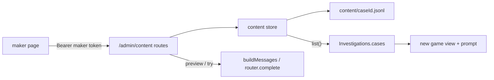
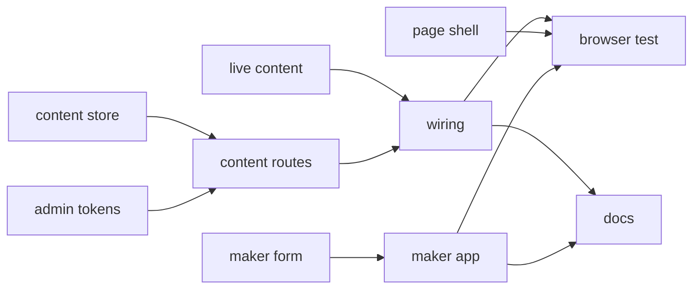

# Plan: per-game content editor

**Goal:** Game makers tune a case's prompts and authored text from `/admin/maker.html` with their own token: validated, persisted as revisions, applied to new games, previewable as the exact prompt, testable against the live model.
**Architecture:** A content store overlays per-case edits on the frozen case modules and re-runs `defineCase`; `Investigations` reads cases through it; the admin listener gains maker tokens and `/admin/content*` routes; a plain-JS admin page edits, previews, tries, publishes and restores.
**Tech stack:** Node 22 ESM server, plain browser JS admin page (no bundler, strict CSP), `node --test`, Playwright.
**Spec:** docs/plans/2026-10-30-content-editor.spec.md
**Detail:** contracts
**Target-min:** 25
**Ignore:** docs/plans/2026-10-30-content-editor*, .superlite/, demos/override/dist/, demos/override/node_modules/, demos/override/test-results/, demos/override/playwright-report/, demos/override/data/, .DS_Store

## Global constraints

- Language: JavaScript (ESM `.mjs`, browser `.js`). Test command: `node --test demos/override/tests/*.test.mjs` from the repo root; e2e `cd demos/override && npm run build && npx playwright test --output=<scratchpad>`. Never run unit and browser suites together.
- Each task's full detail is the spec section with its `§` number; read it first. Paths are relative to the repo root; `O/` means `demos/override/`.
- Never edit `O/server/cases/*.mjs` (hashes `d891b333116d`, `6508e9784a90` are pinned). FROZEN: existing `/admin/*` route shapes, the CSP string, `createAdmin`/`createApp` argument names (new ones optional), `/api/*` shapes, log schema 3.
- No text typed by a player or maker in `system.jsonl`. `O/server/admin/*`: `textContent` only, no `innerHTML`, inline style or inline script; every `src`/`href` under `/admin/`. No new npm dependencies. Every `env.OVERRIDE_*` read in `O/server/*.mjs` is listed in `O/.env.example`. Existing tests change only where the spec section says so.

## Main diagram

## File structure

One responsibility per file, all under `O/`: `server/content.mjs` (overlay store), `server/session.mjs` (`cases` getter, reset refresh), `server/admin.mjs` (tokens, CSP, routes), `server/llm.mjs` (trace `tag`), `server/index.mjs` + `.env.example` (wiring, env), `server/admin/maker-form.js` (form), `server/admin/maker.js` (page app), `server/admin/maker.html` + `maker.css` + `index.html` + `controls.js` (shell, link, log lines), `tests/browser/maker.spec.mjs` + `playwright.config.mjs` (browser flow), `README.md` + `DEPLOY.md` + `docs/CASES_PLAN.md` (docs).

## Task graph

```mermaid
%% schedule
gantt
  title Predicted schedule (mm:ss)
  dateFormat X
  axisFormat %M:%S
  section lane 1
  T3 admin tokens (§3) :t3, 0, 127s
  T4 content routes (§4) :t4, 127, 174s
  T5 wiring (§5) :t5, 301, 131s
  T9 browser test (§9) :t9, 432, 124s
  section lane 2
  T2 live content (§2) :t2, 0, 126s
  T10 docs (§10) :t10, 432, 88s
  section lane 3
  T7 page shell (§7) :t7, 0, 122s
  section lane 4
  T1 content store (§1) :t1, 0, 118s
  section lane 5
  T6 maker form (§6) :t6, 0, 116s
  T8 maker app (§8) :t8, 116, 120s
```

critical path: T3 → T4 → T5 → T9 (9.3 min) · peak width 5 · predicted build 9.3 min · predicted total ≈ 21.9 min (target ✓)

## Predicted schedule

## Repo

**Probe entry:** serve=demos/override/server/index.mjs
**App type:** HTTP service + web UI. Categories: protocol, encoding, state.

### T1 content store (§1) · Complexity 5 · Est. context 34k
**Owns:** demos/override/server/content.mjs, demos/override/tests/content.test.mjs
**Components:** 1
**LOC owned:** 320
**Tests:** fast
**Kind:** design
**Model:** sonnet
**Est. time:** 4 min
**Consumes:** none
**Produces:** content.createContentStore({cases: Case[], dataDir: string, worlds?: object, now?: Function}) -> ContentStore · ContentStore.list() -> Case[] · ContentStore.current(id) -> Case · ContentStore.base(id) -> Case · ContentStore.info(id) -> Info · ContentStore.fields(id) -> {authored, current} · ContentStore.structure(id) -> Structure · ContentStore.history(id) -> Revision[] · ContentStore.preview(id, edits) -> Case · ContentStore.publish(id, edits, {by, baseRev}) -> {rev, contentHash, fields} · ContentStore.revert(id, rev, {by}) -> {rev, contentHash, fields, revertOf} · content.ContentError · content.editablePaths(kase) -> string[]
e.g. store.info('mini-parts') -> { id: 'mini-parts', version: 'mini-parts-v1', rev: 0, by: null, editedAt: null, contentHash: base.contentHash, baseContentHash: base.contentHash, stale: false, … }
e.g. store.publish('mini-parts', { 'copy.intro.lead': 'New lead' }, { by: 'alice', baseRev: 0 }) -> { rev: 1, contentHash: '<12 hex, not the base hash>', fields: ['copy.intro.lead'] }
e.g. store.publish('mini-parts', { 'parts.boss.role': 'honest' }, { by: 'alice', baseRev: 1 }) throws ContentError { status: 400, path: 'parts.boss.role' }
e.g. store.list() -> the current cases in registry order; the authored object itself when unedited
**Review Focus:** `stale_version_record_skipped`; `invalid_overlay_marks_stale`; `publish_stale_base_rev_409`; `string_over_2000_chars_400`.
**Test code:** `identity_when_unedited` (`current(id) === base(id)`); `merge_new_hash_and_text`; `history_has_no_text`; `revert_restores_hash`; `boot_replays_last_record`; `empty_overlay_is_null`. Reuse `defineCase` (`O/server/cases.mjs`), `appendJsonl`/`readJsonl` (`O/server/dataset.mjs`), `partCase` + `agentWorlds(3)` (`O/tests/fixtures/minimal-case.mjs`).

### T2 live content (§2) · Complexity 3 · Est. context 28k
**Owns:** demos/override/server/session.mjs, demos/override/tests/session.test.mjs
**Components:** 1
**LOC owned:** 110
**Tests:** slow
**Kind:** design
**Model:** sonnet
**Est. time:** 2.5 min
**Consumes:** ContentStore.list() -> Case[] (T1)
**Produces:** session.Investigations({dataDir, config, cases?: Case[], content?: ContentStore}) -> Investigations
e.g. new Investigations({ dataDir, config, cases: [a], content: { list: () => [b] } }).cases -> [b]
e.g. mutate(id, 'reset', {}) on a game of case a after the fake store swapped to a' -> view.copy.intro.lead is the a' lead; session_started.assignment === 'default'
**Review Focus:** `content_in_flight_game_keeps_its_case`; `content_evicted_game_replays_onto_new_case` (`idleMs: 0`, revision continuous, new hash on later events).
**Test code:** `content_new_game_sees_published_text`; `reset_without_case_id_uses_current_content`; the two Review Focus tests; a fake store `{ list: () => current }` through `fleet(t, { content })`; existing tests unchanged.

### T3 admin tokens (§3) · Complexity 4 · Est. context 28k
**Owns:** demos/override/server/admin.mjs, demos/override/tests/admin-makers.test.mjs
**Components:** 1
**LOC owned:** 120
**Tests:** slow
**Kind:** design
**Model:** sonnet
**Est. time:** 2.5 min
**Consumes:** none
**Produces:** admin.createAdmin({token: string, makers?: {name: string, token: string}[], content?: ContentStore, probeMessages?: Message[] | Function}) -> http.Server
e.g. GET /admin/health with `Authorization: Bearer <maker token>` -> 403 { error: 'Maker tokens can only edit content.' }
e.g. GET /admin/content with a maker token -> passes the scope gate (status not 401 and not 403; 404 until T4 adds the route)
**Review Focus:** `wrong_maker_token_401`; `maker_403_on_metrics_and_stream`; `probe_thunk_called_per_probe`; `csp_on_every_html_page` (`maker.html` gets the frozen CSP, `x.js` does not).
**Test code:** `maker_scope`, `csp_on_every_html_page`, `probe_thunk`; boot as `tests/admin.test.mjs:26-35` with a temp `pageDir` holding `index.html` and `maker.html`.

### T4 content routes (§4) · Complexity 6 · Est. context 37k
**Owns:** demos/override/server/admin.mjs, demos/override/server/llm.mjs, demos/override/tests/admin-content.test.mjs, demos/override/tests/llm.test.mjs
**Components:** 2
**LOC owned:** 330
**Tests:** slow
**Kind:** design
**Model:** sonnet
**Est. time:** 5 min
**Consumes:** ContentStore.info/fields/structure/history/preview/publish/revert (T1) · createAdmin makers/content/actor (T3)
**Produces:** the HTTP routes of the §4 table: GET /admin/content, GET and PUT /admin/content/<id>, POST /admin/content/<id>/preview|try|revert · llm.LlmRouter.complete({messages, sessionId?, questionEventId?, onAttempt?, tag?: string}) -> {content, reasoning, provenance}
e.g. PUT /admin/content/mini-parts { edits: { 'copy.intro.lead': 'New lead' }, baseRev: 0 } -> 200 { rev: 1, contentHash: '<12 hex>', fields: ['copy.intro.lead'] }; the same body again -> 409
e.g. POST /admin/content/mini-parts/try with router null -> 409 { error: 'Live LLM mode is off.' }
e.g. complete({ messages, tag: 'maker_try' }) -> the trace record has tag: 'maker_try'; without tag it has no `tag` key
**Review Focus:** `content_body_limit` (512 KB + 1 → 413; `/admin/sessions/pause` still 413 at 16 KB + 1); `publish_records_fields_not_text`; `methods_404_405_409`; `preview_bad_path_400_with_path`; `try_502_on_provider_error`; `u2028_in_edits_roundtrips`.
**Test code:** the named tests of §4 in `tests/admin-content.test.mjs` (fake router `{ complete }`, real store on a `mkdtemp` dir); `preview_equals_buildMessages`; `trace_carries_tag` in `tests/llm.test.mjs`.

### T5 wiring (§5) · Complexity 4 · Est. context 32k
**Owns:** demos/override/server/index.mjs, demos/override/.env.example, demos/override/tests/http.test.mjs
**Components:** 1
**LOC owned:** 150
**Tests:** slow
**Kind:** design
**Model:** sonnet
**Est. time:** 3 min
**Consumes:** content.createContentStore (T1) · Investigations content option (T2) · createAdmin makers/content/probeMessages (T3) · /admin/content routes (T4)
**Produces:** index.makerTokens(env: object) -> {name: string, token: string}[] · index.adminHosts(env: object) -> string[]
e.g. makerTokens({ OVERRIDE_MAKER_TOKENS: 'alice:s1,bob:s2', OVERRIDE_ADMIN_TOKEN: 'ops' }) -> [{ name: 'alice', token: 's1' }, { name: 'bob', token: 's2' }]; makerTokens({}) -> []
e.g. makerTokens({ OVERRIDE_MAKER_TOKENS: 'alice:ops', OVERRIDE_ADMIN_TOKEN: 'ops' }) throws Error mentioning OVERRIDE_MAKER_TOKENS
e.g. adminHosts({ OVERRIDE_ADMIN_HOSTS: 'Maker.Example.org, x.test' }) -> ['maker.example.org', 'x.test']
**Review Focus:** `content_survives_restart`; `admin_hosts_env` (`Host: y.test` → 403); `maker_scope_end_to_end`.
**Test code:** `content_publish_reaches_new_games`, `maker_tokens_parse` and the Review Focus tests as named in §5, with `boot()` from `tests/http.test.mjs:104-110`.

### T6 maker form (§6) · Complexity 5 · Est. context 33k
**Owns:** demos/override/server/admin/maker-form.js, demos/override/tests/admin-maker-form.test.mjs
**Components:** 1
**LOC owned:** 300
**Tests:** fast
**Kind:** design
**Model:** sonnet
**Est. time:** 3.5 min
**Consumes:** none
**Produces:** makerForm.renderForm(root: Element, detail: Detail, opts: {onChange: Function}) -> FormHandle · FormHandle.values() -> object · FormHandle.overlay() -> object | null · FormHandle.dirty() -> boolean · FormHandle.setDetail(detail) -> void · FormHandle.setError(path: string, message: string) -> void · FormHandle.clearErrors() -> void · makerForm.knowledgeLines(text: string) -> string[] · makerForm.linesText(items: string[]) -> string
e.g. knowledgeLines('a\n\nb ') -> ['a', 'b']; linesText(['a', 'b']) -> 'a\nb'
e.g. after setting the `copy.intro.lead` textarea to 'New lead': handle.overlay() -> { 'copy.intro.lead': 'New lead' }; untouched: handle.overlay() -> null
e.g. handle.setError('parts.boss.knowledge', 'unknown placeholder {x}') -> that field's `.field-error` text is 'unknown placeholder {x}' and it is shown
**Review Focus:** `text_stays_literal` (`` read back verbatim, no `innerHTML` anywhere); `overlay_only_changed_paths`; `dirty_against_current`.
**Test code:** the named tests of §6 with the `El` fake DOM from `tests/admin-controls.test.mjs:18-31` extended with `value`; the detail shape of §4 is an inline fixture.

### T7 page shell (§7) · Complexity 3 · Est. context 26k
**Owns:** demos/override/server/admin/maker.html, demos/override/server/admin/maker.css, demos/override/server/admin/index.html, demos/override/server/admin/controls.js, demos/override/tests/admin-controls.test.mjs
**Components:** 2
**LOC owned:** 170
**Tests:** fast
**Kind:** design
**Model:** sonnet
**Est. time:** 2.5 min
**Consumes:** none
**Produces:** controls.systemLine(rec: object, fmt: Function) -> string for the three content actions · the page element ids of §7
e.g. systemLine({ type: 'admin_action', timestamp: 1, action: 'content_published', caseId: 'banana-mystery', rev: 3, by: 'alice', fields: ['copy.intro.lead'] }, fmt) -> '14:02 content banana-mystery rev 3 published by alice (1 field)'
e.g. action 'content_reverted' with rev 4, revertOf 0, by 'alice' -> '14:02 content banana-mystery rev 4 reverted to rev 0 by alice'; action 'content_try' with characterId 'momo', by 'alice', ok true -> '14:02 content try banana-mystery momo by alice ok'
**Review Focus:** the page scanner of `tests/admin.test.mjs:428-460` stays green on `maker.html` and `maker.css`.
**Test code:** the three `systemLine` examples above in `tests/admin-controls.test.mjs`; `tests/admin.test.mjs` unchanged and green.

### T8 maker app (§8) · Complexity 6 · Est. context 37k
**Owns:** demos/override/server/admin/maker.js, demos/override/tests/admin-maker-ui.test.mjs, demos/override/tests/admin.test.mjs
**Components:** 1
**LOC owned:** 340
**Tests:** fast
**Kind:** design
**Model:** sonnet
**Est. time:** 4 min
**Consumes:** makerForm.renderForm/FormHandle/knowledgeLines (T6) · /admin/content routes (T4; a recording fake `api` in tests)
**Produces:** maker.mountMaker(root: Element, deps: {api: Function, caseId: string | null, location: object}) -> {load, select, preview, tryAsk, publish, restore}
e.g. publish() with overlay { 'copy.intro.lead': 'New lead' } and detail.rev 2 -> api called with ('/admin/content/banana-mystery', { edits: { 'copy.intro.lead': 'New lead' }, baseRev: 2 }, 'PUT')
e.g. api rejects with Error('Changed') carrying status 409 and body { rev: 3, by: 'bob' } -> #publish-note text 'Changed meanwhile: rev 3 by bob. Reload.'
**Review Focus:** `try_disabled_in_rehearsal`; `publish_409_message`; `restore_posts_revert` (rev 0 posts `{ rev: 0 }`).
**Test code:** the named tests of §8 with the fake DOM and a recording `api`; `tests/admin.test.mjs:433` required files gain `maker.html`, `maker.js`, `maker.css`, `maker-form.js`.

### T9 browser test (§9) · Complexity 4 · Est. context 27k
**Owns:** demos/override/tests/browser/maker.spec.mjs, demos/override/playwright.config.mjs
**Components:** 1
**LOC owned:** 90
**Tests:** slow
**Kind:** design
**Model:** sonnet
**Est. time:** 2.5 min
**Consumes:** the page (T7, T8), the routes and wiring (T5)
**Produces:** none
**Review Focus:** CSP header present on `maker.html`; `pageerror` list empty; the final restore leaves `contentHash === 'd891b333116d'`.
**Test code:** `maker_edits_publishes_and_restores` as the flow in §9; run `npm run build && npx playwright test --project=admin --output=<scratchpad>`, then `--project=default`. Drive the game API on 4319 like `tests/browser/admin.spec.mjs:3-35`; config edits at `playwright.config.mjs:19,21,53` only.

### T10 docs (§10) · Complexity 2 · Est. context 24k
**Owns:** demos/override/README.md, demos/override/DEPLOY.md, demos/override/docs/CASES_PLAN.md
**Components:** 1
**LOC owned:** 120
**Tests:** fast
**Kind:** mechanical
**Model:** haiku
**Est. time:** 1.5 min
**Consumes:** none
**Produces:** none
**Review Focus:** none
**Test code:** `node --test demos/override/tests/docs.test.mjs` -> pass; `grep -c OVERRIDE_MAKER_TOKENS demos/override/README.md` -> at least 2; `grep -c 'admin/maker.html' demos/override/README.md demos/override/DEPLOY.md` -> at least 1 each; `grep -n 'Custom editor' demos/override/docs/CASES_PLAN.md` -> the row says built.
