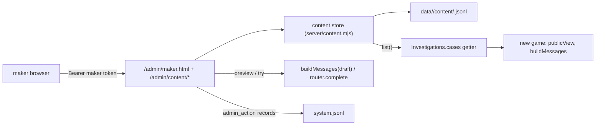

# Spec: per-game content editor for game makers

Repo root `R`; the game is `O` = `demos/override`. Unit suite: `node --test demos/override/tests/*.test.mjs` from `R` (640 pass at start). e2e: `cd demos/override && npm run build && npx playwright test --output=<scratch>`; never run it together with the unit suite. Work happens on branch `superlite/content-editor` in the worktree `R/.superlite/worktrees/content-editor`; `main` is the base (64b282e).

**Intent.** Game makers (the people who author a case) want to tune a case's prompts and authored text during rehearsals and events without a redeploy. Today every case is a frozen ES module (`O/server/cases/*.mjs`) validated at import by `defineCase` (`O/server/cases.mjs:36-94`); the interview prompt is composed in `O/server/interviews.mjs:94-115` from case fields; the admin command centre (`O/server/admin.mjs`, page `O/server/admin/`) is loopback-only, bearer-token, CSP-strict and has no content routes.

Done looks like: a maker opens `/admin/maker.html?case=<id>` on the admin port with a personal token, edits the text, sees the exact system prompt of the draft (Preview), asks the real model a question on the draft (Try, live mode only), publishes with attribution and optimistic concurrency, and can restore any revision or the authored text. New games pick the published content up at once; every logged event already carries `contentHash`, so research data stays joinable. Edits survive a restart and never stop the server from booting.

User decisions (2026-10-30): editor on the admin listener with named maker tokens that can only edit content; all authored text editable, structure locked; edits apply to new games only; AI orchestrator, superlite swarm.

### Global constraints

- Never edit `O/server/cases/*.mjs`; the module hashes `d891b333116d` (banana) and `6508e9784a90` (tower) stay pinned by `tests/cases-content.test.mjs`.
- FROZEN: every existing `/admin/*` route shape, the CSP string in `admin.mjs:10`, the argument names of `createAdmin` and `createApp` (new arguments optional), `/api/*` shapes, session log schema 3.
- Nothing a player or maker typed goes into `system.jsonl`: records carry paths, hashes, names and counts only.
- `O/server/admin/*` is plain browser JS with no bundler: `textContent` only, no `innerHTML`/`outerHTML`/`insertAdjacentHTML`/`document.write`/`eval`/`new Function`, no inline `style=`, no inline `<script>`, every `src`/`href` starts with `/admin/` or `#`, no network `url()` in CSS. `tests/admin.test.mjs:428-460` scans every file in the folder.
- No new npm dependencies. Every `env.OVERRIDE_*` read in `O/server/*.mjs` must appear in `O/.env.example` as `^#?\s*NAME=` (`tests/docs.test.mjs` `env_example_complete`).
- Paths below are relative to `O/`. Existing tests change only where a section says so.

## 1. Content store

New `server/content.mjs`. `createContentStore({ cases, dataDir, worlds = liveWorlds, now = () => Date.now() })` keeps the authored frozen cases (`cases`, registry order) as the base and one overlay per case.

**Editable paths** (`editablePaths(kase) -> string[]`, exported): `copy.headline`, `copy.intro.lead`, `copy.intro.body`, `copy.briefing.title|description|question|hint`, `copy.report.title|description`, `prompt.setting`, `prompt.use`, `prompt.avoid`, `parts.<partId>.label|introduction|quickQuestion|knowledge|finding.classification|finding.explanation` for each part id of the base, `debrief.title|summary|lesson`, `answer.feedback.correct|other`. `prompt.use`, `prompt.avoid` and `parts.<id>.knowledge` are `string[]`; everything else is a string. Locked (never in the overlay): `id, version, order, status, title, world, characters, parts[].id, parts[].role`, the rehearsal functions.

**Overlay** `edits` is a flat object `{ "<path>": value }` relative to the authored case; a published revision's overlay replaces the previous one whole. Validation, in this order, each failure a `ContentError` (`class ContentError extends Error { status, path }`): unknown path → 400 with that `path`; wrong type → 400; a string over 2000 characters → 400; `knowledge` outside 1..20 items, `use`/`avoid` over 30 items, or an empty item → 400; then the merged case runs through `defineCase({ ...rawOf(base), ...merged }, { worlds })` where `rawOf(base)` is the base without `contentHash` and with `world: base.world.id` (a string) and `parts.<id>` edits are mapped onto the base part index. A `defineCase` error (`Error("case <id>: <path>: <message>")`, cases.mjs:38) becomes `ContentError(400)` with that `path` and `message`. **Normalisation:** entries equal to the authored value are dropped; an empty overlay is `null`.

**Identity rule:** `current(id)` returns the authored object itself when the overlay is `null`, so its `contentHash` equals the module hash (a rebuilt un-edited banana case would hash differently because the module has no `world` key). With an overlay, `current(id)` is the frozen `defineCase` result and its hash differs.

**Persistence:** construction creates `<dataDir>/content/` with mode 0o700. Each publish or revert appends one record to `<dataDir>/content/<caseId>.jsonl` through `appendJsonl(file, record, 'content')` (`server/dataset.mjs:18`): `{ type: 'content_revision', caseId, version, rev, timestamp (ISO string), by, edits (object or null), contentHash, fields (string[]), revertOf (integer or absent) }`. `rev` starts at 1; `rev 0` means the authored text. `fields` lists the paths whose effective value changed against the previous revision. Boot replays each file with `readJsonl(file, { repair: true })`: records whose `version` is not the base `version` are skipped; the newest remaining record wins; if `defineCase` throws on it, the case stays authored and `info(id).stale` is `true`. A missing file or folder means no overlay.

**API:** `list() -> Case[]` (current cases in registry order, a cached array rebuilt only on publish/revert); `current(id)`; `base(id)`; `info(id) -> { id, title, version, status, world, rev, by, editedAt, contentHash, baseContentHash, stale }` (`rev 0`, `by null`, `editedAt null` when authored); `history(id) -> [{ rev, timestamp, by, fields, contentHash, revertOf }]` oldest first, never the text; `fields(id) -> { authored, current }`, each a `{ path: value }` over every editable path; `structure(id) -> { characters: [{ id, name, color }], parts: [{ id, role }], world: { id, place, agents }, placeholders: ['{boss}', ...] }`; `preview(id, edits) -> Case` (validated, not persisted); `publish(id, edits, { by, baseRev }) -> { rev, contentHash, fields }` (409 `ContentError` when `baseRev !== info(id).rev`; when the normalised overlay equals the current one nothing is appended and the current `{ rev, contentHash, fields: [] }` returns); `revert(id, rev, { by }) -> { rev, contentHash, fields, revertOf }` (appends a new revision carrying that revision's overlay, `rev 0` = `null`; unknown rev → 404). Unknown case id → `ContentError(404, 'Unknown case.')`.

Done: new `tests/content.test.mjs` passes (fixtures `partCase` with `agentWorlds(3)` and `defineCase(minimalCase)`): identity when unedited (`current(id) === base`, same hash), merge gives a new hash and the edited text, each validation failure names its `path`, `{boss}` placeholder check reaches the error, 409 on a stale `baseRev`, revert appends and restores the hash, boot replay from the jsonl, a record with another `version` is skipped, a stored overlay that no longer validates leaves the case authored with `stale: true`, `{}` normalises to `null`, `history()` carries no text.

## 2. Live content in Investigations

`server/session.mjs`: the `Investigations` constructor (line 91) gains `content = null`. Line 101 `this.cases = cases` becomes `Object.defineProperty(this, 'cases', { enumerable: true, get: () => (content ? content.list() : cases) })`, so the six reads (110, 123, 125, 133, 141, 144) stay as they are. Each `Investigation` keeps its `kase` until idle eviction (line 138) or restart; `replay` matches on `version` only (42-74), so a rebuilt game lands on the edited case and its later events carry the new `contentHash`. In `Investigations.mutate` (140-149) a `reset` without `caseId` takes `this.cases.find(c => c.id === game.kase.id)` as `kase` so the player's Reset session button plays the current content; `assignment` is `'fixed'` only when `input.caseId !== undefined`, else `'default'`.

Done: `tests/session.test.mjs` additions with `fleet(t, { content })` and a fake store `{ list: () => current }` whose array the test swaps: `content_new_game_sees_published_text` (swap, start → `view.copy.intro.lead` is the new text and `session_started.contentHash` is the swapped case's hash); `content_in_flight_game_keeps_its_case` (start, swap, `visit` → old lead); `content_evicted_game_replays_onto_new_case` (`idleMs: 0`, start, swap, next action → new lead, `revision` continuous, new event hash); `reset_without_case_id_uses_current_content` (start, swap, `reset {}` → new lead, `assignment: 'default'`); existing tests untouched.

## 3. Admin tokens, hosts, CSP, probe thunk

`server/admin.mjs`: `createAdmin` (37) gains `content = null` and `makers = []` (`[{ name, token }]`). `authed(req)` (39-42) becomes `actor(req) -> { by: 'admin', scope: 'all' } | { by: <maker name>, scope: 'content' } | null`, every comparison through `safeEqual`. At line 163: `null` → 401 `Unauthorized.`; then `scope === 'content'` on a path that does not start with `/admin/content` → 403 `Maker tokens can only edit content.` (so makers get 403 on `/metrics`, `/admin/stream`, `/admin/health`). Line 157: the CSP header goes on every page file whose type starts with `text/html`, not only `/admin`. Line 103: `router.probe(endpoint, typeof probeMessages === 'function' ? probeMessages() : probeMessages)`. `hostOk` (44) already honours `allowedHosts`; nothing changes there.

Done: new `tests/admin-makers.test.mjs` (boot like `tests/admin.test.mjs:26-35`, page dir a temp folder holding `index.html` and `maker.html`): `maker_scope` (maker token: 200 on `GET /admin/content` when `content` is a fake `{ list: () => [] }` ... see §4 for the real list shape; 403 on `/admin/health`, `/metrics`, `/admin/stream`; wrong maker token 401; admin token still 200 everywhere); `csp_on_every_html_page` (both pages carry the frozen CSP string, `/admin/x.js` does not); `probe_thunk` (a thunk returning two messages reaches the fake router's `probe`).

## 4. Content routes and trace tag

`server/admin.mjs`, one block right after the sessions regex (172-178) and before the route table: matcher `/^\/admin\/content(?:\/([a-z0-9-]{3,40})(?:\/(preview|try|revert))?)?$/`, dispatch on `(method, id, sub)`; it reads its own body for `PUT` and `POST` with `MAX_CONTENT_BODY = 512 * 1024` (line 182 keeps `MAX_BODY`). No `content` store → 409 `Content editing is off.`; unknown id → 404 `Unknown case.`; a wrong method on a known shape → 405. `mode` is `router ? 'live' : 'rehearsal'`.

| Route | Body | Response |
|---|---|---|
| `GET /admin/content` | – | `{ cases: [info(id) for every case in list() order] }` |
| `GET /admin/content/<id>` | – | `{ ...info(id), mode, structure, authored, current, history }` (`fields(id)` gives `authored` and `current`) |
| `PUT /admin/content/<id>` | `{ edits, baseRev }` | `publish(...)` with `by` from `actor(req)` → `{ rev, contentHash, fields }`; then `log('content_published', { by, caseId, rev, contentHash, fields })` unless `fields` is empty |
| `POST /admin/content/<id>/preview` | `{ edits, characterId, question?, history? }` | `{ contentHash, messages, characters, copy }` where `draft = preview(id, edits)`, `cast = identityCast(draft)`, `messages = buildMessages(draft, { cast, interviews: { [characterId]: history ?? [] } }, characterId, question ?? resolved quickQuestion)`, `characters = castCharacters(draft, cast)`, `copy = publicView(draft, cast).copy` |
| `POST /admin/content/<id>/try` | `{ edits, characterId, question, history? }` | `needRouter()`; `router.complete({ messages, sessionId: null, questionEventId: null, tag: 'maker_try' })` → `{ answer: content, reasoning, provenance }`; `InterviewProviderError` → 502 `{ error }`; `log('content_try', { by, caseId, characterId, ok })` |
| `POST /admin/content/<id>/revert` | `{ rev }` | `revert(id, rev, { by })` → `{ rev, contentHash, fields, revertOf }`; `log('content_reverted', { by, caseId, rev, revertOf, contentHash })` |

Body checks: `edits` an object (400 `edits must be an object.`), `baseRev` and `rev` non-negative integers, `characterId` one of the case's character ids, `question` a string of at most 2000 characters, `history` at most 20 `{ question, answer }` string pairs. `ContentError` maps to its own `status` and `{ error, path }`.

`server/llm.mjs`: `complete({ messages, sessionId = null, questionEventId = null, onAttempt, tag = null })` passes `tag` into `run()`; the trace base at line 257 becomes `{ sessionId: req.sessionId, questionEventId: req.questionEventId, attempt: n, ...(req.tag ? { tag: req.tag } : {}) }`, so `onTrace` records carry `tag` when given and are byte-identical otherwise.

Done: new `tests/admin-content.test.mjs` (shape of `tests/admin-leaderboard.test.mjs`; a real store on a `mkdtemp` dir over `defineCase(partCase, { worlds: agentWorlds(3) })`, fake router with `complete`): `list_and_detail_shapes`; `publish_records_fields_not_text` (system record has `fields: ['copy.intro.lead']`, no `edits`, `by: 'alice'`); `publish_stale_409`; `bad_path_400_with_path`; `preview_equals_buildMessages` (with a two-turn history); `try_returns_answer_reasoning_provenance`, `try_409_without_router`, `try_502_on_provider_error`; `content_body_limit` (just over 512 KB → 413 while `POST /admin/sessions/pause` still gives 413 at 16 KB + 1); `methods_404_405_409` (`DELETE` → 405, unknown id → 404, no store → 409). `tests/llm.test.mjs` adds `trace_carries_tag` (a `complete` with `tag: 'maker_try'` writes it on the trace record; without `tag` the record has no `tag` key).

## 5. Server wiring and environment

`server/index.mjs`: after `paths` (166) build `const content = createContentStore({ cases, dataDir: paths.root })`; pass `content` to `new Investigations(...)` (189); export `makerTokens(env) -> [{ name, token }]` parsing `env.OVERRIDE_MAKER_TOKENS` as a comma list of `name:secret` (names `/^[a-z0-9_-]{1,32}$/`, non-empty secrets, unique names, a secret equal to `OVERRIDE_ADMIN_TOKEN` or another maker's is an error; empty or unset → `[]`; errors throw at startup with the variable name) and `adminHosts(env) -> string[]` from `env.OVERRIDE_ADMIN_HOSTS` (comma list, trimmed, lower-cased, empty → `[]`); `createAdmin({ ..., content, makers, allowedHosts, probeMessages: () => buildMessages(current first case, identityCast, first character, its resolved quickQuestion) })` (246-263). `.env.example` gains, under the admin block, `OVERRIDE_MAKER_TOKENS=` (comment: maker name:secret pairs, content editing only) and `OVERRIDE_ADMIN_HOSTS=` (comment: extra Host names the admin listener accepts, for a tunnel).

Done: `tests/http.test.mjs` additions with `boot()` (104-110) and `OVERRIDE_ADMIN_TOKEN: 'ops', OVERRIDE_MAKER_TOKENS: 'alice:s1'`: `content_publish_reaches_new_games` (PUT over `adminUrl` as alice, then a player `POST /api/start` on `url` returns the edited `copy.intro.lead` and a `contentHash !== 'd891b333116d'`; `GET /admin/content` as alice shows `by: 'alice', rev: 1`); `content_survives_restart` (close, boot on the same `dir`, the edit is still live); `maker_scope_end_to_end` (alice 403 on `/admin/health`, ops 200); `admin_hosts_env` (`OVERRIDE_ADMIN_HOSTS: 'x.test'` → `Host: x.test` 200 on `/admin/health`, `Host: y.test` 403); `maker_tokens_parse` (unit: `'alice:s1,bob:s2'` → two entries; `'alice:s1,alice:s2'`, `'bad name:x'`, `'alice:'` and a secret equal to the admin token throw). `tests/docs.test.mjs` stays green.

## 6. Maker form module

New `server/admin/maker-form.js` (imports `./dom.js` only): `renderForm(root, detail, { onChange }) -> handle` builds, in order, `section.prompt` (setting, use, avoid), one `fieldset.part` per `detail.structure.parts` entry (legend `<label> · <role>` from `detail.current['parts.<id>.label']`, a read-only role badge, then label, introduction, quickQuestion, knowledge, finding.classification, finding.explanation), `section.copy` (headline, intro, briefing, report) and `section.debrief` (debrief, feedback). Every field is one `textarea` with `dataset.path`, a `.field-label`, a `.differs` marker (text `edited`, hidden when equal to authored) with a `button.reset` (`Authored`) that restores the authored value, and a hidden `.field-error`. Arrays show one item per line: `linesText(arr) -> string` joins with `\n`; `knowledgeLines(text) -> string[]` splits on `\n`, trims, drops empty lines. The handle: `{ root, values() -> { path: value }, overlay() -> edits (every path whose value differs from authored, arrays compared item by item, `null` when none), dirty() -> boolean (overlay differs from detail.current's overlay), setDetail(detail), setError(path, message) (shows it under that field, clears the others), clearErrors() }`. Any input event calls `onChange(handle)`. A placeholder legend (`detail.structure.placeholders` joined by spaces, hint `names are dealt per session`) sits above the parts.

Done: new `tests/admin-maker-form.test.mjs` with the `El` fake DOM from `tests/admin-controls.test.mjs:18-31` (extended with `value`): `renders_every_editable_path` (one textarea per path of a 3-part detail), `knowledge_lines_roundtrip` (`knowledgeLines('a\n\nb ')` → `['a','b']`, `linesText(['a','b'])` → `'a\nb'`), `overlay_only_changed_paths` (edit one lead → `{ 'copy.intro.lead': 'New lead' }`; restore → `null`), `differs_marker_and_reset`, `dirty_against_current`, `set_error_shows_under_field`, `text_stays_literal` (a value `` is read back verbatim and no node has an `innerHTML` call).

## 7. Maker page shell and log lines

New `server/admin/maker.html` (served at `/admin/maker.html`; loads `/admin/maker.css` and `/admin/maker.js` as a module; header with a back link `/admin`, `#status`, the token form `#auth` with `#token` and `#save` as in `index.html:16-25`; `nav#cases`; `main#form`; `aside#panel` holding Preview (`select#character`, `input#question`, `button#preview`, `pre#prompt`), Try (`button#try`, `pre#answer`, `pre#reasoning`, `p#try-note`), Publish (`button#publish`, `p#publish-note`) and History (`ol#history`)) and new `server/admin/maker.css` (two-column layout: form left, panel right; `.differs` marker amber; `.field-error` red; textareas full width, monospace for `pre`). `index.html` gets `<a id="maker-link" href="/admin/maker.html">Content editor</a>` next to `#board-link`. `server/admin/controls.js` `systemLine` gains: `content_published` → `${at} content ${caseId} rev ${rev} published by ${by} (${n} field|fields)`, `content_reverted` → `${at} content ${caseId} rev ${rev} reverted to rev ${revertOf} by ${by}`, `content_try` → `${at} content try ${caseId} ${characterId} by ${by} ${ok ? 'ok' : 'failed'}`.

Done: `tests/admin-controls.test.mjs` adds the three `systemLine` examples with exact strings; the page scanner in `tests/admin.test.mjs` passes on `maker.html` and `maker.css` (no inline style, every `src`/`href` under `/admin/`).

## 8. Maker app

New `server/admin/maker.js` (imports `./dom.js` and `./maker-form.js`): token in `sessionStorage.adminToken`, its own `api(path, body, method = body ? 'POST' : 'GET')` with the Bearer header (an `Error(j.error)` carrying `.status` and `.path` on failure), `mountMaker(root, { api, caseId, location })` returning `{ load, select(id), preview, tryAsk, publish, restore(rev) }`: `load` fetches `GET /admin/content`, renders the tabs into `#cases` (each a button with the title and `rev N` or `authored`; the `?case=` id or the first case selected), fetches the detail, calls `renderForm` into `#form` and fills `#character` and `#history`; `preview` posts `{ edits: overlay, characterId, question }` and writes the system message into `#prompt` (or the error under its field through `setError`); `tryAsk` likewise to `/try`, writing `#answer` and `#reasoning`; when `detail.mode !== 'live'` `#try` is disabled and `#try-note` says `Rehearsal mode: replies are scripted. Start the server in live mode to try the model.`; `publish` sends `PUT { edits: overlay, baseRev: detail.rev }`, on 200 reloads the detail and shows `Published rev N by <by>` in `#publish-note`, on 409 shows `Changed meanwhile: rev N by <by>. Reload.`; `restore(rev)` posts `/revert` and reloads; `#status` shows `Unsaved changes` while `dirty()`. History rows: `rev N · by · time · fields.join(', ')` with a `Restore` button, and a first row `authored` with `Restore` for rev 0. Guard `if (typeof document !== 'undefined') start();`.

Done: new `tests/admin-maker-ui.test.mjs` with the fake DOM and a recording `api`: `load_renders_tabs_and_form`, `publish_sends_overlay_and_base_rev`, `publish_409_message`, `try_disabled_in_rehearsal`, `preview_fills_prompt`, `restore_posts_revert`; `tests/admin.test.mjs:433` required files gain `maker.html`, `maker.js`, `maker.css`, `maker-form.js`; the page scanner passes on all four files.

## 9. Browser test

New `tests/browser/maker.spec.mjs` in the Playwright `admin` project: `playwright.config.mjs` line 19 adds `maker.spec.mjs` to the default project's `testIgnore`, line 21 sets `testMatch: ['admin.spec.mjs', 'maker.spec.mjs']`, the 4320 server env (line 53) adds `OVERRIDE_MAKER_TOKENS: 'maker:maker-e2e'`. Flow: open `http://127.0.0.1:4320/admin/maker.html?case=banana-mystery`, assert the response carries the CSP header, fill `#token` with `maker-e2e`, click `#save`, wait for a textarea with `data-path="copy.intro.lead"`, type `E2E lead`, click `#preview` → `#prompt` contains `You play Momo`, click `#publish` → `#publish-note` contains `rev 1 by maker`; then start a player over the game API on `http://127.0.0.1:4319` the way `tests/browser/admin.spec.mjs:3-35` does → `copy.intro.lead === 'E2E lead'` and `contentHash !== 'd891b333116d'`; click the `authored` row's `Restore` → a fresh player gets `contentHash === 'd891b333116d'`; collected `pageerror` events are empty.

Done: `npm run build && npx playwright test --project=admin --output=<scratch>` green; the default project still green.

## 10. Docs

`README.md`: a section "Tuning a case from the admin page" under the operating section (who it is for, the page URL, maker tokens, what is editable and what is locked, new games only, Preview and Try, revisions and restore, where the file lives: `data/<env>/content/<caseId>.jsonl`), curl lines for every content route, `OVERRIDE_MAKER_TOKENS` and `OVERRIDE_ADMIN_HOSTS` rows in the environment table, and one sentence in "Research records" that a session can carry two `contentHash` values after a publish and that `content_published` records join them. `DEPLOY.md`: maker access over the existing SSH forward or a second tunnel hostname with `OVERRIDE_ADMIN_HOSTS`; the admin port stays off the public tunnel. `docs/CASES_PLAN.md:156` "Custom editor" row → built (text in the admin page; structure stays in modules). Done: `tests/docs.test.mjs` green; the README anchors referenced from the admin page text resolve.

**Acceptance (whole feature).**

- `OVERRIDE_ADMIN_TOKEN=ops OVERRIDE_MAKER_TOKENS=alice:s3cret npm start`; open `http://127.0.0.1:3002/admin/maker.html?case=banana-mystery` with `s3cret`; change the planner's knowledge; Preview shows it inside `YOUR KNOWLEDGE:`; Publish; in the game press Reset session and ask the planner; `GET /api/state` shows a new `contentHash`.
- `curl -H 'Authorization: Bearer s3cret' http://127.0.0.1:3002/admin/health` → 403; with `ops` → 200.
- Restart the server: the edit persists; Restore authored → `contentHash` is `d891b333116d` again.
- Live mode: Try returns an answer and reasoning; the trace row carries `tag: 'maker_try'`.
