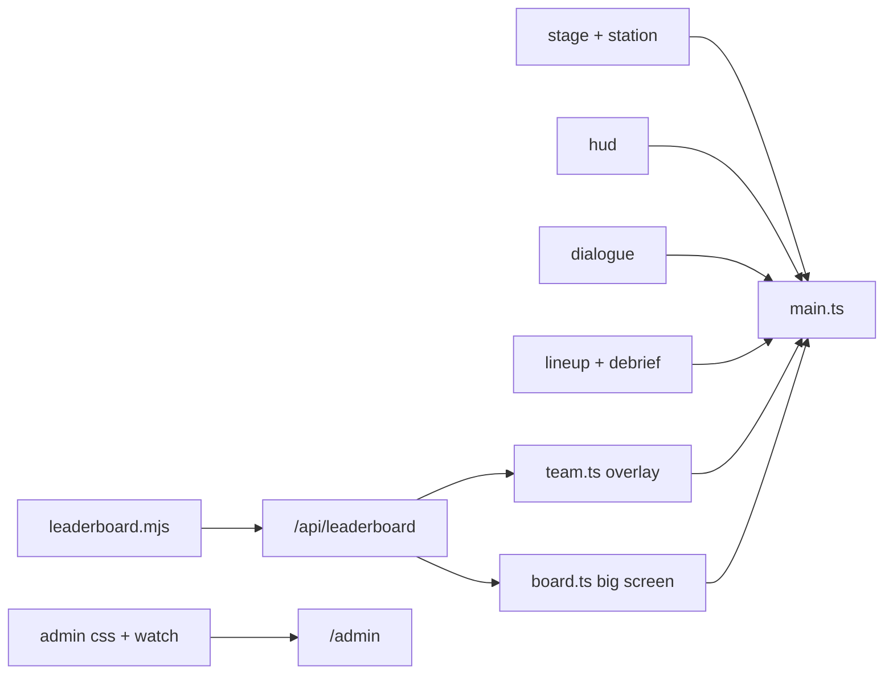
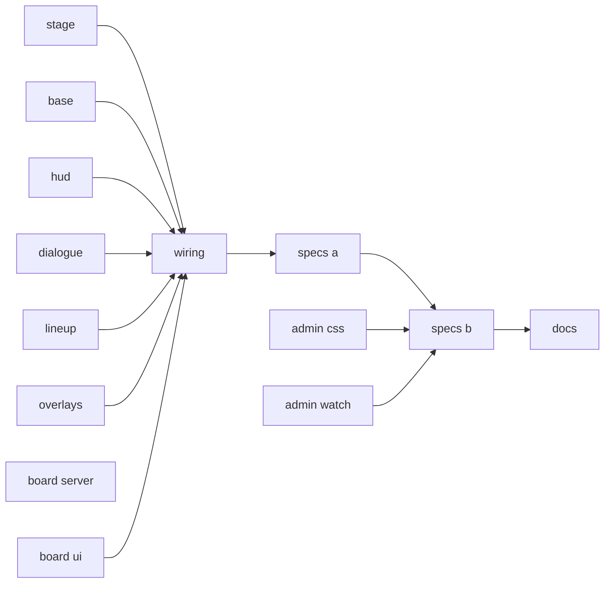

# Integration plan: Override HUD

**Goal:** Ship the design across the whole app: game, verdict, debrief, overlays, big screen, command centre, with the old stylesheets gone.
**Architecture:** Port the prototype module by module, replace the layered CSS with one token base, extend the leaderboard JSON additively, restyle admin in place.
**Tech stack:** TypeScript via Vite, Phaser 3.90, plain CSS, `node --test`, Playwright. Node 25.
**Spec:** docs/plans/2026-10-30-override-hud.spec.md
**Review plan:** docs/plans/2026-10-30-override-hud.feature.md
**Detail:** contracts
**Target-min:** 25
**Ignore:** docs/plans/, demos/override/dist/, demos/override/test-results/, demos/override/node_modules/, demos/override/.superlite/, .gitignore

## Global constraints

- App root is `demos/override`. Paths are relative to the repo root.
- Port source, read-only: `/Users/williambrach/Developer/AgentVerse/.superlite/sandboxes/override-hud-proto/demos/override`. Copy from it, then apply your task's changes. It is a reference, never a merge. Design source, data only: `.superlite/design/{Main,Verdict,Leaderboard,Admin}.dc.html` and `artifact-*.png`.
- FROZEN: `/api/*` request bodies and existing response fields; the `verdict` payload; `data-go`, `#question`, `#inspect-button`, `#continue-button`, `#read-thread`, `input[name="role-<id>"]`, `#lock-in`; `Station.configure/say/clearBubbles/setEnabled/resetPosition`; world coordinates and sprite sheets; `/admin/*` routes; the admin CSP string, no inline style or `innerHTML` in admin.
- Tokens: ink `#0F1B22`, deep `#0B151B`, panel `#13232C`, edge `#355A6B`, cream `#F4EBD3`, muted `#A9BEC6`, gold `#F4B740`, sky `#5CC8F5`, parchment `#FFF6DE`, text ink `#18252D`, rule `#D9C796`. Panel: 2px solid edge, radius 6px, `#0F1B22EB`, shadow `0 4px 0 #0A1217`. Grove `--accent:#8CC56A; --sky:#BFE0EE; --ground:#A7CF7E`; tower `--accent:#B9A2EE; --sky:#DCD3F2; --ground:#A99BD0`, by `html[data-theme]`. Roles: honest `#6DBE63`, fooled `#A68BE0`, collaborator `#F08A3C`, villain `#EA6A55`.
- Font: Atkinson Hyperlegible Next only, by Google Fonts `@import`; numbers use tabular-nums. Admin: `ui-monospace`. Controls 44px minimum, gold `:focus-visible`, `prefers-reduced-motion` respected, all data escaped.
- No rival Arbiter chip, panel, row or count. "THE ARBITER" is only the leaderboard title.
- Browser specs need `npm run build` first and `--output=<scratchpad>`. Never run unit and browser suites together. A spec assertion changes only when the design removes or relabels what it pins; list each such change in your report.

## Main diagram

## File structure

| File | Responsibility |
|---|---|
| `client/stage-layout.ts`, `client/station.ts`, `client/bubble-layout.ts`, `client/bubbles.css` | Wide stage, world, bubbles |
| `client/style.css`, `client/stage.css`, `client/banana.css` | Tokens and base, world labels, portrait sprites |
| `client/hud.ts`, `client/hud.css` | Shell, top bar, rail, toolbelt |
| `client/dialogue.ts`, `client/dialogue.css` | Box, briefing, interview, thread |
| `client/lineup.ts`, `client/lineup.css`, `client/debrief.ts` | Verdict and debrief pages |
| `client/case-board.css`, `client/team.css` | Case board, gate, access, reset, overlay |
| `client/team.ts`, `client/board.ts`, `client/board.css`, `client/types.ts` | Leaderboard overlay and big screen |
| `client/main.ts`, `index.html`, `tsconfig.json` | Wiring |
| `server/leaderboard.mjs`, `server/index.mjs` | Case cells, round label, board link |
| `server/admin/*` | Command centre |

## Task graph

```mermaid
%% schedule
gantt
  title Predicted schedule (mm:ss)
  dateFormat X
  axisFormat %M:%S
  section lane 1
  T3 hud :t3, 0, 125s
  T9 wiring :t9, 125, 157s
  T12 specs a :t12, 282, 124s
  T13 specs b :t13, 405, 121s
  T14 docs :t14, 527, 83s
  section lane 2
  T5 lineup :t5, 0, 123s
  section lane 3
  T4 dialogue :t4, 0, 122s
  section lane 4
  T8 board ui :t8, 0, 122s
  section lane 5
  T2 base :t2, 0, 120s
  section lane 6
  T1 stage :t1, 0, 115s
  section lane 7
  T10 admin css :t10, 0, 96s
  section lane 8
  T6 overlays :t6, 0, 94s
  section lane 9
  T11 admin watch :t11, 0, 91s
  section lane 10
  T7 board server :t7, 0, 88s
```

critical path: T3 → T9 → T12 → T13 → T14 (10.2 min) · peak width 10 · predicted build 10.2 min · predicted total ≈ 22.6 min (target ✓)

## Predicted schedule

## Client

**Probe entry:** serve=demos/override/server/index.mjs
**App type:** web UI. Categories: encoding (rendering, XSS), protocol via its API.

### T1 stage · Complexity 4 (O-1) · Est. context 30k
**Owns:** demos/override/client/stage-layout.ts, demos/override/client/station.ts, demos/override/client/bubble-layout.ts, demos/override/client/bubbles.css, demos/override/tests/stage-layout.test.mjs, demos/override/tests/bubble-layout.test.mjs
**Components:** 2
**LOC owned:** 110
**Tests:** fast
**Model:** sonnet
**Est. time:** 3 min
**Consumes:** none
**Produces:** placeBubble(x: number, y: number, width: number, topClear: number) -> { left: number; top: number; bottom: number; maxHeight: number; tail: number }
e.g. placeBubble(240, 100, 140, 34) -> { left: 170, top: 5, bottom: 85, maxHeight: 51, tail: 70 }
**Review Focus:** `long_line_fits`: a 40-word line in a bubble over Pip ends in an ellipsis or fits, never cut mid-line.
**Test code:** `tests/stage-layout.test.mjs` from the port source. `tests/bubble-layout.test.mjs`: the `e.g.` value; `topClear` defaults to today's margin of 4, so existing cases stay as they are.
**Steps:** 1 failing test, 2 run: FAIL, 3 port, 4 run: PASS
**Notes:** Port `stage-layout.ts` and `station.ts`. Move the top-bar cap out of `say()` into `placeBubble`'s `topClear`. `bubbles.css`: Atkinson at a fixed 15px, width unchanged, and `line-clamp` to the lines that fit `--max`, so a long line ends in an ellipsis; the thread keeps the full text.

### T2 base · Complexity 4 (O-1) · Est. context 32k
**Owns:** demos/override/client/style.css, demos/override/client/stage.css, demos/override/client/pixel.css, demos/override/client/fit.css, demos/override/client/tower.css, demos/override/client/banana.css, demos/override/tests/css-base.test.mjs
**Components:** 2
**LOC owned:** 150
**Tests:** fast
**Model:** sonnet
**Est. time:** 4 min
**Consumes:** none
**Produces:** none
**Review Focus:** `sprites_all_slots`: `.monkey-face` keeps art for slots 0 to 4 in both worlds, including recoloured slots 3 and 4.
**Test code:** `tests/css-base.test.mjs`: `style.css` holds each token above and an `Atkinson+Hyperlegible+Next` import, and no `DM+Sans` or `IBM+Plex`; `pixel.css`, `fit.css`, `tower.css` no longer exist; `stage.css` has `.station-labels`, `.station-label`, `.station-prompt`; `style.css` is under 6000 bytes. `tests/recolor.test.mjs` still passes.
**Steps:** 1 failing test, 2 run: FAIL, 3 implement, 4 run: PASS
**Notes:** Rewrite `style.css` as tokens, resets, `.primary-button`, `.secondary-button`, `.quiet-button`, form fields, `.eyebrow`, `.sr-only`, `.fine-print`, `.board-empty`, `#toast`, `.access-screen`. Primary is ink on parchment surfaces and gold on dark ones. Delete `pixel.css`, `fit.css`, `tower.css`. Move the world label rules into `stage.css`. Trim `banana.css` to sprites: `.monkey-face` sized by `--cell` (from the proto's `hud.css`), `.pixel-person`, `.monkey-line`, slots, the `--face-sheet-*` rules. Drop `.avatar-dot` once nothing renders it.

### T3 hud · Complexity 5 (O-1) · Est. context 36k
**Owns:** demos/override/client/hud.ts, demos/override/client/hud.css, demos/override/client/tools.css, demos/override/tests/hud-ui.test.mjs
**Components:** 2
**LOC owned:** 190
**Tests:** fast
**Model:** sonnet
**Est. time:** 4.5 min
**Consumes:** none
**Produces:** hudShell(v: { teamName: string; headline: string; topline: string }) -> string
e.g. hudShell({ teamName: 'Night Owls', headline: 'Who took the bananas?', topline: 'THE BANANA MYSTERY' }) -> markup with `#station`, `#team-button`, `#room-nav`
**Produces:** castCard(c: CastCard) -> string
e.g. castCard({ id: 'pip', name: 'Pip', part: 'The carrier', faceClass: 'pip slot-1', state: 'talking' }) -> '<button data-go="pip" ...'
**Review Focus:** `team_name_escaped`: team `` renders as text. `gate_clicks`: `pointer-events:none` applies only under `#app[data-hud]`.
**Test code:** Port `tests/hud-ui.test.mjs`. Add: `hud.css` has no selector `#app {` carrying `pointer-events`, and `tools.css` no longer exists.
**Steps:** 1 port tests, 2 run: FAIL, 3 port, 4 run: PASS
**Notes:** Port `hud.ts`, `hud.css`. Merge the live rules from `tools.css` (`.coin-*`, `.tool-card` family, tooltips, NEW, glow) into `hud.css` and delete `tools.css`; `.tool-guide` goes to T4. Move the `.dossier-top` overrides at the end of the proto's `hud.css` to `dialogue.css` through T4 (contract: T4 owns that rule, drop it here). `#app[data-view="lineup"] .dossier` is `position: fixed; inset: 0; margin: 0`, edge to edge, no world visible. Rail: with 5 cast on 1280×720 it must not clip, so reduce card height under 760px tall and let `.hud-rail` scroll as the last resort. Keep the proto's `#notebook-button`, mode strip and compact rules.

### T4 dialogue · Complexity 4 (O-1) · Est. context 30k
**Owns:** demos/override/client/dialogue.ts, demos/override/client/dialogue.css, demos/override/client/notebook.css, demos/override/client/notebook.ts, demos/override/tests/dialogue-ui.test.mjs
**Components:** 2
**LOC owned:** 170
**Tests:** fast
**Model:** sonnet
**Est. time:** 4 min
**Consumes:** none
**Produces:** interviewPanel(v: InterviewView) -> string
e.g. interviewPanel({ character, turns: [], inspections: [], faceClass: 'momo slot-0', closed: false, busy: false, draft: '', waitingOn: null, next: { id: 'pip', name: 'Pip' }, askLabel: '2', askOff: null, hint: 'Ask one question', many: 'monkeys' }) -> markup with `#transcript`
**Produces:** briefingPanel(v: BriefingView) -> string
e.g. briefingPanel({ copy, cast: 4, many: 'monkeys', one: 'monkey', firstId: 'momo', firstName: 'Momo', guide: '' }) -> markup with `data-go="momo"`
**Review Focus:** `answer_escaped`, `question_textarea` from the port tests.
**Test code:** Port `tests/dialogue-ui.test.mjs`. Add: `notebook.css` no longer exists.
**Steps:** 1 port tests, 2 run: FAIL, 3 port, 4 run: PASS
**Notes:** Port both files; drop the `@ts-ignore`. Merge what `.notebook-page` still needs from `notebook.css` into `dialogue.css`, using a short fade, and delete `notebook.css`. `dialogue.css` also takes `.tool-guide`, `.reasoning`, the thread, and `.dossier-top` rules. `.speech` rules come from the old `style.css`, which T2 removes, so `dialogue.css` must stand alone.

### T5 lineup · Complexity 5 (O-1) · Est. context 34k
**Owns:** demos/override/client/lineup.ts, demos/override/client/lineup.css, demos/override/client/debrief.ts, demos/override/client/roles.css, demos/override/tests/lineup-ui.test.mjs, demos/override/tests/debrief-ui.test.mjs
**Components:** 2
**LOC owned:** 180
**Tests:** fast
**Model:** sonnet
**Est. time:** 4.5 min
**Consumes:** none
**Produces:** lineupPanel(v: LineupView) -> string
e.g. lineupPanel({ title, noun: 'monkey', time: '2:31', spent: 14, roles, cast, picks: {}, confidence: 70, explanation: '', busy: false, hint: 'Pick a role for Momo' }) -> '<form id="report-form" ...'
**Produces:** debriefPage(v: DebriefView) -> string
e.g. debriefPage({ title, debrief, roles, cast, time: '2:31', spent: 14, budget: 20, questions: 4, inspections: 1, talks: 2, next: { id: 'tower-echo-bell', title: 'Lanterns Too Soon' }, many: 'monkeys' }) -> markup with `.verdict-summary`
**Review Focus:** `classification_escaped`: authored text with `<` renders as text. `five_cards`: 5 findings fit one grid.
**Test code:** Port `tests/lineup-ui.test.mjs`. `tests/debrief-ui.test.mjs`: score `3 / 4 ROLES` in `.verdict-summary`; one `.finding` per finding, showing the true role label and `You said: <label>` with `.pick-right` or `.pick-wrong`; `.spend-summary` text `You spent 12 of 20 coins`, and `You spent 12 coins` with no budget; `#next-case` with `data-case` when `next` is set, and `#debrief-reset` reads `Play again` when it is null; `#debrief-leaderboard`, `#debrief-export` present; no `Arbiter`.
**Steps:** 1 failing test, 2 run: FAIL, 3 implement, 4 run: PASS
**Notes:** Port the lineup, and delete `roles.css`, moving its live rules to `lineup.css`. `debrief.ts` ports `debriefPanel` and `spendSummary` from `main.ts` as pure functions, in the lineup's look: dark page, eyebrow `CASE CLOSED · <TITLE>`, `h1` from `debrief.title`, summary, TIME, COINS SPENT and SCORE boxes, a card per character with portrait, name, true role in its role colour, pick line, classification, explanation; then the lesson on parchment and the actions. The page scrolls when tall.

### T6 overlays · Complexity 3 (O-1) · Est. context 24k
**Owns:** demos/override/client/case-board.css, demos/override/client/team.css, demos/override/tests/overlays-css.test.mjs
**Components:** 1
**LOC owned:** 120
**Tests:** fast
**Model:** sonnet
**Est. time:** 3 min
**Consumes:** none
**Produces:** none
**Review Focus:** `gate_error_contrast`: `#team-error` is readable on its panel.
**Test code:** Add `tests/overlays-css.test.mjs`: neither file holds `#fff` backgrounds from the old theme, each uses `var(--` tokens, and `team.css` has `.modal-shade`-independent `.team-gate` rules. Run `node --test` on it.
**Steps:** 1 failing test, 2 run: FAIL, 3 implement, 4 run: PASS
**Notes:** Restyle, with no markup change: case board, reset dialog, team gate, access screen, leaderboard overlay frame. Dark panels with parchment for the case preview, gold primary. Remove the `.topbar` media rule from `team.css`; T8 drops the unit test regex that pinned it. Board table styles live in T8's `board.css`.

### T7 board server · Complexity 4 (O-1) · Est. context 26k
**Owns:** demos/override/server/leaderboard.mjs, demos/override/server/index.mjs, demos/override/tests/leaderboard.test.mjs, demos/override/.env.example
**Components:** 1
**LOC owned:** 70
**Tests:** fast
**Model:** sonnet
**Est. time:** 2.5 min
**Consumes:** none
**Produces:** standings(opts) -> Board
e.g. standings() -> { rankBy: 'time', startedAt: 0, round: 'Session B', cases: [{ id: 'banana-mystery', title: 'The Banana Mystery', order: 1, total: 4 }], teams: [{ rank: 1, name: 'Byte Club', points: 3, played: 1, timeMs: 90000, coins: 12, you: false, cells: [{ caseId: 'banana-mystery', state: 'partial', points: 3 }] }] }
**Review Focus:** `old_fields_intact`: every existing field keeps its value. `round_label_restored`: the label survives a restart through `loadRound`.
**Test code:** Add to `tests/leaderboard.test.mjs`: cells are in case order and one per case; `perfect` when points equal `total`, `partial` between, `zero` at 0, `playing` with a session and no verdict, `none` with no session; `reset(at, 'Session B')` gives `round: 'Session B'`, and `round: null` by default.
**Steps:** 1 failing test, 2 run: FAIL, 3 implement, 4 run: PASS
**Notes:** `reset(at, label = null)`. `total` is `characters.length`. Pass the label at `index.mjs:176,193`. Pass `boardUrl` to `createAdmin`: `${env.OVERRIDE_PUBLIC_URL || 'http://127.0.0.1:' + port}/?view=board`. Document `OVERRIDE_PUBLIC_URL` in `.env.example`.

### T8 board ui · Complexity 5 (O-1) · Est. context 34k
**Owns:** demos/override/client/team.ts, demos/override/client/board.ts, demos/override/client/board.css, demos/override/client/types.ts, demos/override/tests/team-ui.test.mjs, demos/override/tests/board-ui.test.mjs
**Components:** 2
**LOC owned:** 170
**Tests:** fast
**Model:** sonnet
**Est. time:** 4.5 min
**Consumes:** standings(opts) -> Board
**Produces:** boardScreen(b: Board) -> string
e.g. boardScreen({ rankBy: 'time', round: 'Session B', cases, teams }) -> markup with `.board-screen`
**Review Focus:** `team_name_escaped_board`: team `<b>x</b>` renders as text. `empty_board`: no teams shows `No team has finished a case yet.`
**Test code:** `tests/board-ui.test.mjs`: title `THE ARBITER`; `LEADERBOARD · SESSION B`, and `LEADERBOARD` alone with `round: null`; TEAMS and CASES counts; one header number per case; cell classes `perfect`, `partial`, `zero`, `playing`, `none` with the score text, `…` for playing; legend `every role right`, `some right`, `playing now`, and each case title; at most 10 rows, then `+ 3 more teams · ties by time` (`ties by coins` when `rankBy` is coins); `rank: null` shows `—`; no `line to beat`, no `ahead of`. In `tests/team-ui.test.mjs`: `leaderboardPanel` keeps `.board-row.you` and gains the same cells; drop the `.topbar` CSS regex.
**Steps:** 1 failing test, 2 run: FAIL, 3 implement, 4 run: PASS
**Notes:** Match `Leaderboard.dc.html`. `leaderboardPanel` and `boardScreen` share a row renderer. `board.css` holds the table for the overlay and the larger projector sizes. `types.ts` gains `cells`, `cases`, `round`.

### T9 wiring · Complexity 6 (O-1) · Est. context 44k
**Owns:** demos/override/client/main.ts, demos/override/index.html, demos/override/tsconfig.json, demos/override/tests/browser/hud.spec.mjs
**Components:** 2
**LOC owned:** 190
**Tests:** slow
**Model:** sonnet
**Est. time:** 5.5 min
**Consumes:** none
**Produces:** none
**Review Focus:** `gate_real_click`, `wasd_while_typing`, `escape_with_overlay`, `resize_keeps_labels_on_world` from the port spec. `board_no_presence`: `?view=board` sends no heartbeat.
**Test code:** Port `tests/browser/hud.spec.mjs` and add: lineup covers the viewport edge to edge (`.dossier` rect equals the window); `#quick-progress` reads `4 of 4 asked · free` after asking everyone; debrief shows after lock-in with `.finding` per character; duplicating a `fieldset.role-row` to 5 shows no horizontal overflow at 1280×720, and 5 cast cards in the rail stay on screen or scroll; `/?view=board` with two teams finishing updates without a reload and shows no `#team-form`, and no request to `/api/heartbeat` fires.
**Steps:** 1 port spec, 2 run: FAIL, 3 port and extend, 4 build, 5 run: PASS
**Notes:** Port `main.ts` from the source, drop imports of deleted CSS, add `stage.css`, `board.css`, `debrief.ts`, `board.ts`. Remove `debriefPanel`, `spendSummary` and the panel functions. `app.dataset.view` is `lineup` for the report and debrief pages. `?view=board`: in `boot()`, after the access check, skip heartbeat and team, render `boardScreen`, poll `/api/leaderboard` every 10 s. Keep the page title `<title> · AgentVerse`.

## Admin

**Probe entry:** serve=demos/override/server/index.mjs
**App type:** web UI. Categories: encoding, protocol via its API.

### T10 admin css · Complexity 4 (O-1) · Est. context 28k
**Owns:** demos/override/server/admin/app.css, demos/override/server/admin/tiles.css, demos/override/server/admin/log.css, demos/override/server/admin/round.css, demos/override/server/admin/controls.css, demos/override/server/admin/board.css, demos/override/server/admin/index.html, demos/override/tests/admin-page-files.test.mjs
**Components:** 1
**LOC owned:** 130
**Tests:** fast
**Model:** sonnet
**Est. time:** 3.5 min
**Consumes:** none
**Produces:** none
**Review Focus:** `csp_unchanged`: the CSP string is byte-identical.
**Test code:** Add to `tests/admin-page-files.test.mjs`: `app.css` has no `prefers-color-scheme` and sets `--bg: #0B151B`; `index.html` has `#watch`, `#board-link`, and `h1` text `command-centre`; existing CSP, no-inline-style and no-innerHTML cases still pass.
**Steps:** 1 failing test, 2 run: FAIL, 3 implement, 4 run: PASS
**Notes:** Match `Admin.dc.html`: dark only, `ui-monospace`, hairlines not boxes, tiles on one ruled row, log rows on a grid, router, funnel and board in the side column. Keep every existing id and class. `index.html` gains an empty `<section id="watch" hidden>` under the header and `<a id="board-link" target="_blank" rel="noreferrer" hidden>big-screen ↗</a>` in the header. Loads `/admin/watch.js` through `app.js`, not a new tag.

### T11 admin watch · Complexity 3 (O-1) · Est. context 24k
**Owns:** demos/override/server/admin/watch.js, demos/override/server/admin/app.js, demos/override/server/admin.mjs, demos/override/tests/admin-watch.test.mjs
**Components:** 1
**LOC owned:** 90
**Tests:** fast
**Model:** sonnet
**Est. time:** 2.5 min
**Consumes:** none
**Produces:** renderWatch(root: HTMLElement, snapshot: object, now: number) -> void
e.g. renderWatch(root, { trends: { failoverAt: 1000 } }, 2000) -> root visible with text `WATCH`
**Review Focus:** `no_innerhtml`: text through `textContent` only. `stale_failover`: failover over 5 minutes old hides the banner.
**Test code:** `tests/admin-watch.test.mjs` with the fake DOM other `admin-*` tests use: a failover within 5 minutes shows `WATCH`, the failover time and the active endpoint; older or none sets `root.hidden = true`; `GET /admin/links` returns `{ board }` with auth and 401 without.
**Steps:** 1 failing test, 2 run: FAIL, 3 implement, 4 run: PASS
**Notes:** Read the snapshot's real field names in `tiles.js` and `app.js`; the `e.g.` shape follows `trends.failoverAt` there. Text only, no invented failure counts: show what the snapshot holds. A `probe` button uses the existing `POST /admin/llm/probe`. `createAdmin` takes `boardUrl`; `app.js` sets `#board-link` from `GET /admin/links` and unhides it.

## Finish

**Probe entry:** serve=demos/override/server/index.mjs
**App type:** web UI. Categories: protocol via its API.

### T12 specs a · Complexity 5 (O-1) · Est. context 36k
**Owns:** demos/override/tests/browser/investigation.spec.mjs, demos/override/tests/browser/cases.spec.mjs, demos/override/tests/browser/teams.spec.mjs, demos/override/tests/browser/roles.spec.mjs, demos/override/tests/browser/provenance.spec.mjs, demos/override/tests/browser/walking.spec.mjs, demos/override/tests/browser/cast.mjs, demos/override/tests/teams-http.test.mjs, demos/override/tests/browser/hud.spec.mjs
**Components:** 1
**LOC owned:** 90
**Tests:** slow
**Model:** sonnet
**Est. time:** 5 min
**Consumes:** none
**Produces:** none
**Review Focus:** `no_weakened_assertions`: a test may be retargeted, not deleted, unless the behaviour is gone by spec.
**Test code:** The listed specs pass against the build with `--project=default`.
**Steps:** 1 build, 2 run, 3 retarget, 4 run: PASS
**Notes:** `tests/teams-http.test.mjs` `leaderboard_public` pins the public row keys: add `cells` to that list and keep the privacy assertions. `board_no_presence` in `hud.spec.mjs` must not depend on the old data in `test-results/sessions`: a fresh team must not need to reach the top 10 rows. Known changes: `#confidence` select becomes `input[name="confidence"]` values 40, 70, 95; `Your guess` becomes `Make your verdict`; `Ask question` becomes `Ask`. Client code fixes are out of scope: report them.

### T13 specs b · Complexity 5 (O-1) · Est. context 36k
**Owns:** demos/override/tests/browser/coins.spec.mjs, demos/override/tests/browser/tower.spec.mjs, demos/override/tests/browser/grove-look.spec.mjs, demos/override/tests/browser/grove-look.spec.mjs-snapshots/grove-darwin.png, demos/override/tests/browser/admin.spec.mjs
**Components:** 1
**LOC owned:** 70
**Tests:** slow
**Model:** sonnet
**Est. time:** 5 min
**Consumes:** none
**Produces:** none
**Review Focus:** `baseline_viewed`: read the new grove PNG before accepting it.
**Test code:** All projects pass: `default`, `tower`, `coins`, `admin`.
**Steps:** 1 build, 2 run, 3 retarget, 4 run: PASS
**Notes:** `coins`: chip is coins left. `tower`: colour assertions move to the new tokens. Regenerate the grove baseline once with `--update-snapshots`, view the image, and report that you did.

### T14 docs · Complexity 2 (O-1) · Est. context 18k
**Owns:** demos/override/README.md, demos/override/DEPLOY.md
**Components:** 1
**LOC owned:** 40
**Tests:** fast
**Kind:** mechanical
**Model:** haiku
**Est. time:** 1.5 min
**Consumes:** none
**Produces:** none
**Test code:** `grep -c 'view=board' demos/override/README.md` is at least 1; `grep -c 'OVERRIDE_PUBLIC_URL' demos/override/DEPLOY.md` is at least 1; `grep -c 'under the map' demos/override/README.md` is 0.
**Steps:** 1 edit, 2 run the greps
**Notes:** README: Play section says the world fills the screen and tools sit in the left rail; add a Big screen section for `/?view=board`, noting that it is behind the access code; say the verdict confidence labels are Guessing, Fairly sure, Certain. DEPLOY: `OVERRIDE_PUBLIC_URL` sets the admin's big-screen link.

Ruling: sequential [chain-bb19] - browser specs share fixed ports and need every client module built, so T9, T12, T13 and the docs after them cannot overlap - cost if wrong: about 10 minutes of wall time

## Review Focus

Web UI: escaping in new templates, pointer events over the canvas, keyboard paths, 3 to 5 agents, four viewports. Admin: CSP unchanged, text only. Server: additive JSON.

## Self-review

Every Done item in the spec maps to a task: 1-4 T1, T3, T4, T9; 5-6 T5, T9; 7 T5; 8 T7, T8, T9; 9 T3, T9; 10 T10, T11; 11 T12, T13.
