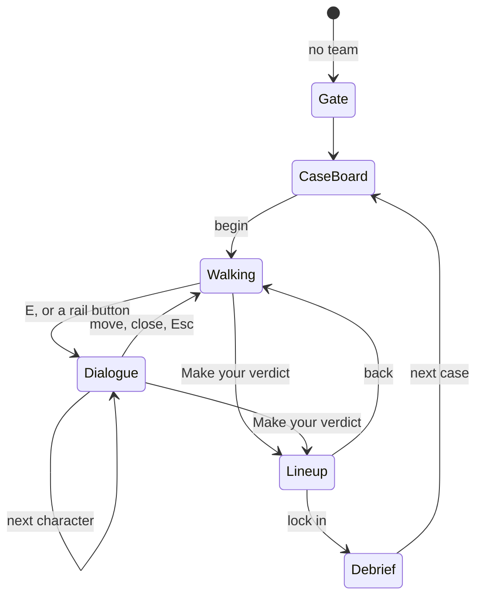
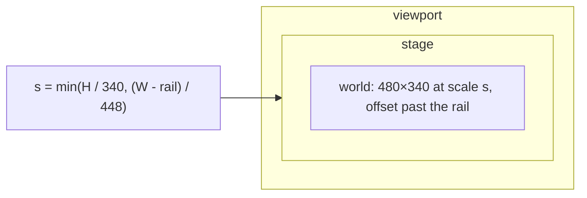

# Spec: override-hud

Source design: artifact "The Override · UI redesign" (https://claude.ai/artifact/AJKDSRcsWCc6YCDp9kRH9Z), boards Main, ATower, Verdict (3/4/5), Leaderboard, Admin. Referred to below as "the design".

## Intent

The Override reads as a web page: a small map beside a notebook. The design turns it into a game: the world fills the screen, a HUD floats over it, conversations happen in a text box, the verdict is a lineup of the cast. It also adds the two surfaces an event needs, a projector leaderboard and a command centre. This spec is the reskin and the layout change. It does not change the rules of the game.

## Goals

- **Full-bleed stage.** The Phaser world fills the viewport at every desktop size, with nothing cropped from the playable area.
- **Game HUD.** Case, world, timer, team and coins float over the world. The left rail holds the cast, the Arbiter tools and the verdict button.
- **Dialogue box.** Briefing, interview and thread render in a parchment box over the world, closed while the player walks.
- **Verdict lineup.** A full-screen cast lineup with a four-stop role scale per character, for 3, 4 and 5 agents.
- **Debrief.** Not in the design: built in the lineup's style.
- **Big screen.** A read-only projector leaderboard with one column per case.
- **Command centre.** The existing `/admin` page restyled to the design.
- **The rest.** Case board, team gate, access screen, reset dialog and leaderboard overlay use the same tokens.

## Non-goals

- A rival Arbiter player (see Decided, row 1).
- Changes to game rules, scoring, the coin economy, prompts or case content.
- New art. Sprites and sheets are reused.
- Changes to the admin Content-Security-Policy.
- New npm dependencies.

## Constraints

| Area | Rule |
|---|---|
| World | World coordinates stay 480×340. Physics bounds, stops, slots and sprites keep their values. |
| Colour | Ink `#0F1B22`, deep `#0B151B`, panel `#13232C`, edge `#355A6B`, cream `#F4EBD3`, muted `#A9BEC6`, gold `#F4B740`, sky `#5CC8F5`, parchment `#FFF6DE`, text ink `#18252D`. Panel shadow `0 4px 0 #0A1217`. |
| World accent | Grove accent `#8CC56A`, sky `#BFE0EE`, ground `#A7CF7E`. Tower accent `#B9A2EE`, sky `#DCD3F2`, ground `#A99BD0`. |
| Roles | Honest `#6DBE63`, Honest but fooled `#A68BE0`, Collaborator `#F08A3C`, Villain `#EA6A55`. |
| Type | Atkinson Hyperlegible Next for all game text, tabular numerals for numbers. Self-hosted from `client/fonts` (latin and latin-ext), with no third-party request. |
| Admin | Stays unbundled, with no inline style and no `innerHTML`. CSP string unchanged. |
| Access | Targets at least 44 px, real radio inputs, visible focus, `prefers-reduced-motion` respected, rendered text escaped. |
| Copy | English. `AUTHORED DEMONSTRATION` and the live/scripted label stay visible during play. |
| Existing ids | Ids and `data-*` hooks stay wherever their control still exists. A test changes only when the design removes or relabels what it pins, in the task that makes the change. |

## Done looks like

1. At 1280×720, 1366×768, 1440×900 and 1920×1080 the page does not scroll, the world fills the window edge to edge, and no character, name label, START HERE or YOUR GUESS sits under the left rail or the top bar.
2. The investigator walks with WASD or arrows and reaches every stop. Walking closes an open dialogue box. E opens it again.
3. Ask, follow up, Inspect reasoning, Let them talk and Read thread all work from the HUD. Earlier turns scroll in the dialogue box.
4. Arbiter tools stay labelled, priced, and show NEW and the glow as they do today.
5. The verdict lineup shows 3, 4 and 5 characters without overflow at 1280×720. Arrow keys move along a character's scale. Lock in stays disabled until every character has a role.
6. A verdict records the same payload as today (`roles`, `confidence` 40, 70 or 95, `explanation`).
7. The debrief shows the score, each character's true role against the pick, the lesson and the next-case action.
8. `/?view=board` shows live standings with one column per case, updates without a reload, and is not counted as a player in `online`.
9. At 390×844 the game is still playable by scrolling.
10. `/admin` matches the design's look. Every existing control still works and its CSP string is unchanged.
11. All unit and browser suites pass, with the grove baseline regenerated and viewed by a person or agent, not blindly.

## Decided

| # | Decision | Why |
|---|---|---|
| 1 | No rival Arbiter: no "verdict sealed" chip or panel, no "line to beat" row, no "ahead of the Arbiter" count. | No code plays the cases, so every figure would be invented on a projector. "THE ARBITER" stays as the leaderboard title; it is the event name. |
| 2 | Inspect reasoning stays in the rail's ARBITER TOOLS group, not in the dialogue box. | Tools were moved there after the design was drawn, because players missed them. |
| 3 | The stage grows, the world does not: Phaser renders a larger stage around the 480×340 world and the margins are filled with procedural ground and props. | Cover-scaling crops 35 game px at 16:9. Cropping would hide stops. |
| 4 | The transcript stays complete and scrolls inside the dialogue box. | The design notes that the box scrolls; history must not be lost. |
| 5 | The coin chip shows coins left (`13 / 20`, label COINS LEFT); with no budget it shows coins spent. | From the design. The server's economy is unchanged. |
| 6 | Confidence is three radio buttons, Guessing, Fairly sure, Certain, keeping values 40, 70, 95. | Design labels, unchanged data. |
| 7 | The role scale runs Honest → Villain, left to right, using real radios. | Design order; the server list is the reverse. |
| 8 | The rule "hear everyone first" stays. | It is a game rule, not styling. |
| 9 | The big screen is `/?view=board` on the public port, behind the existing access gate. | Needs no new route, and `?case=` already sets this convention. |
| 10 | Admin uses `ui-monospace` rather than Atkinson Mono. | Web fonts need a CSP change; this is the design's own fallback. |
| 11 | Leaderboard additions are additive JSON fields. | Existing clients keep working. |
| 13 | Reasoning effort stays `low`. A line with no reasoning keeps Inspect available and shows `<name> did not think.` in the chat, at no cost in coins or charges. | The user's call. `low` skips reasoning on most lines, so charging would spend the tool on nothing. |
| 12 | Open item F-INT-1, cause unknown: in one of three full Playwright runs the test server on 4317 stopped silently before handling a reset. | Not reproduced in targeted runs; no fix is claimed. Tracked in the incident log and rulings. |

## Left to the builder / plan

CSS file layout, how panels leave `main.ts`, the dialogue animation, the margin prop layout, and how the admin link learns the public URL.

## Diagrams

