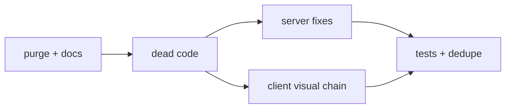
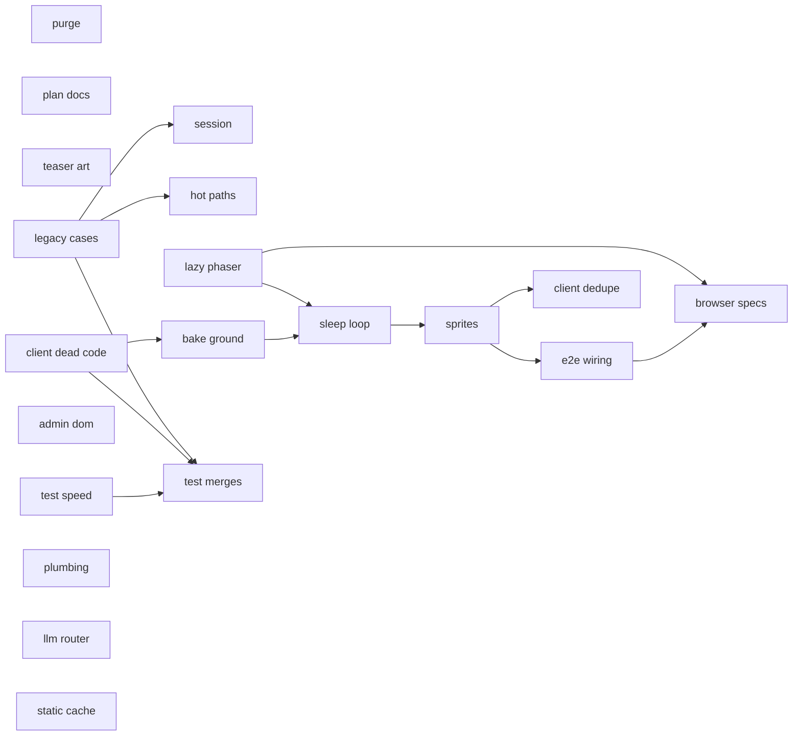

# Plan: repo cleanup and performance pass

**Goal:** Make the repo hold the game only, remove dead code and duplicate helpers from `demos/override`, shrink and steady the test suite, and land the ranked performance fixes for a 50-player event.
**Architecture:** Deletions first, then dead code, then server fixes, then the client's visual chain (lazy Phaser, baked ground, sleep under covers, half-size sheets, one snapshot), then test consolidation and client dedupe.
**Tech stack:** Node 22 ESM server, Vite + TypeScript + Phaser 3.90 client, `node --test`, Playwright.
**Spec:** docs/plans/2026-10-30-repo-cleanup.spec.md
**Detail:** contracts
**Target-min:** 30
**Ignore:** docs/plans/2026-10-30-repo-cleanup*, docs/plans/2026-10-30-repo-cleanup.spec.md, docs/plans/2026-10-30-repo-cleanup.md, .playwright-mcp/, .superlite/, demos/override/dist/, demos/override/node_modules/, demos/override/test-results/, demos/override/playwright-report/, demos/override/data/, demos/override/scripts/teaser/cache/, demos/override/scripts/teaser/out/, .DS_Store

## Global constraints

- Language: JavaScript (ESM `.mjs`) and TypeScript. Test command: `node --test demos/override/tests/*.test.mjs` from the repo root; e2e `cd demos/override && npm run build && npx playwright test --output=<scratchpad>`. Never run unit and browser suites together.
- Each task's full detail is the spec section with its `§` number; read it before starting. Intent and done looks like are in the spec.
- Paths are relative to the repo root; `O/` means `demos/override/`. No new npm dependencies. No `innerHTML` in `O/server/admin/*`; its CSP string is unchanged.
- FROZEN: `/api/*` request and response shapes, session log schema 3, `Station.configure/say/clearBubbles/setEnabled/resetPosition`, world coordinates 480x340, test ids and `data-*` hooks.
- A test changes only when the task's spec section says so; list each such change in your report. Deleting a file you own is `git rm`.

## Main diagram

## File structure

| File | Responsibility |
|---|---|
| `README.md`, `.gitignore`, `.github/workflows/test.yml` | Repo entry, ignores, Node CI |
| `docs/plans/`, `O/docs/`, `O/backendplan.md`, `O/art/` | Kept plans and specs, art prompts and provenance |
| `O/server/http-util.mjs` | Shared body parsing, JSON reply, constant-time compare, integer env |
| `O/server/admin/dom.js` | Admin DOM builder and formatters |
| `O/client/html.ts` | Client escape, svg, heading, mm:ss |
| `O/tests/helpers/until.mjs` | Poll-until helper for server tests |
| `O/tests/cases-content.test.mjs` | Live case content tests (merged) |

## Task graph

```mermaid
%% schedule
gantt
  title Predicted schedule (mm:ss)
  dateFormat X
  axisFormat %M:%S
  section lane 1
  T9 plumbing (§9) :t9, 0, 143s
  T15 sleep loop (§15) :t15, 227, 142s
  T16 sprites (§16) :t16, 369, 141s
  T20 client dedupe (§20) :t20, 510, 116s
  section lane 2
  T7 test speed (§7) :t7, 0, 124s
  T18 test merges (§18) :t18, 124, 94s
  T17 e2e wiring (§17) :t17, 510, 114s
  T19 browser specs (§19) :t19, 624, 156s
  section lane 3
  T13 lazy phaser (§13) :t13, 0, 117s
  section lane 4
  T4 legacy cases (§4) :t4, 0, 116s
  T12 hot paths (§12) :t12, 116, 112s
  section lane 5
  T6 admin dom (§6) :t6, 0, 115s
  T8 session (§8) :t8, 116, 91s
  section lane 6
  T5 client dead code (§5) :t5, 0, 107s
  T14 bake ground (§14) :t14, 107, 120s
  section lane 7
  T10 llm router (§10) :t10, 0, 87s
  section lane 8
  T11 static cache (§11) :t11, 0, 85s
  section lane 9
  T1 purge (§1) :t1, 0, 84s
  section lane 10
  T2 plan docs (§2) :t2, 0, 82s
  T3 teaser art (§3) :t3, 82, 82s
```

critical path: T5 → T14 → T15 → T16 → T17 → T19 (13.0 min) · peak width 10 · predicted build 13.0 min · predicted total ≈ 24.7 min (target ✓)

## Predicted schedule

## Repo

**Probe entry:** serve=demos/override/server/index.mjs
**App type:** file I/O. Categories: file, encoding.

### T1 purge (§1) · Complexity 2 · Est. context 24k
**Owns:** ui/, agentverse/, agentverse_command/, dataloader/, data/, scripts/, imgs/, documentation/, setup.py, requirements.txt, requirements_local.txt, MANIFEST.in, pokemon_server.py, README_zh.md, README_simulation_cases.md, README_tasksolving_cases.md, PULL_REQUEST_TEMPLATE.md, Dockerfile, .dockerignore, .github/, README.md, .gitignore
**Components:** 1
**LOC owned:** 60
**Tests:** fast
**Kind:** mechanical
**Model:** haiku
**Est. time:** 1.5 min
**Consumes:** none
**Produces:** none
**Review Focus:** none
**Test code:** `git ls-files | wc -l` -> about 255; `git ls-files ui agentverse imgs data | wc -l` -> 0; `git ls-files .playwright-mcp | wc -l` -> 0; unit suite -> 642 pass.
**Steps:** 1 `git rm` per §1, 2 write README, .gitignore, workflow, 3 run the checks
**Notes:** Root `scripts/`, `data/`, `Dockerfile` only; never `demos/override/*`. Keep `LICENSE`.

### T2 plan docs (§2) · Complexity 2 · Est. context 22k
**Owns:** docs/plans/*.incidents.jsonl, docs/plans/*.progress.md, docs/plans/*.seam.md, demos/override/docs/plans/*.incidents.jsonl, demos/override/docs/plans/*.progress.md, demos/override/docs/plans/*.report.json, demos/override/docs/plans/*.report.md, demos/override/docs/LEVELS_PLAN.md, demos/override/docs/CASES_PLAN.md, demos/override/backendplan.md
**Components:** 1
**LOC owned:** 30
**Tests:** fast
**Kind:** mechanical
**Model:** haiku
**Est. time:** 1.5 min
**Consumes:** none
**Produces:** none
**Review Focus:** none
**Test code:** `git ls-files docs/plans demos/override/docs/plans | grep -cE '\.(incidents\.jsonl|progress\.md|report\.(json|md)|seam\.md)$'` -> 0; `node --test demos/override/tests/docs.test.mjs` -> pass.
**Steps:** 1 `git rm` the 28 files and LEVELS_PLAN, 2 edit CASES_PLAN lines 3, 7, 128, 3 prepend the status block, 4 run the checks

### T3 teaser art (§3) · Complexity 2 · Est. context 24k
**Owns:** demos/override/scripts/teaser/, demos/override/art/, demos/override/public/assets/banana/*.prompt.txt, demos/override/public/assets/banana/ARTWORK.md, demos/override/public/assets/tower/*.prompt.txt, demos/override/public/assets/tower/ARTWORK.md, demos/override/client/vendor/, demos/override/README.md, demos/override/DEPLOY.md
**Components:** 1
**LOC owned:** 30
**Tests:** fast
**Kind:** mechanical
**Model:** haiku
**Est. time:** 1.5 min
**Consumes:** none
**Produces:** none
**Review Focus:** none
**Test code:** `node --check demos/override/scripts/teaser/frames.mjs` -> ok; `cd demos/override && npm run build && find dist -name '*.prompt.txt' -o -name ARTWORK.md | wc -l` -> 0; `test -e demos/override/client/vendor` -> false.
**Steps:** 1 `git mv` and `git rm` per §3, 2 edit the two imports and the docs, 3 run the checks

## Server

**Probe entry:** serve=demos/override/server/index.mjs
**App type:** HTTP service. Categories: protocol, encoding, state.

### T4 legacy cases (§4) · Complexity 4 · Est. context 40k
**Owns:** demos/override/server/cases/, demos/override/server/cases.mjs, demos/override/server/leaderboard.mjs, demos/override/tests/banana-control.test.mjs, demos/override/tests/tower-cases.test.mjs, demos/override/tests/cases.test.mjs, demos/override/tests/fixtures/, demos/override/tests/fixtures.test.mjs, demos/override/tests/case-set.test.mjs, demos/override/tests/monitor-round.test.mjs, demos/override/tests/session.test.mjs, demos/override/tests/case-prompt.test.mjs
**Components:** 2
**LOC owned:** 120
**Tests:** fast
**Model:** sonnet
**Est. time:** 3 min
**Consumes:** none
**Produces:** none
**Review Focus:** `defineCase_requires_parts`: a case without `parts` throws; `points_from_score_only`: a verdict `{ score: 3, total: 4 }` gives 3 points, a verdict without `score` gives 0.
**Test code:** the two named tests plus the edits in §4.
**Steps:** 1 delete modules and tests, 2 cut the legacy branches, 3 fix the listed tests, 4 run: PASS

### T6 admin dom (§6) · Complexity 3 · Est. context 30k
**Owns:** demos/override/server/admin/dom.js, demos/override/server/admin/board.js, demos/override/server/admin/controls.js, demos/override/server/admin/round.js, demos/override/server/admin/log.js, demos/override/server/admin/tiles.js, demos/override/server/admin/watch.js, demos/override/tests/admin-log.test.mjs, demos/override/tests/admin-dom.test.mjs
**Components:** 2
**LOC owned:** 110
**Tests:** fast
**Model:** sonnet
**Est. time:** 2.5 min
**Consumes:** none
**Produces:** el(doc: Document, tag: string, cls?: string, opts?: { parent?: Element; text?: string }) -> HTMLElement
**Produces:** mmss(ms: number) -> string
e.g. mmss(90000) -> '1:30'
e.g. mmss(0) -> '0:00'
**Review Focus:** `text_only`: `el(doc, 'b', 'x', { text: '<i>' })` renders the literal `<i>`.
**Test code:** `tests/admin-dom.test.mjs`: the `e.g.` values, `pad2(7) === '07'`, `num('x', 0) === 0`, `isNum(NaN) === false`, and the `text_only` case with the fake DOM the other `admin-*` tests use.
**Steps:** 1 failing test, 2 run: FAIL, 3 write `dom.js` and switch the six modules, 4 drop the old-format verdict branch, 5 run: PASS

### T7 test speed (§7) · Complexity 3 · Est. context 36k
**Owns:** demos/override/tests/http.test.mjs, demos/override/tests/teams-http.test.mjs, demos/override/tests/coins-http.test.mjs, demos/override/tests/admin-demo.test.mjs, demos/override/tests/admin.test.mjs, demos/override/tests/mock-llm.test.mjs, demos/override/tests/helpers/until.mjs, demos/override/tests/mock-llm.mjs, demos/override/scripts/mock-llm.mjs, demos/override/scripts/admin-demo.mjs, demos/override/tests/preflight.test.mjs, demos/override/tests/loadtest.mjs
**Components:** 1
**LOC owned:** 90
**Tests:** slow
**Model:** sonnet
**Est. time:** 2.5 min
**Consumes:** none
**Produces:** until(predicate: () => boolean | Promise<boolean>, opts?: { timeoutMs?: number; stepMs?: number }) -> Promise<void>
**Review Focus:** `until_rejects_on_timeout`: `until(() => false, { timeoutMs: 50 })` rejects.
**Test code:** the suite itself; report `time npm test` before and after.
**Steps:** 1 write `until`, 2 pass `publicDir` and `OVERRIDE_APP_COMMIT`, 3 replace sleeps, 4 move mock-llm, 5 run: PASS

### T8 session (§8) · Complexity 5 · Est. context 40k
**Owns:** demos/override/server/session.mjs, demos/override/tests/session.test.mjs
**Components:** 1
**LOC owned:** 90
**Tests:** fast
**Model:** sonnet
**Est. time:** 2.5 min
**Consumes:** none
**Produces:** none
**Review Focus:** `start_cap_counts_only_new_sessions`: 60 concurrent starts, zero 429; `repeat_start_takes_no_slot`: 30 starts on an active session leave the window untouched; `inspect_after_restore`: inspect works on a session rebuilt from its log.
**Test code:** the named tests in `tests/session.test.mjs`.
**Steps:** 1 failing tests, 2 run: FAIL, 3 implement §8, 4 run: PASS

### T9 plumbing (§9) · Complexity 5 · Est. context 46k
**Owns:** demos/override/server/http-util.mjs, demos/override/server/index.mjs, demos/override/server/admin.mjs, demos/override/server/identity.mjs, demos/override/server/interviews.mjs, demos/override/server/economy.mjs, demos/override/server/metrics.mjs, demos/override/server/monitor-sources.mjs, demos/override/tests/http-util.test.mjs
**Components:** 3
**LOC owned:** 160
**Tests:** fast
**Model:** sonnet
**Est. time:** 3.5 min
**Consumes:** none
**Produces:** readJsonBody(req: IncomingMessage, max: number) -> Promise<object>
**Produces:** sendJson(res: ServerResponse, status: number, data: unknown) -> void
**Produces:** safeEqual(a: string, b: string) -> boolean
**Produces:** integerEnv(value: string | undefined, fallback: number, name: string) -> number
e.g. integerEnv('', 7, 'PORT') -> 7
e.g. integerEnv('12', 7, 'PORT') -> 12
**Produces:** diskFreeBytes(dir: string) -> number | null
**Review Focus:** `utf8_split_body`: a 3-byte character split across two writes parses; `body_413`: 16 385 bytes gives 413.
**Test code:** `tests/http-util.test.mjs` per §9; existing `http`, `admin`, `identity`, `metrics` tests unchanged and green.
**Steps:** 1 failing tests, 2 run: FAIL, 3 write `http-util.mjs`, switch callers, add the system ring, 4 run: PASS

### T10 llm router (§10) · Complexity 4 · Est. context 36k
**Owns:** demos/override/server/llm.mjs, demos/override/tests/llm.test.mjs, demos/override/tests/failover.test.mjs, demos/override/tests/interviews.test.mjs
**Components:** 1
**LOC owned:** 60
**Tests:** fast
**Model:** sonnet
**Est. time:** 2 min
**Consumes:** none
**Produces:** none
**Review Focus:** `rate_limit_backoff_same_endpoint`; `429_does_not_failover`.
**Test code:** the two named tests with an injected `sleep` that records its calls.
**Steps:** 1 failing tests, 2 run: FAIL, 3 implement, 4 run: PASS

### T11 static cache (§11) · Complexity 3 · Est. context 26k
**Owns:** demos/override/server/static.mjs, demos/override/tests/static.test.mjs
**Components:** 1
**LOC owned:** 40
**Tests:** fast
**Model:** sonnet
**Est. time:** 1.5 min
**Consumes:** none
**Produces:** none
**Review Focus:** `etag_304`: a GET with the returned `If-None-Match` gives 304 and no body; `hashed_png_immutable`.
**Test code:** the two named tests.
**Steps:** 1 failing tests, 2 run: FAIL, 3 implement, 4 run: PASS

### T12 hot paths (§12) · Complexity 4 · Est. context 36k
**Owns:** demos/override/server/cases.mjs, demos/override/server/leaderboard.mjs, demos/override/server/monitor-window.mjs, demos/override/tests/leaderboard.test.mjs, demos/override/tests/monitor-window.test.mjs, demos/override/tests/cases.test.mjs
**Components:** 2
**LOC owned:** 80
**Tests:** fast
**Model:** sonnet
**Est. time:** 2.5 min
**Consumes:** none
**Produces:** none
**Review Focus:** `rank_cache_refreshes_after_1s`: a team added at t+1001 ms appears; `ties_keep_rank`: equal rows share a rank and the next rank skips.
**Test code:** the named tests plus `resolve_same_result_cached`.
**Steps:** 1 failing tests, 2 run: FAIL, 3 implement, 4 run: PASS

## Client

**Probe entry:** serve=demos/override/server/index.mjs
**App type:** web UI. Categories: encoding, protocol via its API.

### T5 client dead code (§5) · Complexity 3 · Est. context 36k
**Owns:** demos/override/client/detective-walk.ts, demos/override/client/monkey-idle.ts, demos/override/client/placeholder-art.ts, demos/override/client/atlas.ts, demos/override/client/station.ts, demos/override/client/worlds.ts, demos/override/client/hud.css, demos/override/client/style.css, demos/override/client/team.css, demos/override/tests/atlas.test.mjs, demos/override/tests/worlds.test.mjs, demos/override/tests/css-base.test.mjs
**Components:** 2
**LOC owned:** 40
**Tests:** fast
**Model:** sonnet
**Est. time:** 1.5 min
**Consumes:** none
**Produces:** none
**Review Focus:** `tsc_clean`: `npx tsc --noEmit` passes after the removals.
**Test code:** the three test edits in §5; `npx tsc --noEmit`.
**Steps:** 1 remove per §5, 2 fix tests, 3 tsc and unit: PASS

### T13 lazy phaser (§13) · Complexity 3 · Est. context 34k
**Owns:** demos/override/client/main.ts, demos/override/tests/browser/hud.spec.mjs
**Components:** 1
**LOC owned:** 30
**Tests:** slow
**Model:** sonnet
**Est. time:** 2 min
**Consumes:** none
**Produces:** none
**Review Focus:** `board_without_phaser`: `/?view=board` requests no `station-*.js`.
**Test code:** the named spec in `hud.spec.mjs`; `npm run build` shows `index-*.js` and `station-*.js`.
**Steps:** 1 failing spec, 2 build, run: FAIL, 3 implement, 4 run: PASS

### T14 bake ground (§14) · Complexity 4 · Est. context 36k
**Owns:** demos/override/client/station.ts, demos/override/client/detective-walk.ts
**Components:** 1
**LOC owned:** 60
**Tests:** slow
**Model:** sonnet
**Est. time:** 2.5 min
**Consumes:** none
**Produces:** none
**Review Focus:** `depth_order_kept`: the basket still occludes the investigator walking behind it (walking project).
**Test code:** `npx tsc --noEmit`; e2e walking project.
**Steps:** 1 implement §14, 2 tsc, 3 build, run walking: PASS

### T15 sleep loop (§15) · Complexity 5 · Est. context 40k
**Owns:** demos/override/client/station.ts, demos/override/client/main.ts
**Components:** 2
**LOC owned:** 60
**Tests:** slow
**Model:** sonnet
**Est. time:** 2.5 min
**Consumes:** none
**Produces:** Station.setCovered(covered: boolean) -> void
**Review Focus:** `wake_before_walk`: after `#confirm-restart` the investigator moves within 150 ms; `pose0_under_modal`: NPC frames are `<id>-0` while `#reset-confirm` is open.
**Test code:** e2e default, tower, coins projects.
**Steps:** 1 implement §15, 2 tsc, 3 build, run e2e: PASS

### T16 sprites (§16) · Complexity 5 · Est. context 40k
**Owns:** demos/override/public/assets/banana/*.png, demos/override/public/assets/tower/*.png, demos/override/art/README.md, demos/override/client/monkey-idle.ts, demos/override/client/detective-walk.ts, demos/override/client/station.ts, demos/override/client/banana.css, demos/override/tests/sprite-specs.test.mjs
**Components:** 2
**LOC owned:** 50
**Tests:** slow
**Model:** sonnet
**Est. time:** 2.5 min
**Consumes:** none
**Produces:** none
**Review Focus:** `sheet_size_cap`: `du -sh public/assets` at most 3 MB; `tower_real_art`: tower project real-art tests pass.
**Test code:** updated pins in `tests/sprite-specs.test.mjs`; e2e tower project; a screenshot at 1440 wide reviewed.
**Steps:** 1 downscale and compress, 2 scale the grove tables, 3 update pins, 4 tsc, build, run tower: PASS

### T17 e2e wiring (§17) · Complexity 2 · Est. context 26k
**Owns:** demos/override/tests/browser/grove-look.spec.mjs, demos/override/tests/browser/grove-look.spec.mjs-snapshots/, demos/override/package.json
**Components:** 1
**LOC owned:** 10
**Tests:** slow
**Model:** sonnet
**Est. time:** 1.5 min
**Consumes:** none
**Produces:** none
**Review Focus:** `snapshot_reviewed`: the regenerated `grove-darwin.png` shows the cast at the previous size.
**Test code:** full e2e green.
**Steps:** 1 skip off darwin, 2 regenerate the baseline and look at it, 3 `test:e2e` script, 4 run e2e: PASS

## Tests and dedupe

**Probe entry:** serve=demos/override/server/index.mjs
**App type:** web UI. Categories: encoding, state.

### T18 test merges (§18) · Complexity 3 · Est. context 36k
**Owns:** demos/override/tests/css-base.test.mjs, demos/override/tests/overlays-css.test.mjs, demos/override/tests/agent-tools-live.test.mjs, demos/override/tests/agent-tools.test.mjs, demos/override/tests/admin-page-files.test.mjs, demos/override/tests/admin.test.mjs, demos/override/tests/case-set.test.mjs, demos/override/tests/tower-echo.test.mjs, demos/override/tests/case-tools-content.test.mjs, demos/override/tests/cases-content.test.mjs
**Components:** 1
**LOC owned:** 120
**Tests:** fast
**Model:** sonnet
**Est. time:** 2 min
**Consumes:** none
**Produces:** none
**Review Focus:** `no_lost_assertion`: every unique assertion of a merged file exists in its target.
**Test code:** the suite; `ls demos/override/tests/*.test.mjs | wc -l` about 53.
**Steps:** 1 merge, 2 delete, 3 run: PASS

### T19 browser specs (§19) · Complexity 5 · Est. context 44k
**Owns:** demos/override/tests/browser/walking.spec.mjs, demos/override/tests/browser/cast.mjs, demos/override/tests/browser/investigation.spec.mjs, demos/override/tests/browser/roles.spec.mjs, demos/override/tests/browser/hud.spec.mjs, demos/override/tests/browser/cases.spec.mjs, demos/override/tests/sprite-specs.test.mjs, demos/override/playwright.config.mjs
**Components:** 2
**LOC owned:** 180
**Tests:** slow
**Model:** sonnet
**Est. time:** 4.5 min
**Consumes:** none
**Produces:** interviewAll(page: Page) -> Promise<void>
**Produces:** lockIn(page: Page, picks: Record<string, string>) -> Promise<void>
**Review Focus:** `no_fixed_sampling`: no `waitForTimeout` over 300 ms in `walking.spec.mjs`; `twice_green`: e2e passes twice in a row.
**Test code:** the rewritten specs and the two unit tests in `sprite-specs.test.mjs`.
**Steps:** 1 rewrite walking, 2 extract helpers, 3 unit tests for blink and stride, 4 build, run e2e twice: PASS

### T20 client dedupe (§20) · Complexity 4 · Est. context 44k
**Owns:** demos/override/client/html.ts, demos/override/client/main.ts, demos/override/client/board.ts, demos/override/client/debrief.ts, demos/override/client/dialogue.ts, demos/override/client/hud.ts, demos/override/client/lineup.ts, demos/override/client/team.ts, demos/override/client/tools.ts, demos/override/client/atlas.ts, demos/override/client/detective-walk.ts, demos/override/client/monkey-idle.ts, demos/override/client/placeholder-art.ts, demos/override/client/station.ts, demos/override/tests/html.test.mjs
**Components:** 2
**LOC owned:** 120
**Tests:** fast
**Model:** sonnet
**Est. time:** 3 min
**Consumes:** none
**Produces:** escape(value: unknown) -> string
e.g. escape('<b>&"') -> '&lt;b&gt;&amp;&quot;'
e.g. escape(null) -> ''
**Produces:** mmss(seconds: number) -> string
e.g. mmss(151) -> '2:31'
**Review Focus:** `escape_all_five`: `& < > " '` each escaped; `one_escape_definition`: `grep -c "replace(/\[&<>" client/*.ts` is 1.
**Test code:** `tests/html.test.mjs` with the `e.g.` values; existing `*-ui.test.mjs` green; `npx tsc --noEmit`.
**Steps:** 1 failing test, 2 run: FAIL, 3 write `html.ts`, switch callers, dedupe per §20, 4 tsc, run: PASS

## Review Focus

Repo: file (deletions stay inside the listed paths), encoding (README and workflow are plain ASCII). Server: protocol (status codes 304, 413, 429 as specified), state (session cap and caches refresh on time), encoding (UTF-8 bodies). Client: encoding (one `escape`; text through `textContent`), protocol via its API (board view loads no Phaser). Tests: state (no wall-clock sampling).

## Self-review

Coverage: §1-§20 each have a task. No placeholders. Produces and Consumes: none cross tasks, so no stubs block a consumer. Graph: edges exist only where two tasks share a file or a test runs the other task's code. Shared files are sequenced: `session.test.mjs` (T4 then T8), `cases.mjs`, `leaderboard.mjs`, `cases.test.mjs` (T4 then T12), `station.ts` (T5, T14, T15, T16, T20), `detective-walk.ts` (T5, T14, T16, T20), `monkey-idle.ts` (T5, T16, T20), `main.ts` (T13, T15, T20), `hud.spec.mjs` (T13, T19), `sprite-specs.test.mjs` (T16, T19), `admin.test.mjs` (T7, T18), `case-set.test.mjs` (T4, T18), `css-base.test.mjs` (T5, T18), `atlas.ts`, `placeholder-art.ts` (T5, T20).

## Rulings

- Ruling: sequential [chain-7ab8] - the client visual chain shares station.ts and main.ts, each step changes what the next one renders, and the grove snapshot must be regenerated once after all of them - cost if wrong: about 13 min of sequential client work.
- Ruling: plan over the 15k cap - 20 tasks need explicit Owns lists to sequence shared files; the prime stays slim, so agents read only their own block - cost if wrong: a larger task message per agent.
