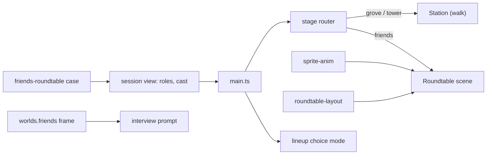
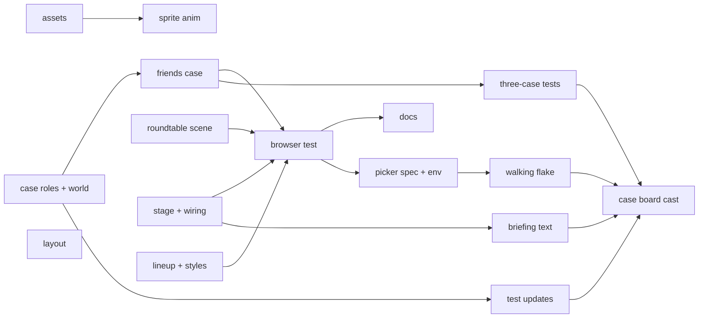

# Plan: the Friends level

**Goal:** A third case, Friends: no walking, the player picks a friend at a roundtable and works out which secret conspiracy theory each of five friends believes; the sprite pack's roundtable scene renders it in the existing Phaser client.
**Architecture:** Server: case-defined verdict roles, a `friends` world with its own prompt framing, the case module. Client: two pure modules (animation table, layout), a roundtable Phaser scene in its own game, a stage router that swaps it with the walking station by world, a choice-mode lineup and friends styles.
**Tech stack:** Node 25 ESM server, TypeScript + Vite + Phaser 3.90 client, `node --test`, Playwright.
**Spec:** docs/plans/2026-11-03-friends-level.spec.md
**Detail:** contracts
**Target-min:** 14
**Ignore:** docs/plans/2026-11-03-friends-level*, .superlite/, demos/override/dist/, demos/override/node_modules/, demos/override/test-results/, demos/override/playwright-report/, demos/override/data/, .DS_Store

Rulings live in `.superlite/progress.md`.

## Global constraints

- Paths are relative to `demos/override/` (`O`). Read your task's spec section (`§n`) first; case strings come from `docs/plans/2026-11-03-friends-level.content.md`.
- Test command: `node --test tests/*.test.mjs` from `O` (710 pass at start). Tests import client `.ts` directly (Node type stripping, as `tests/stage-layout.test.mjs`), so client modules under unit test use erasable TS only: no enums, no parameter properties, `import type` for types. Client type check: `npx tsc --noEmit` from `O`.
- e2e: `npm run build` first, then `npx playwright test <spec> --output=<scratch>/pw-out`; never run unit and browser suites at once.
- Never edit `server/cases/banana-mystery.mjs` or `tower-echo-bell.mjs`; their `contentHash` and the grove/tower system prompts stay byte-identical. Log schema 3, `promptVersion`, `threadPromptVersion` and `/api/*` shapes unchanged.
- No new npm dependencies. Sprite files are byte copies of the pack; never edit or re-encode them, never write into the pack.
- Pixel art: nearest-neighbour sampling, origin = `ANCHOR`, one scale per actor across all its states.
- Missing art stays explicit: code, comments, UI and docs never call a pose-based loop a seated or walk cycle.

## Main diagram

## File structure

Each task's Owns line lists its files; the spec section says what each one does.

## Task graph

```mermaid
%% schedule
gantt
  title Predicted schedule (mm:ss)
  dateFormat X
  axisFormat %M:%S
  section lane 1
  T6 roundtable scene (§6) :t6, 0, 174s
  T9 browser test (§9) :t9, 233, 135s
  T13 case picker spec and env example for :t13, 368, 114s
  T14 reduced-motion walking test under fu :t14, 482, 115s
  T16 case board preview shows the picked  :t16, 597, 140s
  section lane 2
  T7 stage + wiring (§7) :t7, 0, 150s
  T15 roundtable briefing text :t15, 150, 83s
  T12 prompt and leaderboard tests for thr :t12, 233, 84s
  T10 docs (§10) :t10, 368, 88s
  section lane 3
  T8 lineup + styles (§8) :t8, 0, 129s
  section lane 4
  T2 case roles + world (§2) :t2, 0, 122s
  T3 friends case (§3) :t3, 122, 111s
  section lane 5
  T5 layout (§5) :t5, 0, 99s
  T11 existing tests for the friends world :t11, 122, 85s
  section lane 6
  T1 assets (§1) :t1, 0, 85s
  T4 sprite anim (§4) :t4, 85, 94s
```

critical path: T2 → T3 → T9 → T13 → T14 → T16 (12.3 min) · peak width 6 · predicted build 12.3 min · predicted total ≈ 24.2 min (target ✗ 14.0)

## Server

**Probe entry:** call=server.cases.defineCase · call=server.cases.rolesOf · serve=server/index.mjs

### T2 case roles + world (§2) · Complexity 4 · Est. context 46k
**Owns:** demos/override/server/worlds.mjs, demos/override/server/cases.mjs, demos/override/server/interviews.mjs, demos/override/server/session.mjs, demos/override/scripts/admin-demo.mjs, demos/override/tests/case-roles.test.mjs
**Components:** 2
**LOC owned:** 170
**Tests:** fast
**Kind:** design
**Model:** sonnet
**Est. time:** 3 min
**Consumes:** none
**Produces:** cases.rolesOf(kase: Case) -> Role[]
e.g. rolesOf(bananaMystery).map(r => r.id) -> ['villain', 'collaborator', 'fooled', 'honest']
e.g. rolesOf(defineCase({...threeCase, roles: [{id: 'a1', label: 'A', hint: 'h'}, {id: 'b2', label: 'B', hint: 'h'}]})).map(r => r.id) -> ['a1', 'b2']
**Produces:** cases.defineCase(data: object, opts?: {worlds?: object}) -> Case
e.g. a part with role 'villain' while case roles are a1, b2 -> throws /parts\[0\]\.role: must be one of a1, b2/
e.g. roles [{id: 'a1', label: '', hint: 'h'}, ...] -> throws /roles\[0\]\.label/
**Review Focus:** `grove_and_tower_prompts_byte_identical` (buildMessages and buildThreadMessages output for both live cases equals the strings captured before the change, kept as fixtures in the test); `verdict_rejects_role_outside_case` (standard case + roles `{x: 'birds'}` -> 400); `public_view_hides_frame_memory_persona`; `content_hash_unchanged` (banana `d891b333116d`, tower `6508e9784a90`).
**Test code:** the four Review Focus tests plus `roles_of_standard_case`, `case_roles_validate` (bad id, duplicate id, 1 entry, 10 entries, empty hint), `friends_world_shape` (agents 5, persona 'friend', frame/memory strings from §2), `admin_demo_picks_view_roles` (pure helper exported from admin-demo returns ids from the given roles list).

### T3 friends case (§3) · Complexity 3 · Est. context 40k
**Owns:** demos/override/server/cases/friends-roundtable.mjs, demos/override/server/cases/index.mjs, demos/override/tests/friends-case.test.mjs, demos/override/tests/cases-content.test.mjs
**Components:** 1
**LOC owned:** 260
**Tests:** fast
**Kind:** design
**Model:** sonnet
**Est. time:** 3 min
**Consumes:** none
**Produces:** casesIndex.cases -> Case[]
e.g. cases.map(c => c.id) -> ['banana-mystery', 'tower-echo-bell', 'friends-roundtable']
e.g. cases[2].world.id -> 'friends'; cases[2].parts.every(p => p.label === 'Friend') -> true
**Review Focus:** `friends_rehearsal_deflects_then_admits` (birds: 'How was your week?' -> deflection; 'Do you like birds?' -> admission naming drones); `friends_verdict_scores_theories` (Investigation in rehearsal: ask all five, verdict with the true dealt theory for each -> score 5/5; a decoy for one -> 4/5); `friends_no_theory_in_public_view` (publicView before the verdict contains no role label of any part outside `roles`).
**Test code:** the Review Focus tests plus `friends_case_shape` (5 characters with the content doc ids and colours, 7 roles in order, 2 decoys held by no part), `friends_knowledge_has_shared_rule` (every part's knowledge[0] contains "hide it at first"), `friends_tools_text` (rehearsalReasoning non-empty for every part; rehearsalChatter cycles 3 posts); update `registry lists ...` in cases-content.test.mjs to three cases.

### T11 existing tests for the friends world · Complexity 2 · Est. context 30k
**Owns:** demos/override/tests/cases.test.mjs, demos/override/tests/economy.test.mjs, demos/override/tests/agent-tools.test.mjs, demos/override/tests/coins-http.test.mjs
**Components:** 1
**LOC owned:** 40
**Tests:** fast
**Kind:** design
**Model:** sonnet
**Est. time:** 1.5 min
**Consumes:** none
**Produces:** updated assertions for the third world
**Test code:** `worlds registry` and `no world means the grove` expect `frame` and `memory` and the `friends` world; the coin-budget floor is now 10 (ask 2 x 5 friends) in `rules_validation`, `quote_examples`, `reserve_blocks_continue`, `budget_env_seam`; the full unit suite passes.

### T12 prompt and leaderboard tests for three cases · Complexity 2 · Est. context 30k
**Owns:** demos/override/tests/thread-prompt.test.mjs, demos/override/tests/leaderboard.test.mjs
**Components:** 1
**LOC owned:** 30
**Tests:** fast
**Kind:** design
**Model:** sonnet
**Est. time:** 1.5 min
**Consumes:** none
**Produces:** updated assertions for the third case
**Test code:** `interview prompt and promptVersion are pinned` pins a friends-roundtable hash too; `thread_shuffled_cast` skips the other-label check only for parts whose label equals the speaker's own and still asserts no other part's knowledge line appears; `example standings` expects the friends cell; full unit suite passes.

### T13 case picker spec and env example for three cases · Complexity 1 · Est. context 26k
**Owns:** demos/override/tests/browser/cases.spec.mjs, demos/override/.env.example
**Components:** 1
**LOC owned:** 6
**Tests:** slow
**Kind:** design
**Model:** sonnet
**Est. time:** 1.5 min
**Consumes:** none
**Produces:** count and comment updates
**Test code:** `picker starts the chosen case` and `phone width keeps the picker single column` expect 3 `.case-option`; `.env.example` says the coin budget is an integer 10-999; `npx playwright test tests/browser/cases.spec.mjs --project=default` passes; `node --test tests/docs.test.mjs` passes.

### T14 reduced-motion walking test under full load · Complexity 3 · Est. context 40k
**Owns:** demos/override/tests/browser/walking.spec.mjs
**Components:** 1
**LOC owned:** 20
**Tests:** slow
**Kind:** design
**Model:** sonnet
**Est. time:** 2 min
**Consumes:** none
**Produces:** a diagnosed cause and a fix for walking.spec.mjs:139 in the all-projects run
**Test code:** `reduced motion retains direction changes without stepping` passes in two consecutive all-projects runs; if the cause is in client/main.ts or client/stage.ts, the coordinator extends Owns by ruling.

### T15 roundtable briefing text · Complexity 1 · Est. context 24k
**Owns:** demos/override/client/dialogue.ts, demos/override/tests/dialogue-ui.test.mjs
**Components:** 1
**LOC owned:** 20
**Tests:** fast
**Kind:** design
**Model:** sonnet
**Est. time:** 1.5 min
**Consumes:** none
**Produces:** BriefingView.verdict and BriefingView.howTo (optional plain text)
**Test code:** `briefing_roundtable_text`: custom verdict and how-to escaped, no WASD line; walking worlds keep today's text.

### T16 case board preview shows the picked case's cast · Complexity 2 · Est. context 28k
**Owns:** demos/override/server/cases.mjs, demos/override/client/main.ts, demos/override/tests/cases.test.mjs, demos/override/tests/friends-case.test.mjs, demos/override/tests/browser/friends.spec.mjs
**Components:** 2
**LOC owned:** 40
**Tests:** slow
**Kind:** design
**Model:** sonnet
**Est. time:** 2 min
**Consumes:** none
**Produces:** catalog rows gain cast [{id, name}]; casePreview draws the picked row's cast and count
**Test code:** `catalog_rows_name_their_cast`; `case_board_preview_shows_the_picked_cast` (from a grove game, picking Friends shows maya..sam and "Ask 5 friends"; tower shows 3).

## Assets

**Probe entry:** run=node --test tests/friends-assets.test.mjs

### T1 assets (§1) · Complexity 1 · Est. context 24k
**Owns:** demos/override/public/assets/friends/, demos/override/tests/friends-assets.test.mjs
**Components:** 1
**LOC owned:** 80
**Tests:** fast
**Kind:** mechanical
**Model:** haiku
**Est. time:** 1.5 min
**Consumes:** none
**Produces:** files under public/assets/friends/ exactly as listed in §1
**Test code:** `assets_listed_files_exist`; `assets_match_pack_sha256` (skipped when the pack folder is missing); `assets_png_rgba` (IHDR colour type byte at offset 25 is 6); `assets_strip_sizes` (IHDR width/height: strips 1152x288, effect loops 1536x256, table 1672x941).
**Steps:** `cp` each file (no re-encode), write README.md from §1, write the test, run it.

## Client

**Probe entry:** call=client.sprite-anim.frameAt · call=client.roundtable-layout.fitRoom · call=client.stage.createStage

### T4 sprite anim (§4) · Complexity 3 · Est. context 30k
**Owns:** demos/override/client/sprite-anim.ts, demos/override/tests/sprite-anim.test.mjs
**Components:** 1
**LOC owned:** 120
**Tests:** fast
**Kind:** design
**Model:** sonnet
**Est. time:** 2 min
**Consumes:** none
**Produces:** spriteAnim.frameAt(frames: AnimFrame[], elapsedMs: number) -> number
e.g. frameAt([{x: 0, y: 0, w: 192, h: 288, duration: 500}, {x: 192, y: 0, w: 192, h: 288, duration: 170}], 499) -> 0
e.g. same frames: 500 -> 1, 670 -> 0, 1170 -> 1
**Produces:** spriteAnim.actorAnimation(actor: string, state: ActorState) -> ActorAnimation
e.g. actorAnimation('maya', 'talk') -> {key: 'maya:seated-talk', image: 'maya-seated-talk.png', fallback: null}
e.g. actorAnimation('alex', 'think') -> {key: 'alex:think', image: 'alex-think.png', fallback: 'standing pose loop: no seated art yet'}
e.g. actorAnimation('ken', 'think') -> {key: 'ken:seated-think', image: 'ken-seated-think.png', fallback: 'upper-body pose substitute (keeps his glasses)'}
**Produces:** spriteAnim.ANCHOR -> {x: number, y: number}
e.g. ANCHOR -> {x: 0.5, y: 0.9791666666666666}
**Review Focus:** `frame_at_zero_total` (all durations 0 -> 0, returns); `frame_at_huge_elapsed` (1e12 ms -> index in range, O(frames)); `frame_at_negative` (-10 -> 0); `unknown_actor_throws`.
**Test code:** the e.g. values, the Review Focus tests, `actor_ids_six`, `table_keys_exist_in_pack_json` (reads public/assets/friends/animations.json: every key the table can return exists with 6 frames of 192x288), `missing_art_lists_alex_nora_sam_and_ken_think`.

### T5 layout (§5) · Complexity 4 · Est. context 30k
**Owns:** demos/override/client/roundtable-layout.ts, demos/override/tests/roundtable-layout.test.mjs
**Components:** 1
**LOC owned:** 160
**Tests:** fast
**Kind:** design
**Model:** sonnet
**Est. time:** 2.5 min
**Consumes:** none
**Produces:** roundtableLayout.fitRoom(viewW: number, viewH: number, rail: number, compact: boolean) -> StageLayout
e.g. fitRoom(1440, 900, 252, false) -> {width: 1552, height: 970, offsetX: 272, offsetY: 125, scale: 0.928125}
e.g. fitRoom(1920, 1080, 252, false) -> {width: 1473, height: 829, offsetX: 193, offsetY: 55, scale: 1.303125}
e.g. fitRoom(2560, 900, 252, false) -> {width: 2048, height: 720, offsetX: 485, offsetY: 0, scale: 1.25}
e.g. fitRoom(800, 600, 252, true) -> {width: 1280, height: 720, offsetX: 0, offsetY: 0, scale: 0.625}
**Produces:** roundtableLayout.seats() -> Seat[]
e.g. seats().map(s => s.actor) -> ['maya', 'ken', 'alex', 'nora', 'player', 'sam']
e.g. seats().filter(s => s.layer === 'near').map(s => s.actor) -> ['player', 'sam']
**Produces:** roundtableLayout.table() -> TableBox
e.g. table() -> {x: 140, y: 250, width: 1000, height: 1000 * 941 / 1672, depth: 30}
**Produces:** roundtableLayout.onTabletop(x: number, y: number) -> boolean
e.g. onTabletop(640, 474) -> true; onTabletop(170, 700) -> false
**Review Focus:** `table_dominates` (width >= 0.7 x 1280, aspect within 0.1%); `far_seats_behind_table` (depth < table depth, anchor below the ellipse top edge at its x, head top >= 90); `near_seats_in_front_not_on_top` (depth > table depth, `!onTabletop(anchor)`); `fit_room_right_of_rail` (offsetX x scale >= rail - 1 when not compact).
**Test code:** the e.g. values and the Review Focus tests; `fitRoom` formula: scale = min(viewH / 720, (viewW - rail) / 1280); width/height = round(view / scale); railU = rail / scale; offsetX = max(0, round(railU + (width - railU - 1280) / 2)); offsetY = max(0, round((height - 720) / 2)); compact: scale = viewW / 1280, room size, offsets 0.

### T6 roundtable scene (§6) · Complexity 6 · Est. context 72k
**Owns:** demos/override/client/roundtable.ts
**Components:** 2
**LOC owned:** 330
**Tests:** slow
**Kind:** design
**Model:** sonnet
**Est. time:** 5 min
**Consumes:** spriteAnim.frameAt(frames: AnimFrame[], elapsedMs: number) -> number (T4) · spriteAnim.actorAnimation(actor: string, state: ActorState) -> ActorAnimation (T4) · spriteAnim.ANCHOR -> {x: number, y: number} (T4) · roundtableLayout.seats() -> Seat[] (T5) · roundtableLayout.table() -> TableBox (T5) · roundtableLayout.fitRoom(viewW: number, viewH: number, rail: number, compact: boolean) -> StageLayout (T5)
**Produces:** roundtable.createRoundtable(onArrival: (id: string) => void, onHint: (hint: string) => void) -> Roundtable
**Produces:** Roundtable.actors -> Map<string, ActorView>
e.g. scene.actors.get('maya') -> {layer: 'far', state: 'idle', key: 'maya:seated-idle', fallback: null, sprite}
e.g. after scene.think('maya'): actors.get('maya').state -> 'think'; actors.get('player').state -> 'talk'
**Review Focus:** depth order far < table < near; no frame jump after the loop sleeps (delta clamp); `configure` while loading restarts with the latest cast; the overlay never takes pointer events from the HUD.
**Test code:** none in this task: `npx tsc --noEmit` clean and `npm run build` succeed; T9 drives it in a browser. Methods `configure, focus, think, speak, say, clearBubbles, resetPosition, setEnabled, setCovered` as §6 and §7.

### T7 stage + wiring (§7) · Complexity 5 · Est. context 62k
**Owns:** demos/override/client/stage.ts, demos/override/client/main.ts, demos/override/client/hud.ts, demos/override/client/worlds.ts, demos/override/tests/stage.test.mjs, demos/override/tests/worlds.test.mjs
**Components:** 3
**LOC owned:** 220
**Tests:** fast
**Kind:** design
**Model:** sonnet
**Est. time:** 3.5 min
**Consumes:** lineup.lineupPanel(v: LineupView) -> string (T8)
**Produces:** stage.createStage(deps: StageDeps) -> Stage
e.g. configure(friendsPack, cast) -> deps.show('roundtable'), roundtable factory called once, station factory never
e.g. then configure(grovePack, cast) -> roundtable fake got setEnabled(false), setCovered(true), clearBubbles(); deps.show('station'); later setEnabled(true) reaches only the station
**Produces:** worlds.worldFor(id: string | undefined) -> WorldPack
e.g. worldFor('friends').scene -> 'roundtable'; worldFor('grove').scene -> undefined
**Review Focus:** `stage_forwards_only_to_active`; `stage_cues_noop_on_station` (focus/think/speak with the station active call nothing); `stage_reapplies_enabled_covered_on_switch`; `friends_pack_matches_server_world` (place, cast words).
**Test code:** the Review Focus tests and e.g. values with fake scenes; existing worlds tests unchanged. main.ts: builds the stage from `createStation` and T6's `createRoundtable(onArrival, onHint)`; `think(c)` before the interview action, `think(null)` after, `speak(c, answer)` on success, `focus(panel or null)` in render, `heading: state.copy.report` in `reportPanel`, `import './friends.css'`; tsc may report `lineupPanel`'s `heading` or `./roundtable` until T6/T8 land: say so in the report.

### T8 lineup + styles (§8) · Complexity 4 · Est. context 44k
**Owns:** demos/override/client/lineup.ts, demos/override/client/lineup.css, demos/override/client/friends.css, demos/override/tests/lineup-ui.test.mjs
**Components:** 2
**LOC owned:** 230
**Tests:** fast
**Kind:** design
**Model:** sonnet
**Est. time:** 3 min
**Consumes:** none
**Produces:** lineup.lineupPanel(v: LineupView) -> string
e.g. lineupPanel({...view, roles: sevenTheories, heading: {title: 'Who believes what?', description: 'Pick a theory for each friend.'}}) -> each card holds 7 `.role-chip` inputs named `role-<id>` with visible labels, no `.scale-ends`, h1 'Who believes what?'
e.g. lineupPanel(view with the four standard roles) -> the same markup as before this change
**Review Focus:** `choice_mode_escapes_labels` (role label `<b>` renders as text); `standard_lineup_unchanged`; `choice_mode_keeps_picks` (checked input for a picked theory).
**Test code:** the Review Focus tests and the e.g. values. CSS has no unit test; T9 checks it in the browser.

## Browser

**Probe entry:** run=npx playwright test tests/browser/friends.spec.mjs

### T9 browser test (§9) · Complexity 5 · Est. context 60k
**Owns:** demos/override/tests/browser/friends.spec.mjs
**Components:** 1
**LOC owned:** 190
**Tests:** slow
**Kind:** design
**Model:** sonnet
**Est. time:** 4 min
**Consumes:** Roundtable.actors -> Map<string, ActorView> (T6) · casesIndex.cases -> Case[] (T3)
**Produces:** tests/browser/friends.spec.mjs
**Review Focus:** `friends_layers` (far depth < table depth < near depth; 6 actors; `pixelArt` on; origin y 282/288); `friends_playback` (each actor shows >= 2 frame names in 1.5 s); `friends_click_and_rail_open_chat`; `friends_think_then_talk_then_idle`; `friends_choice_lineup_and_debrief`; `friends_back_to_grove_walks` (`#station` visible, `#roundtable` hidden).
**Test code:** the Review Focus tests; capture games as `walking.spec.mjs` does; open `?case=friends-roundtable`; save scene, chat and lineup screenshots to the output folder. Other browser specs change only where the third case changes counts; list each.

## Docs

**Probe entry:** run=node --test tests/docs.test.mjs

### T10 docs (§10) · Complexity 2 · Est. context 30k
**Owns:** demos/override/README.md, demos/override/docs/CASES_PLAN.md
**Components:** 1
**LOC owned:** 70
**Tests:** fast
**Kind:** design
**Model:** sonnet
**Est. time:** 1.5 min
**Consumes:** none
**Produces:** README Friends sections and CASES_PLAN deferred items
**Test code:** `node --test tests/docs.test.mjs` passes. Deferred items with triggers: admin per-role tallies show only the four standard roles (`server/admin/round.js`), fixed decoys, asset weight (about 7 MB, friends case only), missing art, procedural room effects.

## Review Focus

Server (library + HTTP): protocol, state, encoding; T2, T3. Client pure (library): numeric; T4, T5. Client UI: encoding, state; T6-T9.

## Self-review

§1-§10 map to T1-T10; edges only where tests run another task's code; no shared files between parallel tasks.
