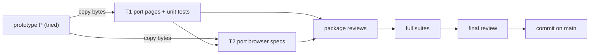
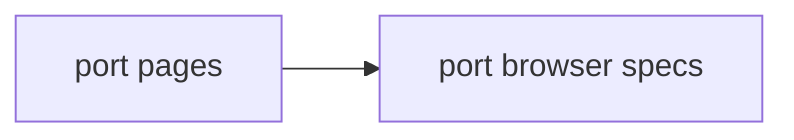

# Plan: admin upgrade integration

**Goal:** Bring the tried prototype of the `/admin` command centre and the `/admin/maker.html` content editor onto `main`, reviewed and green on every suite.
**Architecture:** Static ES-module pages in `demos/override/server/admin/`, served by the admin listener over the frozen `/admin/*` routes. The prototype built the real modules (ruling in the feature plan), so the port copies them file by file; the prototype's demo backend stays behind.
**Tech stack:** Node 25 ESM, plain DOM (no framework), `node --test` with fake DOMs, Playwright.
**Spec:** docs/plans/2026-11-05-admin-upgrade.spec.md
**Review plan:** docs/plans/2026-11-05-admin-upgrade.feature.md
**Detail:** contracts
**Target-min:** 30
**Ignore:** docs/plans/2026-11-05-admin-upgrade*, .superlite/, demos/override/dist/, demos/override/node_modules/, demos/override/test-results/, demos/override/playwright-report/, demos/override/data/, .DS_Store

Rulings live in `.superlite/progress.md`.

## Global constraints

- `O` = `demos/override`. `P` = `/Users/williambrach/Developer/AgentVerse/.superlite/sandboxes/admin-upgrade-proto` (the tried prototype, read only). This worktree is `/Users/williambrach/Developer/AgentVerse/.superlite/worktrees/admin-upgrade`.
- Port = copy the file bytes from `P/O/...` to the same path here. Never edit `P`. Never copy `P/.gitignore`, `P/.superlite/` or anything under `P/docs/`.
- Main moved one commit past the prototype base (873551a, thread faces: `O/client/*`, `O/tests/tools-ui.test.mjs`). No ported file overlaps it; do not touch `O/client/`.
- Unit tests, from the repo root of this worktree: `node --test O/tests/<file>.test.mjs`. All pass at start.
- Plain DOM only in admin pages: no `innerHTML`, `document.write`, `eval(` or `new Function`; text through `textContent` and `value`; no `style=` and no inline script in HTML; every `src` and `href` starts with `/admin/` or `#`; CSS has no `http`, `@import`, `prefers-color-scheme` or web fonts; no new npm dependencies.
- Frozen: every `/admin/*` route and body, the exported names and signatures (new optional options allowed), the ids in the design, the class names in module CSS.
- Browser runs: never at the same time as unit runs. From `O`: `npx playwright test --project=
 --output=/private/tmp/claude-501/-Users-williambrach-Developer-AgentVerse/5e3e1ef1-d855-4b56-b18d-43430a98ff5c/scratchpad/int-e2e`, then `find test-results -maxdepth 1 -name 'sessions*' -exec rm -rf {} +`. The user's game runs on ports 5173, 3001 and 3002: never touch them.

## Main diagram

## File structure

Each task's Owns line lists its files. `docs/plans/2026-11-05-admin-upgrade.design.md` says what each admin file does.

## Task graph

```mermaid
%% schedule
gantt
  title Predicted schedule (mm:ss)
  dateFormat X
  axisFormat %M:%S
  section lane 1
  T1 port pages and unit tests (§1-§5) :t1, 0, 215s
  T2 port browser specs (spec D1-D10  D14  :t2, 215, 141s
```

critical path: T1 → T2 (5.9 min) · peak width 1 · predicted build 5.9 min · predicted total ≈ 19.5 min (target ✓)

## Port

**Probe entry:** serve=demos/override/server/index.mjs

### T1 port pages and unit tests (§1-§5) · Complexity 2 · Est. context 25k
**Owns:** demos/override/server/admin/app.css, demos/override/server/admin/theme.js, demos/override/server/admin/index.html, demos/override/server/admin/app.js, demos/override/server/admin/panels.js, demos/override/server/admin/centre.css, demos/override/server/admin/tiles.css, demos/override/server/admin/log.css, demos/override/server/admin/board.css, demos/override/server/admin/round.css, demos/override/server/admin/controls.css, demos/override/server/admin/controls.js, demos/override/server/admin/maker.html, demos/override/server/admin/maker.js, demos/override/server/admin/maker-form.js, demos/override/server/admin/maker-copy.js, demos/override/server/admin/maker-chat.js, demos/override/server/admin/maker.css, demos/override/tests/admin.test.mjs, demos/override/tests/admin-panels.test.mjs, demos/override/tests/admin-controls.test.mjs, demos/override/tests/admin-theme.test.mjs, demos/override/tests/admin-maker-form.test.mjs, demos/override/tests/admin-maker-chat.test.mjs, demos/override/tests/admin-maker-ui.test.mjs, demos/override/tests/regression/admin-hidden.test.mjs
**Components:** 2
**LOC owned:** 1800
**Tests:** fast
**Kind:** design
**Model:** sonnet
**Est. time:** 2 min
**Consumes:** none
**Review Focus:** `byte_identical` (`cmp P/<f> <f>` is silent for every Owns file); `admin_units_green` (`node --test O/tests/admin*.test.mjs O/tests/regression/admin-hidden.test.mjs` passes, 182 or more tests); `no_other_files` (`git status --short` lists only Owns files).
**Test code:** none new; run the admin unit command above.

### T2 port browser specs (spec D1-D10, D14, D15) · Complexity 2 · Est. context 20k
**Owns:** demos/override/playwright.config.mjs, demos/override/tests/browser/admin.spec.mjs, demos/override/tests/browser/maker.spec.mjs, demos/override/tests/browser/admin-upgrade.spec.mjs
**Components:** 1
**LOC owned:** 450
**Tests:** slow
**Kind:** design
**Model:** sonnet
**Est. time:** 4 min
**Consumes:** none
**Review Focus:** `byte_identical` (as T1); `admin_projects_green` (`--project=admin` then `--project=admin-live` pass, run one after the other).
**Test code:** none new; run the two Playwright projects.
**Notes:** copy only after the prototype's T8 is checkpointed (the coordinator sends this task then).

## Review Focus

Web UI package. Categories:
- protocol through the API (request bodies, 400/409 paths, maker-token 403s)
- encoding (text only, no markup)
- state (dirty tracking, chat busy, failure and reset, collapse and theme storage)

## Self-review

- **Coverage:** D1-D12, D14, D15: T1 code plus T2 specs; D13: the coordinator's full suite runs; D5 live: the coordinator's live check.
- **Spec sections:** Intent, Goals, Non-goals, Constraints, Done looks like, Decided, Left to the builder / plan and Diagrams were built and tried in the prototype; T1 and T2 carry them over unchanged.
- **Placeholders:** none.
- **Files:** T1 and T2 share no file.
