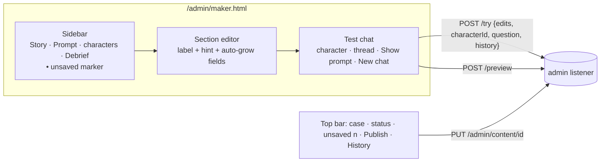
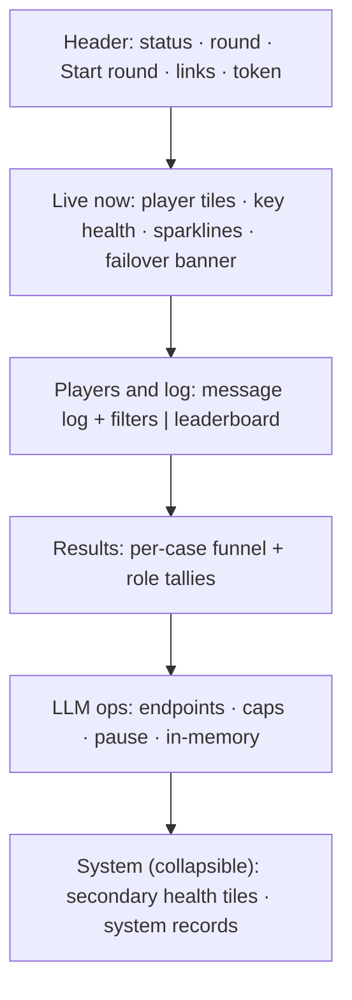

# Spec: admin upgrade (command centre + content editor)

## Intent

The operator runs live events from `/admin` and hands `/admin/maker.html` to game makers. Today `/admin` is one long page with no hierarchy, and the content editor is a 5000 px form of small textareas with raw keys (`finding.classification`) and a one-shot "Ask the model" box. Long character prompts are cut off, nobody can find a section, and a maker cannot hold a conversation with a character to test an edit. This upgrade makes both pages readable and quick to use, with a clean dashboard look, without changing what the server sends or accepts.

## Goals

- **G1 Content editor, section navigation.** A left sidebar lists the sections of the chosen case: Story, Prompt, one entry per character part, and Debrief. Only the chosen section is shown in the editor column.
- **G2 Content editor, readable fields.** Every field has a plain-English label and a one-line hint. Textareas grow with their text, so a full character prompt is visible without an inner scroll. The name tags (`{planner}` …) are explained once, where they are used.
- **G3 Content editor, test chat.** A chat panel lets the maker pick a character by name and hold a multi-turn conversation that uses the unsaved text. The system prompt for the current turn is one click away. The reasoning for each answer is shown collapsed.
- **G4 Command centre, reorganised.** The same data and controls, grouped into four labelled areas: **Live now**, **Players and log**, **Results**, **LLM ops**. Less-used panels can be collapsed, and they stay as the operator left them.
- **G5 One clean dashboard look on both pages.** Dark theme, sans-serif text, monospace only for numbers, ids and logs, soft cards, a clear type scale, one accent colour, and the same status colours (ok, warn, bad) everywhere.

## Non-goals

- No new server data, routes or response fields for the command centre.
- No diff view, per-field undo or publish review screen in the editor. The user did not pick these (2026-11-05).
- No editing of structure (ids, roles, part ids, world), and no editing of the shared rule template.
- No projector view, broadcast banner or round closing (deferred earlier).
- No change to the game client (`client/`) or to the `/?view=board` big screen.
- No web fonts or third-party requests.

## Constraints

- Admin route shapes are frozen: `/admin/stream`, `/admin/round`, `/admin/leaderboard`, `/admin/teams/hidden`, `/admin/sessions/*`, `/admin/llm/*`, `/admin/links`, `/admin/health`, and `/admin/content*` including preview, try, revert and PUT. The test chat uses `/admin/content/<id>/try` with its existing history field. If that field turns out to be missing, adding it is the only server change allowed.
- Pages stay ES modules under the existing CSP: no inline scripts or style attributes in HTML, and no `innerHTML`. Text goes in through `textContent` and `value` only.
- Maker tokens keep content-only scope. The editor must work for a maker token, which gets 403 on non-content routes.
- Edits still apply to new games only. Publish, Restore, the 409 conflict note and the "Discard unsaved changes?" confirmation keep their behaviour.
- Fonts are system stacks (`system-ui` …, `ui-monospace` …).
- Every existing unit and browser test passes. A test that keys on a removed element is updated to the new element and keeps its assertion.
- Usable from 1280 px wide upwards. Below 860 px the columns stack.

## Done looks like

| # | Check |
|---|---|
| D1 | On `/admin/maker.html` with a valid token, the sidebar shows Story, Prompt, one entry per character part (its part label and role), Debrief and History. Clicking one shows only that section, and the page is no taller than the window plus that section. |
| D2 | No field shows a raw dotted key as its label. Each field has a label and a hint. |
| D3 | A character prompt (`knowledge`) of 1500+ characters is fully visible with no scrollbar inside the field. Typing more lines grows the field. |
| D4 | A sidebar entry whose section holds unsaved edits shows a marker. The top bar shows the unsaved count next to Publish. |
| D5 | In live mode, the test chat: pick a character by name, send 3 questions, and get 3 answers in one thread. The third request carries the first two turns as history. Edited, unpublished knowledge text changes the answer. |
| D6 | "Show prompt" in the chat shows the system prompt the next question would use, from `/preview`. Each answer has a collapsed "Reasoning" disclosure when reasoning is present. |
| D7 | In rehearsal mode, the chat input is disabled with the rehearsal note. "New chat" empties the thread. Switching character or case empties the thread. |
| D8 | Publish, Restore, a 409 conflict and a field error with a `path` work as before. A field error opens the section that holds the field and marks the field. |
| D9 | `/admin` shows the four areas Live now, Players and log, Results and LLM ops, in that order, with every control that exists today: Start round, token, links, log filters, Following, leaderboard Hide and Ties by, Move + pin, Probe, Cap, Cap all, Pause new games, plus System records. |
| D10 | The Server health tiles and System records are collapsible panels, and their state survives a reload. A collapsed Server health panel still shows its worst level (warn or bad) in its header. System records start collapsed. |
| D11 | Warn and bad states (disk low, LLM errors, failover banner) are visibly coloured on the new look. |
| D12 | Both pages use the same tokens (colours, radius, spacing, fonts) from one shared stylesheet. |
| D13 | The full unit suite and the browser suites (default and admin projects) pass. |
| D14 | The editor picks the case from one dropdown (`#case-select`), not a row of tabs (user, 2026-11-05: "we will have more levels"). Switching with unsaved edits asks first; cancelling keeps the current case selected. |
| D15 | Both pages have a Light/Dark toggle (`#theme-toggle`). The choice is kept in `localStorage` `override.admin.theme`; the default is dark. Light mode is readable everywhere, including the warn/bad tiles and the failover banner. |

## Decided

- Topic `admin-upgrade`. Plan docs `docs/plans/2026-11-05-admin-upgrade.*`.
- Style: a clean dark dashboard (user, 2026-11-05), with a light mode toggle (user, 2026-11-05, fix round 1). This look is not shared with the game's parchment look.
- Light mode switches on `:root[data-theme="light"]`, set by the classic script `/admin/theme.js` before first paint. It does not use `prefers-color-scheme`, which a test pins as absent.
- Command centre: reorganise and polish, no tabs (user, 2026-11-05).
- Editor: section navigation, readable fields and test chat (user, 2026-11-05).
- The chat thread lives in page memory only. It is never published and never sent anywhere except `/try` and `/preview`.
- The unsaved-changes marker in the sidebar is part of the navigation (D4). It is not a diff view.
- Collapse state is kept in `localStorage` under `override.admin.collapsed`.

## Left to the builder / plan

- The exact label and hint text per field, as long as D2 holds.
- File split of the new modules and CSS. A shared token stylesheet is required (D12).
- Placement inside each area, card sizes, and which secondary tiles collapse beyond D10.
- Whether the token box moves into a compact control.

## Diagrams

