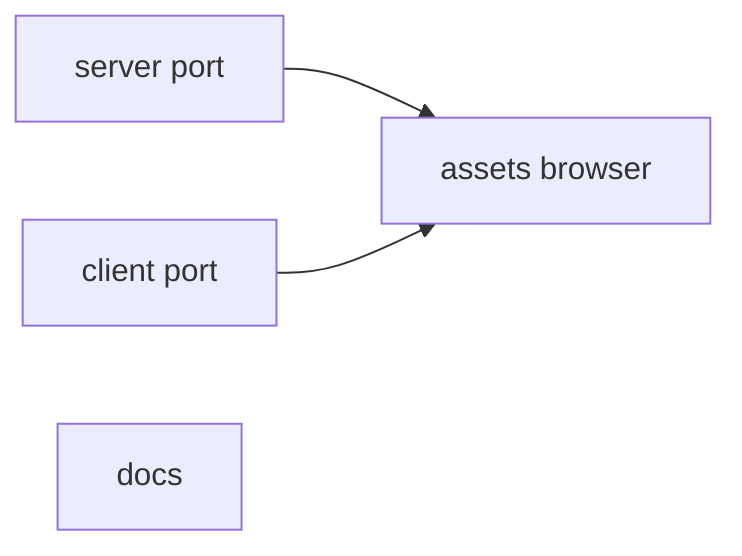

# Plan: department murder mystery (integration)

**Review plan:** docs/plans/2026-11-08-department.feature.md
**Goal:** port the approved department prototype into the real Override code on `superlite/department`: case `department-murder` on world `department` (painted hall, static-pose figures, walk zones, examinable evidence, job labels, Killer/Leaker/Innocent lineup); every existing test passes.
**Architecture:** server schema/prompt/session additions + case module; client world pack, hall layout, station backdrop branch, main/notebook Evidence page, CSS; assets; one Playwright project; docs.
**Tech stack:** Node 25 ESM (`node:test`), TypeScript + Vite + Phaser 3 client, Playwright.
**Spec:** docs/plans/2026-11-08-department.spec.md
**Detail:** contracts
**Target-min:** 15
**Ignore:** docs/plans/2026-11-08-department*, demos/override/test-results/, demos/override/data/, demos/override/dist/, demos/override/playwright-report/

## Global constraints

- Port, never merge: the prototype is reference only, read-only, at `/Users/williambrach/Developer/AgentVerse/.superlite/sandboxes/department-proto/` (same relative paths; its changes are uncommitted on top of b949300, the base of this branch). Port a tracked file with `git -C <proto> diff HEAD -- <path> | git apply` run in this worktree's root; copy a new file with `cp`. Then re-read what you ported.
- App root `demos/override`. Strings: `docs/plans/2026-11-08-department.content.md`. Rulings and geometry: the feature plan § Rulings, as tuned in the prototype try-out (briefing (240,320), report (216,296), jonas (280,240), coffee-corner block (-16,150,82,62); stop labels and evidence prompts at stop y − labelLift in backdrop worlds; prompt kept clear of the rail).
- FROZEN: event `schemaVersion` and replay of existing events; the action list (`server/index.mjs:28`) and routes; banana/tower/friends/factory prompt bytes, content hashes, public views and view keys; `Inspection` type; `promptVersion`/`threadPromptVersion`; grove/tower art keys, `ATLAS_DIMS`, grove-look snapshot; factory floor, deadline and cipher; roundtable path.
- Contract: character `label`, `knowledge` (no placeholders); case `evidence: [{id,title,text}]`; `publicView.evidence = [{id,title}]`; `session.examined` and `session.evidence` only for evidence cases; `visit` accepts `evidence` and `evidence:<id>` (logged as `location_visited`); WorldPack `backdrop`, `walk`, `evidence`; client panel id `evidence`; `Station.evidence(marks)`; `Stage.evidence(marks)`.
- Unit: `cd demos/override && node --test tests/<file>`; full `npm test`. Browser: `npm run build` then `npx playwright test --project=
 --output=/private/tmp/claude-501/-Users-williambrach-Developer-AgentVerse/c8ba40ec-a4cd-4758-a6bc-1e558a30bf5b/scratchpad/pw-int-
`; check `pgrep -fl "playwright test"` first; never unit and browser at once; delete `demos/override/test-results/sessions*` with `find` every few runs.
- Spec coverage: Intent, Goals, Constraints, Decided (T1, T2), Done looks like D1–D11 (T3), Left to the builder / plan (T2, T3), Non-goals (T4: no maker/admin changes), Diagrams (T1, T2).

## File structure

| Task | Files (under `demos/override/`) |
|---|---|
| T1 | `server/worlds.mjs`, `server/cases.mjs`, `server/interviews.mjs`, `server/session.mjs`, `server/cases/department-murder.mjs`, `server/cases/index.mjs`, `tests/department-schema.test.mjs`, `tests/department-case.test.mjs`, `tests/department-session.test.mjs`, `tests/cases-content.test.mjs`, `tests/friends-case.test.mjs`, `tests/factory-case.test.mjs`, `tests/thread-prompt.test.mjs`, `tests/leaderboard.test.mjs` |
| T2 | `client/worlds.ts`, `client/hall-layout.ts`, `client/station.ts`, `client/main.ts`, `client/types.ts`, `client/stage.ts`, `client/dialogue.ts`, `client/department.css`, `tests/department-layout.test.mjs`, `tests/department-ui.test.mjs`, `tests/worlds.test.mjs` |
| T3 | `public/assets/department/`, `tests/department-assets.test.mjs`, `playwright.config.mjs`, `tests/browser/department.spec.mjs`, `tests/browser/cases.spec.mjs`, `tests/browser/factory.spec.mjs` |
| T4 | `README.md`, `docs/CASES_PLAN.md` |

## Task graph

```mermaid
%% schedule
gantt
  title Predicted schedule (mm:ss)
  dateFormat X
  axisFormat %M:%S
  section lane 1
  T2 client port :t2, 0, 115s
  T3 assets  browser project and regressio :t3, 115, 152s
  section lane 2
  T1 server port :t1, 0, 113s
  section lane 3
  T4 README and cases plan :t4, 0, 85s
```

critical path: T2 → T3 (4.5 min) · peak width 3 · predicted build 4.5 min · predicted total ≈ 18.3 min (target ✗ 15.0)

## Server

**Probe entry:** call=demos/override/server/cases.mjs:defineCase

### T1 server port · Complexity 3 · Est. context 30k
**Owns:** demos/override/server/worlds.mjs, demos/override/server/cases.mjs, demos/override/server/interviews.mjs, demos/override/server/session.mjs, demos/override/server/cases/department-murder.mjs, demos/override/server/cases/index.mjs, demos/override/tests/department-schema.test.mjs, demos/override/tests/department-case.test.mjs, demos/override/tests/department-session.test.mjs, demos/override/tests/cases-content.test.mjs, demos/override/tests/friends-case.test.mjs, demos/override/tests/factory-case.test.mjs, demos/override/tests/thread-prompt.test.mjs, demos/override/tests/leaderboard.test.mjs
**Components:** 1
**LOC owned:** 520
**Tests:** fast
**Model:** sonnet
**Produces:** cases/department-murder.default -> Case
e.g. departmentMurder.parts.map(p => p.id) -> ['killer','leaker','witness','lunch','late']
**Test code:** the ported tests unchanged: `node --test tests/department-schema.test.mjs tests/department-case.test.mjs tests/department-session.test.mjs tests/cases-content.test.mjs tests/friends-case.test.mjs tests/factory-case.test.mjs tests/thread-prompt.test.mjs tests/leaderboard.test.mjs tests/case-roles.test.mjs tests/cases.test.mjs tests/content.test.mjs tests/session.test.mjs tests/session-team.test.mjs` in demos/override: all pass.
**Steps:** from this worktree's root: `git -C /Users/williambrach/Developer/AgentVerse/.superlite/sandboxes/department-proto diff HEAD -- <each tracked Owns file> | git apply`; `cp` the four new files (`server/cases/department-murder.mjs`, `tests/department-schema.test.mjs`, `tests/department-case.test.mjs`, `tests/department-session.test.mjs`) from the prototype's `demos/override/`; run the test command.
**Review Focus:** HTTP service — state, encoding: text leak before examine; replay drift; other cases byte-identical; validation of character `label`/`knowledge` and `evidence`; every deal resolves; strings verbatim from the content doc.

## Client

**Probe entry:** call=demos/override/client/hall-layout.ts:inWalk

### T2 client port · Complexity 3 · Est. context 30k
**Owns:** demos/override/client/worlds.ts, demos/override/client/hall-layout.ts, demos/override/client/station.ts, demos/override/client/main.ts, demos/override/client/types.ts, demos/override/client/stage.ts, demos/override/client/dialogue.ts, demos/override/client/department.css, demos/override/tests/department-layout.test.mjs, demos/override/tests/department-ui.test.mjs, demos/override/tests/worlds.test.mjs
**Components:** 1
**LOC owned:** 560
**Tests:** fast
**Model:** sonnet
**Produces:** hallLayout.inWalk(walk: Walk, p: {x: number, y: number}) -> boolean
e.g. inWalk({bounds:{x:40,y:188,w:396,h:138}, blocks:[{x:386,y:272,w:80,h:70}]}, {x:400, y:300}) -> false
**Test code:** `node --test tests/department-layout.test.mjs tests/department-ui.test.mjs tests/worlds.test.mjs tests/factory-figures.test.mjs tests/stage.test.mjs tests/dialogue-ui.test.mjs tests/hud-ui.test.mjs` and `npx tsc --noEmit` in demos/override: all pass, tsc clean.
**Steps:** from this worktree's root: `git -C /Users/williambrach/Developer/AgentVerse/.superlite/sandboxes/department-proto diff HEAD -- <each tracked Owns file> | git apply`; `cp` the new files (`client/hall-layout.ts`, `client/department.css`, `tests/department-layout.test.mjs`, `tests/department-ui.test.mjs`) from the prototype's `demos/override/`; run the test command.
**Review Focus:** web UI — layout, state via API: panel routing (`evidence` panel id, `savedPanel`), nav button and count, station marks after each state, walk bounds and blocks, prompt placement and rail clamp, labels, pose cycling stays off, grove/tower/factory unchanged; department.css contrast and face crops.

## Acceptance

**Probe entry:** serve=demos/override/server/index.mjs

### T3 assets, browser project and regression · Complexity 4 · Est. context 40k
**Owns:** demos/override/public/assets/department/, demos/override/tests/department-assets.test.mjs, demos/override/playwright.config.mjs, demos/override/tests/browser/department.spec.mjs, demos/override/tests/browser/cases.spec.mjs, demos/override/tests/browser/factory.spec.mjs
**Components:** 1
**LOC owned:** 330
**Tests:** slow
**Model:** sonnet
**Consumes:** none
**Review Focus:** port (byte copy assets; `git diff | git apply` the config and the two pinned specs; `cp` department.spec.mjs and department-assets.test.mjs), then run: `node --test tests/department-assets.test.mjs`; `npm run build`; Playwright projects `department`, `default`, `factory`, `tower` one after another, each with its own `--output`; report pass/fail counts per project. Known red on main: only the stale grove-look baseline (report, do not fix). Any other failure: report file, test name and symptom; do not fix app code. Spec D1–D11 and "Left to the builder / plan" (geometry checked by eye in the department screenshots; list their paths).

## Docs

**Probe entry:** run=node -e "0"

### T4 README and cases plan · Complexity 2 · Est. context 24k
**Owns:** demos/override/README.md, demos/override/docs/CASES_PLAN.md
**Components:** 1
**LOC owned:** 40
**Tests:** fast
**Model:** sonnet
**Consumes:** none
**Review Focus:** README: intro and live case list name After Hours (`department-murder`, world `department`, 5 agents, order 5); a "fifth case" paragraph after the Factory one (painted hall, walk zones, evidence you examine with E, jobs fixed and guilt dealt per session, Killer/Leaker/Innocent lineup); `world:` union and agents-per-world line include `department`; the `station.ts` description mentions the painted-hall branch; "Writing a case" lists the optional `characters[].label`/`knowledge` and `evidence` fields (module-only, not editable in the maker). CASES_PLAN header lists five live cases. `node --test tests/docs.test.mjs` passes.

## Review Focus

Server: HTTP service — state, encoding (text leak, replay drift, other cases' bytes). Client: web UI — layout, state via API (collisions, clipping, panel routing, overlap).

## Rulings

Ruling: byte ports with package reviews - the prototype has no stubs or fakes, so T1 and T2 port tried code; the real review happens in the package-reviewer on each - cost: a reviewer pass per package

## Self-review

Coverage, placeholders, types, graph, fields, limits checked.
