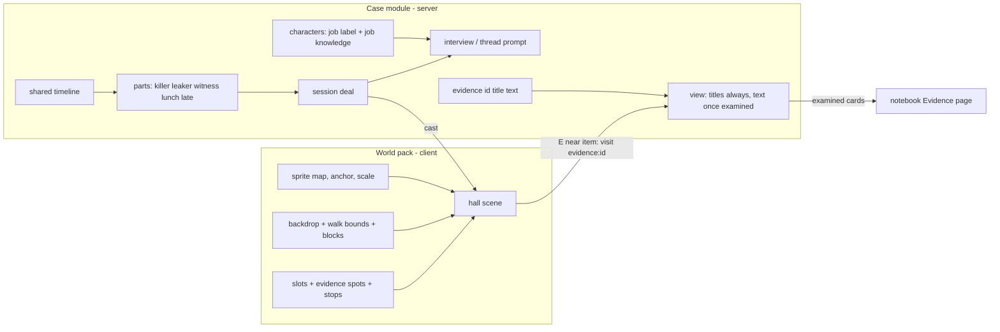
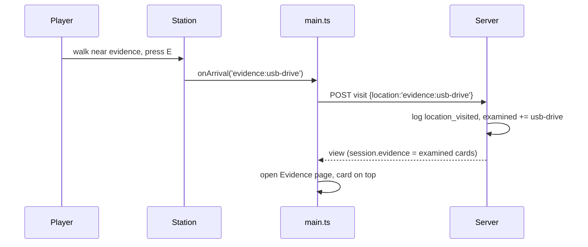

# Spec: department murder mystery

**Intent.** Add a fifth Override game, "After Hours", set in a contemporary Nordic university department inspired by IMADA. A researcher, Dr. Anders Vik, was found dead in the server room the morning after he swore to expose whoever leaked his project's data. The player is the ash-blonde woman detective. She walks the department hall, questions five staff and students, examines evidence on the floor, and labels each person Killer, Leaker or Innocent. The game adds three things the other games lack:
- a painted single-image room with separately defined walk zones,
- jobs that stay with each character while guilt is dealt per session,
- evidence the player walks up to and examines.

The art is the approved pack `/Users/williambrach/Developer/arbiter/assets/murder-mystery-nordic-v2/`. The idea comes from the IMADA Cup call (`~/Documents/luaks-2.txt`).

## Goals

- New case `department-murder` on the new world `department`, registered after Factory. Grove, Tower, Friends and Factory play exactly as before.
- Walking scene: WASD / arrows to move. E next to a person opens their interview; E next to an evidence item examines it.
- Five department characters and one playable detective, each with three static poses: listening, speaking, thinking.
- Each character has a fixed name, job and job knowledge. Hidden parts are dealt per session: killer, leaker, witness and two innocents. No part is ever tied to a sprite, a name or an appearance.
- Evidence cards: 8 examinable items. A card's text reaches the client only after the item is examined. Examined cards stay listed in the notebook across reloads.
- The lineup labels every person Killer / Leaker / Innocent. The game is won only when all five labels are right.

## Non-goals

- Walking or turning animation. The pack has three conversation poses only, so the detective moves in the listening pose.
- A deadline, a cipher, or any change to the factory's mechanics.
- Clues or evidence in other cases. The other levels stay clue-free.
- Editing the job knowledge or the evidence in the maker (content editor). Both stay module fields.
- Admin and monitor tallies per evidence item.
- The real department's name or real people in the story.

## Constraints

- **Scenario and art stay apart.** The case module (server) owns the facts, the timeline, the job knowledge, the parts, the roles, the evidence text and the solution. The client world pack owns the sprite files, the anchors, the scale, the backdrop, the walk zones and the positions of characters and evidence. They share only ids: character ids and evidence ids.
- **Consistent facts.** Every part's knowledge includes the same shared-timeline paragraph. Role facts refer to other people only through part placeholders, so every deal resolves to one consistent story.
- **Fair puzzle.** No evidence card states who killed. The killer and the leaker can each be reached by at least two independent paths, testimony or evidence.
- **Static poses.** A pose changes only on a state change and never cycles on a timer.
- **Rendering.**
  - Nearest-neighbour scaling, `image-rendering: pixelated`, transparency and aspect ratio kept.
  - Each figure is placed by its foot anchor (96, 376) in the 192 × 384 frame.
  - Heads, hands and shoes are never clipped by the canvas, the props or the HUD.
  - The 1536 × 1024 backdrop is scaled proportionally, with the floor lined up to the figures' feet.
- **Only one detective.** The root `investigator-*` art is not shipped; the detective uses `main-character/exports/player-*`.
- **Other cases unchanged.** Their prompts, content hashes, public views and event shapes stay byte-identical. New fields are additive and appear only when a case defines them.
- **Chats stay private** (existing rule): no character's chat goes into another model call.
- **Local assets.** They are copied into the repo; the game never loads from `/Users/.../arbiter`.

## Done looks like

| # | Check |
|---|---|
| D1 | The case board lists After Hours after Factory, with five faces. Picking it opens the department hall. Grove, Tower, Friends and Factory still open and play. |
| D2 | The backdrop, the 18 character images (detective + 5 × 3 poses) and every prop used load with no 404 and no console error. Transparent pixels show the hall beneath. |
| D3 | Every figure stands with its shoes on the hall floor and is fully visible, keeps its aspect ratio and renders crisp at 1440 × 900 and 390 × 844. No HUD control overlaps another. No figure or evidence item sits under the rail or the dialogue controls. |
| D4 | The detective moves with WASD / arrows in a static pose and cannot leave the floor: not into the back wall, the coffee counter, the lounge, the desks, the bottom-left plant or the armchair. Every character and evidence item can be reached. |
| D5 | Next to a person, the existing [E] prompt reads "Ask <name>" and E opens that interview. Next to an evidence item it reads "Examine <title>" and E opens the notebook's Evidence page with that card. |
| D6 | Poses: everyone listens by default. While a person's reply is pending, that person shows thinking; while the reply is on screen, speaking; afterwards, listening. The detective shows thinking while the player types and speaking on send. |
| D7 | The rail and the interview header show each person's job label, for example "PhD student" or "IT administrator", whatever part they were dealt. Across new sessions the killer and the leaker land on different people. Nothing in the DOM, CSS or view reveals a part before the debrief. |
| D8 | Examined evidence: the room nav shows an Evidence button with a count. The Evidence page lists examined cards, newest first. The cards survive a reload and reset with the session. Card text of unexamined items is absent from every client payload. |
| D9 | In live mode, the answers stay consistent with the shared timeline. Asked "when did Anders die?", any character gives the 21:15–22:00 window. In rehearsal mode, the scripted replies follow the same timeline. |
| D10 | The lineup offers Killer / Leaker / Innocent for each person. All five right wins; anything else gets the "other" feedback. The debrief reveals all five parts. |
| D11 | The unit suite, typecheck and build pass. The existing Playwright projects pass except the known stale grove-look baseline, which is unchanged. A new `department` browser project covers D1–D8 and D10. |

## Decided

| Item | Value |
|---|---|
| Case id / world id | `department-murder` / `department`, order 5, status `ready`, version `department-murder-v1.0.0` |
| Roles | `killer` "Killer", `leaker` "Leaker", `innocent` "Innocent" (custom `roles`) |
| Parts | `killer`, `leaker`, `witness`, `lunch`, `late`; the last three have role `innocent` |
| Cast | freja (PhD student, `phd-01`), mikkel (PhD student, `phd-02`), birgit (Professor, `professor`), jonas (IT administrator, `it-admin`), signe (Department administrator, `department-admin`); sprite map client-side |
| Job data | `characters[].label`, `characters[].knowledge`: optional, validated, with no placeholders |
| Evidence data | `evidence: [{id, title, text}]` in the case; `text` may use part placeholders; titles are public, text only after examine |
| Examine | the existing `visit` action with location `evidence:<id>`, logged as the existing `location_visited` event, tracked in `session.examined` |
| Pose triggers | the same as Factory (`station.think/speak/detective`) |
| Win | all five labels correct |
| Branch | its own worktree and branch `superlite/department`, base `main` |

## Left to the builder / plan

- The exact walk bounds, block boxes, character slots, evidence spots and stop points, measured from the backdrop and checked in screenshots.
- The prop draw scale: an exact canvas divisor of ¼ or ½.
- The Evidence page markup, composed from existing notebook styles.
- The file layout of new client helpers and the browser project's port.

## Diagrams

