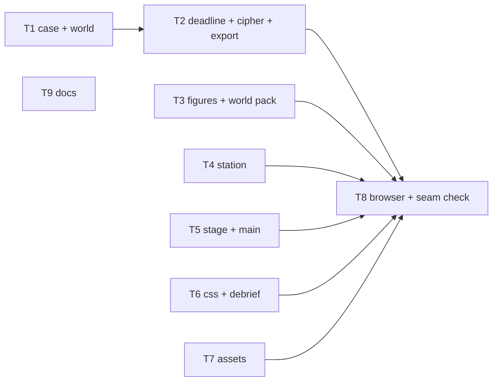
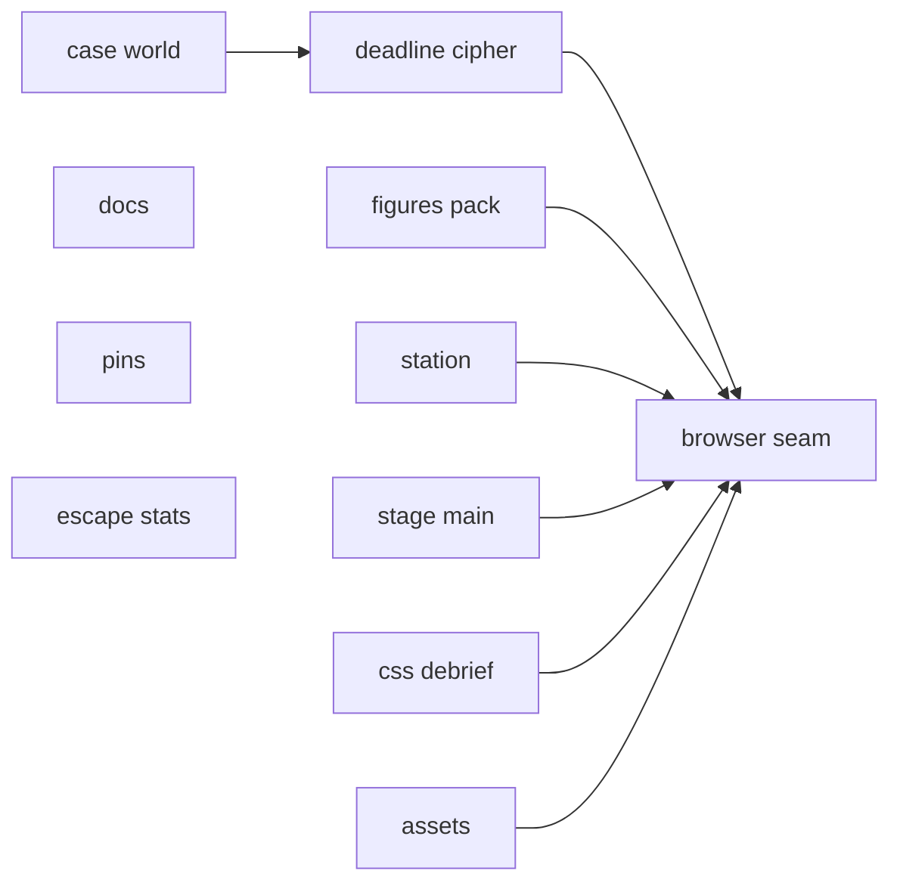

# Plan: factory scenario (integration)

**Review plan:** docs/plans/2026-11-08-factory.feature.md
**Goal:** port the approved factory prototype into the real Override code: case `factory-escape` on world `factory`, static-pose walking floor, ROT13 inspections, hidden deadline with flickers, escape and loss debrief; every existing test passes.
**Architecture:** server case/world/deadline/cipher modules; a factory branch in the walking station driven by a pure figure module; stage/main wiring; CSS and debrief; assets; one Playwright project.
**Tech stack:** Node 25 ESM (`node:test`), TypeScript + Vite + Phaser 3 client, Playwright.
**Spec:** docs/plans/2026-11-08-factory.spec.md
**Detail:** contracts
**Target-min:** 12
**Ignore:** docs/plans/2026-11-08-factory*, demos/override/test-results/, demos/override/data/, demos/override/dist/, demos/override/playwright-report/

## Global constraints

- Port, never merge: the prototype is reference only, read-only, at `/Users/williambrach/Developer/AgentVerse/.superlite/sandboxes/factory-proto/demos/override/` (same paths). Its `proto-*.test.mjs` files become the real-named tests below; `playwright.proto.config.mjs` stays behind. Re-read each ported file; keep it clean.
- Strings: `docs/plans/2026-11-08-factory.content.md` (incl. the escape feedback line). Rulings: the feature plan § Rulings.
- FROZEN (must not change): event `schemaVersion` 3 and replay of existing events; `publicView` allowlist; existing view fields (new ones additive); `Inspection` type; `promptVersion`/`threadPromptVersion`; grove/tower prompt bytes and banana/tower content hashes; action list and routes; grove art keys, `ATLAS_DIMS`, tower `heights`, grove/tower stops (132,276)/(244,276); slot ≥3 recolour for grove/tower; roundtable cue path; economy env messages.
- Shared contract (as the prototype): case fields `deadline {warnAt, escapeAt, escape {title, summary, feedback?}}`, `cipher: 'rot13'`; `OVERRIDE_DEADLINE_SECONDS` only with `OVERRIDE_DEV_TOOLS=1` (warnings 70 %/90 %); `session.alarm` only for deadline cases; escape = one `verdict_submitted` with `outcome:'escaped'`; ROT13 in the view's inspections AND in `/api/events` `reasoning_inspected` lines, plain in the log and admin; WorldPack `figures`, `floor`, `stops`; StageScene optional `think/speak/detective/escape`; `data-figure`/`data-pose` markers; `.factory-flicker[data-kind]`; debrief omits TIME when `time` is null (main passes null for deadline cases).
- Unit tests: `cd demos/override && node --test tests/<file>`; full `npm test`. Browser: `npm run build` then `npx playwright test --project=
 --output=<scratchpad>/pw-int`; check `pgrep -fl "playwright test"`; never unit and browser at once.
- Spec coverage: Intent, Goals, Constraints, Decided (T1–T7), Done looks like D1–D11 (T8), Left to the builder (T3, T4), Non-goals (no admin/editor changes), Diagrams (main diagram).

## File structure

| Task | Files (under `demos/override/`) |
|---|---|
| T1 | `server/worlds.mjs`, `server/cases.mjs`, `server/cases/factory-escape.mjs`, `server/cases/index.mjs`, `tests/factory-case.test.mjs`, `tests/cases-content.test.mjs`, `tests/friends-case.test.mjs` |
| T2 | `server/deadline.mjs`, `server/cipher.mjs`, `server/session.mjs`, `server/index.mjs`, `.env.example`, `tests/deadline.test.mjs` |
| T3 | `client/factory-figures.ts`, `client/worlds.ts`, `tests/factory-figures.test.mjs`, `tests/worlds.test.mjs` |
| T4 | `client/station.ts` |
| T5 | `client/stage.ts`, `client/main.ts`, `client/types.ts`, `tests/stage.test.mjs` |
| T6 | `client/factory.css`, `client/debrief.ts`, `tests/debrief-ui.test.mjs` |
| T7 | `public/assets/factory/`, `tests/factory-assets.test.mjs` |
| T8 | `playwright.config.mjs`, `tests/browser/factory.spec.mjs`, `tests/browser/cases.spec.mjs` |
| T9 | `README.md`, `docs/CASES_PLAN.md` |
| T11 | `server/monitor-round.mjs`, `server/monitor.mjs`, `server/admin/round.js`, `tests/monitor-round.test.mjs`, `tests/monitor.test.mjs`, `tests/admin-round.test.mjs` |

## Task graph

```mermaid
%% schedule
gantt
  title Predicted schedule (mm:ss)
  dateFormat X
  axisFormat %M:%S
  section lane 1
  T4 station factory branch :t4, 0, 165s
  T8 factory browser project and seam chec :t8, 292, 141s
  section lane 2
  T1 factory case and world :t1, 0, 133s
  T2 deadline  loss  ROT13 and export :t2, 133, 159s
  section lane 3
  T3 figure module and world pack :t3, 0, 128s
  section lane 4
  T5 stage and main flow :t5, 0, 126s
  section lane 5
  T6 factory CSS and loss debrief :t6, 0, 120s
  section lane 6
  T7 factory assets :t7, 0, 84s
  section lane 7
  T9 README and cases plan :t9, 0, 83s
```

critical path: T1 → T2 → T8 (7.2 min) · peak width 7 · predicted build 7.2 min · predicted total ≈ 20.4 min (target ✗ 12.0)

## Server

**Probe entry:** call=demos/override/server/deadline.mjs:alarmOf

### T1 factory case and world · Complexity 4 · Est. context 40k
**Owns:** demos/override/server/worlds.mjs, demos/override/server/cases.mjs, demos/override/server/cases/factory-escape.mjs, demos/override/server/cases/index.mjs, demos/override/tests/factory-case.test.mjs, demos/override/tests/cases-content.test.mjs, demos/override/tests/friends-case.test.mjs
**Components:** 2
**LOC owned:** 260
**Tests:** fast
**Model:** sonnet
**Produces:** cases/factory-escape.default -> Case
e.g. factoryEscape.deadline.escapeAt -> 600
e.g. factoryEscape.cipher -> 'rot13'
**Review Focus:** port proto T1 + F-T2-1 validation; `deadline_shape_rejected`; `escape_feedback_empty_rejected`; `public_view_hides_deadline`; `registry_four` (cases-content pin: 4 cases incl. `4:factory-escape:ready:factory`; case-set rule still holds); friends-case pin keeps friends third; banana/tower hashes unchanged.

### T2 deadline, loss, ROT13 and export · Complexity 6 · Est. context 55k
**Owns:** demos/override/server/deadline.mjs, demos/override/server/cipher.mjs, demos/override/server/session.mjs, demos/override/server/index.mjs, demos/override/.env.example, demos/override/tests/deadline.test.mjs
**Components:** 3
**LOC owned:** 300
**Tests:** fast
**Model:** sonnet
**Consumes:** cases/factory-escape.default -> Case (T1)
**Produces:** cipher.rot13(text: string) -> string
e.g. rot13('Hello, World 42!') -> 'Uryyb, Jbeyq 42!'
**Produces:** deadline.alarmOf(schedule: {warnAt: number[], escapeAt: number}, elapsedMs: number) -> 'calm'|'warning1'|'warning2'|'escaped'
e.g. alarmOf({warnAt: [420, 540], escapeAt: 600}, 540000) -> 'warning2'
**Produces:** deadline.scheduleOf(kase: Case, dev: {deadlineSeconds?: number} | null) -> {warnAt: number[], escapeAt: number} | null
e.g. scheduleOf(factory, {deadlineSeconds: 30}) -> {warnAt: [21, 27], escapeAt: 30}
**Review Focus:** port proto T2 + F-T2-1; `expire_closes_once`; `verdict_after_mark_409`; `replay_keeps_loss`; `reset_new_clock`; `inspect_view_rot13`; `export_rot13` (`/api/events` reasoning is ROT13 for factory, plain for banana); `log_plain`; `other_cases_no_alarm`; `escape_counts_zero_on_leaderboard`; `deadline_env_needs_dev_tools`; `.env.example` lists `OVERRIDE_DEADLINE_SECONDS` (docs.test pin).

## Client

**Probe entry:** call=demos/override/client/factory-figures.ts:poseFor

### T3 figure module and world pack · Complexity 4 · Est. context 38k
**Owns:** demos/override/client/factory-figures.ts, demos/override/client/worlds.ts, demos/override/tests/factory-figures.test.mjs, demos/override/tests/worlds.test.mjs
**Components:** 2
**LOC owned:** 220
**Tests:** fast
**Model:** sonnet
**Produces:** factoryFigures.poseUrl(art: FigureArt, sprite: string, pose: Pose) -> string
e.g. poseUrl(factory.figures, 'worker-01', 'thinking') -> '/assets/factory/characters/worker-01-thinking.png'
**Produces:** factoryFigures.figureBox(art: FigureArt, foot: {x: number, y: number}) -> {left: number, top: number, width: number, height: number}
e.g. figureBox(factory.figures, {x: 100, y: 200}) -> {left: 84, top: 137.333, width: 32, height: 64}
**Produces:** factoryFigures.poseFor(state: {thinking: string|null, speaking: string|null, typing: boolean}, id: string) -> Pose
e.g. poseFor({thinking: 'ama', speaking: null, typing: false}, 'ama') -> 'thinking'
**Produces:** factoryFigures.speakMs(text: string) -> number
e.g. speakMs('one two three') -> 2250
**Review Focus:** port proto T3 + both F-T4-1 rounds (`stops`); `five_distinct_sprites`; `slots_clear`; `stops_clear`; `exit_on_floor`; worlds.test: factory pack matches server world, grove/tower/friends packs byte-identical.

### T4 station factory branch · Complexity 7 · Est. context 60k
**Owns:** demos/override/client/station.ts
**Components:** 2
**LOC owned:** 260
**Tests:** slow
**Model:** sonnet
**Consumes:** factoryFigures.poseUrl(art: FigureArt, sprite: string, pose: Pose) -> string (T3) · factoryFigures.figureBox(art: FigureArt, foot: {x: number, y: number}) -> {left: number, top: number, width: number, height: number} (T3) · factoryFigures.poseFor(state: {thinking: string|null, speaking: string|null, typing: boolean}, id: string) -> Pose (T3) · factoryFigures.speakMs(text: string) -> number (T3)
**Produces:** Station.think(id: string | null) -> void · Station.speak(id: string, text: string) -> void · Station.detective(pose: Pose) -> void · Station.escape(id: string) -> Promise<void>
**Review Focus:** port proto T4 + F-T4-1 (`world.stops`); `grove_tower_unchanged`; `no_recolour_factory`; `escape_wakes_loop`; `pose_static`; `labels_lift`; grove-look pixel baseline unaffected by this task.

### T5 stage and main flow · Complexity 6 · Est. context 58k
**Owns:** demos/override/client/stage.ts, demos/override/client/main.ts, demos/override/client/types.ts, demos/override/tests/stage.test.mjs
**Components:** 2
**LOC owned:** 200
**Tests:** fast
**Model:** sonnet
**Consumes:** none
**Review Focus:** port proto T5 + F-T6-1 main part; `poll_only_factory`; `poll_stops_hidden_and_closed`; `escape_before_debrief`; `loss_not_solved`; `clock_hidden`; `detective_typing_pose`; stage.test: replace `stage_cues_noop_on_station` with `station_gets_cues_when_it_has_them` and `station_without_cues_is_noop`; roundtable cue tests unchanged.

### T6 factory CSS and loss debrief · Complexity 3 · Est. context 30k
**Owns:** demos/override/client/factory.css, demos/override/client/debrief.ts, demos/override/tests/debrief-ui.test.mjs
**Components:** 2
**LOC owned:** 150
**Tests:** fast
**Model:** sonnet
**Review Focus:** port proto T6 + F-T6-1 debrief part; `faces_from_listening`; `flicker_reduced_motion`; `reasoning_wraps`; `loss_page` ("Got away", every role); `time_null_hides_stat`.

### T7 factory assets · Complexity 2 · Est. context 22k
**Owns:** demos/override/public/assets/factory/, demos/override/tests/factory-assets.test.mjs
**Components:** 1
**LOC owned:** 60
**Tests:** fast
**Model:** sonnet
**Review Focus:** `factory_assets_listed`: exactly 18 files `characters/{detective,worker-01..worker-05}-{listening,speaking,thinking}.png` and 12 `props/<id>.png` (conveyor, assembly-robot, control-terminal, packing-bench, shipping-crates, locker, electrical-cabinet, emergency-stop, exit-door, safety-barrier, server-rack, parts-bin); `factory_character_size`: every character PNG is 192×384 with an alpha channel; `factory_assets_match_pack`: when `/Users/williambrach/Developer/arbiter/assets/factory-sprites-v3/exports` exists, sha256 of each file equals the pack's (skip otherwise).
**Steps:** copy from the pack's `exports/characters` and `exports/props` (byte copy); test modelled on `tests/friends-assets.test.mjs` (`tests/png.mjs` reads PNG headers).

## Acceptance

**Probe entry:** serve=demos/override/server/index.mjs

### T8 factory browser project and seam check · Complexity 5 · Est. context 48k
**Owns:** demos/override/playwright.config.mjs, demos/override/tests/browser/factory.spec.mjs, demos/override/tests/browser/cases.spec.mjs
**Components:** 1
**LOC owned:** 240
**Tests:** slow
**Model:** sonnet
**Consumes:** none
**Review Focus:** port proto `factory.spec.mjs` (7 tests) into a `factory` project: webServer port 4324, `OVERRIDE_DEV_TOOLS=1`, `OVERRIDE_DEADLINE_SECONDS=45`, empty LLM key/access code, data dir `dataDir('sessions-factory')`; default project ignores `factory.spec.mjs`; cases.spec expects 4 cards; seam check: run `--project=default` and `--project=factory` and report counts; Left to the builder / plan (layout, density) checked by eye in the factory screenshots; known-red on main (grove-look baseline, hud.spec follow-up race) reported, not fixed.

### T10 case-list pins · Complexity 1 · Est. context 20k
**Owns:** demos/override/tests/leaderboard.test.mjs, demos/override/tests/thread-prompt.test.mjs
**Kind:** mechanical
**Components:** 1
**LOC owned:** 10
**Tests:** fast
**Model:** haiku
**Consumes:** none
**Test code:** `example standings`: every team's `cells` array gains `none('factory-escape')` as its last entry (the case list is now 4 cases). `interview prompt and promptVersion are pinned`: `expected` gains `'factory-escape': '559a88ce17aaf2f2'`; the banana/tower/friends hashes and `interview-v5` stay exactly as they are.
**Steps:** edit both pins, run `node --test tests/leaderboard.test.mjs tests/thread-prompt.test.mjs` in demos/override: all pass.

### T11 escape in the round stats · Complexity 2 · Est. context 25k
**Owns:** demos/override/server/monitor-round.mjs, demos/override/server/monitor.mjs, demos/override/server/admin/round.js, demos/override/tests/monitor-round.test.mjs, demos/override/tests/monitor.test.mjs, demos/override/tests/admin-round.test.mjs
**Components:** 1
**LOC owned:** 30
**Tests:** fast
**Model:** sonnet
**Consumes:** none
**Review Focus:** final-review fix M4: a `verdict_submitted` with `verdict.outcome === 'escaped'` never counts as a 0 / N lineup in the round tallies (verdicts, perfect, roles, medians); it counts as an escape.

## Docs

**Probe entry:** run=node -e "0"

### T9 README and cases plan · Complexity 2 · Est. context 24k
**Owns:** demos/override/README.md, demos/override/docs/CASES_PLAN.md
**Components:** 1
**LOC owned:** 40
**Tests:** fast
**Model:** sonnet
**Review Focus:** `readme_lists_factory`: README "Writing a case" lists `factory-escape` (world `factory`, 5 agents) and the walkthrough names the factory floor; env table row `OVERRIDE_DEADLINE_SECONDS` = "unset · with `OVERRIDE_DEV_TOOLS=1`, shortens a case deadline to N seconds (warnings at 70 % and 90 %)"; CASES_PLAN header lists four live cases; `npm test -- tests/docs.test.mjs` passes.

## Review Focus

Server: HTTP service — protocol, state, encoding (double loss log, reload bypass, ROT13 in logs or export, escape counted on the leaderboard). Client: web UI — protocol via API, encoding (pose cycling, clipping, recolour, poll after close, label overlap).

## Rulings

Ruling: sequential [chain-78c8] - T2 ports session code that loads the real factory case (T1) and T8 drives the built app end to end; stubbing either would only defer the same integration - cost: about 7 min serial

Ruling: final-review fix round [fix-m4] - T11 added after dispatch to own the round-stats files M4 touches; the plan passes the 15k size cap by this one block - cost: none

## Self-review

Coverage, placeholders, types, graph, fields, limits checked.
