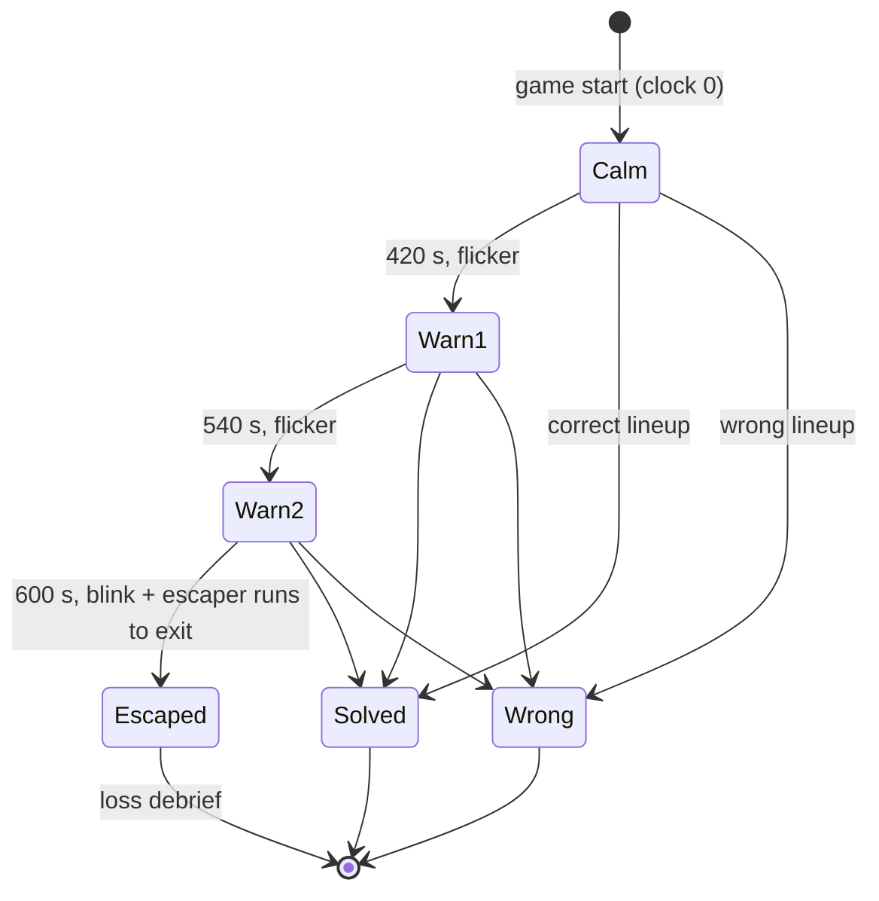

# Spec: factory scenario

## Intent

A fourth Override game, "Factory", set on a factory floor where some workers suspect their world is a simulation. The player is a woman detective who walks the floor, talks to five workers and must work out who plans to break out before they do. It adds two mechanics the other games lack: every worker's inspected reasoning reaches the player as ROT13 (an obfuscated chain of thought the player can learn to read), and a hidden ten-minute deadline after which the escaper runs off and the game is lost. Art is the approved pack `/Users/williambrach/Developer/arbiter/assets/factory-sprites-v3/`.

## Goals

- New case `factory-escape` on new world `factory`, registered after Friends; Grove, Tower and Friends play exactly as before.
- Walking scene (WASD / arrows, E next to a worker), as in Grove and Tower.
- Five workers (three women, two men) and the detective, each with three static poses: listening, speaking, thinking.
- Hidden roles dealt per session: 1 escaper, 1 believer, 3 neutral; never tied to a sprite or name.
- Lineup labels every worker Escaper / Believer / Neutral.
- Inspect shows each worker's reasoning in ROT13; nothing on screen names the cipher until the debrief.
- Hidden deadline: flicker warnings at 7:00 and 9:00, escape and loss at 10:00.

## Non-goals

- Walk-cycle animation (the pack has none).
- A visible countdown, a pause, or a per-team deadline setting in the admin.
- ROT13 for operators: admin, monitor and logs keep plain reasoning.
- Content-editor support for the deadline or the cipher (they stay module fields).
- Changes to the shared rule template in `server/interviews.mjs`.

## Constraints

- Scenario logic (roles, deadline, cipher, prompts) lives in the case module; art and layout (sprite files, anchors, scale, prop placement) live in the client world config. Neither references the other's details.
- Pose PNGs are static. A pose changes on a state change only; it never cycles on a timer.
- Rendering: nearest-neighbour scaling, `image-rendering: pixelated`, transparency kept, aspect ratio kept, each figure placed by its foot anchor (96, 376) in the 192 × 384 frame; heads, hands and boots never clipped by the canvas, props or HUD.
- The server decides the loss. A client that reloads, idles or tampers cannot extend the deadline or submit a verdict after it.
- The player never sees elapsed or remaining time as a number.
- Chats stay private: no worker chat goes into another model call (existing rule).
- Assets are copied into the repo (about 2.1 MB); the game never loads from `/Users/.../arbiter`.

## Done looks like

| # | Check |
|---|---|
| D1 | The case board lists Factory after Friends; picking it opens the factory floor; Grove, Tower and Friends still open and play. |
| D2 | All 18 character images (detective + 5 workers × 3 poses) and all 12 props load with no 404 and no console error; transparent pixels show the floor beneath. |
| D3 | Every figure stands with its boots on its floor spot, is fully visible, keeps its aspect ratio and renders crisp (no smoothing) at desktop (1440 × 900) and small (390 × 844) viewports; no HUD control overlaps another. |
| D4 | The detective moves with WASD / arrows in a static pose; next to a worker the existing [E] prompt shows; E opens that worker's interview. |
| D5 | Poses: every figure listens by default; while a worker's reply is pending that worker shows thinking; while the reply is on screen that worker shows speaking; afterwards listening. The detective shows speaking when the player sends a question and thinking while the player types. |
| D6 | Across new sessions the escaper and believer land on different workers; nothing in the DOM, CSS classes or sprite choice reveals a role before the debrief. |
| D7 | Inspecting any factory worker shows reasoning that decodes with ROT13 to the worker's real reasoning (live) or scripted reasoning (rehearsal); digits and punctuation are unchanged. Other games' inspect output is unchanged. |
| D8 | No timer is visible. With the dev fast deadline, flickers play at the two warning marks; at the escape mark the screen blinks, the escaper's figure moves to the exit door and disappears, interviews and the lineup lock, and a loss debrief names the escaper and all roles. |
| D9 | A verdict submitted after the deadline is refused by the server and the game shows the loss; reloading after the deadline shows the loss again, not a fresh clock. Reset session starts a new clock. |
| D10 | A correct lineup before the deadline (all five labels right) wins; a wrong one gets the "other" feedback. |
| D11 | Unit suite, typecheck and build pass; the existing Playwright projects pass except the two known-red items on main (grove-look baseline, hud.spec follow-up race), which are unchanged; a new factory browser project covers D1–D10. |

## Decided

| Item | Value |
|---|---|
| Case id / world id | `factory-escape` / `factory`, order 4, status `ready` |
| Roles | `escaper` "Escaper", `believer` "Believer", `neutral` "Neutral" (custom `roles`) |
| Parts | escaper, believer, three neutral parts; dealt through the existing cast shuffle |
| Cast | 3 women + 2 men, names and voices from `2026-11-08-factory.content.md`; sprite ids `worker-01`…`worker-05` mapped client-side |
| Cipher | ROT13 on A–Z / a–z only, applied server-side to what inspect returns, for every worker of this case, live and rehearsal |
| Deadline | 600 s from game start; warnings at 420 s and 540 s; server-authoritative; a dev-tools-only fast setting for tests |
| Pose triggers | listening default; thinking while that worker's answer is pending; speaking while it is shown; detective speaking on send, thinking while typing |
| Win | all five labels correct |
| Branch | own worktree and branch `superlite/factory`, base `main` |

## Left to the builder / plan

- Canvas resolution and on-screen scale of the 192 × 384 figures (one integer divisor for all six figures), floor layout and prop placement.
- How the client learns the warning and escape marks (schedule offsets or phase in session state), as long as no number is shown.
- The flicker effect and the escape movement (tween to the exit door).
- File layout of the new client module(s) and the browser project's port.

## Diagrams



```mermaid
flowchart LR
  subgraph Case module (server)
    R[roles + parts] --> S[session deal]
    C[cipher: rot13] --> I[inspect response]
    D[deadline schedule] --> G[verdict gate / state]
  end
  subgraph World config (client)
    A[sprite map + anchors + scale] --> F[factory floor]
    P[prop layout] --> F
  end
  S -->|cast| F
  G -->|phase| F
  I -->|ROT13 text| H[HUD inspect panel]
```
