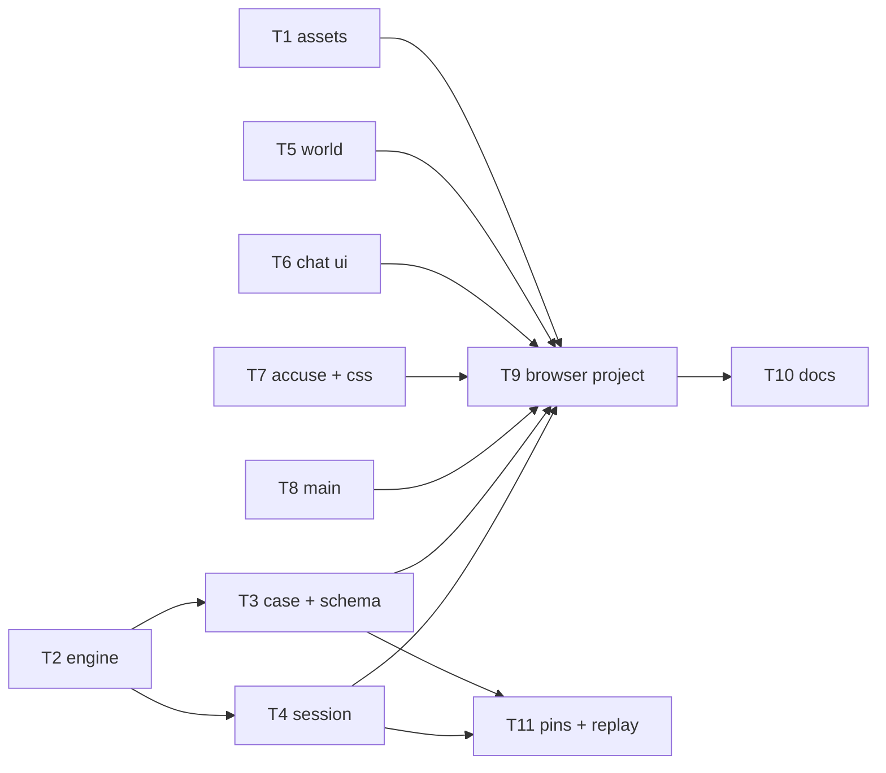
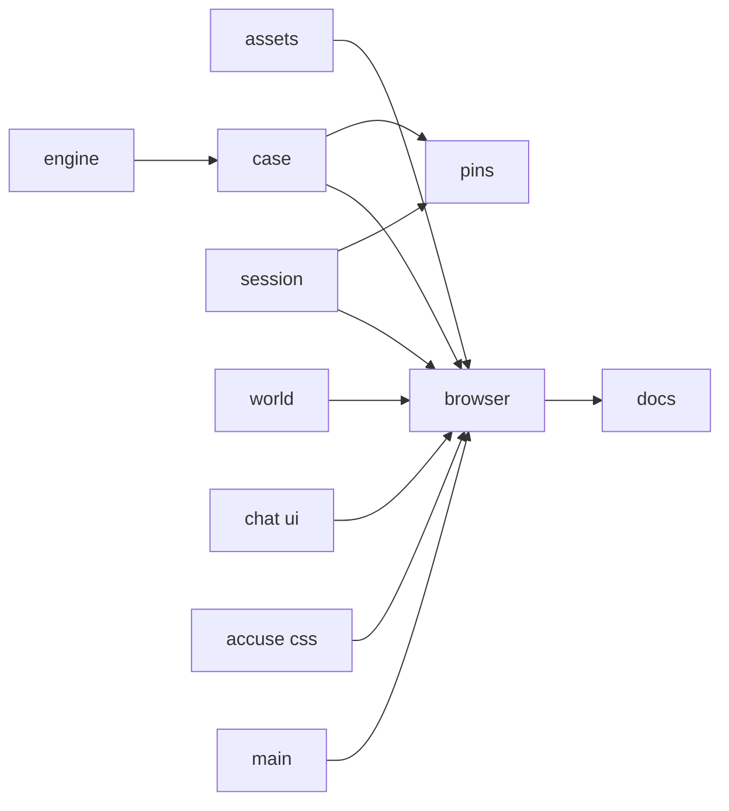

# Plan: renaissance time-traveller level (integration)

**Review plan:** docs/plans/2026-11-08-renaissance.feature.md
**Goal:** port the approved prototype into the real Override code as case `renaissance-traveler` (world `renaissance`), fix the try-out's UI findings, add the Playwright project, docs and pins; every existing test passes.
**Architecture:** pure server modules `anachronism.mjs` + `talk.mjs` under a data-only case module; session actions call the engine; client world pack, pure markup modules (`talk-ui.ts`, `accuse.ts`), wiring in `main.ts`, scoped CSS.
**Tech stack:** Node 25 ESM (`node:test`), TypeScript + Vite + Phaser 3, Playwright, Python 3 + Pillow (art script only).
**Spec:** docs/plans/2026-11-08-renaissance.spec.md
**Detail:** contracts
**Target-min:** 14
**Ignore:** docs/plans/2026-11-08-renaissance*, demos/override/test-results/, demos/override/data/, demos/override/dist/, demos/override/node_modules/, demos/override/playwright-report/

## Global constraints

- Port, never merge. The prototype is reference only and read-only: `PROTO=/Users/williambrach/Developer/AgentVerse/.superlite/sandboxes/renaissance-proto`, same paths, base `bbb28ce`.
  - Modified files: `git -C $PROTO diff bbb28ce -- <file> | git apply` in this worktree.
  - New files: `cp` from `$PROTO`.
  - Then re-read every ported file, keep it clean, and apply your task's fixes.
- App root `demos/override/`; every path below is under it. Unit tests: `node --test tests/<file>`. Browser (T9 only): `npm run build`, then `npx playwright test --project=renaissance --output=<scratchpad>`. Never run unit and browser suites at once.
- Spec wins. All strings: `docs/plans/2026-11-08-renaissance.content.md`.
- FROZEN: other cases' `publicView` keys, prompts, `contentHash`, views and event shapes. Also frozen: `schemaVersion` 3; the `/api/<action>` body `{sessionId, revision, ...}`; `promptVersion`/`threadPromptVersion`; the department world pack and stops; the grove/tower art keys; the leaderboard and monitor inputs.
- Secrets: the traveller, slip ids and challenge counts never reach `view()` or `/api/events` while open; hidden event data lives only in `hidden`.
- Contract (as the prototype):
  - `state.talk.topics`, `state.tools`.
  - Turns `{question, answer, timestamp, id, kind, topic}`.
  - `session.talk {asked, quotes[{id,line,character,text,at}], accusations[{id,character,quotes,at,feedback,denial}]}`, where `at` is an ISO string.
  - `debrief.reveal/slips/wrong`.
  - Actions `interview {topic|about|question}`, `quote`, `unquote`, `accuse`.
  - Score `max(1, 5 − 2·wrong)` of 5.
- Spec coverage:
  - Intent and Goals: T1–T8.
  - Constraints: T2–T4, T7 and T11.
  - Done looks like: R1–R13 in T1–T8, R14 in T9.
  - Decided: T3 and T4.
  - Left to the builder / plan: T1, T5–T8.
  - Diagrams: T2 and T4.
  - Non-goals: T3 hides talk text from the maker.

## File structure

| Task | Files |
|---|---|
| T1 | `art/renaissance/`, `public/assets/renaissance/`, `tests/renaissance-assets.test.mjs` |
| T2 | `server/anachronism.mjs`, `server/talk.mjs`, `tests/fixtures/talk-fixture.mjs`, `tests/talk.test.mjs` |
| T3 | `server/cases/renaissance-traveler.mjs`, `server/cases/index.mjs`, `server/worlds.mjs`, `server/cases.mjs`, `server/content.mjs`, `tests/renaissance-case.test.mjs`, `tests/cases-content.test.mjs`, `tests/friends-case.test.mjs`, `tests/leaderboard.test.mjs`, `tests/thread-prompt.test.mjs`, `tests/department-case.test.mjs` |
| T4 | `server/session.mjs`, `server/interviews.mjs`, `server/index.mjs`, `tests/talk-session.test.mjs` |
| T5 | `client/worlds.ts`, `client/factory-figures.ts`, `client/station.ts`, `tests/renaissance-world.test.mjs` |
| T6 | `client/talk-ui.ts`, `client/dialogue.ts`, `tests/talk-ui.test.mjs` |
| T7 | `client/accuse.ts`, `client/debrief.ts`, `client/renaissance.css`, `tests/accuse-ui.test.mjs` |
| T8 | `client/main.ts`, `client/types.ts`, `client/tools.ts`, `tests/renaissance-main.test.mjs` |
| T9 | `playwright.config.mjs`, `tests/browser/renaissance.spec.mjs`, `tests/browser/cases.spec.mjs`, `tests/browser/factory.spec.mjs`, `tests/browser/department.spec.mjs` |
| T10 | `README.md`, `docs/CASES_PLAN.md` |
| T11 | `tests/renaissance-schema.test.mjs` |

## Task graph

```mermaid
%% schedule
gantt
  title Predicted schedule (mm:ss)
  dateFormat X
  axisFormat %M:%S
  section lane 1
  T4 session  interviews and routes :t4, 0, 169s
  T9 Playwright project :t9, 296, 146s
  T10 README and cases plan :t10, 441, 88s
  section lane 2
  T2 lexicon and talk engine :t2, 0, 141s
  T3 case  world  schema and maker :t3, 141, 155s
  T11 pins and real-case replay :t11, 296, 97s
  section lane 3
  T7 accusation  reveal and CSS :t7, 0, 140s
  section lane 4
  T6 chat and quotes markup :t6, 0, 135s
  section lane 5
  T8 main wiring  briefing and types :t8, 0, 133s
  section lane 6
  T5 world pack and station :t5, 0, 122s
  section lane 7
  T1 assets and art script :t1, 0, 104s
```

critical path: T2 → T3 → T9 → T10 (8.8 min) · peak width 7 · predicted build 8.8 min · predicted total ≈ 21.6 min (target ✗ 14.0)

## Server

**Probe entry:** call=demos/override/server/talk.mjs:topicAnswer

### T2 lexicon and talk engine · Complexity 5 · Est. context 35k
**Owns:** demos/override/server/anachronism.mjs, demos/override/server/talk.mjs, demos/override/tests/fixtures/talk-fixture.mjs, demos/override/tests/talk.test.mjs
**Components:** 2
**LOC owned:** 330
**Tests:** fast
**Model:** sonnet
**Produces:** talk.topicAnswer(kase: object, cast: object, state: object, cid: string, topic: string) -> {text: string, slip: string|null}
e.g. topicAnswer(k, {a: 'traveler', ...}, fresh, 'a', 'work') -> {text: '<a work slip line>', slip: 'a-work'}
**Produces:** talk.checkTalk(data: object) -> void
**Review Focus:** port as is; `lexicon_word_boundaries`, `followups_escalate`, `typed_routes`, `supports_needs_term_in_excerpt`, purity; add `period_words_never_flagged` over every string in the content doc's plain lines.

### T3 case, world, schema and maker · Complexity 5 · Est. context 50k
**Owns:** demos/override/server/cases/renaissance-traveler.mjs, demos/override/server/cases/index.mjs, demos/override/server/worlds.mjs, demos/override/server/cases.mjs, demos/override/server/content.mjs, demos/override/tests/renaissance-case.test.mjs, demos/override/tests/cases-content.test.mjs, demos/override/tests/friends-case.test.mjs, demos/override/tests/leaderboard.test.mjs, demos/override/tests/thread-prompt.test.mjs, demos/override/tests/department-case.test.mjs
**Components:** 3
**LOC owned:** 260
**Tests:** fast
**Model:** sonnet
**Consumes:** talk.checkTalk(data: object) -> void (T2) · talk.topicAnswer(kase: object, cast: object, state: object, cid: string, topic: string) -> {text: string, slip: string|null} (T2)
**Produces:** cases/renaissance-traveler.default -> Case
e.g. publicView(kase, cast).tools -> {inspect: false, talk: false}
**Review Focus:**
- Port as is.
- Fix: `content.mjs` `editablePaths` hides `parts.*.knowledge` for talk cases, so a maker cannot make prompts depend on the deal. Test it as `maker_cannot_split_part_knowledge`.
- Keep `prompt_identical_across_deals`, `fairness_all_travellers`, `registry_six` and `public_view_no_secrets`.

### T4 session, interviews and routes · Complexity 7 · Est. context 55k
**Owns:** demos/override/server/session.mjs, demos/override/server/interviews.mjs, demos/override/server/index.mjs, demos/override/tests/talk-session.test.mjs
**Components:** 3
**LOC owned:** 380
**Tests:** fast
**Model:** sonnet
**Consumes:** talk.topicAnswer(kase: object, cast: object, state: object, cid: string, topic: string) -> {text: string, slip: string|null} (T2)
**Produces:** Investigation.mutate('interview'|'quote'|'unquote'|'accuse', input) -> view
e.g. mutate('accuse', {.., character: 'bruno', quotes: [q1]}) (bruno local) -> view.session.status 'active'
**Review Focus:**
- Port as is, including the seam fix (`session.talk ?? newTalkState`).
- `export_strips_hidden_while_open`, `replay_restores_talk`, `same_feedback_wrong_or_unsupported`, `score_formula`.
- `typed_guard_retry_then_deflect`, `tools_off_409`, `non_talk_cases_unchanged`.
- New: `about_line_of_other_speaker_is_neverSaid`.

## Art and world

**Probe entry:** call=demos/override/client/worlds.ts:worldFor

### T1 assets and art script · Complexity 3 · Est. context 30k
**Owns:** demos/override/art/renaissance/cut.py, demos/override/art/renaissance/ARTWORK.md, demos/override/public/assets/renaissance/, demos/override/tests/renaissance-assets.test.mjs
**Components:** 1
**LOC owned:** 200
**Tests:** fast
**Model:** sonnet
**Produces:** file `public/assets/renaissance/props/quill.png` (96×96 RGBA quill and inkpot, no text) plus every prototype asset
**Review Focus:** port by `cp`, then add the quill to `cut.py` and the test. `asset_sizes`, `no_row4_no_glow`.

### T5 world pack and station · Complexity 4 · Est. context 45k
**Owns:** demos/override/client/worlds.ts, demos/override/client/factory-figures.ts, demos/override/client/station.ts, demos/override/tests/renaissance-world.test.mjs
**Components:** 2
**LOC owned:** 170
**Tests:** fast
**Model:** sonnet
**Produces:** worlds.worldFor('renaissance') -> WorldPack
e.g. worldFor('renaissance').figures.walkFrames -> 4
**Review Focus:**
- Port as is.
- Fix: the name tags overlapped ("MAESTRO OTTAV" ran under "SER MATTEO"). Spread the slots so no two name tags overlap. Ottavio stands centre-front by the sundial steps, Agnese right of the well at x ≥ 100, the others by their buildings.
- Add `name_tags_do_not_overlap`: an estimated tag box is 7 world px per character plus 10, at `labelLift`.
- Keep `slots_on_ground` and `stop_props_default`.

## Client UI

**Probe entry:** call=demos/override/client/talk-ui.ts:wordTokens

### T6 chat and quotes markup · Complexity 4 · Est. context 35k
**Owns:** demos/override/client/talk-ui.ts, demos/override/client/dialogue.ts, demos/override/tests/talk-ui.test.mjs, demos/override/tests/dialogue-ui.test.mjs
**Components:** 2
**LOC owned:** 280
**Tests:** fast
**Model:** sonnet
**Produces:** talkUi.quotesPanel(quotes: Quote[], characters: {id: string, name: string, role: string}[]) -> string
e.g. quotesPanel([], cast) -> contains 'No quotes yet'
**Review Focus:**
- Port as is.
- Fix: the Quotes page rendered as a bare bulleted list. Use `<ul class="quote-list">` with no bullets, a group header with a `monkey-face <cid>` face span (the class the rail uses), name and job, and a small `Remove` button.
- Keep `tokens_have_equal_markup`, `excerpt_escape` and `non_talk_markup_unchanged`.

### T7 accusation, reveal and CSS · Complexity 5 · Est. context 45k
**Owns:** demos/override/client/accuse.ts, demos/override/client/debrief.ts, demos/override/client/renaissance.css, demos/override/tests/accuse-ui.test.mjs
**Components:** 2
**LOC owned:** 320
**Tests:** fast
**Model:** sonnet
**Produces:** accuse.accusePanel(v: {characters, quotes, accusations, draft: {character: string|null, quotes: string[]}, copy, busy}) -> string
e.g. accusePanel({.., draft: {character: 'bruno', quotes: []}}) -> `#accuse-submit` disabled
**Review Focus:**
- Port as is, then fix the try-out findings:
  - Rail faces for bruno and agnese showed grove monkeys: the slot-3/4 fallback in `banana.css` wins. Every renaissance face must come from its listening PNG, by character id, with enough specificity.
  - The chat portrait in the dialogue showed a monkey.
  - The Quotes nav icon is the department evidence bag; use `/assets/renaissance/props/quill.png`.
  - Debrief text had low contrast (eyebrow, "Their words", the feedback line, the coins line, the secondary buttons). Every text must reach a contrast ratio of at least 4.5:1 on its background.
  - Style `.quote-list` and `.quote-group`.
- Keep `max_three_quotes`, `last_feedback_shows_denial`, `reveal_lists_cited` and `escaped_and_role_debriefs_unchanged`.

### T8 main wiring, briefing and types · Complexity 5 · Est. context 55k
**Owns:** demos/override/client/main.ts, demos/override/client/types.ts, demos/override/client/tools.ts, demos/override/tests/renaissance-main.test.mjs
**Components:** 2
**LOC owned:** 260
**Tests:** fast
**Model:** sonnet
**Consumes:** talkUi.quotesPanel(quotes: Quote[], characters: {id: string, name: string, role: string}[]) -> string (T6) · accuse.accusePanel(v: {characters, quotes, accusations, draft: {character: string|null, quotes: string[]}, copy, busy}) -> string (T7) · worlds.worldFor('renaissance') -> WorldPack (T5)
**Review Focus:**
- Port as is, then fix the try-out findings:
  - For talk cases, the briefing still showed "Ask 5 townsfolk, one quick question each", "Use your Arbiter tools" and "Make your verdict". Use three steps instead:
    1. Ask the townsfolk about everyday things (the topic chips).
    2. Save the words that don't belong (Pick words, then Save quote).
    3. Accuse with 1–3 quotes; a wrong accusation costs points, not the game.
  - The rail verdict button reads "Accuse the traveller" with "<n> quotes saved".
  - On the accuse page a blank white block covered the top of the world (talk cases; check `data-view` and the lineup layout). The world must stay visible as on the other report pages.
- Extract the briefing steps into a pure exported function, and test it in `renaissance-main.test.mjs`.
- `npm run build` (tsc) is clean.

## Browser, docs and pins

**Probe entry:** run=npx playwright test --project=renaissance

### T9 Playwright project · Complexity 5 · Est. context 50k
**Owns:** demos/override/playwright.config.mjs, demos/override/tests/browser/renaissance.spec.mjs, demos/override/tests/browser/cases.spec.mjs, demos/override/tests/browser/factory.spec.mjs, demos/override/tests/browser/department.spec.mjs
**Components:** 1
**LOC owned:** 280
**Tests:** slow
**Model:** sonnet
**Review Focus:**
- Config: project `renaissance` on port 4326, plus `seenSplash` and the default `testIgnore`.
- Specs (start from the prototype try-out script at `/private/tmp/claude-501/-Users-williambrach-Developer-AgentVerse/b09753bc-8afe-481f-967e-7424ef157cb3/scratchpad/tryout.mjs`): board and assets with no 404, walking, topics with chips disabled, traveller-only slips, follow-ups, typed routing, quotes with reload, wrong and unsupported feedback, solve with reveal and score, export redaction, tool cards, 390×844.
- The case count becomes 6 in cases.spec, factory.spec and department.spec.
- Run the renaissance, department and factory projects plus default; the grove-look baseline is the only known failure.

### T10 README and cases plan · Complexity 2 · Est. context 25k
**Owns:** demos/override/README.md, demos/override/docs/CASES_PLAN.md
**Components:** 1
**LOC owned:** 70
**Tests:** fast
**Model:** sonnet
**Review Focus:** the sixth case paragraph (play, slips, quotes, accusations, score); the new optional fields (`talk`, `tools`, `characters[].reveal`); missing art stated plainly with `art/renaissance/ARTWORK.md`; the world/case lists and counts.

### T11 pins and real-case replay · Complexity 4 · Est. context 35k
**Owns:** demos/override/tests/renaissance-schema.test.mjs
**Components:** 1
**LOC owned:** 140
**Tests:** fast
**Model:** sonnet
**Review Focus:**
- `other_cases_byte_identical_to_base`: sha256 of `publicView`, `castCharacters`, `rolesOf`, `buildMessages`, `buildThreadMessages` and `contentHash` for the five old cases. Compute the values at base `bbb28ce` in a detached scratch worktree (`git worktree add --detach`, `cp -Rc` node_modules, remove it after). Copy the shape of `tests/department-schema.test.mjs`.
- `real_case_replay`: play the real case through `Investigations` in rehearsal mode (topics, about, quote, a wrong accusation, the solve). Replay from disk; the state, the view and the debrief must be equal.

Ruling: sequential [chain-92fc] - T9 runs every ported module in a browser and T10 documents what T9 verified; T2 -> T3 is the case validation calling the real engine - cost if wrong: a few minutes of wall clock
