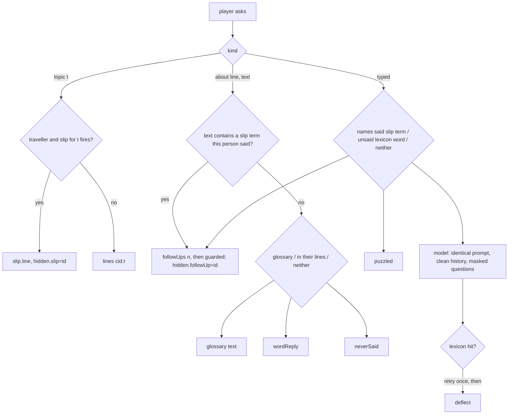
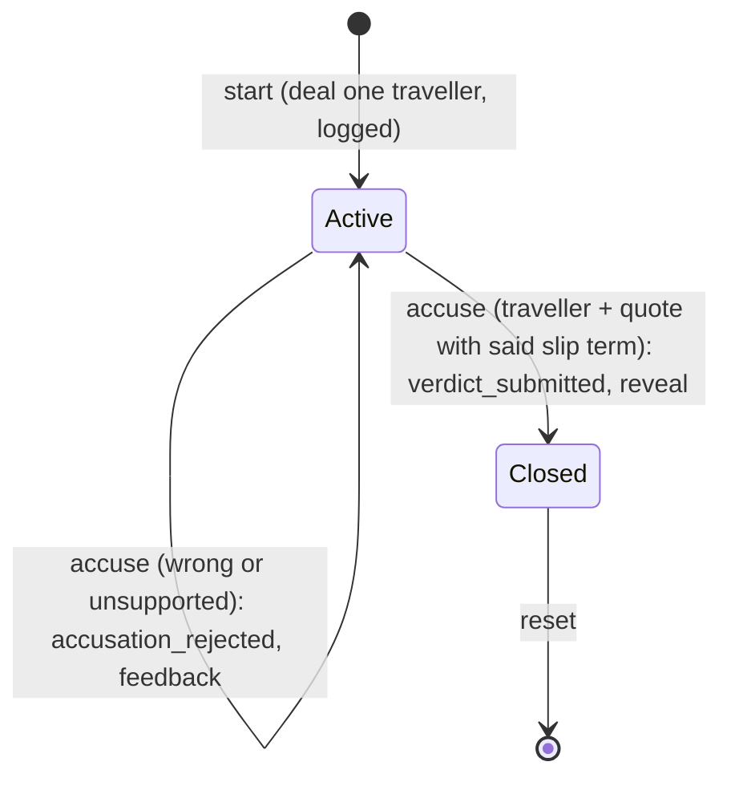

# Spec: Renaissance time-traveller level

**Intent.** Add a sixth Override game, "A Word Out of Time". The player is a time traveller (the hooded scout) who has landed in Castelvento, a fictional Tuscan town, in June 1489. Someone from the player's own century arrived years earlier and now lives there as one of five townsfolk: the astrologer (wizard sprite), the clockmaker (inventor), the noblewoman, the sergeant of the watch (guard) or the apothecary. The player finds them by listening. Everyone speaks a readable Renaissance-flavoured English, and the hidden traveller now and then slips into modern language ("Wi-Fi", "selfie", "podcast"). Those slips are curated scenario data delivered by scenario state, never left to the model. The player saves exact quotes in a notebook and accuses one person with the quotes that prove it. A wrong or unsupported accusation lets the investigation continue; a correct, supported one triggers the traveller's reveal.

Sources: the user's request (2026-11-08), the sprite pack `/Users/williambrach/Developer/arbiter/assets/renaissance-characters-v1/` and the backdrop prompt `/Users/williambrach/Developer/arbiter/assets/renaissance-background-v1/prompt.txt`. Story and every string: `docs/plans/2026-11-08-renaissance.content.md`.

## Goals

- New case `renaissance-traveler` on the new world `renaissance`, listed after After Hours. Grove, Tower, Friends, Factory and Department play exactly as before.
- Walking scene: the town square, WASD / arrows to move the scout, E next to a person to talk to them.
- Exactly one of the five townsfolk is dealt the hidden part `traveler` when a game starts, uniformly at random (the wizard gets no extra weight). The deal is logged and restored on replay, so it holds across requests, reloads, restarts and saves.
- Every person has a fixed name, job, personality, relationships, knowledge of the town and arrival story. The traveller's story is their cover story, and it reads the same as a local's.
- Topic questions (Work, Travel, Letters & news, Pastimes, The square today) get authored answers. The traveller's slips are fired by scenario state.
- Follow-up about wording: the player picks words from a person's line and asks what they meant.
- Notebook "Quotes": the player saves an exact line, or an exact excerpt of it, under its speaker, and can remove it.
- Accusation: a suspect plus 1 to 3 of that suspect's saved quotes. Evaluated on the server.
- Reveal debrief: who the traveller was, when they arrived, why they hid, and the slips they made.

## Non-goals

- Generating the missing art (the wizard sheet, the apothecary sheet, the town-square backdrop). Placeholders stand in until the user generates the art from prompt files.
- Inspect reasoning and Let them talk in this case (both off, see Decided).
- Editing slips, topic lines or character text in the maker. They stay module fields; the existing editable paths are unchanged.
- Admin and monitor tallies for failed accusations.
- Historical accuracy beyond a consistent fictional voice.

## Constraints

- **Hidden identity is data, not appearance.** No artwork, sprite choice, pose, CSS class, filename, label, introduction, topic answer of a local, `publicView` field, `session` field, or `/api/events` line before the close may depend on who was dealt `traveler`. Sprite row 4 (the "suspicious action") and every frame that shows a glowing object are never used.
- **Slips come only from scenario data, only from the traveller.**
  - Every authored text except slip `line`s and the reveal must contain no word from the anachronism lexicon: plain answers, follow-ups, glossary, character replies, rehearsal lines, knowledge, introductions and copy. This includes every slip term and alias. The case fails `defineCase` otherwise.
  - Every model answer goes through the same check before it is shown or logged. A hit is retried once, then replaced by the speaker's authored `deflect` line.
- **The model never knows who the traveller is.** Every character's interview prompt is byte-identical in every deal: character-bound knowledge, and part knowledge identical for all parts. In the model's history, a slip line appears as its `clean` form. In the questions the model sees, lexicon words are replaced by "that word".
- **Chats stay private** (existing rule): no character's chat enters another model call. With the thread tool off, nothing changes here.
- **Fair puzzle.** Each potential traveller has one slip per topic (5): 3 `always`, 1 `distracted`, 1 `pressed`, with the 3 `always` slips on different topics. So any 3 topic questions put to the traveller produce at least one slip, and all 5 topics produce at least 3. No particular question is required.
- **Consistency.** A transcript line never changes after it is said. Follow-ups to a slip follow that slip's authored sequence (1st, 2nd, then the character's `guarded` line), so a correction and its explanation stay consistent. Topic chips are single-use per person.
- **Other cases unchanged.** Their `publicView`, prompts, `contentHash`, views and event shapes stay byte-identical. New fields are additive and appear only for a case that defines `talk`.
- **Local assets.** Everything ships under `public/assets/renaissance/`; the game never loads from `/Users/.../arbiter`.

## Done looks like

| # | Check |
|---|---|
| R1 | The case board lists "A Word Out of Time" after After Hours, with five faces. Picking it opens the square. The other five cases still open and play. |
| R2 | The backdrop, the five townsfolk and the scout load with no 404 and no console error, render crisp, stand on the ground, and are not clipped at 1440×900 or 390×844. No HUD control overlaps another. |
| R3 | The scout walks with WASD / arrows, shows walk frames while moving, faces left or right, and cannot leave the ground. "[E] Ask <name>" appears next to each person, and E opens their chat. |
| R4 | Over 200 fresh deals each of the five gets `traveler` at least 20 times, and the dealt id stays the same for a session across `view()`, every action, `replay()` from disk and a reset-free reload. |
| R5 | A unit test plays every possible traveller through all 5 topics and through every 3-topic order. It finds at least 1 slip for any 3 topics and at least 3 for all 5. It also finds that no line spoken by a local, no follow-up, no glossary answer and no character reply contains a lexicon word. |
| R6 | Topic chips answer instantly with the authored line, and a chip used once is marked asked and disabled for that person. The traveller's slip lines appear exactly as written; locals never slip. |
| R7 | Picking words in a line and asking "What did you mean by …?" works as follows: • on a slip term the traveller said, it returns that slip's follow-ups in order, then `guarded`; • on a glossary word, it returns the glossary answer; • on other words of that person's line, it returns their `wordReply`; • on words not in that person's lines, it returns `neverSaid`. A typed question naming a slip term the person said is treated as that follow-up. A typed question with a lexicon word the person never said gets `puzzled`. Neither calls the model. |
| R8 | In live mode a typed question gets a model answer, guarded by the lexicon (a hit is retried once, then `deflect`). Each character's prompt is identical across deals (pinned by sha256 for every character × every part). The history the model sees holds `clean` slip lines. |
| R9 | Save quote stores the whole line, or an exact excerpt of 3 or more characters, with the speaker. The Quotes page lists the quotes by speaker, removal works, and quotes survive a reload and a restart. An excerpt that is not in the line is rejected (400). |
| R10 | Accusing a local, or the traveller with quotes that contain no slip term, gives the same feedback text: `answer.feedback.other` plus the accused person's `denial`. The game stays open and nothing reveals the traveller. Accusing the traveller with at least one quote whose excerpt contains a slip term they said closes the game. |
| R11 | The reveal debrief shows the traveller's name, job and `reveal` text, the slips they said this game with the cited ones marked, the number of wrong accusations, and score `max(1, 5 − 2 × wrong)` of 5. The leaderboard counts the solve once. |
| R12 | Before the close, `/api/state` and `/api/events` contain no field that names the traveller or marks a line as a slip: there is no `hidden` key, the cast is null, and there are no slip or part ids. After the close, the export is complete. |
| R13 | The rail and the chat header show job labels. The Inspect reasoning and Let them talk cards show as off with "Not in this case". The briefing names the topics and the accusation rule. |
| R14 | The unit suite, `tsc` and the build pass. The existing Playwright projects pass, except the known stale grove-look baseline. A new `renaissance` project covers R1–R3, R6, R7, R9–R11 and R13 in rehearsal mode. |

## Decided

| Item | Value |
|---|---|
| Case / world | `renaissance-traveler` / `renaissance`, order 6, status `ready`, version `renaissance-traveler-v1.0.0`; world `{place: 'Castelvento', cast {one: 'a townsperson', many: 'townsfolk'}, persona: 'townsperson', agents: 5}` |
| Roles | custom: `traveler` "Time traveller", `local` "Townsperson" |
| Parts | `traveler`, `locala`, `localb`, `localc`, `locald`. All have label "Townsperson", the same knowledge (the setting) and the same intro and quick question; findings: traveller vs local |
| Cast | ottavio (Astrologer, sprite `wizard`), matteo (Clockmaker, `inventor`), beatrice (Noblewoman, `noble`), bruno (Sergeant of the watch, `guard`), agnese (Apothecary, `apothecary`); player sprite `scout` |
| Character text | the existing `characters[].label/introduction/quickQuestion/knowledge`, plus new optional `characters[].reveal` (may use modern words) |
| Talk data | new optional case field `talk`: `topics[{id,label,question}]`, `lines{cid:{topicId:text}}`, `slips{cid:[{id,topic,when,term,aliases[],line,clean,correction,followUps[2]}]}`, `replies{cid:{guarded,wordReply,neverSaid,puzzled,deflect,denial}}`, `glossary[{terms[],text}]`, `rehearsal{cid:[text,text]}`. `when` ∈ `always`, `distracted` (≥2 earlier topic answers by this person), `pressed` (≥1 earlier challenge of this person's slip) |
| Lexicon | `server/anachronism.mjs`: a curated modern-word list plus every slip term and alias in the case. Matching is case-insensitive, on word boundaries, and also catches multi-word terms |
| Dialogue actions | `interview` takes exactly one of `question` (typed), `topic`, or `about {line, text}`. All cost `ask` and log `interview_question` + `interview_answer`; the answer adds `kind`, `topic`, `about` and `hidden {slip, followUp, guard}` |
| Notebook actions | `quote {line, text?}` → `quote_saved`; `unquote {quote}` → `quote_removed`; at most 30 quotes; free |
| Accusation | action `accuse {character, quotes[1..3]}` (each quote must be by the accused), free. Failure logs `accusation_rejected {character, quotes, hidden{traveler, supported}}`; success logs `verdict_submitted` (roles: accused traveller, others local; score `max(1, 5−2·wrong)`, total 5, `accusation {character, quotes, wrong}`) + `debrief_viewed`. The `verdict` action answers 400 for talk cases |
| Secret fields | One `hidden` object per event. `export()` drops `hidden` from every line while the game is open; `view()` never includes it |
| Tools | case field `tools: {inspect: false, talk: false}` (absent = on). Off tools answer 409 "Not in this case." |
| Art | per-pose PNGs cut from the sheets at 0.6 scale, drawn at 1/3 with density 3 (1:1 px). Poses come from rows 1 and 3 only. The wizard and apothecary are placeholders recoloured from the inventor and noble sheets, and the backdrop is a script-drawn 1536×1024 placeholder. All are rebuilt by one script when real art lands |
| Branch | worktree `.superlite/worktrees/renaissance`, branch `superlite/renaissance`, base main `bbb28ce`; Playwright project `renaissance` on port 4326 |

## Left to the builder / plan

- Walk bounds, blocks, slot points and stop points, measured on the placeholder backdrop.
- The exact frames per pose (rows 1/3, never row 4, no glow), the placeholder recolour bands and the backdrop drawing.
- The word-picker markup and the Quotes and accusation page layouts, composed from existing notebook styles.
- The lexicon's exact list, as long as R5 and the period words in the content doc (printing press, spectacles, clockwork, skittles) pass.

## Diagrams

