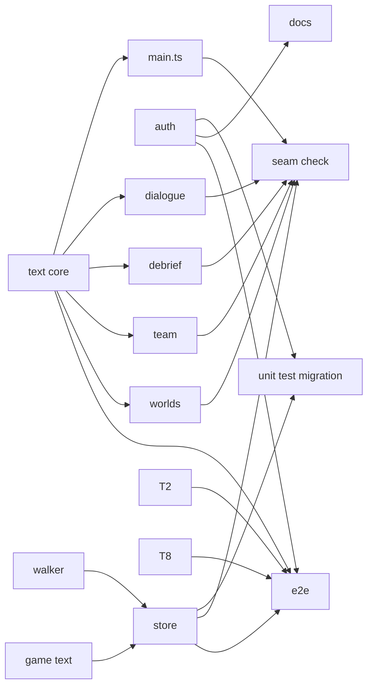
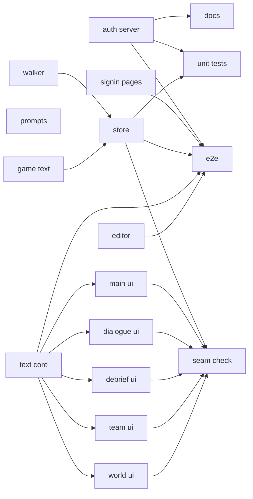

# Integration plan: admin text

**Review plan:** docs/plans/2026-11-09-admin-text.feature.md
**Goal:** port the approved prototype into `main`'s code task by task, convert every remaining client UI string to the catalog, migrate tests and docs.
**Architecture:** as in the prototype. Cookie auth on the admin listener; path walker plus content store with tracked JSON under `content/` and the local log; game document (ui, prompt, worlds); `client/text.ts` catalog loaded from `GET /api/text`.
**Tech stack:** Node 25 ESM (tests run client `.ts` by type stripping), TypeScript client with Vite, no new deps.
**Spec:** docs/plans/2026-11-09-admin-text.spec.md
**Detail:** contracts
**Target-min:** 14
**Ignore:** docs/plans/, demos/override/node_modules, demos/override/dist

## Global constraints

- SB = /Users/williambrach/Developer/AgentVerse/.superlite/sandboxes/admin-text-proto (the prototype). WT = /Users/williambrach/Developer/AgentVerse/.superlite/worktrees/admin-text (this build). Both start at main e546007. Work only in WT, with absolute paths.
- **Port rule:** each path under a task's **Port:** is copied byte for byte: `cp $SB/<path> $WT/<path>`. Then apply the task's own changes. Never copy a file your task does not own.
- App root `demos/override`. Unit tests: `node --test demos/override/tests/<file>.test.mjs`. Only T15 runs Playwright.
- Byte identity: with no edits, prompts, `publicView`, `contentHash` and UI strings equal main's. These must stay green: `cases`, `cases-content`, `case-roles`, `thread-prompt`, `interviews`, `renaissance-schema`, `department-schema`, `session`, and every `*-ui.test.mjs`.
- Client text:
  - `t(key, vars)` returns HTML-escaped text (vars escaped too) for innerHTML templates. `plain()` / `plainTn()` return raw text for textContent and attributes. Never escape a `t()` result again. Pass vars raw.
  - Defaults live in `client/text/<area>.json`, with keys `<area>.<name>` and the exact current English. Reuse an existing key when the same string already has one (for example `tools.talk`).
  - Markup stays in code. Module-level string constants become functions or getters.
- Tests write only to `mkdtempSync` dirs. Every test server sets `OVERRIDE_CONTENT_DIR` to a temp dir.
- Error texts are exactly as written in the prototype and spec.

## File structure

| File | Responsibility |
|---|---|
| server/content-paths.mjs | fields of a case, path get/set, error path mapping |
| server/game-text.mjs | UI defaults, game fields, per-key checks, applyGame |
| server/content.mjs | case and game docs, tracked files, revision log |
| client/text.ts, client/text/*.json | catalog and English defaults |
| content/README.md | what the tracked folder holds |

## Task graph

```mermaid
%% schedule
gantt
  title Predicted schedule (mm:ss)
  dateFormat X
  axisFormat %M:%S
  section lane 1
  T1 auth server :t1, 0, 116s
  T16 docs :t16, 116, 94s
  section lane 2
  T7 text core port :t7, 0, 104s
  T9 main ui :t9, 104, 104s
  T17 seam check :t17, 208, 98s
  section lane 3
  T5 prompt templates port :t5, 0, 97s
  T10 dialogue ui :t10, 104, 97s
  section lane 4
  T2 sign-in pages port :t2, 0, 96s
  T13 world ui :t13, 104, 97s
  section lane 5
  T6 game text port :t6, 0, 94s
  T4 content store :t4, 94, 87s
  T15 e2e :t15, 182, 154s
  section lane 6
  T3 path walker :t3, 0, 91s
  T11 debrief ui :t11, 104, 96s
  section lane 7
  T8 editor :t8, 0, 86s
  T12 team ui :t12, 104, 94s
  section lane 8
  T14 unit test migration :t14, 182, 94s
```

critical path: T6 → T4 → T15 (5.6 min) · peak width 8 · predicted build 5.6 min · predicted total ≈ 19.2 min (target ✗ 14.0)

## Server

**Probe entry:** call=contentPaths.fieldsOf · serve=admin.createAdmin

### T1 auth server · Complexity 6 · Est. context 40k
**Owns:** demos/override/server/identity.mjs, demos/override/server/admin.mjs, demos/override/server/index.mjs, demos/override/tests/admin-auth.test.mjs
**Port:** all four
**Components:** 2
**LOC owned:** 120
**Tests:** fast
**Kind:** design
**Model:** sonnet
**Consumes:** none
**Produces:** identity.signToken(secret: string, expiresAt: number, purpose?: string) -> string · identity.verifyToken(secret: string, token: string, now: number, purpose?: string) -> boolean · index.adminSecret(env: object) -> {password: string|null, warnings: Array}
e.g. adminSecret({OVERRIDE_ADMIN_PASSWORD:'pw'}) -> {password:'pw', warnings:[]} · adminSecret({OVERRIDE_ADMIN_TOKEN:'t'}).warnings -> ['OVERRIDE_ADMIN_TOKEN is deprecated; use OVERRIDE_ADMIN_PASSWORD.']
**Review Focus:** security. `logout_csrf`: a cookie POST /admin/logout with sec-fetch-site cross-site answers 403 and does not clear the cookie. `no_maker_tokens`: index.mjs exports no `makerTokens`, and nothing in server/ reads OVERRIDE_MAKER_TOKENS except the adminSecret warning. The ported admin-auth tests still pass, plus admin.test.mjs.
**Steps:** port, failing tests for the two changes, implement, pass.
**Notes:** Logout gets the same CSRF rule as other cookie writes. http.test.mjs imports makerTokens; T14 rewrites it, so ignore its import failure here.

### T2 sign-in pages port · Complexity 2 · Est. context 22k
**Owns:** demos/override/server/admin/signin.js, demos/override/server/admin/app.js, demos/override/server/admin/index.html, demos/override/tests/admin-signin.test.mjs
**Port:** all four
**Components:** 1
**LOC owned:** 130
**Tests:** fast
**Kind:** design
**Model:** sonnet
**Consumes:** none
**Produces:** signin.mountSignIn(doc: object, opts: {fetch?: Function, onSignedIn: Function}) -> Promise<{signOut: Function, show: Function}>
e.g. GET /admin/session 401 -> #auth shown; a 401 login shows #auth-error 'Wrong password.'
**Review Focus:** `ported_tests_pass`: node --test tests/admin-signin.test.mjs passes all tests, and tests/admin-panels.test.mjs and admin-theme.test.mjs still pass.
**Steps:** cp the four files, run the tests, report.

### T3 path walker · Complexity 4 · Est. context 34k
**Owns:** demos/override/server/content-paths.mjs, demos/override/tests/content-paths.test.mjs, demos/override/tests/renaissance-case.test.mjs
**Port:** content-paths.mjs, content-paths.test.mjs
**Components:** 1
**LOC owned:** 90
**Tests:** fast
**Kind:** design
**Model:** sonnet
**Consumes:** none
**Produces:** contentPaths.rawOf(kase: object) -> object · contentPaths.fieldsOf(raw: object) -> Array<{path: string, kind: string, value: any}> · contentPaths.getPath(raw: object, path: string) -> any · contentPaths.setPath(raw: object, path: string, value: any) -> void · contentPaths.editPathOf(raw: object, errorPath: string) -> string|null
e.g. fieldsOf(rawOf(department)) has no 'parts.killer.label' (every character overrides it) and has 'parts.killer.knowledge'
e.g. fieldsOf(rawOf(renaissance)) has 'partsKnowledge' (list) and no 'parts.<id>.knowledge'; setPath(raw, 'partsKnowledge', ['x']) sets every part's knowledge to ['x']
**Review Focus:** `hidden_part_fields`: a part label, introduction or quickQuestion that every character overrides is not a field (department), and is still a field in banana. `talk_shared_knowledge`: talk cases offer only `partsKnowledge`; getPath(raw, 'partsKnowledge') returns parts[0].knowledge; editPathOf(raw, 'parts[2].knowledge[0]') -> 'partsKnowledge'. `walks_every_case` is updated for the two exclusions. In renaissance-case.test.mjs, `maker_cannot_split_part_knowledge` narrows its first assertion to paths that start with 'parts.' and end with '.knowledge'. Its intent stays, and `characters.<id>.knowledge` stays editable.
**Steps:** port, failing tests, implement, pass; also run tests/department-case.test.mjs and renaissance-case.test.mjs.

### T5 prompt templates port · Complexity 2 · Est. context 26k
**Owns:** demos/override/server/interviews.mjs, demos/override/server/cases.mjs, demos/override/server/session.mjs, demos/override/tests/prompt-templates.test.mjs
**Port:** all four
**Components:** 1
**LOC owned:** 140
**Tests:** fast
**Kind:** design
**Model:** sonnet
**Consumes:** none
**Produces:** interviews.DEFAULT_TEMPLATES -> {interview: string, thread: string} · interviews.checkTemplate(kind: string, text: string) -> string|null · interviews.renderTemplate(template: string, values: object) -> string · cases.defineCase(data: object, opts: {worlds?: object, prompts?: object}) -> object
e.g. checkTemplate('interview', 'hello') -> 'The template needs [[knowledge]] exactly once.' · renderTemplate('Hi [[name]]', {name:'Momo'}) -> 'Hi Momo'
**Review Focus:** `ported_and_identical`: prompt-templates.test.mjs passes, and so do thread-prompt, case-roles, interviews, renaissance-schema, department-schema, cases and session.
**Steps:** cp the four files, run the tests, report.

### T6 game text port · Complexity 2 · Est. context 22k
**Owns:** demos/override/server/game-text.mjs, demos/override/tests/game-text.test.mjs
**Port:** both
**Components:** 1
**LOC owned:** 120
**Tests:** fast
**Kind:** design
**Model:** sonnet
**Consumes:** none
**Produces:** gameText.loadUiDefaults(dir: string) -> object · gameText.gameFields(uiDefaults: object, worlds: object) -> Array<{path: string, kind: string, value: string}> · gameText.checkGameEdit(path: string, value: any, uiDefaults: object, worlds: object) -> string|null · gameText.applyGame(edits: object, worlds: object) -> {worlds: object, prompts: object|null, ui: object}
e.g. checkGameEdit('ui.nope', 'x', {}, worlds) -> 'Unknown field ui.nope.' · applyGame({}, worlds) -> {worlds, prompts: null, ui: {}}
**Review Focus:** `ported_tests_pass`: game-text.test.mjs passes all tests.
**Steps:** cp both files, run the test, report.

### T4 content store · Complexity 5 · Est. context 40k
**Owns:** demos/override/server/content.mjs, demos/override/tests/content.test.mjs, demos/override/tests/content-files.test.mjs
**Port:** all three
**Components:** 1
**LOC owned:** 60
**Tests:** fast
**Kind:** design
**Model:** sonnet
**Consumes:** none
**Produces:** content.createContentStore(opts: {cases: Array, dataDir: string, contentDir?: string, uiDefaults?: object, worlds?: object, now?: Function}) -> ContentStore · ContentStore.uiText() -> object · ContentStore.fields(id: string) -> {authored: object, current: object, order: Array}
e.g. store.uiText() -> {} · after publish('game', {'ui.tools.talk':'Chat'}, {by:'admin', baseRev:0}) -> {'tools.talk':'Chat'}
e.g. store.fields('renaissance-traveler').order includes 'partsKnowledge'
**Review Focus:** state, file. `parts_knowledge_publish`: publishing renaissance {'partsKnowledge': [...]} writes one edit, and every part of current() gets that knowledge. `talk_split_rejected`: preview with 'parts.<id>.knowledge' answers 400 with that path. The ported tests and department-case / renaissance-case pass.
**Steps:** port, failing tests, implement, pass.
**Notes:** Runs on the real T3 and T6 modules (graph edges).

## Admin pages

**Probe entry:** call=makerCopy.sectionOf

### T8 editor · Complexity 4 · Est. context 38k
**Owns:** demos/override/server/admin/maker-form.js, demos/override/server/admin/maker.js, demos/override/server/admin/maker-copy.js, demos/override/server/admin/maker.html, demos/override/server/admin/maker.css, demos/override/tests/admin-maker-form.test.mjs, demos/override/tests/admin-maker-ui.test.mjs
**Port:** all seven
**Components:** 1
**LOC owned:** 50
**Tests:** fast
**Kind:** design
**Model:** sonnet
**Consumes:** none
**Produces:** makerCopy.sectionOf(path: string, structure: object) -> string
e.g. sectionOf('talk.glossary.0.text', s) -> 'Topics' · sectionOf('partsKnowledge', s) -> 'Prompt' · sectionOf('ui.dialogue.ask', s) -> 'UI · Conversation'
**Review Focus:** `glossary_in_topics`, `parts_knowledge_section`, and `area_labels`: UI section titles read hud 'HUD', tools 'Arbiter tools', main 'Screens', dialogue 'Conversation', talk 'Talk case', accuse 'Accusations', debrief 'Debrief', lineup 'Verdict', notebook 'Notebook', team 'Team check-in', board 'Leaderboard', splash 'Intro', worlds 'Worlds', station 'Map labels', roundtable 'Roundtable'; an unknown area shows its own name. The ported tests and admin-maker-chat pass.
**Steps:** port, failing tests, implement, pass.

## Client

**Probe entry:** call=text.t

### T7 text core port · Complexity 3 · Est. context 30k
**Owns:** demos/override/client/text.ts, demos/override/client/text/hud.json, demos/override/client/text/tools.json, demos/override/client/hud.ts, demos/override/client/tools.ts, demos/override/tsconfig.json, demos/override/tests/text-ui.test.mjs
**Port:** all seven
**Components:** 1
**LOC owned:** 200
**Tests:** fast
**Kind:** design
**Model:** sonnet
**Consumes:** none
**Produces:** text.t(key: string, vars?: object) -> string · text.plain(key: string, vars?: object) -> string · text.tn(key: string, count: number, vars?: object) -> string · text.plainTn(key: string, count: number, vars?: object) -> string · text.setText(overrides: object) -> void · text.loadText(fetchFn?: Function, timeoutMs?: number) -> Promise<void> · tools.notInCase() -> string
e.g. t('tools.talk') -> 'Let them talk' · after setText({'tools.talk':'<b>C</b>'}) t('tools.talk') -> '&lt;b&gt;C&lt;/b&gt;' · tn('tools.coin', 3) -> '3 coins'
**Review Focus:** `ported_tests_pass`: text-ui, hud-ui and tools-ui pass. `NOT_IN_CASE` stays exported for main.ts until T9 replaces its use.
**Steps:** cp, run tests, report.

### T9 main ui · Complexity 5 · Est. context 46k
**Owns:** demos/override/client/main.ts, demos/override/client/text/main.json, demos/override/tests/renaissance-main.test.mjs, demos/override/tests/accuse-ui.test.mjs
**Port:** main.ts
**Components:** 1
**LOC owned:** 200
**Tests:** fast
**Kind:** design
**Model:** sonnet
**Consumes:** text.t(key: string, vars?: object) -> string (T7) · text.plain(key: string, vars?: object) -> string (T7) · tools.notInCase() -> string (T7)
**Produces:** none
**Review Focus:** encoding. `main_keys_exist`: every key literal in main.ts exists in client/text/*.json. `main_escape`: no `escape(t(` and no `esc(t(`. The access and offline screens take the world name from the world pack, not a literal 'Banana Mystery'. The source-regex tests are updated only where the shape changed, keeping their intent. `npx tsc --noEmit` is clean.
**Steps:** port, convert, tests, typecheck.
**Notes:** Use notInCase() instead of NOT_IN_CASE. Keep the existing double-escape fix at the notebook section (textContent gets plain text).

### T10 dialogue ui · Complexity 4 · Est. context 36k
**Owns:** demos/override/client/dialogue.ts, demos/override/client/talk-ui.ts, demos/override/client/accuse.ts, demos/override/client/text/dialogue.json, demos/override/client/text/talk.json, demos/override/client/text/accuse.json
**Components:** 1
**LOC owned:** 140
**Tests:** fast
**Kind:** design
**Model:** sonnet
**Consumes:** text.t(key: string, vars?: object) -> string (T7) · text.plain(key: string, vars?: object) -> string (T7)
**Produces:** none
**Review Focus:** encoding: the placeholders in attributes (dialogue.ts:113) use attribute-safe `t()`. dialogue-ui, talk-ui and accuse-ui pass unchanged.
**Steps:** convert, tests, typecheck.

### T11 debrief ui · Complexity 4 · Est. context 36k
**Owns:** demos/override/client/debrief.ts, demos/override/client/lineup.ts, demos/override/client/notebook.ts, demos/override/client/text/debrief.json, demos/override/client/text/lineup.json, demos/override/client/text/notebook.json
**Components:** 1
**LOC owned:** 130
**Tests:** fast
**Kind:** design
**Model:** sonnet
**Consumes:** text.t(key: string, vars?: object) -> string (T7) · text.tn(key: string, count: number, vars?: object) -> string (T7)
**Produces:** none
**Review Focus:** encoding. The CONFIDENCE labels become lazy. The plural in the spend summary uses tn. debrief-ui and lineup-ui pass unchanged.
**Steps:** convert, tests, typecheck.

### T12 team ui · Complexity 4 · Est. context 34k
**Owns:** demos/override/client/team.ts, demos/override/client/board.ts, demos/override/client/splash.ts, demos/override/client/text/team.json, demos/override/client/text/board.json, demos/override/client/text/splash.json
**Components:** 1
**LOC owned:** 120
**Tests:** fast
**Kind:** design
**Model:** sonnet
**Consumes:** text.t(key: string, vars?: object) -> string (T7) · text.tn(key: string, count: number, vars?: object) -> string (T7)
**Produces:** none
**Review Focus:** encoding. Sponsor names stay code (logos), but their alt label is text. team-ui, board-ui and splash-ui pass unchanged.
**Steps:** convert, tests, typecheck.

### T13 world ui · Complexity 4 · Est. context 36k
**Owns:** demos/override/client/worlds.ts, demos/override/client/station.ts, demos/override/client/roundtable.ts, demos/override/client/text/worlds.json, demos/override/client/text/station.json, demos/override/client/text/roundtable.json, demos/override/tests/department-ui.test.mjs, demos/override/tests/recolor.test.mjs
**Components:** 1
**LOC owned:** 140
**Tests:** fast
**Kind:** design
**Model:** sonnet
**Consumes:** text.plain(key: string, vars?: object) -> string (T7)
**Produces:** none
**Review Focus:** encoding. The world pack `text` fields become getters on `worlds.<id>.<field>` keys. The station and roundtable labels are textContent, so they use plain(). department-ui changes only its source-regex line.
**Steps:** convert, tests, typecheck.

## Tests and docs

**Probe entry:** run=node --test demos/override/tests/text-probe.test.mjs

### T14 unit test migration · Complexity 3 · Est. context 34k
**Owns:** demos/override/tests/http.test.mjs, demos/override/tests/admin-makers.test.mjs, demos/override/tests/admin-content.test.mjs
**Components:** 1
**LOC owned:** 120
**Tests:** fast
**Kind:** design
**Model:** sonnet
**Consumes:** none
**Produces:** none
**Review Focus:** `maker_cases_rewritten`: http.test maker cases run with OVERRIDE_ADMIN_PASSWORD and expect by 'admin'. `content_publish_reaches_new_games` and `content_survives_restart` keep their intent and also set OVERRIDE_CONTENT_DIR. admin-makers.test.mjs is deleted, and its CSP test is kept in http.test or admin-auth. admin-content.test passes with by 'admin' and never hangs.
**Steps:** rewrite, run, pass.

### T15 e2e · Complexity 4 · Est. context 40k
**Owns:** demos/override/playwright.config.mjs, demos/override/scripts/admin-demo.mjs, demos/override/tests/admin-demo.test.mjs, demos/override/tests/browser/admin.spec.mjs, demos/override/tests/browser/maker.spec.mjs, demos/override/tests/browser/admin-upgrade.spec.mjs, demos/override/tests/browser/admin-text.spec.mjs
**Components:** 2
**LOC owned:** 160
**Tests:** slow
**Kind:** design
**Model:** sonnet
**Consumes:** none
**Produces:** none
**Review Focus:** protocol. Every webServer env sets OVERRIDE_CONTENT_DIR: dataDir('content-<name>'). The admin project uses OVERRIDE_ADMIN_PASSWORD 'admin-e2e' with no maker tokens. Specs sign in with #password and #signin. maker.spec expects 'by admin'. admin-demo.mjs passes OVERRIDE_ADMIN_PASSWORD and a temp content dir. The new admin-text.spec ports the try-out checks: sign-in, second tab, rename, field error, game text override shown literally, and restore deleting the file.
**Steps:** `npm run build`, then `npx playwright test --project admin --output=<scratchpad>`, then `--project admin-live`.
**Notes:** Try-out script to port: /private/tmp/claude-501/-Users-williambrach-Developer-AgentVerse/3879a284-21af-403d-91b9-23d7957d1809/scratchpad/tryout/tryout.mjs.

### T16 docs · Complexity 2 · Est. context 30k
**Owns:** demos/override/README.md, demos/override/DEPLOY.md, demos/override/.env.example, demos/override/Dockerfile, demos/override/content/README.md, demos/override/ops/prometheus.yml
**Components:** 1
**LOC owned:** 120
**Tests:** fast
**Kind:** design
**Model:** sonnet
**Consumes:** none
**Produces:** none
**Review Focus:** `env_documented`: tests/docs.test.mjs passes with OVERRIDE_ADMIN_PASSWORD and OVERRIDE_CONTENT_DIR in .env.example. OVERRIDE_ADMIN_TOKEN stays as a deprecated alias line, and the maker tokens line is removed. README covers editing every text, sign-in, the tracked content folder, the git workflow by hand, and dev use. The Dockerfile copies client/text into the runtime image and creates a writable content/, and DEPLOY says to mount it.
**Steps:** write, run docs.test, report.

### T17 seam check · Complexity 4 · Est. context 36k
**Owns:** demos/override/tests/text-probe.test.mjs, demos/override/tests/text-keys.test.mjs, demos/override/tests/admin-text-identity.test.mjs
**Components:** 1
**LOC owned:** 150
**Tests:** fast
**Kind:** design
**Model:** sonnet
**Consumes:** none
**Produces:** none
**Review Focus:**
- `probe_every_key`: setText maps every catalog key to `<i>"&'`. Then every pure renderer (hud, tools, dialogue, talk-ui, accuse, debrief, lineup, notebook, team, board, splash) outputs no '<i>' and no '&amp;amp;'.
- `keys_used_exist`: every t/plain/tn/plainTn key literal in client/*.ts exists in the JSON.
- `no_orphan_keys`: every JSON key is used somewhere, or is a plural pair.
- `identity_pins`: sha12 of JSON.stringify of publicView(kase, identityCast), buildMessages(first character, its quick question or 'What happened?'), buildThreadMessages, plus contentHash, equal:

| case | contentHash | view | interview | thread |
|---|---|---|---|---|
| banana-mystery | d891b333116d | 9e6f4a0017cd | b4f9f9956f07 | 835c9ba2c84e |
| tower-echo-bell | 6508e9784a90 | ab9e04857871 | 6d4248453224 | abed47a153ef |
| friends-roundtable | abe99bc0d29a | 1b9a94ac1357 | b4a9a828e288 | 03d197f681b4 |
| factory-escape | 660d1ebbc219 | a8b347d0ca93 | 81b8d73d3192 | 6d49737e1e55 |
| department-murder | a1c1119d0782 | e1a59a6ddce1 | b75908cac04b | 63c24a81d17d |
| renaissance-traveler | 522bc25859cb | 8ebf9aa827bf | 16fca864fdaa | 1faf5496261f |

- `store_identity`: a store with empty dirs gives current(id) === base(id) for all cases.
**Steps:** write, run, pass.
**Notes:** The session is `{cast, interviews: {<every id>: []}, thread: []}`. The pin script is /private/tmp/claude-501/-Users-williambrach-Developer-AgentVerse/3879a284-21af-403d-91b9-23d7957d1809/scratchpad/pins/pins.mjs.

## Review Focus

- Server (HTTP and auth): protocol, state, security. T1 gets a security review.
- Store (file I/O): file, state.
- Client and admin pages (web UI): encoding. Admin text is never markup.

## Self-review

Spec coverage: A1-A8 (T1, T2, T14, T15); C1-C4 (T3, T4, T8); P1-P3 (T5, T6, T17); U1-U4 (T7, T9-T13, T17); S1-S6 (T4, T15, T16). Interfaces copied from the prototype.
