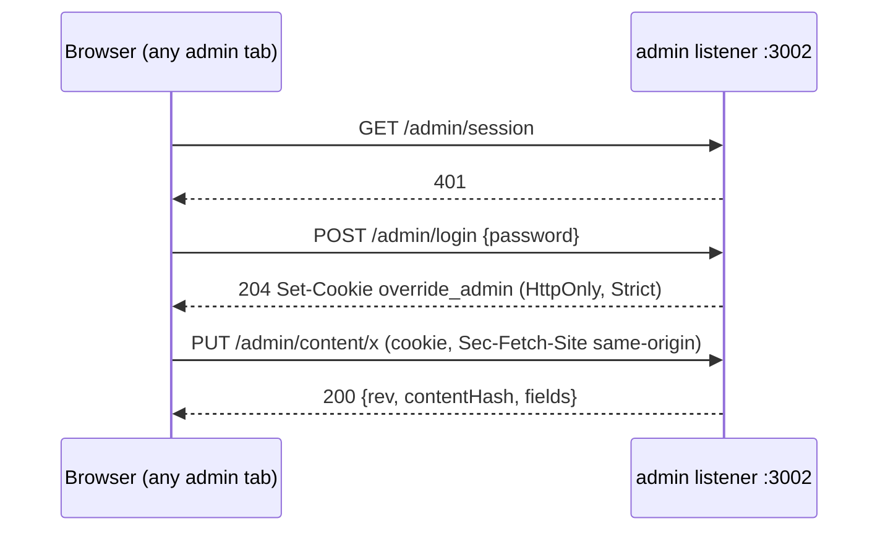

# Spec: admin text (one password, every text editable, edits in git)

App: `demos/override`. Feature plan: `docs/plans/2026-11-09-admin-text.feature.md`.

## Intent

Event admins tune the games through the admin page. Today they need two kinds of tokens, can edit only part of each case's text, and their edits live in a gitignored data folder on one machine. After this change one password opens the whole admin panel, an admin can change every word a player reads or a model is told (case text, the shared prompt rules, world prompt text and all game UI text), and every published edit lands in a tracked folder of the repo, so a developer reviews the diff, commits and pushes it by hand.

## Goals

- **G1 One password.** `OVERRIDE_ADMIN_PASSWORD` opens the command centre, the content editor and every `/admin/*` route. One sign-in sets a cookie that covers every admin page and tab. Maker tokens are gone.
- **G2 Every case string.** Every string leaf of a case's data is editable, except the locked keys (D4). Ids, roles, colors, numbers, booleans and the count of characters, parts, evidence, roles, topics and slips stay locked.
- **G3 Prompt rules.** The shared interview and thread prompt templates (`server/interviews.mjs`) are editable text with `[[token]]` slots.
- **G4 World prompt text.** Each world's `frame`, `persona`, `memory`, `cast.one` and `cast.many` is editable.
- **G5 Game UI text.** Every player-facing string of the game client is served at runtime from a text catalog. The built-in English stays as the default.
- **G6 Edits in git.** Published edits are written as readable JSON under `demos/override/content/`, a tracked folder. The server never runs git.

## Non-goals

| Not in scope | Why / trigger to revisit |
|---|---|
| Server player-facing error messages (about 100 `RequestError` strings in session, economy, llm, teams, index) | They are templated at their throw sites and many tests assert them. Revisit if an admin needs to reword one. |
| Rehearsal scripts written as functions (banana, tower, friends, factory, department) and their keyword regexes | They only run without a model (scripted rehearsal) and are code, not data. The talk case's `talk.rehearsal` data is editable. |
| Changing structure: adding or removing characters, parts, evidence, topics or slips; changing ids, roles, colors, deadline numbers or tools | It is a case-module edit. |
| Admin (operator) page text, server `world.place` (the client pack's place text is what players see) | Players never read them. |
| Per-person accounts, attribution, git automation, translations | One shared password, English only. |

## Constraints

- **Byte identity when unedited.** With no edits on file, every prompt, public view, `contentHash`, `promptVersion` and rendered UI string is byte-identical to today. Every existing test passes. A test may change only if it asserts a removed feature (maker tokens) or reads source text whose shape this change rewrites.
- The admin listener stays bound to 127.0.0.1, with the host guard and `OVERRIDE_ADMIN_HOSTS` unchanged.
- The CSP stays (`form-action 'none'`), so sign-in goes through `fetch`.
- Case, prompt and world edits reach new games only; a running game keeps its text until it is evicted, the server restarts, or the player presses Reset session. UI text reaches the next page load.
- No new dependencies. Plain ES modules for the admin pages, TypeScript for the client.
- Tests and Playwright never write into the repo's `content/` folder: every test server sets `OVERRIDE_CONTENT_DIR` to a temp dir.

## Done looks like

### Auth
- **A1** With `OVERRIDE_ADMIN_PASSWORD=pw`, `/admin` shows a password form. A wrong password shows "Wrong password." (401). The right one loads the command centre. `/admin/maker.html` in a new tab opens without a second sign-in.
- **A2** "Sign out" on either page clears the cookie. Both pages ask for the password on the next load.
- **A3** `Authorization: Bearer pw` still works on every admin route and `/metrics`.
- **A4** A cookie-authenticated POST, PUT or DELETE with `Sec-Fetch-Site` other than `same-origin`, or with an `Origin` that does not match the host, answers 403.
- **A5** A player access cookie value sent as `override_admin` answers 401: the admin MAC uses its own purpose prefix.
- **A6** More than 10 failed sign-ins in 60 s answer 429 until the window passes.
- **A7** If `OVERRIDE_MAKER_TOKENS` is set, the server logs one warning that it is ignored. A former maker token answers 401.
- **A8** If only `OVERRIDE_ADMIN_TOKEN` is set, it works as the password and the server logs a deprecation warning. If both are set and differ, startup fails with a clear message.

### Case text
- **C1** For each of the 6 cases, the editor offers one field per string leaf outside the locked keys, with list fields for string arrays. A unit test walks every case and compares.
- **C2** Rename a banana character and publish, then press Reset session in the game: the case board, HUD, interview and prompt preview show the new name.
- **C3** `PUT` with a locked or unknown path (for example `characters.momo.id`) answers 400 `{error, path}`.
- **C4** A text that fails `defineCase` answers 400, and the editor shows the error under that field. Example: a renaissance slip line that no longer contains its term.

### Prompt rules and worlds
- **P1** "Game text → Prompt rules" shows the interview and thread templates with their `[[tokens]]`. Unedited, the preview of every case is byte-identical to today's prompt.
- **P2** A template without `[[knowledge]]`, or with an unknown token, answers 400.
- **P3** After a template or world-prompt edit, new games' prompts use it and log `promptVersion` as `interview-v5+<8 hex>` (thread: `thread-v4+<8 hex>`).

### UI text
- **U1** "Game text → UI" lists every player-facing client string, grouped by area. Edit the "Let them talk" tool label, publish and reload the game: the button shows the new text.
- **U2** An override `<b>x</b>"&` shows as literal text everywhere. No markup is injected and nothing is double-escaped. A probe test covers every key.
- **U3** An override that uses a `{var}` the default does not have answers 400. Dropping a var is allowed.
- **U4** If `/api/text` fails or is slow (over 1.5 s), the game renders with the built-in English.

### Storage
- **S1** Publish writes `content/cases/<caseId>.json` or `content/game.json` (sorted keys, 2-space indent, trailing newline, atomic write). `git status` shows the change. No git command runs.
- **S2** Restart: the edits are still active. Remove the file and restart: back to authored.
- **S3** Restore authored deletes the file.
- **S4** A legacy `data/<env>/content/<caseId>.jsonl` whose last revision has edits, with no tracked file, writes the tracked file once at boot.
- **S5** A tracked case file whose `version` differs from the case leaves the case authored and marks it stale; the file is not touched.
- **S6** History and Restore still work from the local revision log. A boot that finds the tracked file different from the log's last revision appends a revision with `by: "file"`.

## Decided

| # | Decision |
|---|---|
| D1 | Env: `OVERRIDE_ADMIN_PASSWORD`. `OVERRIDE_ADMIN_TOKEN` is a deprecated alias (A8). `OVERRIDE_MAKER_TOKENS` is ignored with a warning. `OVERRIDE_CONTENT_DIR` (default `<app>/content`). |
| D2 | Cookie `override_admin=<exp>.<hex mac>`: HttpOnly, SameSite=Strict, Path=/, Max-Age=43200, Secure only on TLS or a trusted forwarded proto. The MAC key is `sha256("override-admin-v1:" + secret + ":" + password)`, so a password change signs everyone out. `identity.mjs` `signToken`/`verifyToken` gain an optional `purpose` argument; the default keeps the player prefix byte-identical. |
| D3 | Routes: `POST /admin/login {password}` → 204 plus cookie, or 401 / 429. `POST /admin/logout` → 204 and clears the cookie. `GET /admin/session` → 200 `{signedIn:true}` or 401. Page files stay public. Every revision's `by` is `"admin"`. |
| D4 | Locked keys at any depth: `id`, `version`, `world`, `status`, `order`, `color`, `role`, `cipher`, `when`, `tools`, `deadline.escapeAt`, `deadline.warnAt`. Functions and non-strings are never fields. |
| D5 | Edit paths: dotted. An array item with an `id` is addressed by its id (`characters.momo.name`, `parts.planner.label`, `evidence.knife.text`, `roles.villain.hint`, `talk.topics.weather.label`). Any other array of objects is addressed by index (`talk.slips.ottavio.0.line`, `talk.glossary.2.text`). An array of strings is one list field (`parts.planner.knowledge`, `prompt.use`, `talk.rehearsal.ottavio`). Every path the current editor knows keeps its spelling, so legacy revisions replay. |
| D6 | Validation: each text at most 2000 characters (templates 8000); lists 0–30 items, no empty items; then `defineCase` re-runs and decides. Its error path maps back to the edit path. |
| D7 | Game document id `game` (reserved; `defineCase` rejects a case id `game`). Paths `ui.<key>`, `prompt.interview`, `prompt.thread`, `worlds.<worldId>.<frame/persona/memory/cast.one/cast.many>`. Each key is validated on its own: a stored key that no longer validates is skipped and listed in `info().skipped`. |
| D8 | Template tokens: `[[name]]`, `[[label]]`, `[[setting]]`, `[[version]]`, `[[promptVersion]]`, `[[frame]]`, `[[frameFirst]]`, `[[use]]`, `[[avoid]]`, `[[persona]]`, `[[memory]]`, `[[knowledge]]`, `[[others]]` (thread only). `[[knowledge]]` must appear exactly once. Unedited, `promptVersion` stays `interview-v5` / `thread-v4`. When the game document holds any `prompt.*` or world `frame`/`persona`/`memory` edit, both versions gain `+` and the first 8 hex of sha256 over those edits (sorted JSON), the same for every case. |
| D9 | Prompt and world edits reach games by rebuilding every case's current object with `defineCase(raw, {worlds, prompts})`. `prompts` is stored on the case object and is not hashed. An unedited case with an unedited game document is the authored object (the identity rule). |
| D10 | UI catalog: defaults in `client/text/<area>.json` (flat `key → string`, keys `<area>.<name>`, unique across files). `client/text.ts` exports `t(key, vars)`, which returns HTML-escaped text with escaped vars, for innerHTML templates, and `plain(key, vars)` for textContent and attributes. Plurals are two keys `<key>.one` / `<key>.other`, chosen with `tn(key, count, vars)`. Markup stays in code. `GET /api/text` on the player port, before the access gate, answers `{text: {key: override}}` with `cache-control: no-cache`. The client awaits it at boot, with a 1.5 s timeout, before the splash. |
| D11 | Tracked file shape: `{"id", "version" (cases only), "edits": {sorted}}`. No rev, date or author, to keep diffs small. An empty overlay deletes the file. The local log `data/<env>/content/<id>.jsonl` keeps revisions for History and Restore. `rev` and `baseRev` (409) come from the log. |
| D12 | Docker: the runtime image copies `client/text/` and `content/`. DEPLOY says to mount `content/` so edits survive the container. |

## Left to the builder / plan

- Field labels and hints. A hint table exists for known paths; labels come from the path.
- Editor layout: sections per area (Story, Prompt, one per character, parts, evidence, roles, topics, debrief; game: UI by area, Prompt rules, Worlds), search box, debounced dirty tracking.
- Exact UI catalog key names, and how each client module turns module-level constants into lazy lookups.
- Task split, file layout inside `server/` and test names.

## Diagrams

```mermaid
flowchart LR
  E[Editor /admin/maker.html] -- cookie or Bearer --> A[admin.mjs /admin/content/*]
  A --> S[content store]
  S -- atomic write --> F[(content/cases/*.json<br/>content/game.json<br/>tracked)]
  S -- append --> L[(data/env/content/*.jsonl<br/>revision log, gitignored)]
  F -- boot --> S
  S -- current cases + prompts + worlds --> G[Investigations: new games]
  S -- ui overrides --> T[GET /api/text]
  T --> C[client t() / plain()]
  D[client/text/*.json defaults] --> C
  D --> S
```


