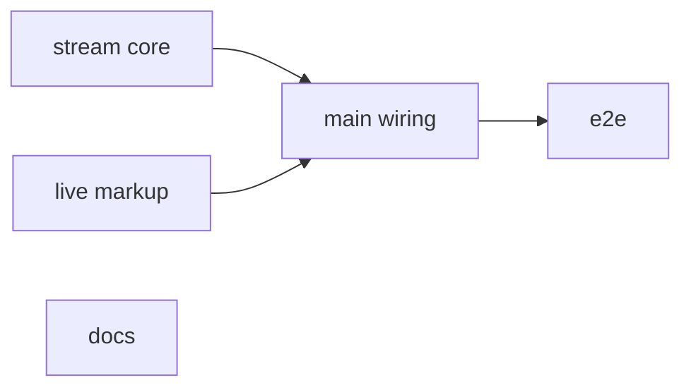

# Integration plan: streaming interviews, client side

**Goal:** finish PR #4: the client reads the NDJSON interview stream, types the answer as it arrives, lets the player Watch reasoning live, wipes a guard false start, plus e2e and README.
**Architecture:** the server side is done (see `demos/override/STREAMING_PLAN.md`, server/index.mjs `createNdjsonSink`, server/session.mjs `live`). New pure module `client/stream.ts` (NDJSON reader + per-label fold). `dialogue.ts`/`tools.ts` gain live markup hooks. `main.ts` wires the stream into `askQuestion`, patches only live DOM nodes per token, and sends the live Watch.
**Tech stack:** Node 25 ESM (tests run client `.ts` by type stripping), TypeScript client with Vite, Playwright, no new deps.
**Spec:** docs/plans/2026-11-13-streaming-client.spec.md
**Spec coverage:** Intent and Done looks like: S1-S6 -> T1, T2, T3; S7 -> T2, T3; S8 -> T4; S9 -> T5 (README) and T3 (`npm run build`).
**Detail:** contracts
**Target-min:** 20
**Ignore:** docs/plans/, demos/override/node_modules, demos/override/dist

## Global constraints

- WT = /Users/williambrach/Developer/AgentVerse/.superlite/worktrees/streaming-client (branch superlite/streaming-client from 53a7a15). Work only in WT, with absolute paths. App root `WT/demos/override`.
- Unit tests: `cd WT/demos/override && node --test tests/<file>.test.mjs`. Only T4 runs Playwright, and it runs `npm run build` first (the server serves `dist/`). Pass `--output=<scratch dir>` to Playwright.
- NDJSON lines (server contract, do not change): `{t:'accepted', questionEventId, queued}`, `{t:'start', a, attempt, endpoint}`, `{t:'delta', a, text}`, `{t:'scrub', a}`, `{t:'reasoning', a, text}`, `{t:'reasoning_scrub', a}`, `{t:'ping'}`, `{t:'fail', status, error}`, `{t:'view', ...CaseState}`. `a` is a call label (`c1`, `c2`, ...); the shown text is the latest label's buffer.
- Client text: `t(key, vars)` returns escaped text for innerHTML; `plain()` returns raw text for textContent. New strings go in `client/text/<area>.json` with key `<area>.<name>`; `tests/text-keys.test.mjs` must pass (used keys exist, no orphans).
- No full `render()` per token: tokens write into existing live DOM nodes (`[data-stream="answer"]`, `[data-stream="reasoning"]`) via textContent.
- These must stay green: dialogue-ui, tools-ui, hud-ui, text-keys, text-ui, stream, interviews, session.

## File structure

| File | Responsibility |
|---|---|
| client/stream.ts | NDJSON line reader over a fetch Response; per-label fold of answer and reasoning |
| client/dialogue.ts | waiting bubble with live answer node + caret |
| client/tools.ts | live reasoning card markup |
| client/main.ts | streaming ask, typewriter pacing, poses, live Watch |
| tests/browser/stream.spec.mjs | e2e over a live mock server |

## Task graph

```mermaid
%% schedule
gantt
  title Predicted schedule (mm:ss)
  dateFormat X
  axisFormat %M:%S
  section lane 1
  T2 live markup :t2, 0, 112s
  T3 main wiring :t3, 112, 126s
  T4 e2e :t4, 237, 134s
  section lane 2
  T1 stream core :t1, 0, 94s
  section lane 3
  T5 docs :t5, 0, 82s
```

critical path: T2 → T3 → T4 (6.2 min) · peak width 3 · predicted build 6.2 min · predicted total ≈ 19.6 min (target ✓)

## Client

**Probe entry:** call=stream.createStreamFold

### T1 stream core · Complexity 4 · Est. context 30k
**Owns:** demos/override/client/stream.ts, demos/override/tests/stream-client.test.mjs
**Components:** 1
**LOC owned:** 120
**Tests:** fast
**Kind:** design
**Model:** sonnet
**Consumes:** none
**Produces:** stream.readNdjson(body: ReadableStream<Uint8Array>, onLine: (line: object) => void) -> Promise<void> · stream.createStreamFold() -> {apply(line: object): boolean, answer(): string, reasoning(): string, label(): string|null, questionEventId(): string|null} · stream.isNdjson(contentType: string|null) -> boolean
e.g. fold.apply({t:'delta',a:'c1',text:'Hi '}); fold.apply({t:'delta',a:'c1',text:'there'}); fold.answer() -> 'Hi there' · after {t:'scrub',a:'c1'} then {t:'delta',a:'c2',text:'Ok'}: fold.answer() -> 'Ok' · apply({t:'start',a:'c2',attempt:2}) clears c2's buffers · apply({t:'ping'}) -> false (nothing changed) · isNdjson('application/x-ndjson; charset=utf-8') -> true
**Review Focus:** correctness. `split_chunks`: a line split across two body chunks (and a multi-byte UTF-8 char split across chunks) is parsed once, intact; a trailing line with no newline is still delivered; a blank or non-JSON line is skipped, not thrown. `scrub_resets`: scrub on the shown label empties answer(); reasoning_scrub empties reasoning() only; text from a scrubbed label never comes back.
**Steps:** failing tests, implement, pass. Pure module: no DOM, no fetch; `readNdjson` takes the body stream and uses TextDecoder with `stream: true`.

### T2 live markup · Complexity 4 · Est. context 35k
**Owns:** demos/override/client/dialogue.ts, demos/override/client/tools.ts, demos/override/client/dialogue.css, demos/override/client/text/dialogue.json, demos/override/client/text/tools.json, demos/override/tests/dialogue-ui.test.mjs, demos/override/tests/tools-ui.test.mjs
**Components:** 2
**LOC owned:** 80
**Tests:** fast
**Kind:** design
**Model:** sonnet
**Consumes:** none
**Produces:** InterviewView.streaming?: {answer: string, reasoning: string|null} (dialogue.ts; null reasoning = no live card) · tools.liveReasoningBlock(name: string, text: string) -> string
e.g. interviewPanel({...v, waitingOn:'momo', streaming:{answer:'', reasoning:null}}) still shows the thinking dots and holds an empty `` and a `.stream-caret` · with streaming.answer 'Hi' the waiting bubble shows 'Hi' in `[data-stream="answer"]`, no thinking dots · liveReasoningBlock('Momo','') contains `data-stream="reasoning"`
**Review Focus:** correctness, a11y. `live_nodes`: the waiting bubble has exactly one `[data-stream="answer"]` node; streaming text is escaped; without `streaming` the markup is byte-identical to today (existing dialogue-ui tests unchanged). `reduced_motion`: dialogue.css stops the caret blink under `prefers-reduced-motion: reduce`. New keys exist in the json files, none orphaned.
**Steps:** failing tests, implement, pass; also run tests/text-keys.test.mjs and tests/hud-ui.test.mjs.
**Notes:** the live reasoning card reuses the reasoningBlock look (same classes) with a "watching" label key. The thinking dots stay inside the waiting bubble until the first text arrives; main.ts (T3) hides them by toggling a class, so give the bubble `data-stream-bubble` for that.

### T3 main wiring · Complexity 8 · Est. context 70k
**Owns:** demos/override/client/main.ts, demos/override/client/stream-ui.ts, demos/override/client/text/main.json, demos/override/tests/stream-main.test.mjs
**Components:** 2
**LOC owned:** 200
**Tests:** fast
**Kind:** design
**Model:** sonnet
**Consumes:** stream.readNdjson, stream.createStreamFold, stream.isNdjson, InterviewView.streaming, tools.liveReasoningBlock
**Produces:** main.ts behaviour only (spec S1-S6)
e.g. askQuestion -> POST /api/interview {..., stream:true}; JSON reply -> today's path; NDJSON reply -> accepted/delta/view handled live
**Review Focus:** correctness, concurrency. `busy_bypass`: the live Watch fetch runs while `busy` is true and sends no `revision`; a Watch 409 shows its error and does not end the stream. `single_receive`: the `view` line goes through `receive()` once with the same onSuccess (drafts cleared, pick reset) as action(); `fail` sets errorMessage and refreshes state like action()'s catch. `no_rerender_per_token`: delta writes textContent into `[data-stream="answer"]`; a render() during streaming (poll, resize) re-creates the bubble from the fold so nothing is lost. `pacing`: typed reveal never runs ahead of received text; click on the bubble reveals all received; reduced motion reveals per chunk. `no_thought`: Watched + committed line with no reasoning adds noThought for that line key. `inspect_off`: no Watch when state.tools?.inspect === false.
**Steps:** read client/main.ts action(), askQuestion(), toolbelt render, onClick inspect branch, and server/session.mjs mutate/activateLiveInspect. Put any pure helper (typewriter pacing, line dispatch) in a small exported function in main.ts or a new client/stream-ui.ts you own, and unit-test it in tests/stream-main.test.mjs; DOM wiring is proven by T4. Implement, run dialogue-ui, tools-ui, hud-ui, text-keys, then `npx tsc --noEmit -p .` if a tsconfig exists, and `npm run build`.
**Notes:** the Inspect tool card label while streaming becomes Watch (new key in main.json). Station: `station.think(character)` until the first delta, then `station.speak(character, textSoFar)` at most every ~600 ms; after view, the existing speak runs. Watch while the answer streams is the only action allowed; every other control stays disabled by `busy`.

## Verification

### T4 e2e · Complexity 6 · Est. context 55k
**Owns:** demos/override/playwright.config.mjs, demos/override/tests/browser/stream.spec.mjs, demos/override/scripts/stream-e2e.mjs
**Components:** 1
**LOC owned:** 180
**Tests:** slow
**Kind:** design
**Model:** sonnet
**Consumes:** main.ts behaviour (T3)
**Produces:** playwright project `stream` on port 4327
e.g. `npx playwright test --project stream --output=$SCRATCH/pw-stream` -> 4 passed
**Review Focus:** test-coverage. `four_cases`: typing reveal (answer text grows over at least two observations before the turn commits), Watch during stream (live reasoning card shows text before commit; the coin counter changes only after commit), scrub on guard retry (the first attempt's forbidden word is never visible after the retry text appears), fail line (error message shown, Ask enabled again). `isolated`: the new webServer uses its own data/content dirs from `dataDir()`, port 4327 is added to `seenSplash` origins, and the `default` project ignores stream.spec.mjs.
**Steps:** write scripts/stream-e2e.mjs: startServer in live mode over scripts/mock-llm.mjs (see scripts/admin-demo.mjs for how), with a small control route or env so a spec can set the mock's mode/content/reasoning/streamChunkMs (e.g. a slow 120 ms chunk pace). Guard retry: use a guarded case (renaissance Castelvento `guard.words`) or any path that emits `scrub`; find it in server/session.mjs guardedAnswer/talk paths. Build, run only the stream project, then the default project's hud.spec.mjs to check nothing else broke.
**Notes:** never run the unit suite at the same time. `find test-results -maxdepth 1 -name 'sessions*' -exec rm -rf {} +` if team caps hit.

### T5 docs · Complexity 2 · Est. context 15k
**Owns:** demos/override/README.md, demos/override/STREAMING_PLAN.md
**Components:** 1
**LOC owned:** 30
**Tests:** none
**Kind:** design
**Model:** sonnet
**Consumes:** none
**Produces:** README streaming paragraph + env row
e.g. README.md under "## Live interviews" gains a paragraph on NDJSON streaming, typewriter, live Watch charged at commit, guard scrub; env table gains `OVERRIDE_LLM_STREAM` (default on; `0` = plain JSON)
**Review Focus:** docs. `accurate`: matches server/interviews.mjs `OVERRIDE_LLM_STREAM` handling and .env.example wording; STREAMING_PLAN.md "Remaining" items are marked done.
**Steps:** read .env.example and server/interviews.mjs for the switch, edit README, mark STREAMING_PLAN.md remaining items done.
